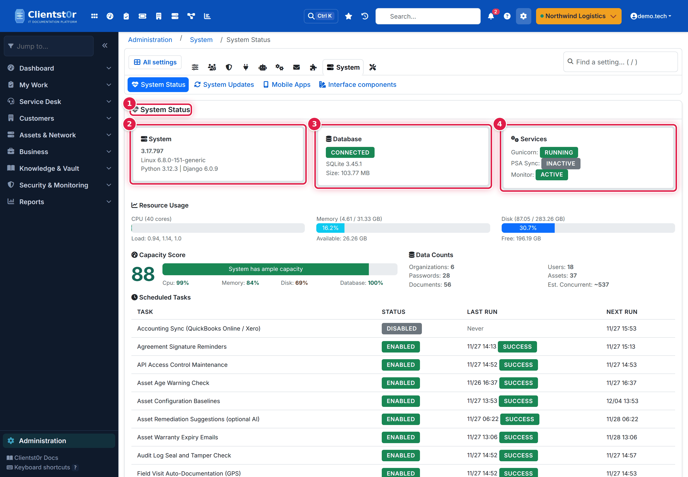

# Clientst0r Installation Guide

Complete guide for installing, upgrading, and managing Clientst0r.

## Table of Contents

- [Quick Start](#quick-start)
- [System Requirements](#system-requirements)
- [Fresh Installation](#fresh-installation)
- [First sign-in: the Setup Assistant](#first-sign-in-the-setup-assistant)
- [Existing Installation Detection](#existing-installation-detection)
- [Upgrade/Update](#upgradeupdate)
- [System Check](#system-check)
- [Clean Reinstall](#clean-reinstall)
- [Manual Installation](#manual-installation)
- [Troubleshooting](#troubleshooting)
- [Post-Installation](#post-installation)

---

## Quick Start

### One-Line Installation

Install Clientst0r on a fresh Ubuntu/Debian server:

```bash
git clone https://github.com/agit8or1/clientst0r.git && cd clientst0r && bash install.sh
```

**That's it!** When complete, the server is running at `http://YOUR_IP:8000`

After you sign in, **Administration → System → System Status** (superusers) shows the version, the database and whether the web service is running, which is the quickest check that the install is healthy.

<!-- guide-figure: guide-x4-install -->


1. System Status (Administration → System → System Status, superusers only): the page to open after an install to see that the app is healthy.
2. The first overview card: the version and server basics.
3. The database card: green when the app reaches its database.
4. The Gunicorn service card: green when the web service is running.
<!-- /guide-figure -->

---

## System Requirements

### Minimum Requirements

- **OS**: Ubuntu 20.04+ or Debian 11+
- **RAM**: 2GB minimum (4GB recommended)
- **Disk**: 10GB free space
- **Network**: Internet connection for package installation

### Automatically Installed

The installer handles all dependencies:

- **Python**: Python 3.11, 3.12 or 3.13 with venv and dev headers, plus python3-pip (uses an installed version; otherwise installs the newest one apt offers)
- **Database**: mariadb-server, mariadb-client, default-libmysqlclient-dev
- **Build Tools**: build-essential, pkg-config
- **Libraries**: libssl-dev, libffi-dev, libldap2-dev, libsasl2-dev
- **Python Packages**: Django, Gunicorn, Cryptography, and 40+ more

---

## Fresh Installation

### Step-by-Step

1. **Clone the repository:**
   ```bash
   git clone https://github.com/agit8or1/clientst0r.git
   cd clientst0r
   ```

2. **Run the installer:**
   ```bash
   bash install.sh
   ```

3. **Follow the prompts:**
   - The installer runs its steps automatically; the organization setup step asks for your business name
   - It creates a superuser account non-interactively: username **`admin`**, password **`ChangeMe123!`**
   - **Change this password immediately at first login.** Anyone who reaches the server before you do can sign in with it

4. **Access the application:**
   - When complete, you'll see the access URL
   - Open `http://YOUR_IP:8000` in your browser
   - Log in as `admin` / `ChangeMe123!`, change the password, and enrol 2FA (required by default)
   - After 2FA enrolment the **Setup Assistant** opens by itself (see [First sign-in: the Setup Assistant](#first-sign-in-the-setup-assistant))
   - The installer does not install Nginx or TLS. Gunicorn listens on port 8000; put your own reverse proxy with TLS in front of it (a sample config is in `deploy/nginx-clientst0r.conf`)

### Installation Steps (Automated)

The installer performs these steps automatically:

1. ✅ **System Prerequisites** - Installs all required packages
2. ✅ **Virtual Environment** - Creates Python virtual environment
3. ✅ **Python Dependencies** - Installs 40+ Python packages (2-3 minutes)
4. ✅ **Secure Secrets** - Generates encryption keys automatically
5. ✅ **Environment Config** - Creates `.env` file with all settings
   (step 5.5 then installs the root helper, `/usr/local/sbin/clientst0r-root-helper`, which the web UI uses for updates)
6. ✅ **Database Setup** - Creates database and user
7. ✅ **Log Directory** - Creates `/var/log/itdocs/`
8. ✅ **Database Migrations** - Applies all schema migrations
9. ✅ **Organization Setup** - Interactive prompt for your business name and demo data
10. ✅ **Superuser Account** - Creates `admin` / `ChangeMe123!` non-interactively (change it at first login)
11. ✅ **Default Content** - On a fresh install only: document categories, document and diagram templates, and the MSP knowledge base
12. ✅ **Static Files** - Collects CSS, JavaScript, images
13. ✅ **Production Server** - Starts Gunicorn with systemd (4 workers on port 8000)

During **Step 9 (Organization Setup)**, you will be asked:
```
Business Name (Organization): Acme Corporation
Create demo office floor plan? (y/n) [y]: y
```

This creates:
- Your default organization with the name you provide
- (Optional) Demo office floor plan with network infrastructure
- Proper database structure for multi-tenancy

**Total time:** 5-10 minutes depending on server speed

---

## First sign-in: the Setup Assistant

On a new install the first administrator who signs in (after enrolling 2FA, when 2FA is required, which is
the default) is shown the **Setup Assistant**: a guided path through the settings a new install needs.

- **Basic path** (essentials only, about five minutes): your company name, the public address of this server,
  time zone and logo; administrator security (the installer's default password must be changed, recovery codes,
  session policy); the first customer, or a pointer to Data Import; outgoing mail with a Send test button and
  the mailboxes that turn e-mail into tickets; the install readiness check (backups, scheduler, disk,
  migrations); review.
- **Advanced path**: also modules, technicians, roles and access groups, routing and notification defaults,
  and optional integrations (RMM, external PSA, connected applications, OPTIONAL AI — off by default).
- Only two steps are required to finish it: company details and administrator security. Every other step can
  be skipped, and skipping changes nothing. Setup never needs Rem0te, an RMM or any other integration.
- It writes the same settings as the Administration pages, can be left and resumed at any time, and
  **Later** stops it opening by itself. Run it again any time from **Administration → General → Setup
  assistant**; every step shows the current values and nothing changes until you edit a step and save it.
- Upgrading an existing install never opens it. It is offered automatically only while the install still looks
  new (one user account, no customers apart from your own organization, no tickets); loading demo data with
  `seed_demo_data` or restoring a backup turns the automatic offer off.

Details: [docs/ADMIN_GUIDE.md — Setup assistant](docs/ADMIN_GUIDE.md#setup-assistant).

---

## Existing Installation Detection

The installer automatically detects existing installations by checking for:

- `.env` configuration file
- Python virtual environment (`venv/` directory)
- Systemd service (`clientst0r-gunicorn.service`)
- Database with user data

### Detection Example

When you run the installer on an existing installation:

```
[!] Existing Clientst0r installation detected!

  • Found: .env configuration file
  • Found: Python virtual environment
  • Found: systemd service
    Status: Running ✓
  • Found: Database 'clientst0r' with 1 user(s)

What would you like to do?

  1) Upgrade/Update (pull latest code, run migrations, restart service)
  2) System Check (verify all components are working)
  3) Clean Install (remove everything and reinstall)
  4) Exit

Enter choice [1-4]:
```

---

## Upgrade/Update

Update an existing installation to the latest version.

The usual way is the web UI: **Administration → System → System Updates** (`/core/settings/updates/`),
*Check for Updates*, review what *Apply would install*, then *Apply*. The full
guide, including release channels, backups and recovery, is
[docs/UPGRADE_AND_RECOVERY.md](docs/UPGRADE_AND_RECOVERY.md).

### From the command line

```bash
cd ~/clientst0r
venv/bin/python manage.py upgrade_apply
```

or `bash install.sh` and choose **Option 1**, which runs the same command.

### What the Upgrade Does

1. Shows the installed version, the recommended release and what it would install (tag + commit)
2. Verifies that revision (release tag signature, exact commit)
3. Runs preflight checks (disk, database, pending migrations, media, keys, backup destination, dependencies)
4. Takes a backup of the database, uploaded files and keys, and verifies it by restoring it into a scratch copy
5. Installs the revision with its own update script: dependencies, migrations, static files
6. Reloads the service; until then the old version keeps serving

If anything fails before the migration, nothing is changed. If the migration
fails, the output names the verified backup and the recovery steps.

---

## System Check

Verify all components are working correctly.

### Run System Check

```bash
cd ~/clientst0r
bash install.sh
```

Choose **Option 2** when prompted.

### What's Checked

- **Python Environment**: Version and virtual environment
- **Database**: Existence, table count
- **Service**: Status (running/stopped), PID
- **Port 8000**: Listening status
- **Log Directory**: `/var/log/itdocs/` exists
- **HTTP Response**: Test actual web response

### Example Output

```
[i] Running system check...

[✓] Python: Python 3.12.3
[✓] Database: clientst0r exists
  Tables: 56
[✓] Service: Running
  602570 - active
[✓] Port 8000: Listening
[✓] Log directory: /var/log/itdocs
[✓] HTTP Response: 302 (OK)

Access at: http://192.168.22.72:8000

[i] System check complete
```

---

## Clean Reinstall

Remove everything and perform a fresh installation.

### When to Use

- Fix corrupted installation
- Reset all settings to defaults
- Clear all data and start over
- Troubleshoot persistent issues

### Run Clean Reinstall

```bash
cd ~/clientst0r
bash install.sh
```

Choose **Option 3** when prompted.

### Warning

⚠️ **This deletes ALL data:**
- Database and all contents
- Configuration files
- Virtual environment
- Log files
- Systemd service

You'll be asked to type "yes" to confirm.

### What Happens

1. Stops and removes systemd service
2. Drops database and user
3. Removes virtual environment
4. Deletes `.env` file
5. Cleans log directory
6. Proceeds with fresh installation (all the steps above)

---

## Manual Installation

For advanced users who want manual control.

### Prerequisites

Install system dependencies:

```bash
sudo apt-get update
sudo apt-get install -y \
    python3.12 \
    python3.12-venv \
    python3.12-dev \
    python3-pip \
    mariadb-server \
    mariadb-client \
    build-essential \
    pkg-config \
    libssl-dev \
    libffi-dev \
    default-libmysqlclient-dev \
    libldap2-dev \
    libsasl2-dev
```

### Step-by-Step Manual Installation

1. **Clone and enter directory:**
   ```bash
   git clone https://github.com/agit8or1/clientst0r.git
   cd clientst0r
   ```

2. **Create virtual environment:**
   ```bash
   python3.12 -m venv venv
   source venv/bin/activate
   ```

3. **Install Python packages:**
   ```bash
   pip install --upgrade pip
   pip install -r requirements.txt
   ```

4. **Generate secrets:**
   ```bash
   python3 -c "from cryptography.fernet import Fernet; print('APP_MASTER_KEY=' + Fernet.generate_key().decode())"
   python3 -c "import secrets; print('SECRET_KEY=' + secrets.token_urlsafe(50))"
   python3 -c "import secrets; print('API_KEY_SECRET=' + secrets.token_urlsafe(50))"
   ```

5. **Create .env file:**
   ```bash
   cat > .env << 'EOF'
   DEBUG=True
   SECRET_KEY=<paste_secret_key>
   ALLOWED_HOSTS=localhost,127.0.0.1,YOUR_IP

   DB_NAME=clientst0r
   DB_USER=clientst0r
   DB_PASSWORD=your_secure_password
   DB_HOST=localhost
   DB_PORT=3306

   APP_MASTER_KEY=<paste_master_key>
   API_KEY_SECRET=<paste_api_key_secret>

   EMAIL_BACKEND=django.core.mail.backends.console.EmailBackend
   SITE_NAME=Clientst0r
   SITE_URL=http://YOUR_IP:8000
   EOF
   ```

6. **Setup database:**
   ```bash
   sudo systemctl start mariadb
   sudo mysql << 'EOSQL'
   CREATE DATABASE clientst0r CHARACTER SET utf8mb4 COLLATE utf8mb4_unicode_ci;
   CREATE USER 'clientst0r'@'localhost' IDENTIFIED BY 'your_secure_password';
   GRANT ALL PRIVILEGES ON clientst0r.* TO 'clientst0r'@'localhost';
   FLUSH PRIVILEGES;
   EOSQL
   ```

7. **Create log directory:**
   ```bash
   sudo mkdir -p /var/log/itdocs
   sudo chown $USER:$USER /var/log/itdocs
   sudo chmod 755 /var/log/itdocs
   ```

8. **Run migrations:**
   ```bash
   python3 manage.py migrate
   ```

9. **Create superuser:**
   ```bash
   python3 manage.py createsuperuser
   ```

10. **Collect static files:**
    ```bash
    python3 manage.py collectstatic --noinput
    ```

11. **Start development server:**
    ```bash
    python3 manage.py runserver 0.0.0.0:8000
    ```

---

## Troubleshooting

### Common Issues

#### Port 8000 Already in Use

**Error:** `Error: That port is already in use.`

**Solution:**
```bash
# Check what's using port 8000
sudo ss -tlnp | grep :8000

# Stop the service
sudo systemctl stop clientst0r-gunicorn.service

# Or kill the process
sudo kill <PID>
```

#### Database Connection Failed

**Error:** `Can't connect to MySQL server`

**Solution:**
```bash
# Check if MariaDB is running
sudo systemctl status mariadb

# Start MariaDB
sudo systemctl start mariadb

# Check database exists
sudo mysql -e "SHOW DATABASES LIKE 'clientst0r';"
```

#### Missing Python Module

**Error:** `ModuleNotFoundError: No module named 'xxx'`

**Solution:**
```bash
cd ~/clientst0r
source venv/bin/activate
pip install -r requirements.txt
```

#### Permission Denied on Log Directory

**Error:** `Permission denied: '/var/log/itdocs/django.log'`

**Solution:**
```bash
sudo mkdir -p /var/log/itdocs
sudo chown $USER:$USER /var/log/itdocs
sudo chmod 755 /var/log/itdocs
```

#### Service Won't Start

**Error:** Service fails to start

**Solution:**
```bash
# Check service status and logs
sudo systemctl status clientst0r-gunicorn.service
sudo journalctl -u clientst0r-gunicorn.service -n 50

# Common fixes:
# 1. Check .env file exists
ls -la ~/clientst0r/.env

# 2. Check virtual environment
ls -la ~/clientst0r/venv/bin/activate

# 3. Test manually
cd ~/clientst0r
source venv/bin/activate
python3 manage.py check
```

### View Logs

**Application logs:**
```bash
sudo journalctl -u clientst0r-gunicorn.service -f
```

**Gunicorn access logs:**
```bash
tail -f /var/log/itdocs/gunicorn-access.log
```

**Gunicorn error logs:**
```bash
tail -f /var/log/itdocs/gunicorn-error.log
```

**Django logs:**
```bash
tail -f /var/log/itdocs/django.log
```

---

## Post-Installation

### First Steps After Installation

1. **Access the application:**
   - Open `http://YOUR_IP:8000` in browser
   - Log in as `admin` / `ChangeMe123!` and change the password immediately
   - Follow the Setup Assistant that opens after the first sign-in (also under Administration → General →
     Setup assistant)

2. **Load demo data (Optional, Recommended for Testing):**
   - Loads comprehensive demo data under "Acme Corporation" organization
   - Includes assets, documents, passwords, workflows, diagrams, and more
   ```bash
   cd ~/clientst0r
   source venv/bin/activate
   python manage.py seed_demo_data
   ```
   - Demo users created (demo and test installs only; never load demo data on a server that holds real customer data):
     - `demo.admin` / `demo123` - Admin role
     - `demo.editor` / `demo123` - Editor role
     - `demo.viewer` / `demo123` - Read-only role
   - Demo data includes:
     - 9 assets (servers, network devices, workstations)
     - 5 documentation articles
     - 5 password vault entries (in folders)
     - 3 workflows with multiple stages
     - Network topology diagram
     - 3 contacts
     - 3 website monitors
     - 15 tags

3. **Create an organization (if not using demo data):**
   - Clients → All Clients → Create Organization
   - All data is organization-scoped

4. **Enable 2FA (Required):**
   - Account menu → My Profile → 2FA Settings
   - Scan QR code with authenticator app
   - Required for all users

5. **Change database password:**
   - Edit `.env` file
   - Change `DB_PASSWORD` from default
   - Update in MySQL:
     ```bash
     sudo mysql -e "ALTER USER 'clientst0r'@'localhost' IDENTIFIED BY 'new_password';"
     ```
   - Restart service:
     ```bash
     sudo systemctl restart clientst0r-gunicorn.service
     ```

6. **Configure for production:**
   - Edit `.env`:
     ```
     DEBUG=False
     ALLOWED_HOSTS=yourdomain.com,YOUR_IP
     SITE_URL=https://yourdomain.com
     ```
   - Restart service

### Server Management

**Check status:**
```bash
sudo systemctl status clientst0r-gunicorn.service
```

**Start service:**
```bash
sudo systemctl start clientst0r-gunicorn.service
```

**Stop service:**
```bash
sudo systemctl stop clientst0r-gunicorn.service
```

**Restart service:**
```bash
sudo systemctl restart clientst0r-gunicorn.service
```

**Enable auto-start on boot:**
```bash
sudo systemctl enable clientst0r-gunicorn.service
```

**Disable auto-start:**
```bash
sudo systemctl disable clientst0r-gunicorn.service
```

### Backup and Restore

**Backup database:**
```bash
mysqldump -u clientst0r -p clientst0r > clientst0r_backup_$(date +%Y%m%d).sql
```

**Restore database:**
```bash
mysql -u clientst0r -p clientst0r < clientst0r_backup_YYYYMMDD.sql
```

**Backup files:**
```bash
tar -czf clientst0r_files_$(date +%Y%m%d).tar.gz \
    ~/clientst0r/.env \
    ~/clientst0r/media/ \
    /var/log/itdocs/
```

### Security Hardening

1. **Use strong passwords:**
   - Minimum 12 characters
   - Mix of uppercase, lowercase, numbers, symbols

2. **Enable firewall:**
   ```bash
   sudo ufw allow 22/tcp
   sudo ufw allow 8000/tcp
   sudo ufw enable
   ```

3. **Keep system updated:**
   ```bash
   sudo apt-get update
   sudo apt-get upgrade
   ```

4. **Regular backups:**
   - Schedule daily database backups
   - Test restore procedures

5. **Monitor logs:**
   - Check for suspicious activity
   - Set up log rotation

---

## Support

- **Documentation:** https://github.com/agit8or1/clientst0r
- **Issues:** https://github.com/agit8or1/clientst0r/issues
- **Security:** See SECURITY.md for vulnerability disclosure

---

**Made with ❤️ and 🐕 by the Clientst0r Team and Luna the German Shepherd**
