<div align="center">

<picture>
  <source media="(prefers-color-scheme: dark)" srcset="docs/images/github/clientst0r-wordmark-dark.svg">
  
</picture>

**Your clients. Your infrastructure. Your data. One platform.**

Self-hosted, open-source IT documentation, password vault, service desk and asset platform for MSPs.

[](LICENSE) [](https://github.com/agit8or1/clientst0r/releases) [](https://github.com/agit8or1/clientst0r/actions/workflows/codeql.yml) [](https://github.com/agit8or1/clientst0r/actions/workflows/docker-image.yml)

[Features](FEATURES.md) · [Screenshots](docs/screenshots.md) · [Quick start](#quick-start) · [Docs](#documentation) · [Roadmap](docs/ROADMAP.md) · [Comparison](COMPARISON.md)

</div>

---

[](docs/screenshots.md)

<sub>Dashboard in the Professional Dark theme (the default). Click for the full screenshot gallery.</sub>

## Why ClientSt0r?

- **Self-hosted.** It runs on your server, as a Docker Compose stack or a native install. There is no hosted tier and no usage telemetry; outbound calls are the GitHub update check and the integrations you configure.
- **One place for the daily work.** Documentation, the credential vault, tickets, contracts, assets, racks and network ports live in one application and link to each other. A ticket shows the client's contract, the asset it concerns, the runbook and the credentials the job needs.
- **Your data stays on your server.** Customer records, ticket history and secrets sit in your database, under your backup policy.
- **Open source.** MIT-licensed, with no paid tiers, seat limits or license activation.
- **Role-based access per customer.** Every record belongs to a customer organization. Customer users see only their own organization and only the tickets you share with them. Technician access to AI and RMM tools is assigned per customer.
- **Optional AI.** AI features are off by default and call nothing until an administrator turns them on and configures a provider. Local models (Ollama) are supported.

## Watch it work

[](docs/images/github/walkthrough.gif)

A 52-second excerpt of the walkthrough recorded on **v3.17.683** (the interface has gained pages since then).
Full video: [3¾-minute walkthrough (MP4)](https://github.com/agit8or1/clientst0r/releases/download/v3.17.683/clientst0r-walkthrough.mp4) ·
[84-second highlight](https://github.com/agit8or1/clientst0r/releases/download/v3.17.683/clientst0r-walkthrough-highlight.mp4) ·
[transcript](docs/media/walkthrough.txt) · [captions](docs/media/walkthrough.vtt).
Regenerate it, or the screenshots, with [`scripts/demo/`](scripts/demo/README.md).

## Visual tour

<table>
<tr>
<td width="50%" valign="top">
<a href="docs/images/github/events-dark.png">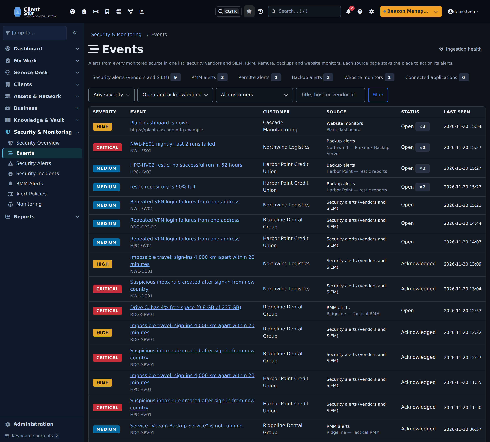</a>
<b>One list of events</b> · Dark<br>Security, RMM, Rem0te, backup and website-monitor alerts, side by side.
</td>
<td width="50%" valign="top">
<a href="docs/images/github/wallboard-dark.png">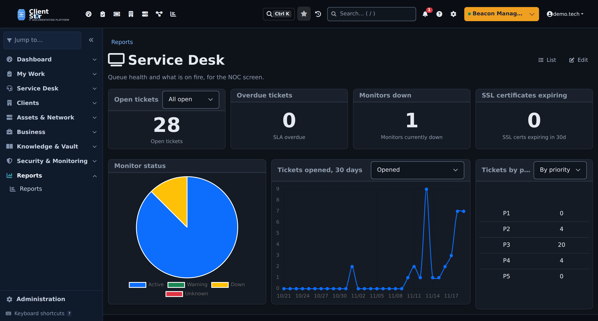</a>
<b>Wallboards</b> · Dark<br>Configurable boards of KPIs and charts for a shared screen.
</td>
</tr>
<tr>
<td width="50%" valign="top">
<a href="docs/images/github/ticket-detail-light.png">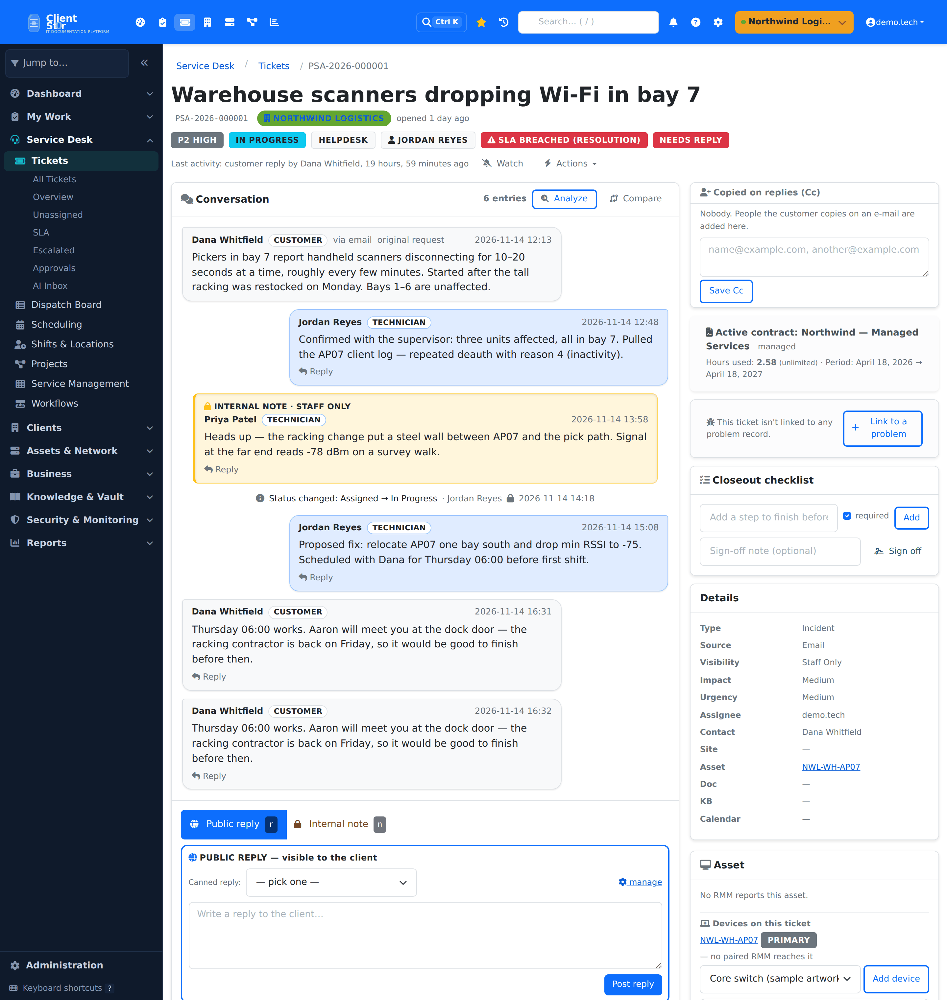</a>
<b>Ticket workspace</b> · Light<br>The conversation beside the contract, SLA, asset and credentials.
</td>
<td width="50%" valign="top">
<a href="docs/images/github/ticket-rmm-requests-dark.png">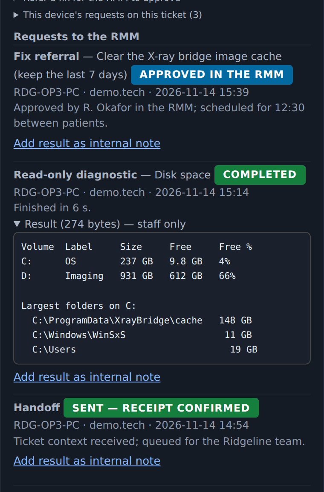</a>
<b>RMM requests on a ticket</b> · Dark<br>Handoffs and requests to a paired RMM; diagnostics and fixes with Rem0te are in development.
</td>
</tr>
<tr>
<td width="50%" valign="top">
<a href="docs/images/github/vault-dark.png">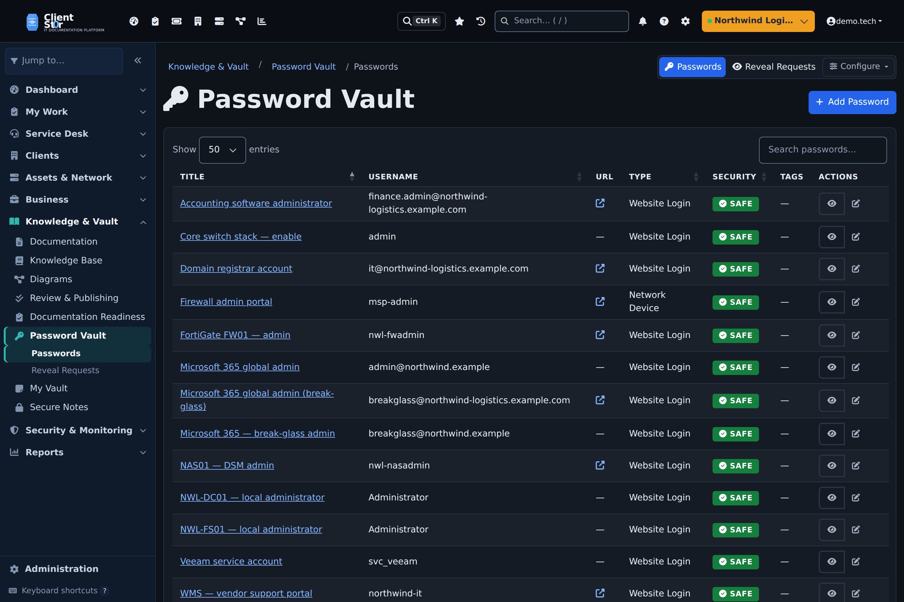</a>
<b>Password vault</b> · Dark<br>AES-256-GCM at rest; every reveal checked and audited.
</td>
<td width="50%" valign="top">
<a href="docs/images/github/technician-access-light.png">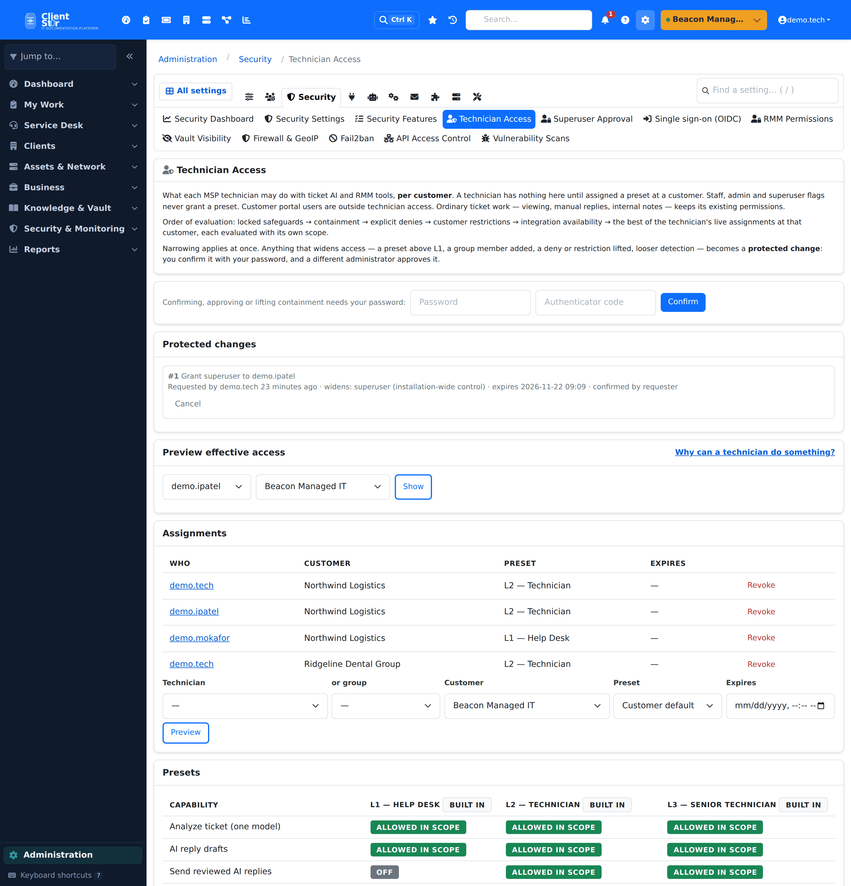</a>
<b>Technician access per customer</b> · Light<br>L1/L2/L3 presets; widening access needs a second administrator.
</td>
</tr>
<tr>
<td width="50%" valign="top">
<a href="docs/images/github/rack-elevation-dark.png">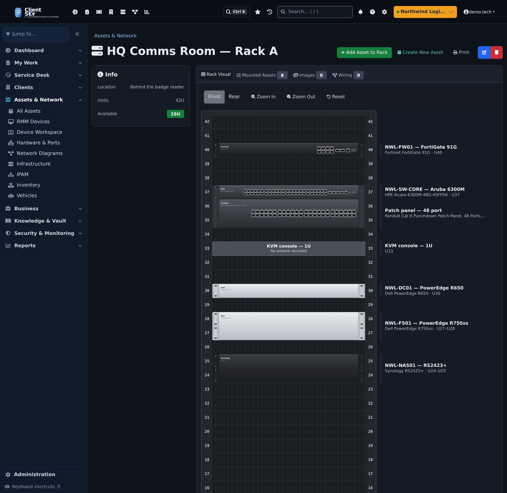</a>
<b>Racks from real artwork</b> · Dark<br>Each device drawn across its U span; click through to its ports.
</td>
<td width="50%" valign="top">
<a href="docs/images/github/hardware-trace-light.png">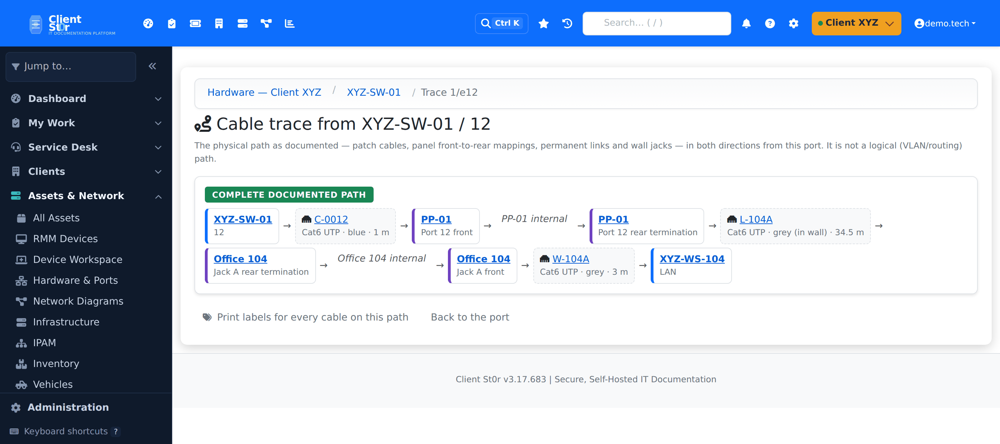</a>
<b>Trace the cable</b> · Light<br>Switch port to desk, through panel and wall jack.
</td>
</tr>
<tr>
<td width="50%" valign="top">
<a href="docs/images/github/business-overview-dark.png">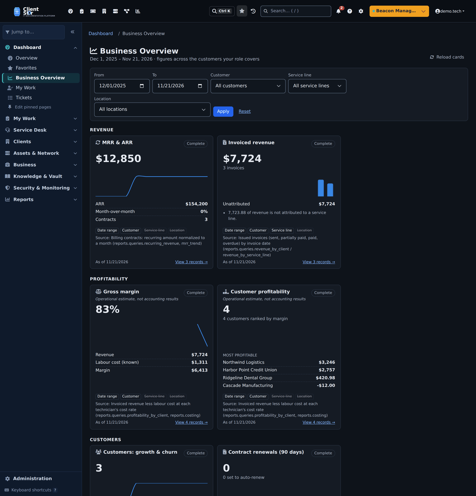</a>
<b>Business Overview</b> · Dark<br>Revenue, margin and renewals, each card naming its source.
</td>
<td width="50%" valign="top">
<a href="docs/images/github/api-access-light.png">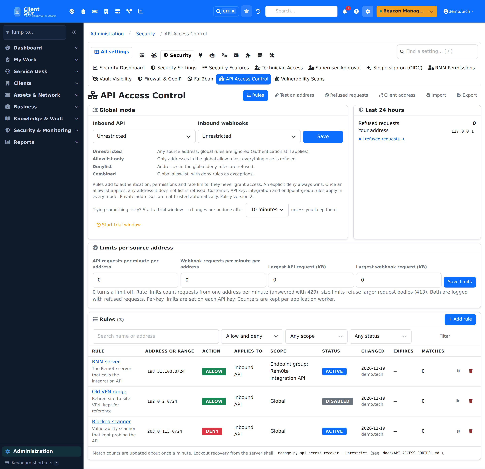</a>
<b>API access control</b> · Light<br>Allow and deny rules for the API and webhooks, with a rollback window.
</td>
</tr>
<tr>
<td width="50%" valign="top">
<a href="docs/images/github/portal-ticket-light.png">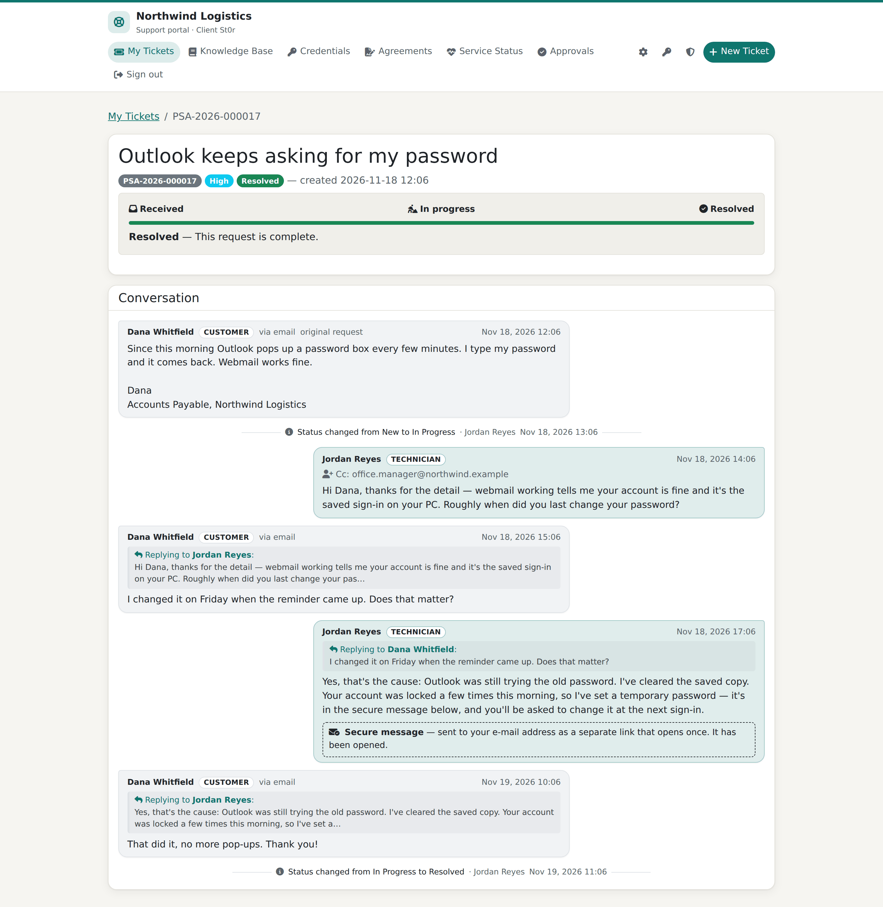</a>
<b>Customer portal</b> · Light<br>Customers see the shared conversation, never internal notes.
</td>
<td width="50%" valign="top">
<a href="docs/images/github/command-palette-dark.png">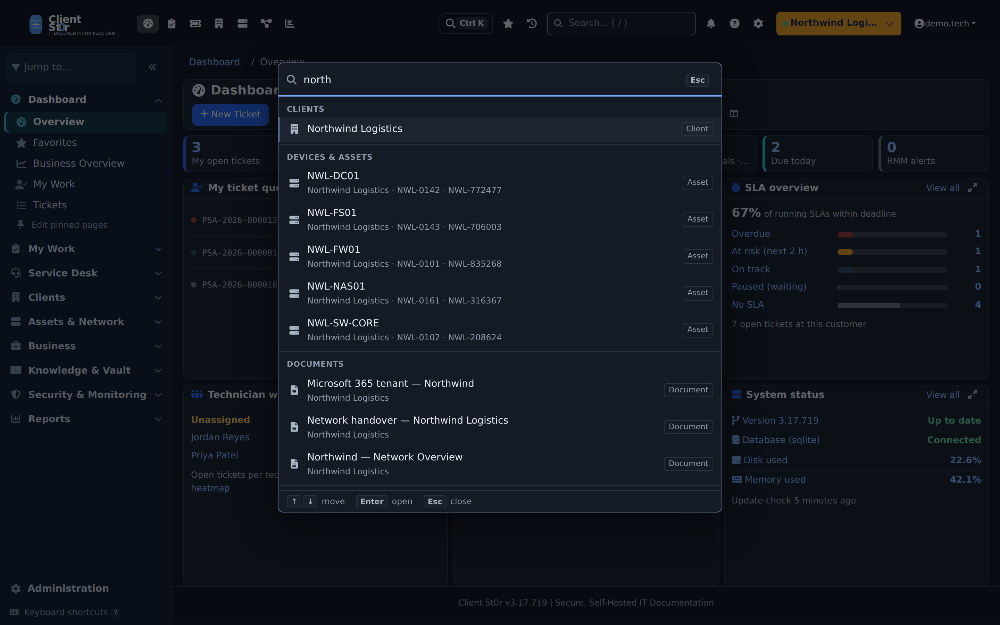</a>
<b>Go to anything with Ctrl+K</b> · Dark<br>Pages, settings, clients, tickets, devices and documents.
</td>
</tr>
</table>

**[See all screenshots →](docs/screenshots.md)** — light and Professional Dark, plus the phone layout.

## Features at a glance

Full list with status, configuration and limitations: **[FEATURES.md](FEATURES.md)**.

- **Service desk (PSA):** tickets, queues, SLAs with pause, time and expenses, My Work, email-to-ticket, service catalog with guided portal requests, problems, changes, workflow rules, optional rule-based routing. Off until you turn on `psa_enabled`.
- **Clients:** one workspace per customer, parent/child organizations, locations, an onboarding wizard, a customer operations page.
- **Documentation:** WYSIWYG or Markdown documents, templates, versions with compare and restore, review and approval, a global knowledge base shared with chosen customers, documentation readiness scores, draw.io diagrams, agreements.
- **Password vault:** encrypted entries, folders, access rules, reveal approval, break-glass, breach checks, per-entry portal visibility.
- **Assets and network:** assets with custom types and fields, a hardware catalog with panel artwork, ports, cables, racks, IPAM and VLANs, network config backups, network controller sync.
- **Monitoring and security:** website, SSL and WAN monitors, status pages, backup monitoring, security alerts from webhooks and SIEM endpoints, incidents, a shared event list.
- **RMM:** device, alert and software sync from six RMM products (Rem0te included), a device workspace, and alert-to-ticket with a paired RMM.
- **Business:** contracts, quotes with e-signature, invoices, contract documents with signing, CRM, procurement, licensing, accounting push, profitability and Business Overview.
- **Reports:** profitability and SLA reports, custom dashboards, wallboards, scheduled reports, client health score, pricing advisor.
- **Administration:** a searchable settings center, roles with about a hundred permission switches, SSO, a REST API with scoped keys, outbound webhooks, a built-in scheduler, web updates.

## What's new

Since the last documentation refresh (v3.17.683), releases through **v3.17.719** added:

- **Navigation.** Ten sidebar sections (Dashboard, My Work, Service Desk, Clients, Assets & Network, Business, Knowledge & Vault, Security & Monitoring, Reports, and Administration at the foot) that collapse to an icon rail with flyouts. **Ctrl+K** opens Go to; the sidebar has a **Jump to** filter; any page can be starred into **Favorites**, and **Recent** lists what you opened last.
- **AI (OPTIONAL AI).** Off by default, gated by `psa_ai_enabled` and a per-customer AI policy. Ticket AI uses model profiles for Anthropic, OpenAI or a local Ollama model; documentation AI also supports Moonshot and MiniMax. Secrets are redacted from the evidence sent, and vault data, attachments and internal notes are never sent. Ticket *Analyze* and *Compare models* run through a paired RMM; reply drafts, triage and suggested actions do not need one.
- **Rem0te.** Rem0te is a separate RMM application, not part of this repository. ClientSt0r pairs with it over a signed contract (ticket-rmm-v1 revision 2: Ed25519 signatures, replay protection, the Rem0te tenant pinned by immutable IDs). Tested with both real applications in CI: pairing, Rem0te alerts becoming ClientSt0r tickets with a link back, optional AI analysis of Rem0te-supplied evidence, containment, revoked access and tenant isolation. Read-only diagnostics, remediation proposals and results flowing back to the ticket are **in development**: the contract routes are agreed but not yet built on the Rem0te side. Approval of any endpoint action always happens in Rem0te, never in ClientSt0r or by AI.
- **Technician security.** L1/L2/L3 technician access per customer with expiry and a "why can this technician" page, optional Superuser Approval by a second administrator, and vault visibility that shows a customer's entries only where a membership or global role grants it.
- **Wallboards.** Configurable boards under Reports → Wallboards, and a public token-protected scheduler wallboard.
- **Security alerts and events.** Generic JSON vendor webhooks and SIEM webhook endpoints (CEF, JSON, Syslog format over HTTPS), incidents, and a shared **Events** list that copies security, RMM, Rem0te, backup and website-monitor alerts into one place with ingestion health and retention per source and per customer.
- **API security.** API Access Control (IP/CIDR allow and deny rules for the API and webhooks), a rollback window that undoes risky changes, webhook signatures with timestamps and replay protection, API key expiry and rotation, mutual TLS per API key, and trusted proxies set in Settings.
- **Business tools.** Business Overview, backup monitoring (Proxmox Backup Server, restic, Borg, Kopia), client health scores, software licensing, the pricing advisor and the customer onboarding wizard. Payments (Stripe, GoCardless), sales tax (Avalara, TaxJar) and OIDC sign-in are in the code but not yet verified against live services; see [FEATURES.md](FEATURES.md).

Release-by-release detail: [CHANGELOG.md](CHANGELOG.md).

## Coming soon

No dates. Status comes from the [roadmap](docs/ROADMAP.md); ideas and votes go to [GitHub discussion #161](https://github.com/agit8or1/clientst0r/discussions/161).

**In development**

- Rem0te ticket actions: read-only diagnostics, remediation proposals approved in Rem0te, and results returned to the ticket (contract revision 3).
- Shared event and alert foundation (Phase 82, remainder): per-connection rate limits, which arrive with push connectors, and the correlation, automation and AI analysis switches. (Event permissions, the Security Analyst and Security Administrator roles, and per-source and per-customer retention shipped in v3.17.720.)

**Planned**

- Contracts, recurring billing and quote conversion (Phase 70): accepting a quote creates a contract or invoice.
- Customer command center portal (Phase 77): one customer dashboard for health, backups, contracts, licensing and billing, with self-service requests.
- NOC/SOC wallboards and secure display pairing (Phase 83): presentation mode, preset boards and paired read-only displays.
- Security connector framework and vendor integrations (Phase 84): a connector SDK, a TLS syslog collector, then vendor connectors in batches.
- Operations Center, alert triage and correlation (Phase 85).
- SOAR Lite (Phase 86): approval-driven security automation, read-only by default.
- Alert routing, on-call and escalation (Phase 87).
- Service dependency and impact mapping (Phase 88).
- Security posture scorecards and customer service reviews (Phase 89).
- AI Operations Analyst (Phase 90, OPTIONAL AI): alert and incident analysis with labelled provenance, no autonomous actions.

**Under consideration**

- Live wallboard updates over server-sent events (SSE)
- API concurrency limits with a shared cache
- Lead capture from an IMAP mailbox
- JSON and Excel report export
- Travel-time-aware dispatch

## How it compares

ClientSt0r covers ground that is often split across several tool categories: IT documentation, PSA/ticketing, password management, asset and network documentation, basic monitoring, and billing. It is not a full RMM (device management runs in a paired RMM such as Rem0te), not a SIEM (it receives alerts, it does not collect logs), and not an accounting package (it pushes invoices to one). **[COMPARISON.md](COMPARISON.md)** goes category by category: what is native, what comes through integrations, what is planned, and where a dedicated tool fits better.

## Quick start

### Docker

Requires Docker Engine 24.0+ with Docker Compose v2.24+, about 2 GB of disk for the image and 1 GB for the database volume.

```bash
git clone https://github.com/agit8or1/clientst0r.git
cd clientst0r
cp .env.example .env
# edit .env and set at least:
#   SECRET_KEY, APP_MASTER_KEY, API_KEY_SECRET, DB_PASSWORD, DB_ROOT_PASSWORD
#   ALLOWED_HOSTS and BASE_URL for your hostname
# optional: DJANGO_SUPERUSER_USERNAME / _EMAIL / _PASSWORD to create the first admin
docker compose up -d
```

Compose refuses to start if a required secret is missing. `.env.example` ships placeholder values for `SECRET_KEY`, `API_KEY_SECRET` and the database passwords; replace every one of them. Keep a copy of `APP_MASTER_KEY` off the server: without it, vault data in a backup cannot be decrypted.

The app listens on port 8000. The `.env.example` defaults assume HTTPS (`SECURE_SSL_REDIRECT=True`, secure cookies), so put TLS in front: your own reverse proxy, or the bundled Nginx profile (`docker compose --profile proxy up -d`). Other profiles: `cache` (Redis) and `ai-gateway`. Full guide: **[docs/docker.md](docs/docker.md)**.

### Native install (Ubuntu or Debian)

Ubuntu 20.04+ / Debian 11+, 2 GB RAM (4 GB recommended), 10 GB free disk.

```bash
git clone https://github.com/agit8or1/clientst0r.git && cd clientst0r && bash install.sh
```

The installer sets up Python (3.11–3.13), MariaDB, Gunicorn on port 8000 and the systemd units, generates the encryption keys and runs migrations.

> [!WARNING]
> `install.sh` creates a superuser named **`admin`** with the password **`ChangeMe123!`**. Change it immediately at first login, and enrol 2FA (required by default).

`install.sh` does **not** install Nginx or TLS. Put your own reverse proxy in front of port 8000; a sample config is in `deploy/nginx-clientst0r.conf`. Full guide: **[INSTALL.md](INSTALL.md)**.

### First steps

1. Sign in, change the default password and enrol 2FA.
2. Create your first client under **Clients**.
3. Add technicians under **Settings → Users & Access → Access Management** and set their **User Type** to **Staff**. Everyone else is a customer user.
4. Turn on the service desk under **Settings → Modules → Feature Toggles** (`psa_enabled` is off by default).
5. For the customer portal, set its address and branding under **Settings → General → Customer Portal**.
6. Check **Settings → Automation → Task Scheduler**. Periodic jobs run from the built-in scheduler; no crontab is needed.

## Updating and backups

**Update from the web UI:** **Settings → System → System Updates** → *Check for Updates* → *Apply*. Superusers also see an **Update Available** pill when a newer release is published. Apply installs a reviewed, pinned commit, verifies the release tag signature, runs preflight checks and takes a verified backup before it changes anything. Rollback is not automatic: restoring a pre-upgrade backup is a command run on the server, shown on the Updates page. See [docs/UPGRADE_AND_RECOVERY.md](docs/UPGRADE_AND_RECOVERY.md) and [AUTO_UPDATE.md](AUTO_UPDATE.md).

CLI fallback (native installs; bypasses the verified pipeline):

```bash
git pull && python manage.py migrate && sudo systemctl restart clientst0r-gunicorn.service
```

Under Docker: `docker compose pull && docker compose up -d`.

Standalone backups:

```bash
python manage.py backup --output-dir /var/backups/clientst0r --encrypt --retention-days 30
```

Restore is command-line only (`python manage.py restore <file>`). Docker users: see [Backups](docs/docker.md#backups).

## Architecture

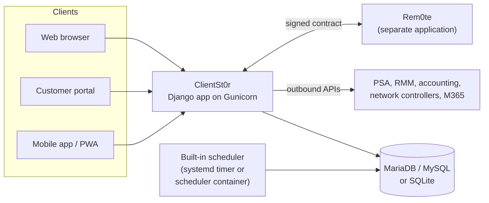

One server per MSP; there is no clustered deployment. Redis is optional (cache only). MariaDB is the production database; SQLite is for local development.

## Supported versions and limitations

- Security fixes land on the current **3.17.x** line. See [SECURITY.md](SECURITY.md).
- **Single server by design.** One VM or container host per MSP.
- **Self-hosted only.** There is no public demo instance. Optional managed hosting and support are offered separately by [MSP Reboot](#msp-reboot).
- **The service desk is opt-in** (`psa_enabled` off by default).
- **AI is optional** (`psa_ai_enabled` off by default).
- **Some integrations are not verified against live services:** payments (Stripe, GoCardless), sales tax (Avalara, TaxJar), OIDC with real identity providers, office editors (ONLYOFFICE, Collabora, Microsoft 365 documents). Warranty lookups (Dell, HPE, Lenovo) are stubs; enter warranty dates by hand. Security vendor names in the connection list are labels: alerts arrive only through the generic JSON webhook or a SIEM webhook endpoint.

## How ClientSt0r protects client data

Full walkthrough with evidence and known gaps: [docs/CLIENT_DATA_PROTECTION.md](docs/CLIENT_DATA_PROTECTION.md). Administrators can check each protection per customer under **Settings → Security → Security Features**.

- **Customers see the shared conversation, never your working notes.** Internal notes, time entries, expenses and the RMM's view stay with technicians; posting to technician-only URLs returns 403.
- **Revealing a credential is its own permission, and every reveal is recorded.** Optional per-entry approval and access rules (country, address range, time) apply first; reveals are rate-limited. The web vault, REST and mobile APIs and the browser extension use the same check.
- **Sign-in defaults:** TOTP 2FA required for everyone, Argon2 hashes, 12+ character passwords, lockout after 5 failures for 30 minutes, sign-out after 60 minutes idle or 8 hours.
- **Encryption:** vault passwords, TOTP seeds and stored integration credentials use AES-256-GCM with per-purpose keys; tokens are stored as HMAC-SHA256 hashes. Ticket text and attachments are not encrypted by the app.
- **Staff have broader access than customers, by design.** The vault is stricter: a technician sees a customer's entries only where a membership or global role grants "view vault". Ticket AI and RMM tools need an L1/L2/L3 assignment at each customer.
- **Ticket AI (OPTIONAL AI)** is off until a superuser enables it and sets each customer's AI policy. Nothing AI produces reaches a customer until a technician presses Send.
- **A paired RMM does the device work.** Pairing is a protected change a second administrator approves and is pinned to one RMM tenant. Any endpoint action is approved in the RMM, never in ClientSt0r or by AI. Rem0te is the only known implementation of the pairing contract.

Known limitations (audit log deletable by superusers, with each deletion recorded; Azure AD sign-in skips local TOTP; mobile tokens last until revoked; CSP report-only by default): [docs/CLIENT_DATA_PROTECTION.md](docs/CLIENT_DATA_PROTECTION.md#limitations).

## Security

- TOTP 2FA, Argon2, brute-force lockout and session limits, set in **Settings → Security → Security Settings** (environment variables take precedence).
- AES-256-GCM for vault entries and every other stored secret; `manage.py rotate_encryption_key` and `manage.py check_secrets_storage`.
- Role permissions for passwords, documents, assets, files, monitors and integrations, enforced across the web UI, search, the APIs and the mobile app.
- Azure AD / Entra ID SSO, LDAP / Active Directory sign-in, and OIDC sign-in (not yet verified against a live provider).
- API Access Control, API key expiry and mutual TLS, signed webhooks with replay protection, application-level IP and GeoIP rules.
- Content-Security-Policy with per-request nonces, report-only by default (`CSP_REPORT_ONLY=False` to enforce).
- CodeQL and dependency scanning in CI.

**Found a vulnerability?** Report it privately through [GitHub Security Advisories](https://github.com/agit8or1/clientst0r/security/advisories/new), not a public issue. Policy: [SECURITY.md](SECURITY.md).

## Documentation

| Guide | What it covers |
|---|---|
| [Installation](INSTALL.md) | Native install, upgrade, troubleshooting |
| [Docker](docs/docker.md) | Compose layout, profiles, backups, upgrades |
| [Upgrades and recovery](docs/UPGRADE_AND_RECOVERY.md) | Update channels, verified backups, restore |
| [Features](FEATURES.md) | Every area with status, configuration and limitations |
| [Comparison](COMPARISON.md) | Coverage by tool category |
| [Screenshots](docs/screenshots.md) | Full visual tour |
| [Roadmap](docs/ROADMAP.md) | Shipped, in progress and planned phases |
| [Changelog](CHANGELOG.md) | Release history |
| [Integrations](docs/INTEGRATION_SETUP_GUIDE.md) | PSA, RMM, M365, accounting and distributors |
| [API access control](docs/API_ACCESS_CONTROL.md) | Address rules, webhook signatures, mutual TLS |
| [API](API_V2_GRAPHQL.md) | REST and GraphQL endpoints |
| [Client data protection](docs/CLIENT_DATA_PROTECTION.md) | Who sees what, vault reveals, ticket AI, RMM pairing |
| [Technician access](docs/TECHNICIAN_ACCESS.md) | Per-customer L1/L2/L3 presets, protected changes |
| [Hardware inventory](docs/HARDWARE_INVENTORY.md) | Device catalog, panel artwork, ports, cables, racks |
| [Security policy](SECURITY.md) | Supported versions, reporting |
| [FAQ](docs/faq.md) · [More docs](docs/README.md) | Everything else |

## Contributing

Issues and pull requests are welcome.

- **Bugs:** [open a bug report](https://github.com/agit8or1/clientst0r/issues/new?template=bug_report.yml)
- **Ideas:** [open a feature request](https://github.com/agit8or1/clientst0r/issues/new?template=feature_request.yml) or join [discussion #161](https://github.com/agit8or1/clientst0r/discussions/161)
- **Code:** fork, branch, add a test in the relevant app's `tests.py`, run `python manage.py test <app>`, then open a PR. See [CONTRIBUTING.md](CONTRIBUTING.md).

Questions: [GitHub Issues](https://github.com/agit8or1/clientst0r/issues) or [Discussions](https://github.com/agit8or1/clientst0r/discussions).

## License

MIT — see [LICENSE](LICENSE). Every first-party feature works on a self-hosted install: no paid tiers, no seat or client limits, no license activation.

## MSP Reboot

ClientSt0r is built by the people behind **[MSP Reboot](https://mspreboot.com)**, an MSP consulting practice working with owners on pricing, operations, margins and service delivery. **Optional managed hosting and commercial support** are offered separately for teams that would rather not run it themselves. None of that is required to use ClientSt0r; paying for hosting or support buys time and infrastructure, not access to features.

---

<div align="center">

If ClientSt0r saves you time, a ⭐ helps other MSPs find it.

<sub>Built by a small team and one German Shepherd. Luna supervises.</sub>

</div>
