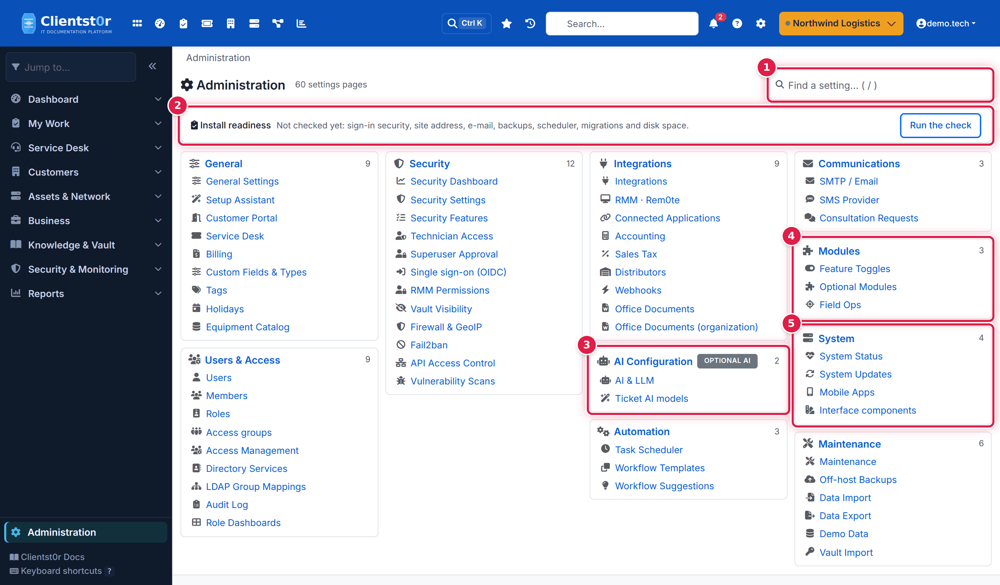

# Administrator guide

Where to switch on the optional features (routing, AI, support workflows, technician access and the rest). After upgrading, every feature below
is in its default state until an administrator changes it. Feature guides:
[TICKET_ROUTING.md](TICKET_ROUTING.md), [AI_TROUBLESHOOT.md](AI_TROUBLESHOOT.md),
[SUPPORT_WORKFLOWS.md](SUPPORT_WORKFLOWS.md),
[TECHNICIAN_ACCESS.md](TECHNICIAN_ACCESS.md),
[UPGRADE_AND_RECOVERY.md](UPGRADE_AND_RECOVERY.md).

## The Administration page

Administration is the last item in the sidebar (and the gear in the top bar). It opens the settings center: one
card per category (General, Users & Access, Security, Integrations, AI Configuration, Automation, Communications,
Modules, System, Maintenance), each listing the pages you may open. Type in the search box to filter the cards.
The Install readiness card at the top runs a check of sign-in security, site address, e-mail, backups, the
scheduler, migrations and disk space; run it after a first install and after changes. Only administrators see
the group; a page you may not open is not listed. The numbers in the screenshot match the list under it. Every
screenshot is a capture of the application against a demo database; the customers and people in it are invented.

<!-- guide-figure: guide-x1-admin-settings -->

1. Find a setting by name; the cards filter as you type (press / to jump here).
2. Install readiness: sign-in security, site address, e-mail, backups, scheduler, migrations and disk space.
3. AI Configuration (OPTIONAL AI): provider and ticket AI model settings. The switch itself is in General, PSA.
4. Modules: Feature Toggles and Optional Modules.
5. System: System Status, System Updates and Mobile Apps.
<!-- /guide-figure -->

## Where to switch things on

"su" means superuser. Permission names are role-template flags.

| Feature | Setting location | Default | Who can change it |
|---|---|---|---|
| Integration owner (platform or one customer) | Administration → Integrations → Integrations, in global view → Add (Owner); existing connections: "Make platform-owned" or `manage.py integrations_ownership` | New connections in global view are platform-owned; existing ones keep their customer | su, Django staff, or MSP staff whose global role grants `integrations_configure` |
| Rem0te pairing (Ed25519) | Administration → Integrations → RMM · Rem0te (`/integrations/rmm/rem0te/setup/`) | Not paired: no identity keys until created | su |
| RMM service lists (Tactical RMM only) | Administration → Integrations → Integrations → the RMM connection → Edit → "Collect services" | Off | MSP staff who are administrators of the selected customer |
| Refresh from RMM (one device) | Assets & Network → Device Workspace → Refresh from RMM | Available; once per device every 5 minutes | MSP technicians allowed `device.view` for that device |
| RMM permission levels (L1 / L2 / L3) | Administration → Security → RMM Permissions (`/settings/security/rmm-permissions/`); levels are set on the user's global role | No level assigned | `policy.manage`; giving or changing a level also needs a second administrator to approve |
| Ticket routing | Service Desk → Dispatch Board → Configure → Ticket Routing (`/psa/routing/`; MSP default), per customer under Customers | Off; customers inherit the MSP default | PSA on + `routing_manage_rules` |
| Alert-to-ticket policy | Security & Monitoring → Alert Policies (`/psa/routing/alerts/`) | Legacy: one ticket per Rem0te alert, no policy; synced RMM alerts not included | PSA on + `routing_manage_rules` |
| Support workflows | Service Desk → Workflows → Support Workflows (`/psa/workflows/`) | Twelve built-in workflows, active | PSA on + `routing_manage_rules` |
| AI features (master switch) **OPTIONAL AI** | Administration → General → Service Desk (`/psa/settings/`) → `psa_ai_enabled` | Off | su |
| AI Troubleshoot per customer **OPTIONAL AI** | Administration → AI Configuration → Ticket AI models (`/psa/ai/profiles/`) → the customer's policy | Off; 50 runs a day per customer, 20 per technician; network identifiers and contact names not shared | su |
| Installation-wide AI cap and command allowlist **OPTIONAL AI** | Administration → AI Configuration → Ticket AI models (`/psa/ai/profiles/`) → Installation-wide limits | No cap; no allowlist (built-in denylist always applies) | su |
| Geo-aware dispatch | Service Desk → Shifts & Locations → Configure → Dispatch Locations | Off | su who is MSP staff |
| Sharing my position with dispatch | Service Desk → Shifts & Locations → Location Sharing | Not shared | Each technician, for themselves |
| Shift templates | Service Desk → Shifts & Locations → Configure → Shift Templates | None | Staff with `resourcing_approve_leave` or `routing_manage_rules`, or su |
| LDAP group mappings | Administration → Users & Access → LDAP Group Mappings (`/accounts/ldap/group-mappings/`) | None | su |
| LDAP background sync | Administration → Automation → Task Scheduler → LDAP Group Mapping Sync | On, every 15 minutes; does nothing without LDAP sign-in and mappings | su |
| Weekly security digest | Security & Monitoring → Security Alerts → Configure → Weekly Digest (`/security/digest/`) | No contacts subscribed | `security_alerts_view` to view; `security_alerts_manage_connections` to change |
| "All clear" digest e-mail | Same page, per customer | Off | `security_alerts_manage_connections` for that customer |
| Agreement reminders | Each agreement's settings | On, every 7 days | Staff who manage agreements |
| Portal for a customer | Administration → General → Service Desk → per-customer settings (`/psa/settings/client/`) | As before | su |
| Requesters' default sites | `/psa/requester-sites/` | None | Staff with `tickets_edit` for that customer |
| Release channel | Administration → System → System Updates | New installs: Stable. Existing installs: Preview (keep following `main`) | su |
| Setup Assistant | Administration → General → Setup assistant (`/core/settings/setup/`) | New installs: opens by itself after the first administrator's sign-in. Upgraded installs: never opens by itself. See [Setup assistant](#setup-assistant) | su |
| Module switches | Administration → Modules → Feature Toggles (`/core/settings/features/`); overview on Optional Modules (`/core/settings/modules/`) | Every module on for a new install; upgrades keep each module as it was. See [Modules](#modules-turning-features-on-and-off) | su |
| File upload and delete | Administration → Users & Access → Roles → `files_upload`, `files_delete` | Custom roles with `files_view` get both on upgrade; built-in Editor has no delete, Read-Only neither | Administrators who manage roles |
| Invoice editing and payments | Administration → Users & Access → Roles → `billing_send_invoices`, `billing_record_payments` | Owner and Admin roles | Administrators who manage roles |
| Knowledge base in customer portals | Global KB (`/docs/kb/`): the Portal column and the bulk actions Show in all portals / Make staff only | New global articles default to shown in every customer portal; existing live global articles were switched on once by migration. Customer-scoped documents default to staff only and show only in their own customer's portal when ticked (the document form's "Show in this customer's portal"). | Staff with `kb_edit_articles` and publish rights |

## Setup assistant

**Administration → General → Setup assistant** (`/core/settings/setup/`, superusers only) is a guided path
through the settings a new install needs. It is not a second settings system: each step saves through the
same code as the Administration page it stands for, and those pages stay the place for everything it does not
cover.

**When it opens by itself.** Only on a new install, only for superusers, once per sign-in, as a start screen
with **Start setup** and **Later**. It opens after two-factor enrolment: while 2FA is required (the default)
an administrator without an authenticator is sent to enrolment first, and no assistant page answers before
that. An install counts as new while all of these hold:

- the install's settings were created after this feature arrived (an upgrade marks the existing settings
  "not offered" during its migration, so an upgraded install is never redirected);
- there is at most one user account, at most one organization apart from internal ones (the one `install.sh`
  creates for your company), and no tickets. As soon as that stops being true before the assistant is started
  (for example after `seed_demo_data` or a restore), it stops offering itself for good.

**Later** stops it opening by itself. Nothing is ever blocked: every page stays reachable while setup is
unfinished. Opening the assistant by hand on an upgraded or finished install never makes it offer itself again.

**Paths.** *Basic* covers the essentials; *Advanced* adds the rest. Steps outside the basic path are marked
skipped ("Not in the basic path"); switching to advanced reopens them.

| Step | Path | Required | Saves through |
|---|---|---|---|
| MSP details and branding: site name, company name, public address, time zone, logo | Basic | Yes | Administration → General |
| Administrator security: default password, your 2FA and recovery codes, session and password policy | Basic | Yes (the installer's default password must be changed first) | Administration → Security |
| Modules: one switch per module with what it covers | Advanced | No | Administration → Modules (same dependency checks and audit rows) |
| Technicians, access groups and roles: counts and links to Add a user, Users, Roles, Access groups | Advanced | No | Those pages (their approvals and rules apply) |
| First customer, or links to Data Import, customer onboarding and a new lead | Basic | No | Organizations → New (you become the owner) |
| Service desk mail: SMTP server with Send test; incoming mailboxes (e-mail to ticket) | Basic | No | Administration → SMTP / Email; Service Desk → Email Ingestion |
| Routing and notifications: the MSP default routing mode, expiry warnings, new-user e-mails | Advanced | No | Ticket Routing; Administration → SMTP / Email |
| Optional integrations: RMM (Rem0te and others), external PSA, connected applications, AI assistance **OPTIONAL AI** | Advanced | No | Each integration's own page and Test button |
| Backups and health: the install readiness check | Basic | No | Administration (readiness card) |
| Review and finish | — | — | Marks the assistant finished |

Rules the assistant keeps:

- **Shows before it changes.** Every form starts from the current values. Saving an unchanged form changes
  nothing, so running it again on a configured install is safe.
- **Never loosens security.** The security step accepts only values at least as strict as the defaults (2FA
  required, idle sign-out 60 minutes, sessions up to 8 hours, passwords of 12 characters with a special
  character, lockout after 5 failed sign-ins for 30 minutes). Loosening a setting stays on Administration →
  Security, which explains what it changes. Settings fixed by environment variables are shown read-only.
- **Skip changes nothing.** A skipped step leaves every setting as it was and can be filled in later.
- **No secrets in summaries or logs.** The SMTP password field is write-only: it is never shown back, and the
  step records only that it changed. The audit log and the review list field names and "configured / not
  configured", never values.
- **Standalone.** Mail, integrations and AI are optional. Setup completes with no integration configured and
  makes no outbound call itself; connection tests are the existing buttons on the pages that own them.
  AI assistance is **OPTIONAL AI**, off by default and switched on only under Administration → AI
  (`psa_ai_enabled`).

Progress is saved after every step; each saved or skipped step writes one audit entry ("Setup Assistant").
Finishing records who finished and when. Running the assistant again starts a new run with every step
showing its current state.

## Modules: turning features on and off

**Administration → Modules → Feature Toggles** (`/core/settings/features/`, superusers only) has one
switch per module. **Administration → Modules → Optional Modules** (`/core/settings/modules/`) shows the
same modules with what each one needs, what people see when it is on and where its settings are,
and can switch them one at a time.

- Every module is **on** for a new install.
- Upgrading never changes a module: switches added for modules that were always available are
  added on, and an install that had PSA, CRM or pulse checks off keeps them off.
- A module that is off disappears from the sidebar, tab strips, dashboard cards, quick actions,
  shortcut pins and the Go to palette; its pages answer "Page not found"; its scheduled jobs are
  skipped (Administration → Automation → Task Scheduler shows them as skipped while the module is off).
- Turning a module off never deletes anything. Turning it back on shows every record again, and
  its scheduled jobs run on the next scheduler tick.
- Some modules need another one (for example Projects needs PSA). Optional Modules refuses to
  turn one on while what it needs is off.

| Group | Module | Switch | What it covers |
|---|---|---|---|
| Service desk | PSA / Service desk | `psa_enabled` | Tickets, queues, SLA, dispatch, invoices and billing; everything below marked "needs PSA" |
| Service desk | Projects (needs PSA) | `projects_enabled` | Projects, project templates and tasks, also in the mobile app |
| Service desk | Quotes (needs PSA) | `quotes_enabled` | Quote pages; signing links already sent to customers keep working |
| Service desk | Change, problem and release management (needs PSA) | `change_management_enabled` | Change requests, problems and releases |
| Service desk | Procurement and vendors (needs PSA) | `procurement_enabled` | Requisitions, purchase orders, back-orders, vendors; recurring purchases and the distributor health probe |
| Service desk | Security alerts and incidents (needs PSA) | `security_alerts_enabled` | Security Overview, alerts, incidents, playbooks, SIEM endpoints, weekly digests and alert polling; unsubscribe links keep working |
| Service desk | Pulse checks | `pulse_enabled` | Feedback surveys, the portal Feedback page and scheduled sends |
| Business | Client health | `client_health_enabled` | Client Health pages, the health card on client records and daily snapshots |
| Business | CRM | `crm_enabled` | Leads, pipeline, opportunities, campaigns, commissions and the sales dashboard cards |
| Business | Contract documents | `contracts_enabled` | Contract drafting, templates, clauses, reminders; signing links already sent keep working |
| Business | Software licensing | `licensing_enabled` | Subscriptions, renewals, license sync and alerts |
| Operations | Monitoring | `monitoring_enabled` | Website, SSL, domain and WAN monitoring and expirations (racks, IPAM and VLANs stay) |
| Operations | Status pages (menu under Monitoring) | `status_pages_enabled` | Status pages, public pages and the portal's Service Status |
| Operations | Configuration backups (menu under Monitoring) | `netconfig_enabled` | Network device configuration backups, also in the mobile app |
| Operations | Backup monitoring | `backup_monitoring_enabled` | Customer backup jobs, alerts, restore tests and polling |
| Operations | Workflows | `workflows_enabled` | Runbooks and tracked runs, also in the mobile app |
| Operations | Scheduling | `scheduling_enabled` | Scheduled tasks, calendar, wallboard and task alerts |
| Operations | Inventory | `inventory_enabled` | Stock, tools and low-stock reports, also in the mobile app |
| Operations | Service vehicles | `vehicles_enabled` | Fleet, mileage, maintenance, fuel, vehicle stock and service alerts; expense receipts stay |
| Operations | Field operations | `field_ops_enabled` | Timeclock, location sharing, geo-aware dispatch and field visit notes; people can still see and delete their own location history |
| Operations | Customer onboarding | `onboarding_enabled` | The onboarding wizard |
| Operations | Webhooks | `webhooks_enabled` | Event delivery to your endpoints |
| Operations | Reports & Analytics | `reports_enabled` | Reports, dashboards, wallboards, scheduled reports and the Pricing Advisor |
| Documentation and vault | Global knowledge base | `global_kb_enabled` | The staff-only shared knowledge base (customer documents are not affected) |
| Documentation and vault | Diagrams | `diagrams_enabled` | Drawings and diagram templates in the documentation |
| Documentation and vault | Documentation readiness | `readiness_enabled` | Readiness checks per customer |
| Documentation and vault | Secure Notes | `secure_notes_enabled` | Secure notes inbox, sent and secret links; links already sent still open |
| Documentation and vault | Location maps | `locations_map_enabled` | Maps and address lookup on location pages |

Not modules, and not on this page: clients, users and access, tickets inside PSA, the password
vault, settings, the audit log and help are always available. These keep their own setting and
their own default:

- AI features **OPTIONAL AI** (`psa_ai_enabled`, Administration → General → Service Desk): off until you turn
  them on.
- Customer portal switches (announcements, votes, escalation, customer approvals): Settings →
  Customer portal, off by default.
- Satisfaction survey e-mails (`psa_csat_enabled`), late fees, invoice auto-send and autopay,
  asset age warnings, warranty lookups and firmware checks: each on its own settings page, with
  its existing default.

## Safety rules that no setting changes

- Routing a ticket never starts a remote session or authorizes an endpoint action.
- Routing, the alert policy and support workflows work with AI switched off.
- AI suggestions, including commands, are shown as text and never run.
- Customer users never see RMM data.
