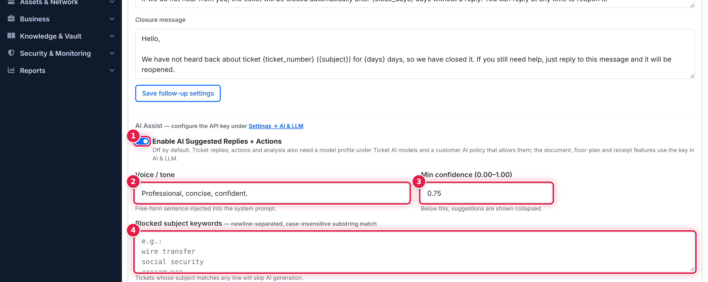
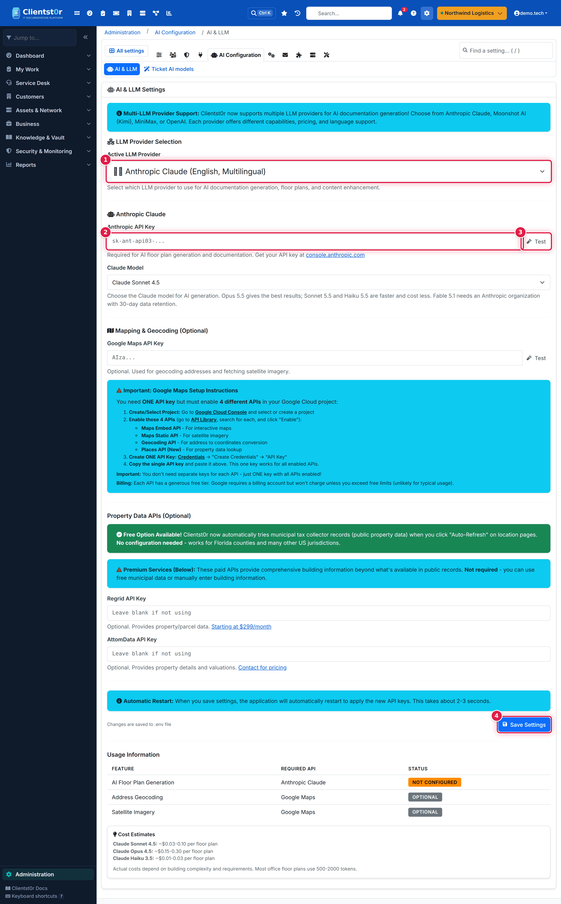
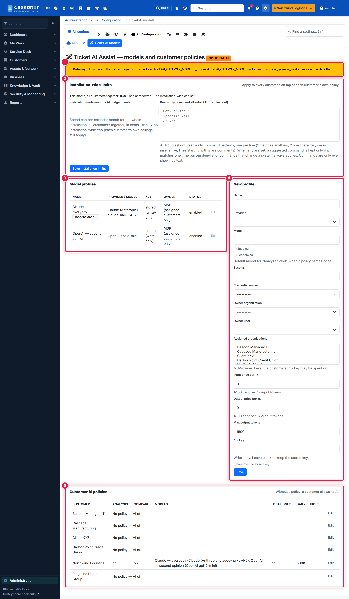
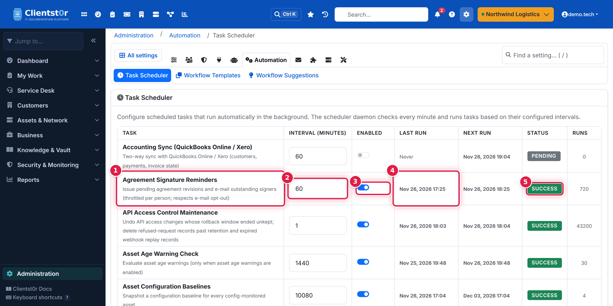
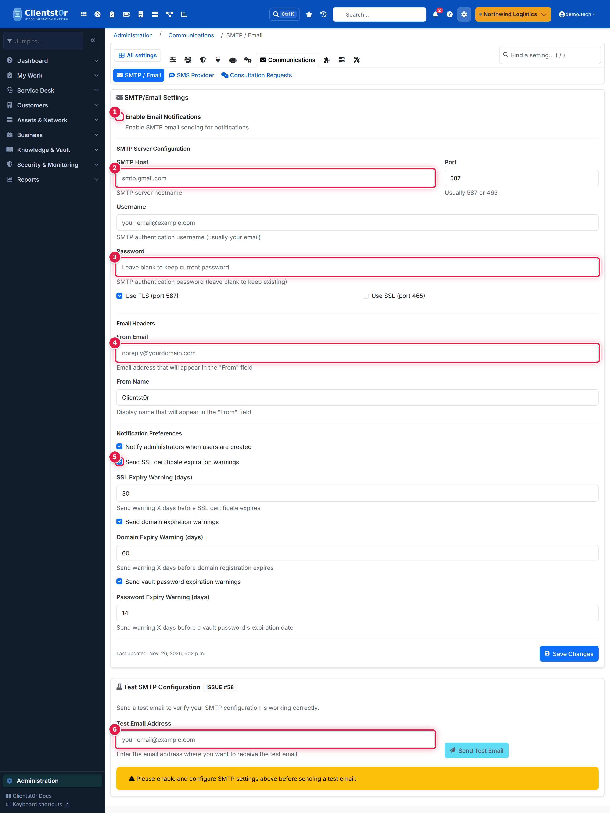
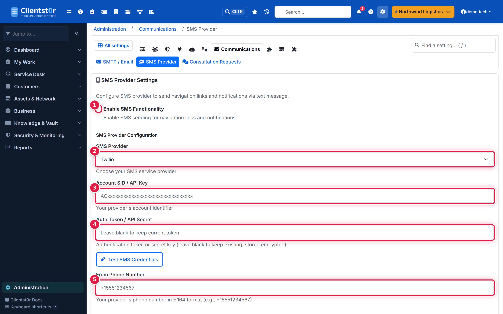
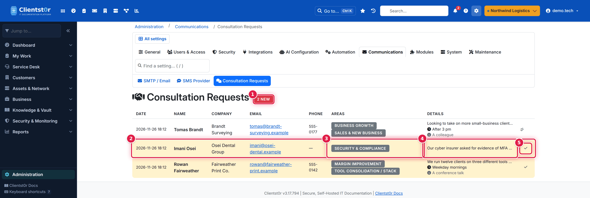

# AI, automation and communications settings

Three groups under **Administration** (the gear at the bottom of the sidebar) set up what Clientst0r does on its
own and how it reaches people: **AI Configuration**, **Automation** and **Communications**. Every page in them is
for **superusers** only, except that *Workflow Templates* and *Workflow Suggestions* are for MSP staff when the
service desk is on. The numbers in each screenshot match the list under it. Every screenshot is a capture of the
application against a demo database; the customers and people in it are invented. No real key, mail host or
phone number was entered to take them, and nothing was sent.

| Group | Pages | What they set |
|---|---|---|
| AI Configuration | AI & LLM, Ticket AI models | Which model providers the optional AI features may call, and with whose key |
| Automation | Task Scheduler, Workflow Templates, Workflow Suggestions | The background jobs, and ticket rule starters |
| Communications | SMTP / Email, SMS Provider, Consultation Requests | Outgoing email and text messages, and the inbox for the public consultation form |

Switching modules on and off (including AI-related modules) is in **Administration → Modules**, which has its own
page.

## AI features are optional and off by default

**OPTIONAL AI.** Clientst0r works the same with all AI off, and AI is off on a new install. Two things must both
be true before any AI feature calls a provider:

1. The **master switch** is on. It is `psa_ai_enabled`, set in **Administration → General → Service Desk**
   (`/core/settings/psa/`), section *AI Assist*. Default: off. Only a superuser can change it.
2. The feature has a **model and a key** it is allowed to use (next two sections). A ticket AI feature also
   needs the customer's **AI policy** to allow it.

<!-- guide-figure: guide-setx-psa-switch -->

1. The AI master switch. Off by default. With it off, every AI feature in Clientst0r refuses to call a provider.
2. Voice / tone: a sentence added to the instructions for suggested replies.
3. Suggestions below this confidence are shown collapsed.
4. Tickets whose subject contains any of these lines are skipped by AI generation.
<!-- /guide-figure -->

- With the master switch off, the AI features refuse: the document assistant, asset AI documentation,
  floor-plan generation, receipt reading (web and mobile) and the ticket AI buttons all answer that AI is turned
  off, and nothing is sent. If the setting cannot be read, AI is treated as off.
- **Voice / tone** is one sentence added to the instructions for suggested replies. **Min confidence** (0.00 to
  1.00, default 0.75) decides when a suggestion is shown collapsed. **Blocked subject keywords** (one per line,
  matched anywhere in the subject, ignoring case) skip AI generation for those tickets.
- Saving the page also saves the ticket close-out and follow-up settings that share it; those are not AI.

### What each AI feature sends to the provider

Nothing is sent until a person clicks the feature (or, for the scheduled jobs, never: see below). What is sent:

| Feature | Where you use it | What is sent |
|---|---|---|
| Suggested reply, suggested actions, triage | A ticket | The client's name, the ticket number, subject and description, the last public comments, and, where the customer's sharing rules allow it, the linked asset's name, type, hostname and serial number and the titles of matching knowledge base articles. **Internal notes and device output are replaced with a placeholder**, never sent. Attachments and vault data are never read. |
| Analyze ticket, Compare models | A ticket | A preview shows exactly what will be sent, to which model, and the cost estimate, before you confirm. It holds the subject, description, public conversation (up to 20 comments) and a summary of the linked asset and its RMM status. |
| AI Troubleshoot | A ticket or a device | The same kind of summary, plus device name, OS, RMM status, alerts and completed read-only diagnostic output, filtered by the customer's sharing rules (below). The session page lists what was sent and what was withheld. It never runs anything. See [AI Troubleshoot](AI_TROUBLESHOOT.md). |
| Explain in plain English | A pricing advisor finding | Only the computed figures of the finding, each labelled verified, estimate or unknown. Customer and contract names are replaced with placeholders. Any amount in the answer that was not in the input is rejected and the plain summary is shown instead. |
| Document assistant: generate, enhance, validate, review an import | Knowledge & Vault | The text you typed or the document you chose (title and body), plus the extra context you entered. |
| Asset AI documentation | An asset | The asset's name, type, tag, serial number, make, model, hostname, IP and MAC address, OS, CPU, RAM, storage, notes and customer name; if an RMM device is linked, its provider, online status, last seen time, site, OS and up to 80 installed software names; and the notes you typed. |
| Floor plan generation | A location | The building name and size, number of employees, departments and the extra requirements you typed. |
| Receipt reading | A vehicle receipt (web) and the mobile receipt scanner | The receipt photograph. |

These do **not** call any provider, even with AI on: *Workflow Suggestions* and *Asset remediation suggestions*
are built by rules from your own ticket and asset data, and the *incident summary* in Security & Monitoring is a
local template unless your own deployment plugs a model into it. They are tagged OPTIONAL AI because the
master switch also gates them.

Each customer's AI policy controls the ticket features above (next sections). Reply and action text is never
posted for you: it appears as a draft that a person sends.

## AI & LLM

**Administration → AI Configuration → AI & LLM** (`/core/settings/ai/`).

<!-- guide-figure: guide-setx-ai -->

1. The active provider for the document, floor-plan, asset and receipt features.
2. The provider key. Stored in the .env file as plain text, not encrypted.
3. Test sends the key you typed to the provider to check it. Do not use it with a key you are not ready to use.
4. Save writes the .env file and reloads the application.
<!-- /guide-figure -->

This page holds the **one install-wide provider and key** that the document assistant, asset AI documentation,
floor-plan generation and receipt reading use. It is separate from *Ticket AI models*, which the ticket features use.

- **Active LLM Provider** (default Anthropic Claude): Anthropic Claude, Moonshot AI (Kimi), MiniMax, MiniMax
  Coding Plan, OpenAI or Ollama (a server you run yourself, default address `http://localhost:11434`). Only
  the section of the chosen provider is shown. Each section has its key, and a model (Claude's list shows
  current and previous model names; an unknown or malformed Claude model name is ignored and the saved one kept).
- **Mapping & Geocoding** (Google Maps) and **Property data** (Regrid, AttomData) keys are also on this page.
  They are not AI, and are used for location features.
- **Key fields are write-only.** The page never shows a saved key: a field with a key says *A key is set*.
  Leave it blank to keep the saved key, type a new key to replace it, or tick *Clear the saved key* to remove
  it.
- **Test** next to a key sends the key you typed, or the saved key when the field is blank, to that provider
  to check it. It is a real request to the provider; leave it alone unless you are ready to use that key.
- **Where the keys are kept.** Saving writes the keys, in plain text, into the `.env` file in the application's
  folder on the server. They are **not encrypted** there (the page does not send them back to the browser).
  Protect the file with normal server permissions and keep it out of backups you share. Keys for the ticket features are stored differently (see *Ticket AI models*).
- **Save Settings** rewrites `.env` and then signals the application to reload (or restarts the service when
  allowed to), so it takes a few seconds. If neither works the page says to refresh. Saving writes every
  field except the keys you left blank, so do not save the form while only looking around.
- A feature that needs a provider with no key says so (for example "LLM provider is not configured"). The *Usage
  Information* table at the bottom shows which features need which key.

## Ticket AI models

**Administration → AI Configuration → Ticket AI models** (`/psa/ai/profiles/`).

<!-- guide-figure: guide-setx-profiles -->

1. Gateway status: whether provider keys are isolated from the web application.
2. Installation-wide monthly cap and the read-only command allowlist for AI Troubleshoot.
3. Model profiles: provider, model, whether a key is stored (write-only), owner and status.
4. Add or edit a profile. The key field is write-only.
5. Each customer's AI policy. A customer without one allows no ticket AI.
<!-- /guide-figure -->

1. **Gateway.** Provider keys here are sealed with the *AI gateway's* public key, so the web application can
   store a key you type but cannot read it back. Run `manage.py ai_gateway_keygen` once to create the key pair
   (until then the page says keys cannot be stored). Green means **isolated**: with `AI_GATEWAY_MODE=worker`,
   only the separate `ai_gateway_worker` service opens keys, and it runs without the vault master key. Amber
   means the web process opens keys itself (`AI_GATEWAY_MODE=in_process`, the default): it works, but it is
   not isolated.
2. **Installation-wide limits.** A monthly spend cap in cents across all customers (blank: no cap; when it is
   reached AI requests are refused) and the read-only command allowlist for AI Troubleshoot.
3. **Model profiles.** A profile is one provider (Claude, OpenAI or Ollama) and model, who owns the key
   (*Customer company*, *MSP*, or *Technician*), and whether it is enabled (new profiles are off). The Key
   column only says whether a key is stored. *Economical* marks the default model for Analyze ticket when a policy names
   none. An Ollama profile's address is used only after a protected change approves it (**Propose address**,
   which a second administrator confirms).
4. **New profile / Edit.** The API key field is write-only: leave it blank to keep the stored key, or tick
   *Remove the stored key*. Saving is written to the audit log (without the key).
5. **Customer AI policies.** **A customer with no policy allows no ticket AI at all.** Edit opens that
   customer's policy: whether analysis and comparison are on, which profiles it may use and the default one,
   whether technicians may use their own keys, a local-only rule (both the processor and the model must be
   on-premises), a daily and monthly spend limit, how long AI history is kept (default 365 days), AI
   Troubleshoot on or off with its daily run limits, and an **exclude this customer from every AI feature** switch
   that overrides the rest.

The **information-sharing rules** in each policy decide what may leave for a model: ticket text (default
shared), device data (shared), KB article titles (shared), network identifiers (hostnames, IP and MAC addresses;
**not** shared, replaced with placeholders) and contact names (**not** shared, replaced with `[contact]`).
Passwords, keys and tokens that appear in text are redacted whatever the rules say.

Technicians can add their own cloud profile under **My AI keys** (`/psa/ai/my-keys/`); it is usable only by them
and only on customers whose policy allows it.

## How to turn all AI off

1. **Administration → General → Service Desk:** turn off *Enable AI Suggested Replies + Actions* and save. This stops every
   feature in the table above at once, including those that use the install-wide key.
2. For belt and braces, clear the keys: empty the key fields on *AI & LLM* and save (this rewrites `.env`),
   and on *Ticket AI models* tick *Remove the stored key* on each profile or disable the profiles.
3. To keep AI off for one customer only, give that customer's policy **Exclude this customer from every AI
   feature**, or leave the customer without a policy.

The scheduled jobs *PSA Workflow Suggestions (optional AI)*, *Asset Remediation Suggestions (optional AI)* and
*Ticket AI Analysis Job Recovery (optional AI)* do nothing while the master switch is off.

## Task Scheduler

**Administration → Automation → Task Scheduler** (`/core/settings/scheduler/`).

<!-- guide-figure: guide-setx-scheduler -->

1. A task and what it does. A red line under it is the last error.
2. Interval in minutes, 1 to 10080.
3. Enabled: off means the scheduler skips the task.
4. When the last run started, and when the next is due.
5. Status of the last run: Success, Failed, Running or Pending.
<!-- /guide-figure -->

1. The task: its name, a line on what it does, and in red the last error if the last run failed.
2. **Interval (minutes)**, from 1 to 10080 (one week). 60 is hourly, 1440 daily, 10080 weekly.
3. **Enabled.** A disabled task is skipped.
4. When the last run started and when the next is due.
5. The result of the last run (Success, Failed, Running or Pending) and how many times it has run.

- **How tasks run.** A systemd timer starts `manage.py run_scheduler` every minute (the Docker install runs the
  same loop). Each run starts the tasks that are due, one at a time, and records the result. A task that
  fails shows **Failed** and its message; one that has nothing to do reports Success. A run that was
  interrupted (for example by a reboot) is picked up again after six hours.
- **To disable a task**, switch it off and press **Save Changes**. **To change a schedule**, edit the interval
  and save. A shorter interval takes effect from now rather than after the old interval runs out. An interval
  that is not a whole number from 1 to 10080 is ignored for that task, and the page says which.
- **There is no "Run now" button.** To run what is due right away, run
  `venv/bin/python manage.py run_scheduler` on the server. It runs only tasks that are due and enabled.
  To make one task due, shorten its interval and save.
- The box under the table reports whether any task has started in the last 15 minutes. If not, it says the
  scheduler may not be running and shows the commands to check the timer; the web page cannot start it.
- A task that ships with an update appears here and first runs one interval later, so you can switch it
  off before it does anything. Many tasks do nothing until their feature is configured, so leaving them on is cheap.

### The scheduled jobs and their defaults

Intervals are in minutes (1440 is daily). **Off** marks the tasks that start disabled.

| Group | Task | Default | What it does |
|---|---|---|---|
| Monitoring | Website Monitoring Checks | 5 | Checks website monitors and their SSL certificates |
| | WAN Connection Checks | 1 | Pings monitored WAN connections that are due; alerts on down and recovery |
| | Prune Website and WAN Check History | 1440 | Trims check history to the retention window |
| | Security Alert Polling | 5 | Polls security vendor connections for new alerts |
| | Backup Monitoring Poll + Alerts | 15 | Polls backup providers and evaluates alert rules |
| | Shared Event Layer Ingestion | 1 | Copies alerts into the shared event layer; applies event retention |
| | Security Incident SLA Breach Check | 15 | Records SLA breaches on open incidents |
| | Security Exposure Score Recompute | 60 | Recomputes each customer's exposure score |
| Expiry and warnings | SSL Certificate Expiry Check | 1440 | Warns about expiring certificates (by email, needs SMTP) |
| | Domain Expiry Check | 1440 | Warns about expiring domains |
| | Vault Password Expiry Notifications | 1440 | Emails about passwords nearing expiry |
| | Asset Age / Firmware Update / Warranty Expiry Checks | 1440 | Each does its work only when its feature is enabled |
| | Asset Warranty Expiry Emails | 1440 | Emails customer owners about warranties ending soon |
| | Software License Renewal and Utilization Alerts | 1440 | Emails about renewals within 30, 60 and 90 days |
| | KB Review Reminders | 10080 | Emails article owners a digest of articles overdue for review |
| | KB Dead Link Check | 1440 | Finds dead links in published articles |
| | Compliance Recertification Reminders | 1440 | Emails reminders that are due |
| Security | Password Breach Scanning | 1440 | Checks stored passwords against a breach database |
| | Python Dependency Vulnerability Scan | 1440 | Scans installed Python packages for known vulnerabilities |
| | Automated Security Scan | 1440 (**Off**) | OS packages and Snyk scan; alerts superusers (opt in) |
| | Cleanup Stuck Security Scans | 60 | Marks scans that ran over 2 hours as timed out |
| | System Warnings Digest Email | 1440 (**Off**) | Emails superusers a digest of unresolved warnings (opt in, needs SMTP) |
| | Audit Log Seal and Tamper Check | 5 | Seals new audit entries into the tamper-evident chain; verifies it daily |
| | Security Alert Weekly Digest | 10080 | Emails opted-in customer contacts their unresolved alerts |
| | API Access Control Maintenance | 1 | Undoes unconfirmed API access changes; prunes old records |
| | LDAP Group Mapping Sync | 15 | Re-checks LDAP group membership for users who have not signed in again |
| Service desk and billing | PSA Email-to-Ticket Polling | 5 | Turns inbound email into tickets and replies |
| | PSA Outbound Email Retry Worker | 5 | Retries Microsoft Graph emails left queued |
| | PSA SLA Workflow Tick | 5 | Fires SLA-threshold rules on open tickets |
| | PSA Recurring Tickets | 15 | Creates tickets from recurring schedules |
| | PSA Ticket Reminders | 1 | Marks due reminders as fired so they show in My Work |
| | PSA Idle Approval Escalation | 60 | Emails superusers about approvals pending too long |
| | Erase Expired Secure Ticket Replies | 60 | Erases secure reply text past retention |
| | PSA Recurring Invoices | 1440 | Drafts invoices for the current period only; never back-bills |
| | PSA Contract Lifecycle / Auto-Renewal | 1440 | Resumes, cancels, expires and renews contracts |
| | PSA Late Fees | 1440 (**Off**) | Applies late fees; off because the first run charges every invoice already late |
| | PSA Recurring Purchase Requisitions | 1440 | Drafts requisitions from recurring templates |
| | Stock Minimum Scan | 1440 | Logs inventory at or below its minimum |
| | Invoice Autopay | 60 | Charges due invoices for customers who authorized autopay |
| | Contract Jobs / Reminders and Expirations | 1 / 60 | Sends contract emails, finalizes signed contracts, expires links |
| | Agreement Signature Reminders | 60 | Emails outstanding signers (respects opt-out) |
| | Pulse Check Scheduled Sends | 60 | Sends repeating pulse checks that are due |
| | Customer Health Score Snapshots; Pricing Advisor | 1440 | Nightly scores and findings (the advisor never changes prices) |
| | Scheduled Reports | 15 | Generates and emails reports that are due |
| | PSA Synchronization; RMM Synchronization; Accounting Sync | 60 (**Off**) | Integration syncs; off because a timer or your choice runs them |
| | Software License Sync; Network Device Asset Sync; Distributor Health Probe | 1440 / 30 / 60 | Pull from connected systems; do nothing without connections |
| Assets and field | Network Device Config Backup | 60 | Collects configs that are due (each device has its own cadence) |
| | Asset Configuration Baselines | 10080 | Snapshots a baseline for each monitored asset |
| | Field Visit Auto-Documentation; Prune Technician Location History | 1 / 1440 | Geofence time entries; delete old location pings |
| | Vehicle Service Alerts | 60 | Service alerts for vehicles coming due |
| System | System Update Check | 15 on a new install (60 where it was created by an older release) | Checks for new Clientst0r versions |
| | GeoIP Country Database Refresh | 1440 | Refreshes the database when over 25 days old |
| | Pre-upgrade Backup Cleanup | 1440 | Applies the backup retention from System Updates |
| | Off-host Backup and Restore Verification | 15 | Does nothing until Off-host Backups is set up |
| | Snyk CLI Update Check | 1440 | Emails superusers about a newer Snyk CLI |
| | Purge Office Quarantine; Managed ONLYOFFICE Operations; Microsoft 365 Edit Sessions | 60 / 1 / 60 | Office document upkeep |
| | Connected Applications: Event Delivery, Health Monitor, Key Rotation | 1 / 1 / 60 | Do nothing unless Connected Applications is on |
| | IT Glue / Hudu Migration Rehearsal Worker | 1 | Does nothing when nothing is queued |
| Optional AI | PSA Workflow Suggestions; Asset Remediation Suggestions | 1440 | Rule based; only with the master switch on |
| | Ticket AI Analysis Job Recovery | 1 | Recovers unfinished analysis jobs |

The description under *System Update Check* may still say "every hour"; the interval column is what runs.

## Workflow Templates and Suggestions

**Administration → Automation → Workflow Templates** (`/psa/rules/templates/`) lists saved ticket rules you can
copy onto a customer. **Workflow Suggestions** (`/psa/rules/suggestions/`, OPTIONAL AI) lists rules proposed from
repeating ticket patterns; it appears only with the master switch on. Both are for MSP staff with the service
desk on. They are the same pages as the tabs under Service Desk → Workflows, and are explained in
[Workflows](WORKFLOWS.md) and [Ticket routing](TICKET_ROUTING.md). Suggestions come from rules over the last
30 days of your tickets: no ticket text leaves the server for them.

## SMTP / Email

**Administration → Communications → SMTP / Email** (`/core/settings/smtp/`).

<!-- guide-figure: guide-setx-smtp -->

1. Turn outgoing email on. Everything below is ignored while it is off.
2. The mail server name and port.
3. The password is write-only: leave it blank to keep the saved one.
4. The From address and name on every message Clientst0r sends.
5. Which expiry warnings to email and how many days ahead.
6. Send Test Email: sends one real message to this address.
<!-- /guide-figure -->

1. **Enable Email Notifications** (default off). While off nothing is emailed by the scheduled tasks or alerts.
2. **SMTP Host** and **Port** (default 587), and **Username**. Use TLS (default on, port 587) or SSL (default off, port
   465). Choose one.
3. **Password.** Stored encrypted with the application's master key (`APP_MASTER_KEY`). It is write-only: leave
   the field blank to keep the saved one. If the master key is missing or invalid, saving a password fails with
   a message and nothing is changed.
4. **From Email** and **From Name** (default "Clientst0r") appear on the messages.
5. **Notification Preferences:** tell administrators when users are created; warn about SSL certificates (30
   days ahead by default), domains (60 days) and vault passwords (14 days). Each warning has its own
   on/off switch and days, 1 to 365.
6. **Send Test Email.** Sends one real message to the address you type, using the saved settings (so save
   first). It needs SMTP enabled (the button is disabled until then) and gives up after 10 seconds. The page
   reports the exact error on failure, such as a refused login. The message lists the host, port, and TLS or
   SSL, but not the password.

Mail is also used for: scheduled warnings and digests (above), ticket replies and notifications, contract and
agreement signing emails, scheduled reports, approval escalation, scheduled task alerts and Connected Applications
alerts. If SMTP is off or has no host, those mails are skipped, not queued. The readiness check shows whether
email is set up.

## SMS Provider

**Administration → Communications → SMS Provider** (`/core/settings/sms/`).

<!-- guide-figure: guide-setx-sms -->

1. Turn SMS on.
2. Twilio, Plivo, Vonage or Telnyx.
3. Account SID or API key.
4. Auth token or secret: write-only, leave blank to keep the saved one.
5. The sending number in international format, such as +15551234567.
<!-- /guide-figure -->

1. **Enable SMS Functionality** (default off).
2. **SMS Provider:** Twilio (default), Plivo, Vonage or Telnyx. Sinch and AWS SNS were listed in older
   releases but the application cannot send through them; they are no longer offered and are refused if sent.
   If the saved provider is one of them the page says so.
3. **Account SID / API Key** and 4. **Auth Token / API Secret** (stored encrypted; leave blank to keep).
   Under the token, **Test SMS Credentials** checks the credentials with Twilio or Vonage (a request to their
   API, no message is sent). For Plivo and Telnyx it says to test by sending a message.
5. **From Phone Number** in international format, such as `+15551234567`.

SMS is used for: location navigation links sent to a technician or client, a technician's ticket
assignment text (each person opts in on their own profile and needs a phone number), and the alerts about
scheduled tasks. A recipient number must start with `+`. There is no test-send button; send a navigation
link from a location to try it.

## Consultation Requests

**Administration → Communications → Consultation Requests** (`/core/free-consult/requests/`).

<!-- guide-figure: guide-setx-consult -->

1. How many requests are unread.
2. Unread requests are highlighted.
3. The areas of interest the visitor ticked.
4. Details, best time and how they heard of you.
5. Mark read.
<!-- /guide-figure -->

The **About** page links to a public form (`/core/free-consult/`, no sign-in) where a visitor gives a name and
email (required), company, phone, the areas they want help with, details, best time and how they heard of you. Each
submission is saved here.

1. How many are unread.
2. Unread requests are highlighted.
3. The areas ticked: sales, growth, technical challenges, margins, efficiency, tools, security and
   compliance, and others listed on the form.
4. The details, best time and source.
5. **Mark read.**

- Submissions are **not emailed to anyone**: check this page. There is no way to delete or reply from it; use the
  address in the row.
- The form is public and has no spam check of its own, so expect the occasional junk entry.
- The page lists every request, newest first, with no paging.
