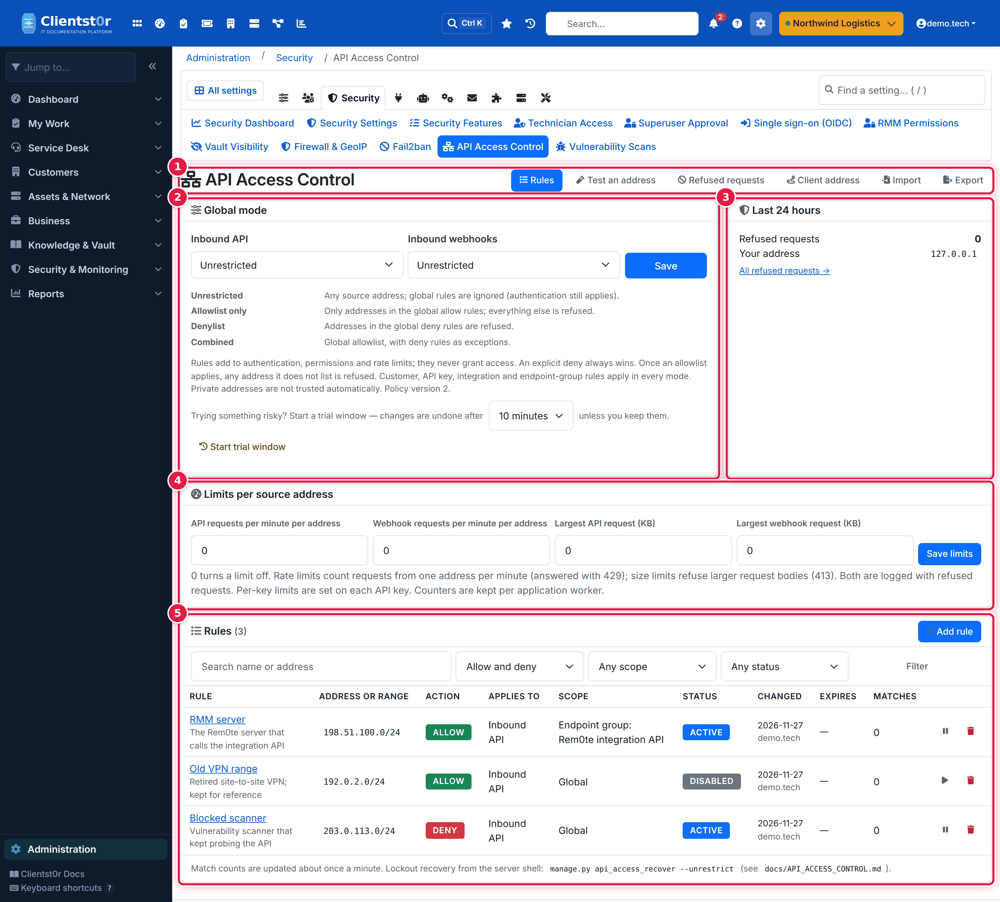

# API access control

**Administration → Security → API Access Control** (`/settings/security/api-access/`, superusers).
Network rules for the inbound API and inbound webhooks — roadmap Phase 81.

<!-- guide-figure: guide-x3-api-access -->


1. Rules, Test an address, Refused requests, Client address, Import and Export.
2. Global mode, one for the inbound API and one for inbound webhooks. New installs start Unrestricted.
3. Requests refused in the last 24 hours and the address this server sees for you.
4. Per-address request and body-size limits; 0 turns a limit off.
5. The rules: address or range, allow or deny, what it applies to, scope, status, expiry and match count.
<!-- /guide-figure -->

Rules are an extra check. They never grant access: a request that passes them still needs a valid credential,
the right permissions, its rate limits and customer isolation. Web pages (the app you sign in to) are not
covered here; the site-wide **Firewall & GeoIP** page covers them.

New and upgraded installs start **Unrestricted** with no rules, so nothing changes until an administrator
adds rules.

## What is covered

Every request whose path belongs to one of these endpoint groups:

| Endpoint group | Paths | Surface | Integration |
|---|---|---|---|
| REST API | `/api/` | API | — |
| GraphQL API | `/api/v2/graphql/` | API | — |
| Mobile app API | `/api/mobile/v1/` | API | — |
| Rem0te integration API | `/api/integration/v1/` | API | Rem0te |
| Agit8or Connect API | `/connect/v1/`, `/.well-known/agit8or-connect` | Connect (own policy, see below) | Agit8or Connect |
| Security vendor webhooks | `/security/webhook/` | Webhook | Security vendor connections |
| SIEM webhooks | `/security/siem/webhook/` | Webhook | SIEM endpoints |
| Distributor webhooks | `/integrations/distributors/webhooks/` | Webhook | Distributors |
| Payment provider webhooks | `/payments/webhooks/stripe/`, `/payments/webhooks/gocardless/` | Webhook | Stripe, GoCardless |
| Ticket partner webhooks | `/psa/partners/webhook/` | Webhook | Ticket partners |
| Emergency restart webhook | `/core/emergency-restart/` | Webhook | — |

New API or webhook routes are added to `api_access/groups.py`; a test fails if a group has no route.

### Agit8or Connect has its own source policy

The Agit8or Connect endpoints are classified as their own surface (`connect`). The REST API mode, limits and
rules above **never** apply to them, whatever the mode (an API rule that targets the Connect endpoint group or
integration is inert, and the rule form no longer offers them). Instead Connect enforces a **default-deny**
allowlist of its own, managed under **Administration → Integrations → Connected Applications → Network**
(`connect/source_policy.py`, rules in `connect.SourceRule`):

- two layers, both required: an installation-wide list, and a list per connection; a deny in either wins; an
  empty list refuses everything;
- evaluated in the same middleware, before any authentication, by the same engine (`api_access.policy.evaluate`,
  allowlist-with-deny-exceptions), with the client address read through the same trusted-proxy resolver;
- no `0.0.0.0/0` or `::/0`, no IPv4 range wider than /16 or IPv6 range wider than /32, private / loopback /
  link-local sources only as single addresses an administrator flagged; no exemption for private addresses
  (the site firewall's LAN exemption runs later and does not apply);
- changes are staged with an impact preview and applied atomically with a policy version (widening needs a
  second administrator); the rollback window on this page never touches them, and a Connect rollback only
  narrows;
- refusals are logged in **Refused requests** with the surface *Agit8or Connect*.

Recovery from the server: `manage.py connect_source_rules list|add|remove|enforce`.

## Rules

A rule is an IPv4 or IPv6 address or CIDR range, **allow** or **deny**, for the API, webhooks or both, with
one scope:

- **Global** — every covered request on that surface, subject to the global mode.
- **Customer** — API keys that belong to that customer.
- **API key** — one key ("this key may only be used from these networks").
- **Integration** — one integration's endpoints (for example Rem0te or SIEM endpoints).
- **Endpoint group** — one group from the table above.

Rules can expire (temporary access) and can be disabled without deleting them.

### Global mode (one per surface)

| Mode | Global allow rules | Global deny rules |
|---|---|---|
| Unrestricted | ignored | ignored |
| Allowlist only | required | ignored |
| Denylist | ignored | refused |
| Combined | required | refused |

Customer, API key, integration and endpoint-group rules apply in every mode.

### Precedence

1. A matching **deny** rule at any scope refuses the request. An explicit deny always beats an allow.
2. Each scope level (global, customer, integration, endpoint group, API key) that has at least one allow rule
   for the request is an **allowlist**: the address must match one of that level's rules. Default deny: once
   an allowlist applies, anything it does not list is refused.
3. An allowlist mode with no global allow rules refuses everything on that surface.
4. Then normal authentication, permissions and rate limits run.

Private addresses (`10.x`, `172.16–31.x`, `192.168.x`, `fd00::/8`, loopback) get no special treatment.
IPv4-mapped IPv6 addresses (`::ffff:192.0.2.1`) are matched as the IPv4 address.

**Fail closed:** if a request's address cannot be read, or the policy cannot be evaluated, the request is
refused whenever any restriction applies to it. With no restrictions configured, requests pass.

Global, integration and endpoint-group rules are checked before any view runs. Customer and API-key rules
are checked when the key is authenticated; a refused key is not marked as used.

## Client address and reverse proxies

The address used for rules comes from `core/client_ip.py`:

- Only a connecting peer listed in `TRUSTED_PROXY_CIDRS` may supply `X-Forwarded-For`. From anyone else the
  header is ignored and the connecting address is used.
- The chain is read from the nearest hop backwards; the first address that is not a trusted proxy is the
  client. An address a client puts at the front of the header is therefore ignored.
- `X-Real-IP` is never used.
- A request over gunicorn's unix socket (the local nginx) counts as coming from a trusted local proxy.
- A malformed `X-Forwarded-For` from a trusted proxy makes the address unreadable (refused under
  restrictions), never a pass.

**API Access Control → Client address** shows how your own request was read.

Add trusted proxies on **API Access Control → Client address** (superusers). They are used on top of
`TRUSTED_PROXY_CIDRS` from `.env`; ranges wider than IPv4 /12 or IPv6 /29 are refused, a change that would
alter how your own address is read asks for confirmation, and every change is audited. Other application
workers use a change within 10 seconds.

Or set them in `.env` (comma-separated), then restart the app:

```
TRUSTED_PROXY_CIDRS=127.0.0.1/32,::1/128
```

List only the proxies you run. Never trust a whole private range unless every host in it is your proxy.

### Nginx

```nginx
proxy_set_header X-Forwarded-For $proxy_add_x_forwarded_for;
```

With nginx on the same host over the unix socket, nothing else is needed. With nginx on another host, add its
address to `TRUSTED_PROXY_CIDRS`.

### HAProxy

```
option forwardfor
```

Add the HAProxy addresses to `TRUSTED_PROXY_CIDRS`.

### Cloudflare (or another CDN) in front of nginx

The CDN's edge addresses become hops in the chain. Either add the CDN's published ranges to
`TRUSTED_PROXY_CIDRS` (and keep them current), or have nginx restore the client address with its `real_ip`
module limited to those ranges and pass `$remote_addr` on. Without one of these, every request appears to
come from the CDN, and an allowlist of your own addresses refuses everything.

## Before a change is saved

Saving a rule, enabling one, changing a mode or importing rules shows the impact first:

- whether **your address** could still call the REST API;
- every **API key used in the last 90 days** that would be refused from the address it last used;
- a warning when a webhook mode becomes restrictive (webhook senders' addresses are not recorded in advance —
  check each vendor's published ranges).

High-impact changes need an explicit confirmation, and offer an **automatic undo** (5 to 60 minutes, 10 by
default): until you click **Keep changes** at the top of the page, every API access change made in that
window — modes, limits and rules, including rules added or deleted — is undone when it ends, on the next API
request or by the scheduler (every minute), whichever comes first. **Undo now** reverts at once, and **Start
trial window** opens a window before a change. A second change inside the window keeps the original restore
point. Trusted proxies are not included. Every change bumps the **policy version**, is applied on
the next request in every worker, and is written to the audit log.

**Test an address** evaluates any address against the saved policy for any endpoint group and API key, and
lists the rules that applied. The same page answers "would a GraphQL call from this address get through?"
by choosing the *GraphQL API* group.

## Refused requests

Each refusal records the time, source address, endpoint group and integration, method and path (no query
string), API key prefix and customer when known, reason, matched rule and policy version. Repeats from one
source for the same reason within a minute share a row with a count, so a flood writes a handful of rows.
Request bodies, headers and key secrets are never stored. A source refused 10, 100 and 1000 times in an hour
is also reported in the server log. At 100 in an hour, the administrators (superusers with an e-mail address)
get one e-mail per address per day, and any source refused 100+ times in 24 hours appears in the system
warnings and the daily digest. Records older than the retention setting (30 days by default) are deleted by
the **API Access Control Maintenance** scheduled task.

## Import and export

**Export** downloads every rule as JSON. **Import** validates the whole file first (at most 1000 rules,
512 KB) and adds nothing if any rule is invalid; customer rules are matched by customer name and API-key rules
by key prefix. Imported rules are added; existing rules are not changed.

## Lockout recovery

There is no HTTP bypass. Recovery needs a shell on the server as the application user:

```bash
cd /home/administrator   # the install directory
venv/bin/python manage.py api_access_recover --status
venv/bin/python manage.py api_access_recover --unrestrict              # both surfaces
venv/bin/python manage.py api_access_recover --unrestrict --surface webhook
venv/bin/python manage.py api_access_recover --disable-rule 12
venv/bin/python manage.py api_access_recover --disable-all-rules
venv/bin/python manage.py api_access_recover --disable-proxies          # proxies added in Settings
```

If a rollback window is open, the change is also undone on its own when the window ends.

Each change is audited and takes effect on the next request. Disabled rules stay listed and can be
re-enabled from the settings page.

The settings pages themselves are web pages, so API rules never lock an administrator out of them.

## API keys

Each key (the API Keys page, `/api/keys/`, under **Administration → Users & Access → Access Management**; it lists the current customer's keys) is sent as `Authorization: Bearer cst_live_…`. Keys created
before the prefix change start with `itdocs_live_` and keep working unchanged; a key is matched by a hash of
the whole key, never by its prefix, so rules and rotation treat both alike. Each key can carry:

- **Expiry.** An expired key is refused with `401 API key expired` and is not marked as used. Keys made
  before v3.17.714 never expire until you set a date.
- **Allowed sources.** One address or CIDR range per line. These become API-key rules (allow, API surface)
  and appear in the rules table here; clearing the list removes them. Narrowing the sources of a key that was
  last used from an address outside the new list asks for confirmation first.
- **Rate limit.** Requests per minute for the key, on top of the standard limits; over it, `429`.

**Rotation.** The key's owner (or a superuser) can rotate a key: a new key is issued with the same name,
owner, level, scope, expiry, rate limit and network rules, and the old key keeps working for the chosen grace
period (immediately stopped, 1 hour, 24 hours, 3 days or 7 days) — never longer than its own expiry. The new
secret is shown once. Only the owner rotates, because the new secret acts as the owner.

Read-only versus write-capable keys are the key levels (Read-Only, Editor, Admin, Owner), enforced since
v3.17.618.

## Limits per source address

On the API Access Control page, for the API and for webhooks separately:

- **Requests per minute per address** — over the limit, `429` with `Retry-After: 60`.
- **Largest request body (KB)** — a larger declared body is refused with `413` before the view reads it.

`0` turns a limit off (the default). Network rules are checked first; limits apply to requests the rules
allow. Refusals are logged with the other refused requests. Counters live in the application cache, so with
the default per-process cache each worker counts on its own.

## Webhook signatures, timestamps and replays

The security vendor, SIEM, distributor and ticket-partner receivers share these checks
(`api_access/webhook_guard.py`):

- **Signature.** Vendor and SIEM receivers take `X-Cst0r-Signature: <hex>` (or `sha256=<hex>`), an
  HMAC-SHA256 with the receiver's secret. New vendor connections and SIEM endpoints require it; existing ones
  keep their setting. Distributors use their own signature header and always require it.
- **Timestamp (optional).** Send `X-Cst0r-Timestamp: <unix seconds>` and sign `"<timestamp>." + body`
  instead of the body. Requests more than 5 minutes from the server's clock are refused (401).
- **Replays.** A delivery identical to one already accepted is answered `200 {"ok": true, "duplicate": true}`
  and not processed again — for 11 minutes with a signed timestamp, 24 hours without. If processing fails,
  the delivery is not remembered, so the sender's retry goes through.
- **Body size.** Vendor and SIEM 2 MB, distributors 1 MB, ticket partners 128 KB (413 above). The global
  webhook body limit on this page applies as well.

Ticket partners on v3.17.716 and later also send `X-CST0R-Signature-V2`, an HMAC over
`"<timestamp>.<request path>.<body>"`, which binds the post to one share. Once a partner has sent one, posts
from it without that signature are refused; clear *Partner signs v2 since* on the partner organization (admin)
if the partner returns to an older version.

### Emergency restart

`POST /core/emergency-restart/` (enabled only when `EMERGENCY_RESTART_SECRET` is set). Prefer the signed form,
which never sends the secret and works once, within five minutes:

```bash
ts=$(date +%s); path=/core/emergency-restart/
sig=$(printf '%s.%s' "$ts" "$path" | openssl dgst -sha256 -hmac "$EMERGENCY_RESTART_SECRET" | cut -d' ' -f2)
curl -X POST "https://your-host$path" -H "X-Emergency-Timestamp: $ts" -H "X-Emergency-Signature: $sig"
```

Set `EMERGENCY_RESTART_REQUIRE_SIGNED=true` to refuse the plain `X-Emergency-Secret` form.

Example sender (shell):

```bash
ts=$(date +%s); body='{"id":"evt-1","title":"Test alert","severity":"low"}'
sig=$(printf '%s.%s' "$ts" "$body" | openssl dgst -sha256 -hmac "$SECRET" | cut -d' ' -f2)
curl -X POST "$URL" -H 'Content-Type: application/json' \
     -H "X-Cst0r-Timestamp: $ts" -H "X-Cst0r-Signature: $sig" --data "$body"
```

## Mutual TLS (client certificates)

A key can require a client certificate. TLS ends at the reverse proxy, which verifies the certificate against
your CA and passes it on; the app reads these headers only from a trusted proxy and compares the certificate's
SHA-256 fingerprint with the one pinned on the key. A key with no pin is unaffected.

Nginx (in the `server` block that serves the API):

```nginx
ssl_client_certificate /etc/nginx/client-ca.pem;   # the CA that issues your integration certificates
ssl_verify_client optional;                        # web users keep signing in without a certificate
proxy_set_header X-SSL-Client-Verify $ssl_client_verify;
proxy_set_header X-SSL-Client-Cert   $ssl_client_escaped_cert;
```

`proxy_set_header` replaces any header of the same name a client sends. Fingerprint a certificate with:

```bash
openssl x509 -in client.pem -noout -fingerprint -sha256
```

Paste the result (colons are fine) into *Required client certificate* on the key. **Client address** on this
page shows the certificate your own connection presents.

## Not included

- **Concurrency limits.** The server runs a fixed number of single-request workers (four in the default install) with a
  per-process cache, so it never has more requests in flight than it has workers and a per-key count could not be shared between workers. Per-key and
  per-address rate limits cover abuse; revisit with a shared cache.
- **Payment webhooks** keep their own verification (signed timestamps for Stripe) and de-duplicate by provider
  event id permanently, so a replay is never processed twice.
- Refusals are not yet sent to the shared event layer (Events); they are listed under **Refused requests** only.
