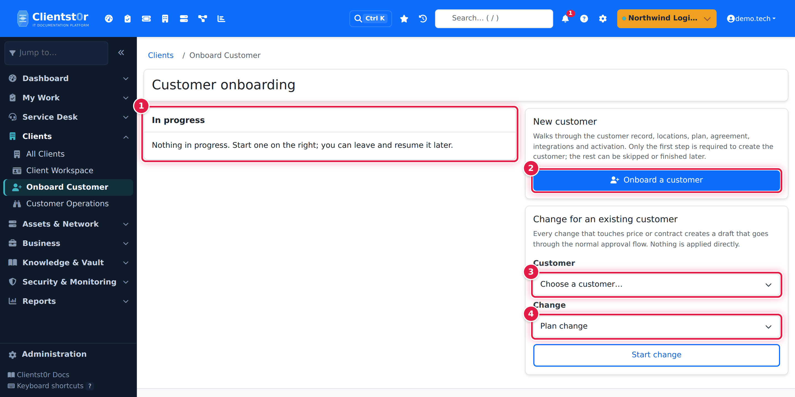
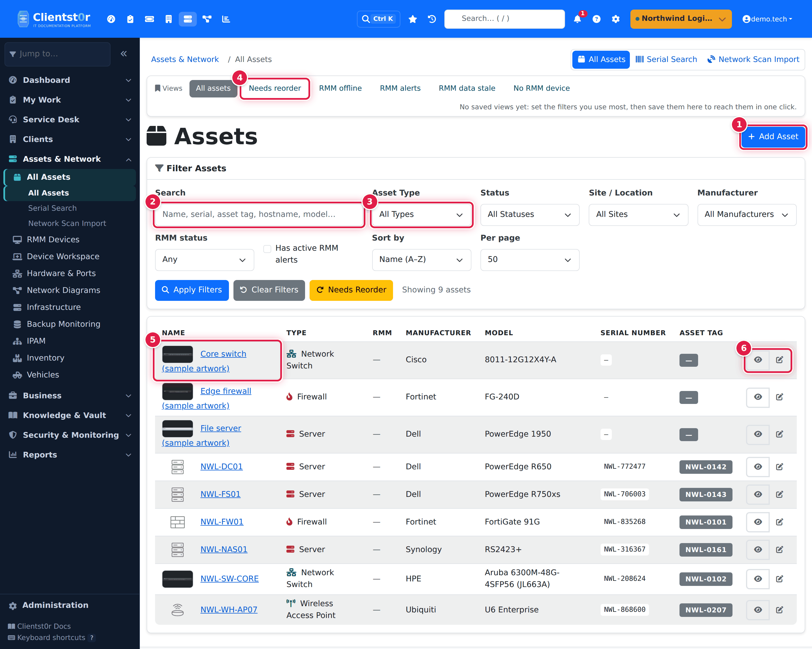
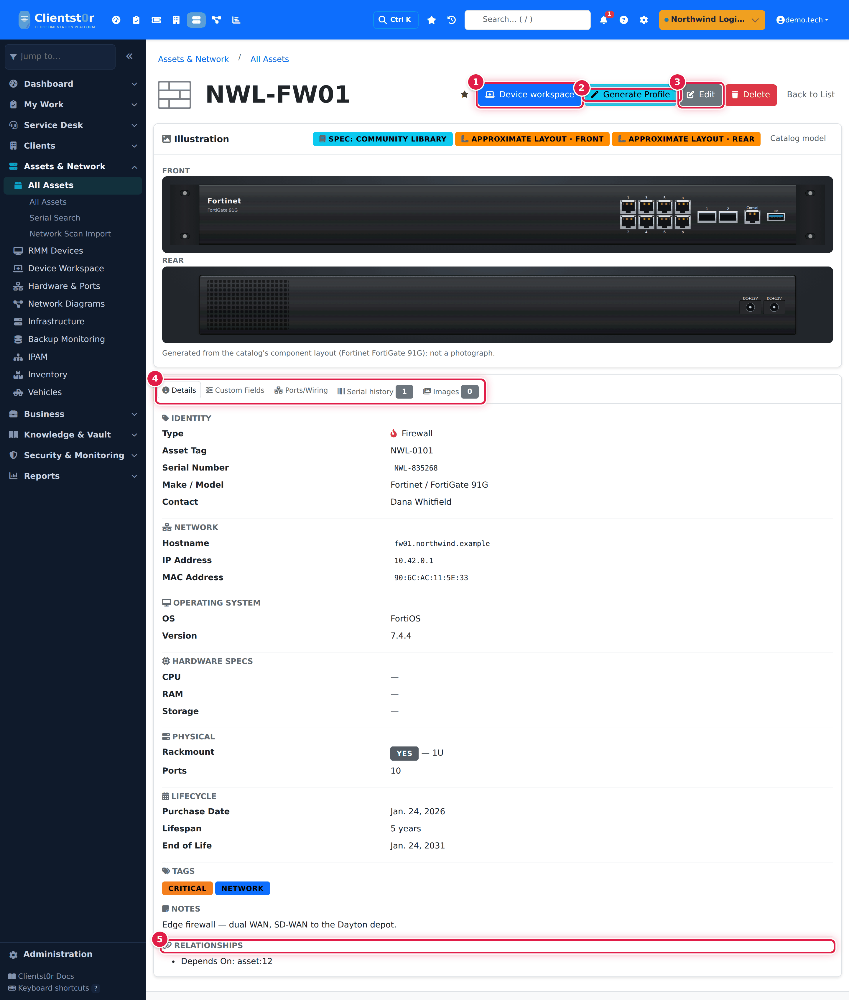
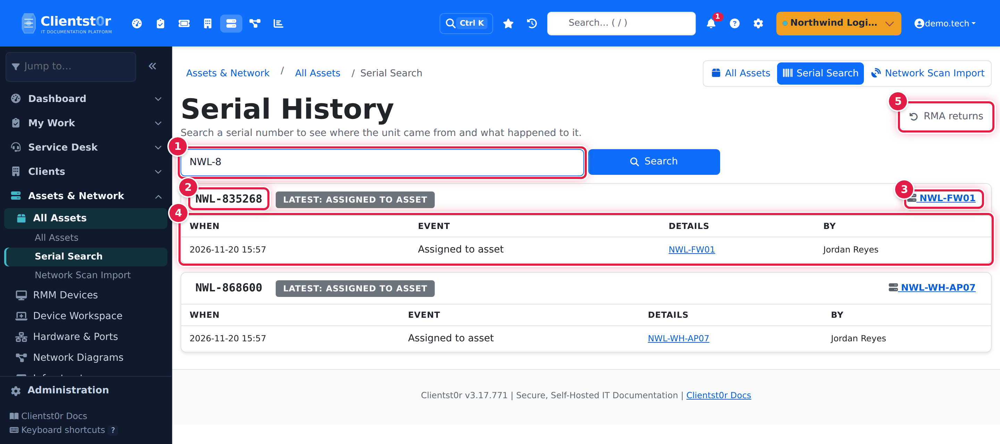
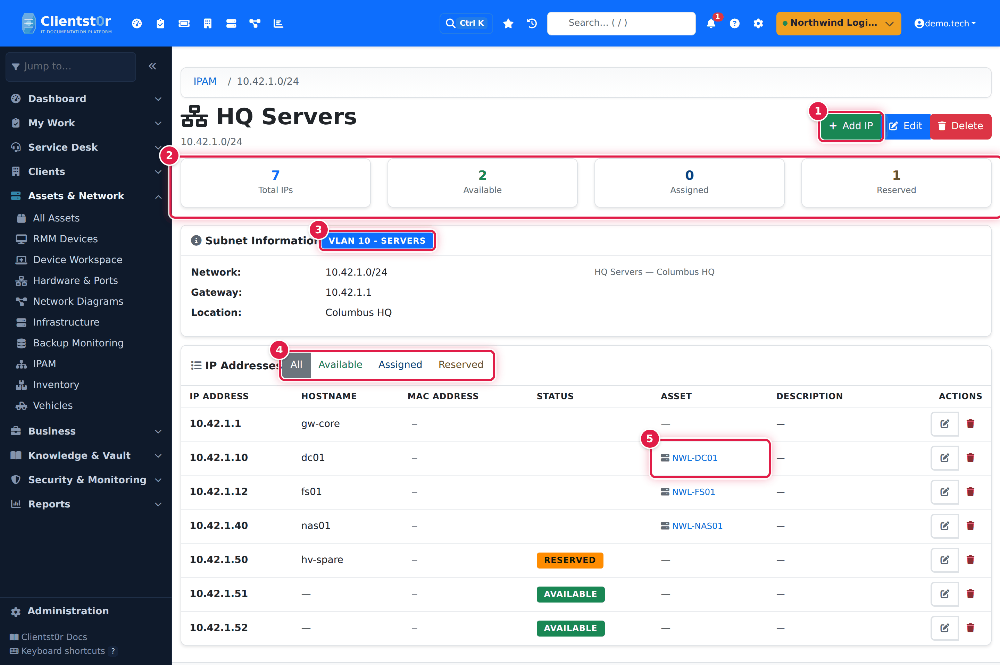
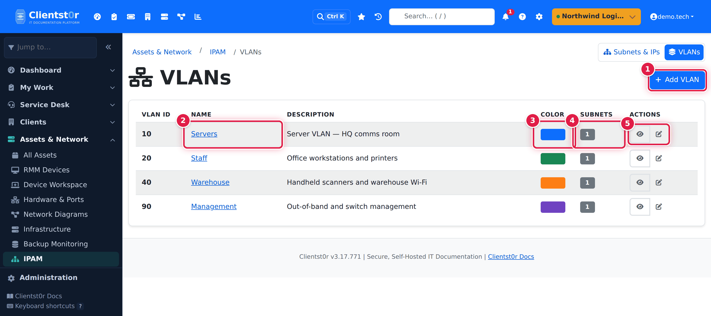

# Customers, assets and IP addresses

How technicians bring a new customer on board, keep the customer's asset list, trace a serial number, import
a network scan, and record subnets, IP addresses and VLANs. The onboarding wizard is in **Clients**; the rest
is in **Assets & Network** in the sidebar. The numbers in each screenshot match the list under it. Every
screenshot is a capture of the application against a demo database; the customers and people in it are
invented.

Most pages here show the records of the customer in the client switcher (see
[Choosing the customer you work for](GETTING_STARTED.md#choosing-the-customer-you-work-for)). For devices,
cables and switch ports, see [Hardware inventory](HARDWARE_INVENTORY.md).

## Onboard Customer

**Clients → Onboard Customer** (`/onboarding/`). A wizard that walks a new customer from the first record to
an active customer with a signed agreement, and a shorter wizard for changes to an existing customer.

<!-- guide-figure: guide-assets-onboarding -->

1. Sessions still open. Resume one from where it was left; recently closed sessions are listed below.
2. Start a new customer. Only the first step is required to create the customer.
3. For a change to an existing customer, pick the customer...
4. ...and the change: plan change, users or devices added or removed, a location, renewal, price increase or offboarding.
<!-- /guide-figure -->

**Who sees it.** MSP staff whose role grants *manage customer onboarding* (`manage_customer_onboarding`)
for at least one customer. A session is only visible to people who hold that permission for the customer it
is about. Customer users never see the wizard.

### New customer

Click **Onboard a customer**. The steps, in order:

| Step | What it does |
|---|---|
| Customer | Create the customer record, or continue with one that already exists. The only step that cannot be skipped, and the only one needed to create the customer. |
| Locations | The customer's sites. **Save and add another** adds more. |
| Service plan | The plan from the price book. Needs the price book. |
| Quantities | Users, devices, servers and locations covered, and (without a price book) the monthly unit prices. These become the lines of the draft. |
| Add-ons | Add-on plans from the price book. Needs the price book. |
| Customer-specific pricing | A negotiated discount on the draft lines. A discount that needs approval is requested through the draft's approval. Needs the price book. |
| Contract template | Starts the agreement as a draft from a template. |
| SLA | Response and resolution targets per priority. Blank keeps the default. |
| Account manager | The technician who owns the relationship, set on the agreement draft. |
| Billing frequency | How often the customer is invoiced, set on the agreement draft. |
| Accounting customer | Links the customer to its QuickBooks Online or Xero record by ID. |
| Payment terms and method | Terms go on the agreement draft; the preferred method needs the payments feature. |
| Distributor relationships | Which distributors supply the customer. Kept on the onboarding record only. |
| RMM integration | Maps the customer to its tenant or site in the RMM, so its devices land under it on the next sync. |
| Backup monitoring | Pins a backup connection to the customer. Needs backup monitoring. |
| Warranty tracking | Records the decision. Warranty lookups have no per-customer switch; the step shows the platform setting. |
| Quote or agreement | Builds the draft from the quantities, plan and prices so far. Nothing is sent from here. |
| Send for approval and signature | Hands the drafts to the normal approval and e-signature flows. |
| Activate customer | Makes the customer active and closes the wizard. |

- **Save and continue** moves to the next step; **Save and finish later** saves and returns to the session.
  Progress is saved after every step, so you can leave and come back: open sessions are listed under *In
  progress* with **Resume**.
- **Skip this step** (with an optional reason) and **Reopen this step** are on each step. A step whose
  feature is not turned on says so ("Available once … is enabled") and can be skipped.
- Steps marked *draft only* never change anything live. Prices and contract terms only ever reach a draft
  quote or agreement, which then goes through approval and signature like any other.
- Each step also checks the permission for what it changes (for example, changing or activating the customer
  needs *manage organization settings*); without it the step explains why and its buttons are disabled.
- **Activate customer** refuses an agreement that is not signed unless you tick the box to activate anyway.
  When the agreement is signed, it also creates a draft billing contract for review.
- **Cancel session** (on the session page) stops it. Drafts and records it already created are kept.

### Change for an existing customer

Pick the customer and the change: *Plan change*, *Add users*, *Remove users*, *Add devices*, *Remove
devices*, *Add location*, *Renewal*, *Price increase* or *Offboarding*, then **Start change**. The wizard asks
for the details and the effective date, then **Draft the change** creates a draft amendment, renewal or quote.
A plan change also passes through the service plan, add-on and pricing steps; *Add location* adds the site.
The last step sends the draft for approval and signature. Nothing is applied directly.

## All Assets

**Assets & Network → All Assets** (`/assets/`). The customer's servers, workstations, network gear and other
devices. In Global View, MSP staff see every customer's assets, with a *Customer* filter and column.

<!-- guide-figure: guide-assets-list -->

1. Add an asset by hand.
2. Search name, serial, asset tag, hostname, manufacturer and model.
3. Filters: type, status, location, manufacturer, and for technicians RMM state and active alerts. Sort and page size sit at the end.
4. Views: Needs reorder, and for technicians RMM offline, RMM alerts, RMM data stale and No RMM device. Save your own filter sets here too.
5. The picture and name. The name opens the asset; badges flag reorder, age, firmware and warranty when those checks are on.
6. View or edit the asset.
<!-- /guide-figure -->

- **Search** matches name, serial number, asset tag, hostname, manufacturer and model.
- **Filters**: type, status, site / location, manufacturer, sort (name, type, customer, manufacturer, recently
  updated, recently added) and page size (25, 50, 100 or 200). MSP technicians also get *RMM status* (online,
  offline, stale, any RMM device, no RMM device) and *Has active RMM alerts*; when an RMM is connected the
  list gains an *RMM* column. Filters are in the page address, so a filtered list can be bookmarked.
- **Views** (the bar above the title) offers *Needs reorder*, and for technicians *RMM offline*, *RMM
  alerts*, *RMM data stale* and *No RMM device*. Filter sets you save appear there too.
- Badges next to a name flag *Reorder*, and, when the checks are turned on in settings, asset age, a firmware
  update and an expired or expiring warranty.
- The small picture is the asset's photo, its hardware artwork, or a stock image for its type.

**Who sees it.** Anyone whose role grants *view assets* (`assets_view`) for the customer. **Add Asset**
needs *create assets* and a customer selected; editing needs *edit assets*, deleting *delete assets*.

## An asset

Click an asset's name. The page holds everything recorded about the device.

<!-- guide-figure: guide-assets-detail -->

1. Device workspace: the technician's working view of this device.
2. Generate Profile: write the asset's fields (and linked RMM data) into a document.
3. Edit the asset, including its picture.
4. Details, Custom Fields, Ports, RMM, Serial history and Images. Ports and RMM appear only when there is something to show.
5. Relationships this asset starts, by kind (Depends On, Related and so on).
<!-- /guide-figure -->

- **Device workspace** (MSP technicians only) opens the working view of the device with its RMM data.
- **Generate Profile** writes the asset's fields, and any linked RMM device data, into a document and links
  it; **View Profile Doc** opens it afterwards. It needs permission to create and edit documents.
- **Generate AI Doc** (OPTIONAL AI) appears only when an AI provider is configured. It drafts a document from
  one of five templates (server, network device, workstation, security record, general) and your notes.
- **Illustration**: when the asset matches a device in the hardware inventory or a catalog model, a generated
  front and rear drawing appears. It is drawn from the catalog layout, not a photograph.
- **Details** groups identity, network, operating system, hardware, physical, lifecycle, firmware, warranty,
  tags and notes.
- **Custom Fields** shows values for fields defined under *Custom Fields & Types*.
- **Ports/Wiring** (network gear and patch panels) shows the port and VLAN layout, with a link to configure it.
- **RMM** (MSP technicians with access to the customer's integrations) shows the linked RMM device: system and
  hardware facts, active alerts and installed software.
- **Relationships** lists the links this asset starts (Related To, Parent Of, Child Of, Depends On,
  Documents), each named and linked to the other record. **Add relationship** links this asset to another
  asset, a document, a vault entry or a contact (needs *edit assets*). A record you may not open shows as its
  type and number.

### Editing an asset and its picture

**Edit** opens the asset form: name, type, tag, serial, catalog model, make and model, hostname, IP and MAC
address, operating system, CPU, RAM, storage, rack mounting, port count, purchase date and lifespan (with an
optional reminder), firmware, warranty, primary contact, tags and notes.

The **picture** is one of *No image*, *Photo* (an upload; it is re-encoded and its location data removed) or
*Hardware artwork* (a catalog model, front or rear). With no photo or artwork, the asset shows a stock image
for its type.

The **Images** tab keeps more pictures (up to 50 are shown) and the Word, Excel and PowerPoint files attached
to the asset. Uploading needs *upload files*, deleting *delete files*; without *view files* the tab is empty.

### Serial history

The **Serial history** tab lists what happened to the asset's serial number: received on a purchase order,
assigned, moved between customers, RMA steps, returned, retired or disposed, with who recorded it. Most events
are written automatically. **Record** adds *Returned*, *Retired*, *Disposed* or a note by hand (needs *edit
assets*). An asset without a serial number has no history until one is added.

## Serial Search

**Assets & Network → All Assets → Serial Search** (`/assets/serials/`). Find a serial number, or part of one,
and see where the unit came from and what happened to it.

<!-- guide-figure: guide-assets-serials -->

1. A serial number, or part of one.
2. One serial, with its latest event.
3. The asset (and any RMA) carrying this serial.
4. Every event for the serial, oldest first, with who recorded it.
5. The RMA returns list.
<!-- /guide-figure -->

- Results are grouped by serial. Each group shows the latest event, the assets and RMAs carrying the serial,
  and every event oldest first.
- A serial recorded before serial tracking existed shows its asset with "No lifecycle events yet"; events
  start with its next change.
- The search covers the selected customer and its sites. In Global View, MSP staff search every customer and
  each group names the customer.

## Network Scan Import

**Assets & Network → All Assets → Network Scan Import** (`/assets/network-scan/`). Turns a network scan into
assets. It needs a customer selected.

1. Download the scanner script from the page (**Download network_scanner.py**; it needs Python 3, nmap and
   `python-nmap`) and run it against a range, for example `python3 scripts/network_scanner.py 192.168.1.0/24`. It writes
   `network_scan.json`.
2. Upload the file and click **Upload & Preview**.
3. The preview sorts devices into *New Devices* (no match), *Update Existing Assets* (matched an asset by MAC
   address, or by IP address) and *Potential Duplicates* (same IP as an asset, different MAC). New and update
   rows start ticked; untick what you don't want and confirm. Duplicates are left for you to review; nothing
   is created or changed for them.

Applying needs *create assets* and *edit assets*. Devices are picked by MAC address, so a device the scan
found without a MAC address cannot be selected.

## IPAM: Subnets & IPs

**Assets & Network → IPAM → Subnets & IPs** (`/monitoring/ipam/`). The customer's subnets, each with its
network, VLAN, gateway, location, number of recorded addresses and description. The table can be searched
and sorted. **Add Subnet** needs a customer selected.

A subnet has a name, network (for example `192.168.1.0/24`), description, VLAN, gateway, DNS servers
(comma-separated) and location. Click a subnet to see its addresses.

<!-- guide-figure: guide-assets-subnet -->

1. Record an address in this subnet.
2. How many addresses are recorded, and how many are available, assigned or reserved.
3. The VLAN the subnet is on.
4. Show only available, assigned or reserved addresses.
5. The asset using the address. It opens the asset.
<!-- /guide-figure -->

- Addresses are recorded by hand with **Add IP**: the address, hostname, MAC address, status (*Available*,
  *Assigned*, *Reserved* or *DHCP Pool*), description, notes and an optional linked asset. Clientst0r does
  not scan or ping the subnet to fill this in.
- The cards count the recorded addresses, not the size of the subnet.

## IPAM: VLANs

**Assets & Network → IPAM → VLANs** (`/monitoring/vlans/`). The customer's VLAN register. In Global View, MSP staff see the VLANs of every customer
they may view.

<!-- guide-figure: guide-assets-vlans -->

1. Add a VLAN: number (1 to 4094), name, description and colour.
2. The name opens the VLAN with the subnets on it.
3. The colour used to tell VLANs apart.
4. How many subnets are on the VLAN.
5. View or edit.
<!-- /guide-figure -->

- A VLAN has a number (1 to 4094), name, description and colour. A number is unique within the customer (or
  within a VLAN group, for customers whose sites number VLANs separately).
- A VLAN's page lists the subnets on it. Put a subnet on a VLAN from the subnet's form.
- The same VLANs appear under **Hardware & Ports → VLAN Ports**, seen from the switch ports.
- The list shows the selected customer only; in Global View it is empty.

**Who sees IPAM.** Anyone whose role grants *view monitoring* (`monitoring_view`) for the customer. Adding,
editing and deleting subnets, addresses and VLANs needs *create*, *edit* or *delete monitoring*.
