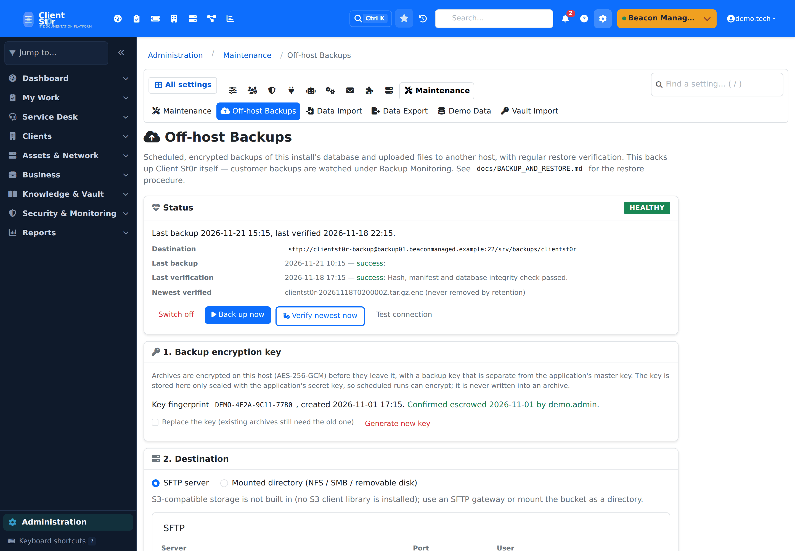

# Backing up and restoring Client St0r

This page is about backing up **Client St0r itself**: its database and uploaded files. Watching
your customers' backups is a different feature, described in [BACKUP_MONITORING.md](BACKUP_MONITORING.md).

Client St0r makes three kinds of backup:

| Kind | Where it goes | When it runs | Keys inside? |
|------|---------------|--------------|--------------|
| **Off-host backup** (this page) | An SFTP server or a mounted directory on another host | On a schedule, daily by default, with weekly restore verification | No. Encrypted with a separate backup key |
| Pre-upgrade snapshot | `backups/upgrades/` on this host | Before every update | Yes (`keys.env`), so it stays on this host. See [UPGRADE_AND_RECOVERY.md](UPGRADE_AND_RECOVERY.md) |
| `manage.py backup` | `backups/` on this host | When you run it | Encrypted with APP_MASTER_KEY |

Only the off-host backup survives losing the host. Set it up on every production install.



## What is in an off-host archive

Each archive is one file, `clientst0r-offhost-YYYYMMDDTHHMMSSZ.csbk`. Decrypted, it is a `tar.gz` that
contains a `backup/` directory with:

- `database.sqlite3` (SQLite installs): a consistent online copy made with SQLite's backup API.
- `database.sql` (MariaDB/MySQL installs): `mysqldump --single-transaction --routines --triggers --hex-blob`.
- `media/…`: every file under MEDIA_ROOT, including attachments, documents, pictures and uploads. Symlinks are skipped.
- `manifest.json`: app version, database engine, the table list, row counts, applied migrations, a
  SHA-256 for every file, and **fingerprints** of SECRET_KEY, APP_MASTER_KEY and API_KEY_SECRET. The
  fingerprints let you check that the keys you escrowed are the right ones. They are not the keys.

**Not in the archive:**

- `.env` / `keys.env`: APP_MASTER_KEY, APP_MASTER_KEY_PREVIOUS, SECRET_KEY, API_KEY_SECRET, the database password.
- The backup encryption key.
- The AI gateway keys.
- The application code. Reinstall the same version from git; the manifest records which one.

The database does contain the secrets the application stores: vault passwords, secure notes, TOTP
secrets, integration credentials, and the SFTP credentials for this feature. They are all **ciphertext
under APP_MASTER_KEY**. A restored database without the matching APP_MASTER_KEY starts up, but none of
those secrets can be read.

PostgreSQL installs are not supported, the same as `manage.py backup`.

## Encryption

- Archives are encrypted **on this host, before upload**, with AES-256-GCM from the `cryptography`
  library. The format is segmented (1 MiB segments in the STREAM layout, the same design age and Tink's
  streaming AEAD use), and each archive uses a fresh HKDF-derived key and nonce prefix.
- A changed, reordered, truncated or extended archive fails to decrypt. No unencrypted archive is ever
  written to disk: the tar is streamed straight into the encryptor. While a run is in progress, the database copy
  sits briefly in a 0700 staging directory (`backups/offhost-staging/`, or `OFFHOST_BACKUP_STAGING_DIR`).
- The **backup key** (`csbk1_…`) is 32 random bytes that only this feature uses. It is **not**
  APP_MASTER_KEY. It is generated when you set up off-host backups and shown **once**. On this host it is
  stored sealed with the application's secret-field encryption, so scheduled runs can encrypt.
- Every archive header records the key's fingerprint (for example `3fa2-91c0-77d1-0b4e`), so you can
  tell which key an archive needs.

## Key escrow: do this before you rely on backups

You need **two** secrets to restore. Store both somewhere that does not depend on this host:

1. **The backup key** (`csbk1_…`). It decrypts the archive. Without it the archives cannot be opened by
   you, by support, or by anyone else.
2. **The contents of `.env`**, at least APP_MASTER_KEY (plus APP_MASTER_KEY_PREVIOUS if it is set),
   SECRET_KEY and API_KEY_SECRET. These make the vault and credentials in the restored database readable.
   `.env` is never written into an off-host archive, so escrow it yourself. Do it again every time you
   rotate APP_MASTER_KEY.

Good places for them: a company password manager whose recovery does not depend on this server, a
sealed printout in a safe, or both. Keep the two in separate entries. Do **not** store them on the
backup server next to the archives, because then anyone who gets into that server has both the archives and
the keys.

When you generate a new backup key, archives already uploaded still need the **old** key. Keep the old
key until those archives have aged out of retention. That takes `keep_weekly` weeks.

## Setup

Settings → Maintenance → **Off-host Backups** (`/core/settings/maintenance/offhost-backups/`), superusers only.

1. **Generate backup key.** Copy the key shown into your escrow location. Then type its last 6
   characters and click **Confirm I stored it**. Backups cannot be switched on until you confirm.
2. **Destination.** Choose one:
   - **SFTP server:** enter the server, port, user and remote directory (the directory must already exist).
     For sign-in, either click **Generate SSH key pair** and add the public key shown to the backup user's
     `~/.ssh/authorized_keys`, or paste an existing unencrypted OpenSSH private key, or enter a password.
     Save, then click **Fetch host key**. Compare the fingerprint with
     `ssh-keygen -lf /etc/ssh/ssh_host_ed25519_key.pub` on the server and click **Approve this key**. You
     can also paste the server's public key line instead. Nothing is trusted on first use. If the server ever
     presents a different key, no credential is sent and the run fails until you approve the new key.
   - **Mounted directory:** a path on another disk or a network mount (NFS, SMB, `rclone mount`/`s3fs`
     for object storage). The path may not be inside the application or media directory. The page warns
     you if the directory is on the same filesystem as the application.
   - S3-compatible object storage is not built in, because no S3 client library is installed. Use an SFTP
     gateway or a mounted bucket.
   - SFTP addresses are checked before connecting. LAN addresses are allowed. Cloud metadata addresses
     are always refused. Loopback is allowed only with `ALLOW_PRIVATE_IP_INTEGRATIONS`.
3. **Test connection.**
4. **Schedule and retention.** Defaults: back up every 24 hours, verify every 7 days, keep 7 daily and 4
   weekly archives, and warn after 2 days without a successful backup.
5. **Switch on.** The scheduler task *Off-host Backup and Restore Verification* checks every 15
   minutes what is due. The first backup runs within 15 minutes, and the first verification runs right after it.
   **Back up now** and **Verify newest now** queue a run for the next scheduler pass, within a minute.

The scheduler must be running (`clientst0r-scheduler.timer`, or the scheduler container on Docker).

From the command line (as the application user, in the app directory):

```bash
python manage.py offhost_backup status
python manage.py offhost_backup run      # back up now
python manage.py offhost_backup verify   # verify the newest archive now
```

## Retention

After each successful upload, archives at the destination are pruned. The newest archive of each of
the last `keep_daily` days is kept, and so is the newest of each of the last `keep_weekly` ISO weeks. The
**newest archive** and the **newest archive that passed verification** are never removed. Only files named
`clientst0r-offhost-*.csbk` are ever touched.

## Restore verification

Every `verify_interval_days` (and after the first backup), the newest archive is downloaded into a 0700
scratch directory on this host. Then:

1. Its SHA-256 is compared with the hash recorded at upload.
2. It is decrypted with the backup key, and every segment must authenticate.
3. The tar is listed and extracted. Absolute paths, `..`, links and key files are refused.
4. Every file is checked against the manifest's SHA-256.
5. The database is checked:
   - **SQLite:** the copy is opened read-only, `PRAGMA integrity_check` must return `ok`, and the row counts of
     key tables (migrations, users, organizations, vault passwords, audit log) must match the manifest.
   - **MariaDB/MySQL:** the dump must be complete (mysqldump's `-- Dump completed` trailer), create every
     table in the manifest and carry the migration history.

The live database and media are never touched. The scratch directory is deleted afterwards. The result
appears on the page, in the audit log and in the run history.

## Warnings

- **System warnings** (the warnings list and digest e-mail) show a warning when off-host backups are switched on
  and there has been no successful backup within the warning window, a run cannot start, the newest
  archive failed verification, or no archive has passed verification recently.
- **Readiness** (Settings home) lists *Off-host backups* until they are set up and healthy.
- Configuration changes, key generation and confirmation, host-key approvals, and every run go to the
  audit log (object type `offhost_backup`). Secrets are never logged.

## Restoring after losing the host: step by step

You need: an archive, the backup key, the escrowed `.env` values, and a host to restore onto.

1. **Install the same version** of Client St0r on the new host (`bash install.sh`, or Docker), using the
   app version from the archive's manifest. Do not open the web UI yet.
2. **Put the escrowed keys back.** Edit `.env` so APP_MASTER_KEY (and APP_MASTER_KEY_PREVIOUS if
   you had one), SECRET_KEY and API_KEY_SECRET are your escrowed values. Keep the database settings
   for the new host.
3. **Fetch the archive** from the SFTP server or share, for example
   `scp backup@nas:/backups/clientst0r/clientst0r-offhost-20261120T020000Z.csbk /root/`.
4. **Check and decrypt it** in the app directory as the application user. The key is read from a prompt
   or from `--key-file`. It is never taken as an argument, because other users can see arguments in the process list.

   ```bash
   python manage.py offhost_backup check-archive /root/clientst0r-offhost-….csbk
   python manage.py offhost_backup decrypt /root/clientst0r-offhost-….csbk /root/restore.tar.gz
   mkdir -m 700 /root/restore && tar -xzf /root/restore.tar.gz -C /root/restore
   ```

   Neither command needs a working database or configuration on the new host. If you use `--key-file`, put the key
   in a 0600 file and delete it afterwards.
5. **Compare key fingerprints.** `backup/manifest.json` → `key_fingerprints` should match the keys
   now in `.env`. In the same Python shell, `from core.upgrade.snapshot import key_fingerprint`.
6. **Stop the application:** `sudo systemctl stop clientst0r-gunicorn clientst0r-scheduler.timer`.
7. **Restore the database.**
   - SQLite: copy `backup/database.sqlite3` over the database file named in your settings (normally
     `db.sqlite3` in the app directory). Keep ownership as the application user and set mode 0600.
   - MariaDB/MySQL: create an empty database and user, then load the dump:
     `mysql --defaults-extra-file=/root/my.cnf clientst0r < /root/restore/backup/database.sql`.
8. **Restore uploaded files:** copy `backup/media/` into MEDIA_ROOT (normally `media/` in the app
   directory), owned by the application user.
9. **Migrate and start:** `python manage.py migrate`, then
   `sudo systemctl start clientst0r-gunicorn clientst0r-scheduler.timer`.
10. **Check:** sign in, open a vault entry (this proves APP_MASTER_KEY is right), and open an attachment.
    Then re-check Settings → Off-host Backups. The restored settings still point at the old destination,
    and the host key will need approving again if the backup server changed.
11. **Clean up** `/root/restore`, `/root/restore.tar.gz` and any key file. They hold the whole database in the clear.

To rehearse this without disturbing production, run steps 3–5 on any machine. They only read the archive.
