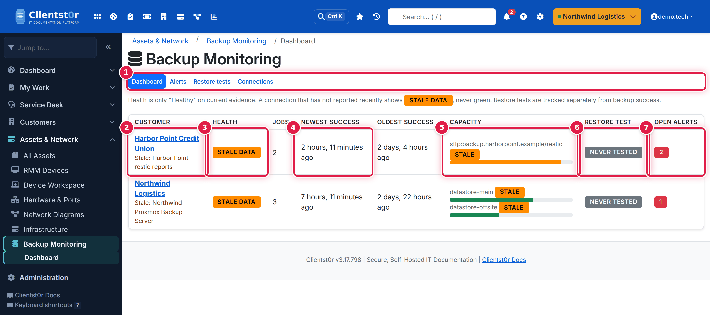
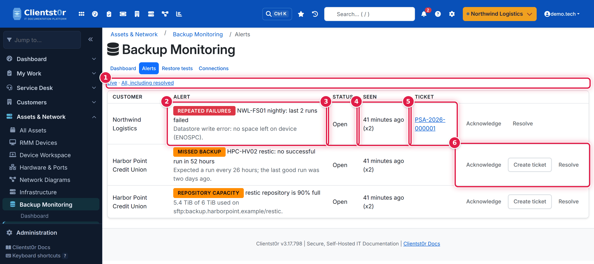

# Backup Monitoring

Backup Monitoring shows the health of your customers' backups in one place: which jobs ran, which failed or went missing, how full the repositories are, and when a restore was last actually tested. It lives under **Assets & Network > Backup Monitoring**.

This is not the platform's own pre-upgrade backup (that is separate and unchanged).

The dashboard shows one row per customer, worst health first; it follows the customer switcher until you click *Show every customer you can see*.

<!-- guide-figure: guide-stock-backup-dashboard -->


1. Dashboard, Alerts, Restore Tests and Connections (Connections needs permission to manage backup integrations).
2. A customer. Click it for its jobs, systems, repositories and alert policy.
3. Health on current evidence: Failed, Missed, Stale data, Warning, No data or Healthy. The worst customers sort first.
4. How long ago the newest successful backup finished.
5. Repository capacity; the bar turns amber and red as it fills.
6. Restore test state, tracked apart from backup health. Never tested means no restore was recorded.
7. Open alerts; the number opens the Alerts tab.
<!-- /guide-figure -->

## What is supported

| Source | How it works | Status |
|---|---|---|
| Proxmox Backup Server | Polled over the REST API (`/api2/json`) with an API token | Supported |
| restic | Push: the backup host POSTs a signed JSON report | Supported |
| BorgBackup | Push (same endpoint) | Supported |
| Kopia | Push (same endpoint) | Supported |
| Veeam, Acronis, Cove, Datto, Synology | | Planned, not implemented |

Planned sources have no code yet and do not appear in the provider list.

## Principles

- **Stale is never healthy.** Every health figure shows how old its evidence is. A polled connection that has not been reached for two hours (or whose last poll failed) turns all its jobs to "Stale data", and raises one alert. A job that never reported shows "No data".
- **Restore tests are separate.** A successful backup does not prove a restore works. Restore tests are recorded by people (or imported) and tracked independently; a customer with all-green backups and no restore test shows "Never tested". They never change job health.
- **Warnings count as completed backups** (a backup was produced) but display as warnings.
- Customers only ever see their own data: every row is scoped to the customer, and every query is restricted to the customers the user's role reaches.

## Customers and MSP-wide connections

One install serves one MSP, and each organization is one of its customers. A connection is either:

- **Customer-specific**: choose the customer as its organization. Everything it reports belongs to that customer.
- **MSP-wide**: leave the organization empty (only users whose role reaches every customer may do this), for example one Proxmox Backup Server protecting many customers. Its systems, jobs and repositories start **unmapped** and are visible only to users who reach every customer, under *Unmapped (MSP-wide)* on the dashboard. Map each system to its customer from the link icon next to the system; its jobs and alerts then move to that customer and appear only for people who reach that customer. Setting the connection's **Customer** pin instead maps everything it discovers to that customer automatically.

Server-level items (repositories of an MSP-wide connection) stay MSP-side. Unmapped alerts cannot be turned into tickets until the system is mapped, since a ticket needs a customer.

## Permissions

| Permission | Allows |
|---|---|
| `view_backup_status` | See dashboards, jobs, runs, repositories, alerts, restore tests, and the Device Workspace backup panel |
| `manage_backup_integrations` | Create / edit / delete connections (credentials, signing secrets), alert policies, protected systems; record restore tests; acknowledge, resolve and ticket alerts |

Both are staff-only. Owners and Organization Administrators get both; Service Managers, Level 1-3 technicians and Auditors get view. Existing built-in roles you have customized are left as they are.

## Proxmox Backup Server

1. In PBS create an API token (Configuration > Access Control > API Token) for a user with at least `Datastore.Audit` on the datastores and `Sys.Audit` for the task list.
2. In Clientst0r: **Backup Monitoring > Connections > New connection**, provider *Proxmox Backup Server*, the `https://host:8007` URL, and the token as `user@realm!tokenname:secret`. The token is stored encrypted and never shown again.
3. Use **Test**, then **Poll now**.

Each PBS backup group (for example `vm/100`) becomes a job and a protected system; each backup task becomes a run; datastores become repositories with capacity. PBS does not hold the backup schedule (the client does), so the schedule shows that. Retention comes from the PBS prune jobs when the token may read them.

Set the connection's **Customer** to pin everything it discovers to one customer; otherwise systems start at the owning organization and are reassigned from the customer page (the link icon next to a job's system).

## Push reports (restic, Borg, Kopia)

Create a connection with the provider; the signing secret and report URL are shown once. Each report is a JSON document:

```json
{
  "job":        {"id": "nightly-home", "name": "Nightly home", "schedule": "daily 02:00", "retention": "keep-daily 7"},
  "system":     {"id": "web01", "name": "web01"},
  "run":        {"id": "web01-2026-11-16T02:00:11Z", "status": "success",
                 "started_at": "2026-11-16T02:00:11Z", "finished_at": "2026-11-16T02:04:40Z",
                 "bytes": 123456789, "message": ""},
  "repository": {"id": "b2-main", "name": "B2 bucket", "total_bytes": 1000000000000, "used_bytes": 420000000000, "available": true}
}
```

`run.status` is `success`, `warning`, `failed` or `running`. `run.id` must be unique per run: it is what makes retries and replays harmless (a repeated report is acknowledged as `duplicate` and changes nothing; a `running` run is finished by a second report with the same id). `repository` is optional and may be sent alone.

Sign the exact request body: `X-Backup-Signature: sha256=<hex HMAC-SHA256(secret, "<timestamp>." + body)>` with `X-Backup-Timestamp` as unix seconds. Requests more than five minutes off, or with a wrong signature, get `401`. Bodies over 256 KB get `413`.

Example wrapper around restic (run after `restic backup`, with `$SECRET`, `$URL` set):

```sh
#!/bin/sh
set -u
START=$(date -u +%Y-%m-%dT%H:%M:%SZ)
restic backup /data --quiet; RC=$?
END=$(date -u +%Y-%m-%dT%H:%M:%SZ)
STATUS=success; [ "$RC" -ne 0 ] && STATUS=failed
BODY=$(printf '{"job":{"id":"nightly-data","name":"Nightly data"},"system":{"id":"%s","name":"%s"},"run":{"id":"%s-%s","status":"%s","started_at":"%s","finished_at":"%s"}}' \
  "$(hostname)" "$(hostname)" "$(hostname)" "$START" "$STATUS" "$START" "$END")
TS=$(date +%s)
SIG=$(printf '%s.%s' "$TS" "$BODY" | openssl dgst -sha256 -hmac "$SECRET" -hex | sed 's/^.* //')
curl -fsS -X POST "$URL" -H 'Content-Type: application/json' \
  -H "X-Backup-Timestamp: $TS" -H "X-Backup-Signature: sha256=$SIG" --data "$BODY"
```

The same wrapper works for `borg create` or `kopia snapshot create`; only the backup command and exit-code handling change. Send the body with `--data` unchanged between signing and posting.

## Alerts

Evaluated after each poll and each accepted report. Thresholds are per customer (Alert policy on the customer page), with built-in defaults of:

| Rule | Default |
|---|---|
| Missed: no completed backup within | 26 hours (per-job override available) |
| Failed: latest run failed | always |
| Repeated failures: last N runs failed | 2 |
| Repository capacity | 85% (critical from 95%) |
| Repository unavailable | always |
| Protected system with no job | on |
| No recent data from a connection | polled: 2 hours |

One live alert exists per (connection, rule key); re-evaluation updates it. Alerts clear themselves when the condition clears, but never on stale data. Lifecycle: open, acknowledged, resolved. **Create ticket** opens one PSA ticket per alert (never a second); with *Open a PSA ticket for each new alert* on in the policy, new alerts open a ticket automatically.

The Alerts tab lists every live alert for the customers you can see, whichever customer is selected.

<!-- guide-figure: guide-stock-backup-alerts -->


1. Live alerts only, or all alerts including resolved ones.
2. The rule that fired (amber for warning, red for critical) and what it found.
3. Status: open, acknowledged or resolved.
4. When it was last seen, and how many times the check has found it.
5. The ticket opened for this alert. An alert never gets a second one.
6. Acknowledge, Create ticket or Resolve. Shown to people who may manage backup integrations for that customer.
<!-- /guide-figure -->

The alert-to-ticket policy engine used for RMM alerts is tied to RMM connections, so backup alerts use their own ticket path for now.

## Scheduling

The poller is `manage.py poll_backup_monitoring [--connection ID] [--no-alerts]`, registered with the scheduler as *Backup Monitoring Poll + Alerts* (every 15 minutes by default). It exits non-zero when any connection fails to poll, so the scheduler records the failure.

## Planned

Veeam, Acronis, Cove, Datto and Synology adapters; importing restore-test records from other tools; routing backup alerts through the shared alert policy engine; customer portal visibility.
