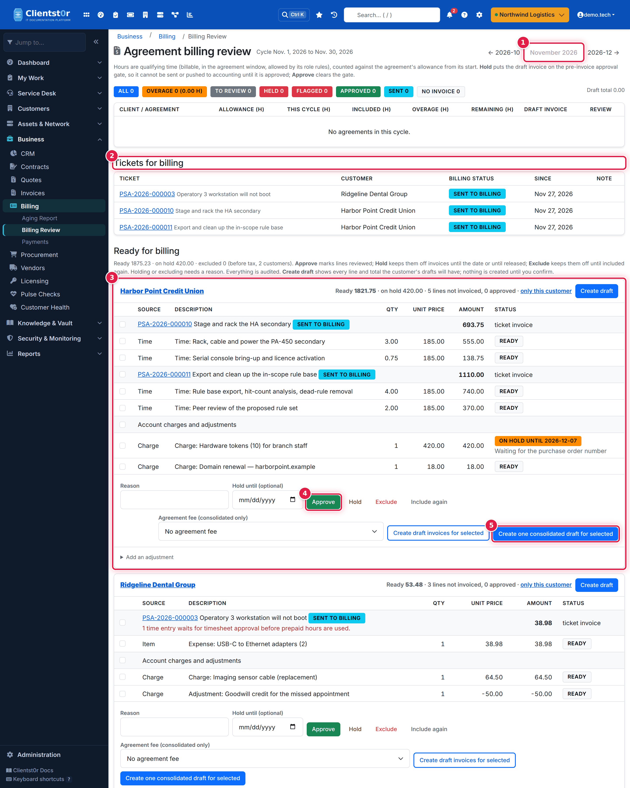

# Billing, prepaid hours and contracts

How time and charges on a ticket become invoices, and how agreements and contracts are signed.
This page describes what the application does as of v3.17.761. Everything here needs the native
service desk (`psa_enabled`) and MSP staff access; customers and portal users never see internal time,
item, cost or billing fields.

Screenshots: [Ready for Billing](images/github/billing-ready-dark.png) ·
[consolidated draft](images/github/invoice-consolidated-light.png) ·
[prepaid-hour ledger](images/github/contract-ledger-dark.png) ·
[Settings → Billing](images/github/settings-billing-light.png) ·
[sample contract library](images/github/contract-library-light.png) ·
[contract awaiting signature](images/github/contract-awaiting-signature-light.png).

<!-- guide-figure: guide-billing-ready -->

1. The billing month. Step back or forward a month.
2. Tickets for billing: tickets whose time and items are waiting to be billed.
3. Ready for billing, per customer: the exact lines an invoice would carry, with amounts ready and on hold.
4. Approve, hold or exclude lines before invoicing.
5. Create draft invoices: one per ticket, or one consolidated draft per customer.
<!-- /guide-figure -->

## The path from work to invoice

1. **Log time and add items on the ticket (Time & Charges).** The timer and manual time ask for a
   classification (billable, covered, non-billable, warranty, goodwill, awaiting classification), a work type
   (standard, remote, onsite, travel) and a role. People with **Manage charges** can choose which agreement a
   time entry uses, from the agreements valid for that customer and date. Each entry shows actual and rounded
   time, covered and charged hours, rate, estimate and status.
2. **Add Item** puts a catalog item (priced for the customer), stock, or a one-off line (parts, hardware,
   licenses, travel, shipping, services) on the ticket. Credits need **Manage charges**; a price below the
   catalog minimum needs discount approval. Cost and margin are visible only with the internal-cost
   permission and are left out of the data, not just hidden. Stock is reserved when added, deducted once when
   marked used, and released when removed.
3. **Read the billing summary.** It shows the agreement, prepaid hours now and after approval, labor, items,
   fees, the unbilled total before tax and anything that blocks clean billing. **Review charges** shows the
   exact invoice lines. **Send to billing** marks the ticket for invoicing; it never creates an invoice.
   Closing a ticket that still has unbilled work flags it **Needs billing review**.
4. **Review in Billing Review → Ready for Billing** (Business → Billing → Billing Review), described below.
5. **Create drafts.** Nothing is sent automatically. A sent invoice is changed only by a credit note.

What bills nothing: non-billable, warranty and goodwill time. Left off the invoice with a warning: time
awaiting classification, stock that is reserved but not yet used, and time with no rate anywhere (never billed
at 0). Approved time is corrected only through the existing correction page; time or items already invoiced
cannot be changed from the ticket.

## Ready for Billing

A section of **Billing Review**. Per customer it lists the exact lines each ticket sent to billing would
invoice, plus unbilled account charges, adjustments and completed project milestones.

| Action | What it does | Needs |
|---|---|---|
| Approve | Marks lines reviewed; creates nothing | Manage charges |
| Hold | Keeps lines off every invoice, with a reason and an optional until-date; the hold lapses on its own | Manage charges |
| Exclude | Keeps lines off every invoice until included again, with a reason | Manage charges |
| Add adjustment | A charge or credit with a reason; source records are never edited | Manage charges |
| Create draft invoices for selected | One draft per ticket; nothing is sent | Send invoices |
| Create one consolidated draft for selected | See below | Send invoices |

Viewing the queue needs **View invoices**. All permissions are checked for that customer, and every action is
written to the audit log with its reason. Held and excluded work is never billed by any invoicing path.

### Consolidated invoices

Select several tickets for one customer and choose **Create one consolidated draft for selected**. The draft
contains the tickets' lines in ticket order (each labelled with its ticket), then the customer's account
charges, then, if you pick it, the agreement fee for the current period. The picker says why an agreement
cannot be billed now (paused, ending, not due yet, already invoiced, needs e-signature, and so on). Each line
stays linked to the time entry, charge or agreement it bills. Everything runs under a per-customer lock, so a
double click or retry never bills anything twice, and the agreement period is claimed so recurring billing will
not bill it again. The draft opens for review.

Voiding an invoice releases its ticket time and account charges to be billed again.

## Prepaid-hour ledger

Each contract with prepaid or rollover hours keeps a ledger of postings that cannot be edited or deleted:
purchases, use, overage, expiry, reversals and manual adjustments. Open it from the contract page
(**Prepaid-hour ledger**).

- Only **approved** time uses hours. Draft and pending time uses nothing; rejecting or returning approved
  time gives its hours back; approving twice never deducts twice.
- Blocks are used earliest expiry first. Unused hours expire 45 days after a block ends.
- Retainers billed monthly, quarterly or yearly get a fresh allowance each cycle.
- A low balance raises a system warning. Contract options: billing priority, allow negative balance, low
  balance warning threshold.
- When two agreements tie for a time entry, nothing is used until someone with billing permission chooses.
- Manual adjustments and extra blocks need **Manage charges** for that customer and a reason, and are audited.
- Remaining hours on the contract list, the ticket banner and the mobile app read the ledger.
- Time-and-materials time worked after the upgrade is priced from rate cards (minimum time, billing
  increments, trip fees once per onsite day, holiday rates). After-hours and weekend rates are not applied
  automatically yet. Existing invoices are never repriced.

Before relying on it, run `manage.py billing_preview` to compare old and new ticket invoices per customer;
`manage.py prepaid_ledger_reconcile --dry-run` compares each block with the old counter.

## Settings → Billing

**Settings → General → Billing** (superusers and staff who can approve invoices). One page for: invoice
approval threshold, agreement-usage approval percentage, late fee percentage and days overdue, automatic
accounting push for recurring invoices, quote approval threshold, default tax rate and default currency, and
whether month-to-month contracts are exempt from the e-signature rule (exempt by default).

Approval thresholds and late-fee terms can be overridden per customer and per contract; the page shows each
value and the level it comes from. Every change is validated and audit-logged. The invoice approval threshold
applies to draft invoices only; a sent invoice is never put back on hold. A late fee is added as a separate
account charge and never edits the invoice.

### Invoice layout and branding

The same page sets the **invoice layout** and the **invoice footer text**. The layout changes how an invoice's
lines are presented, never the lines, tax or totals:

| Layout | What the customer sees |
|---|---|
| Itemized (default) | Every line, as before. |
| Grouped by ticket | Lines under a heading per ticket (number, subject, subtotal); lines without a ticket under *Other charges*. |
| Monthly summary | One row per category (labour, items and expenses, fees, agreement fee, account charges, other) with totals. *PDF with detail* adds the itemized lines as an appendix. |
| Summary + service report | The monthly summary plus the tickets worked: number, subject, dates, hours, technicians and resolution summary. |

The layout can be overridden per customer and per contract, and chosen on a draft invoice; the invoice's own
choice wins, then the contract, then the customer, then Settings → Billing. When an invoice leaves draft, the
layout it would render with is stored on it, so a sent invoice always looks the same, even if the defaults change
later. The staff view, the customer portal and the PDF use the same layout.

The service report is written for the customer: it never shows ticket comments, time-entry notes or anything
marked internal, and a ticket the customer may not see is listed by number and hours only.

Invoices carry your letterhead: the name, address, phone, e-mail and logo of your organization, falling back to
the company name and logo under Settings → General (Whitelabeling / Branding), and the footer text (payment instructions, thanks,
registration numbers) at the foot of each invoice. Footer text is plain text.

## Contracts: samples, terms and e-signature

- **Sample library** (Business → Contracts → Templates). Twelve starter agreements: managed services
  (month-to-month, 12-month, 36-month), prepaid block hours, a project statement of work, break-fix / time and
  materials, and a master services agreement with a service schedule. **Use this sample** makes your own
  editable copy. Samples are starting points, **not legal advice**, and contain review notes that block sending
  until you replace them. Updates never overwrite a sample you edited.
- **Terms.** Contracts and billing contracts carry a term (month-to-month, annual, multi-year or a custom fixed
  term) and a notice period. Existing contracts were given the term their dates imply and bill as before.
- **E-signature before it takes effect.** Every quote, and every contract that is not month-to-month, needs the
  customer's e-signature before it can be accepted, converted, activated or billed. Staff cannot mark it
  accepted for the customer. Changing the signed terms needs a new signature.
- **Viewed tracking.** Quote, invoice and contract links record first view, last view and view count. Quote and
  invoice pages show Sent → Viewed → Signed / Accepted / Paid, and lists show a Viewed badge. The first view
  writes an audit entry, fires a `quote.viewed`, `invoice.viewed` or `contract.viewed` webhook and emails the
  person who created the document. Staff previews, email security scanners and bots are not counted. Invoice
  emails include a link to view the invoice in the customer portal.

## Financial definitions

Every report, Business Overview card, dashboard widget and CSV export that shows revenue, cost, profit or
margin uses one set of definitions, computed in one place (`reports/financials.py`). The same customer and period
give the same figure everywhere. Report pages that show these figures have a **Definitions** panel; nothing here
changes an invoice or a stored amount.

| Figure | Definition |
|---|---|
| **Billed revenue** | Issued invoices (sent, partially paid, paid, overdue — not drafts, not void) dated in the period by **invoice date**, **excluding tax**, **net of credit notes**. An issued credit note reduces billed revenue on its own date and counts under the contract, project and service line of the invoice it credits. |
| **Collected revenue** | Payments received in the period by **payment date**, **net of refunds** (a refund or lost dispute is a negative payment). The tax share of each payment is removed in proportion to its invoice: amount × (total − tax) ÷ total. Payments on a void invoice, or on an invoice with tax but a zero total, still count and mark the figure **partial**. |
| **Recognized revenue** | Billed revenue spread over its service period. Contract-period invoices (billing period start plus the contract's monthly, quarterly or yearly frequency) are spread pro rata by day; every other invoice is recognized on its invoice date, because invoice lines carry no service period. A straight-line approximation, not accounting-system revenue recognition. |
| **Direct cost** | By the date of the work (a ticket's costs count under the contract covering that customer on that date): labour (every time entry, billable or not, at the technician's cost rate on that day — never an assumed rate), ticket items at unit cost × quantity, ticket expenses at their amount, and lines on issued invoices that carry a unit cost (lines billing time or a ticket item are not counted twice). Credits to the customer are not costs. Purchase orders, licences and overheads are not included. |
| **Gross profit** | Billed revenue − direct cost for the same customer and period. |
| **Margin** | Gross profit ÷ billed revenue; none when billed revenue is zero. |

**Partial figures.** An hour without a cost rate or an item without a unit cost makes direct cost **partial**: the
cost shown is the known part, gross profit and margin show as unknown, and the page says why — for example
"Partial — 2 technicians have no cost rate (6.5 h)". Set technician cost rates on the Tech Cost Rates page (`/resourcing/cost-rates/`) and
unit costs on items to complete them.

**Figures that are deliberately something else**, and named so:

- **Contracted MRR / ARR** — contracts' recurring amounts normalized to a month; a commitment, not revenue.
- **Attributed labour revenue** (profitability by technician, margin analytics, effective rate by technician) —
  billable hours × the entry's bill rate; a measure of labour value, not what was invoiced.
- **Contract-terms estimate** (contract page) — revenue from the contract's terms over its window, shown next to
  the billed revenue from the contract's invoices.
- **Receivables** (aging, balances, billing reconciliation) — what customers owe, including tax. Billing
  reconciliation counts issued invoices only.
- **Ticket billing estimate** (ticket Charges tab) — what the ticket's unbilled work would bill at.

Amounts are summed as stored; an install that invoices in several currencies sees them added together.
