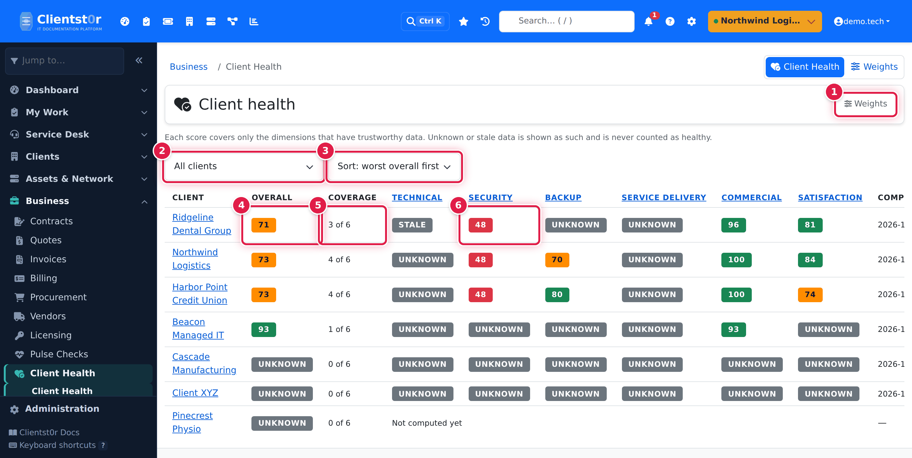
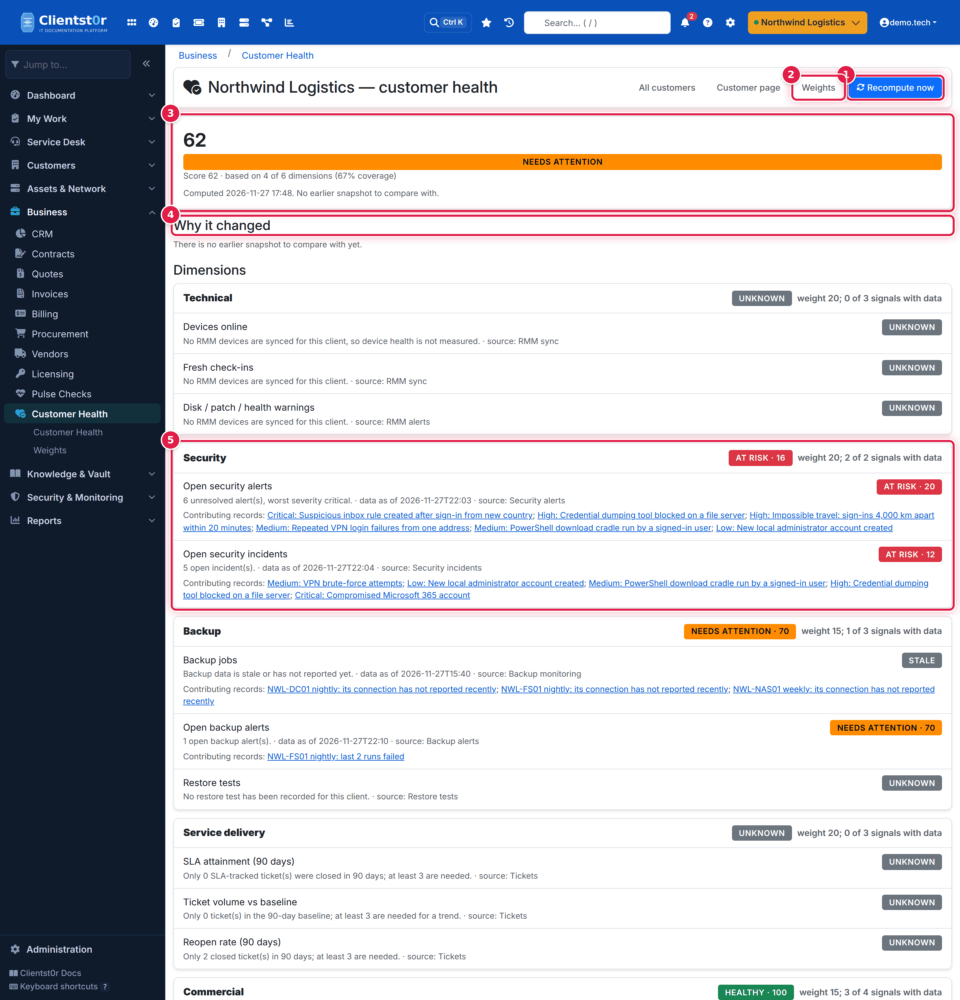
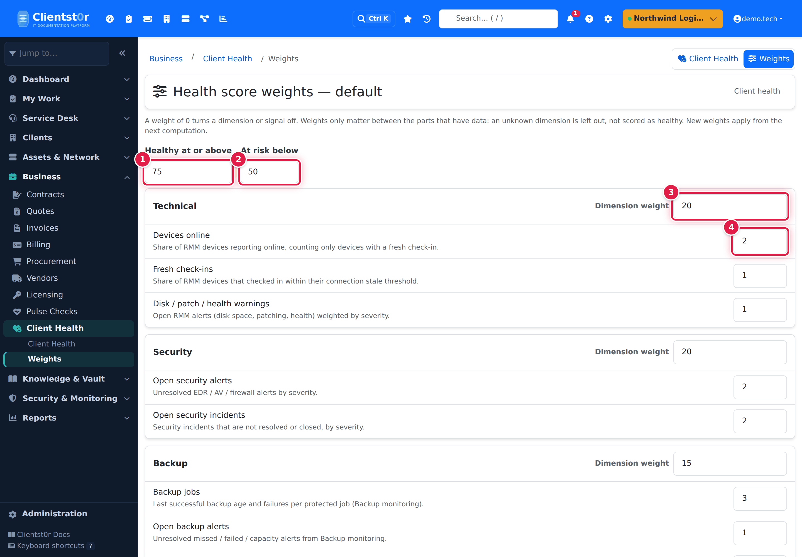

# Customer Health

A single 0 to 100 score for each client, built from the data Clientst0r already holds: devices, security
alerts, backups, tickets, invoices and pulse check answers. It lives in the sidebar under **Business →
Customer Health** and is for MSP staff only. Customers never see it, in the portal or anywhere else. The numbers
in each screenshot match the list under it. Every screenshot is a capture of the application against a demo
database; the customers and people in it are invented.

The score is a summary for you, not a verdict. Open a client to see which signals moved it and which records
(an alert, a failed backup job, an overdue invoice) are behind each one.

## How the score is built

Six **dimensions**, each made of a few **signals**. A signal answers one question about one client and returns
a value from 0 to 100 (higher is healthier) with an explanation, the date of the newest evidence, its source
and the records it was based on.

1. A signal's value is graded with the thresholds below.
2. A dimension's score is the average of its signals' values, each counted by its **signal weight**.
3. The overall score is the average of the dimensions' scores, each counted by its **dimension weight**.

**Unknown is not healthy.** A signal with no data (no RMM devices, no backup jobs, too few tickets) or with data
too old to trust (**Stale**) is listed but carries no weight at all. A dimension with no scored signal is
Unknown or Stale and is left out of the overall score. The overall score always comes with its **coverage**,
for example "based on 4 of 6 dimensions". With no known dimension there is no score, only Unknown. A client
with almost no data can therefore show a high score on one dimension; read the coverage.

Dimensions and signals, with their default weights (dimension weight in brackets):

### Technical (20)

| Signal | Weight | Value |
|---|---|---|
| Devices online | 2 | Share of synced RMM devices with a fresh check-in that are online. Stale devices are not counted. |
| Fresh check-ins | 1 | Share of devices that checked in within their connection's stale threshold. |
| Disk / patch / health warnings | 1 | 100 minus 30 for each open critical RMM alert, 15 for each error and 5 for each warning (not below 0). |

All three are Unknown with no RMM devices for the client, and Stale when every device is past its stale threshold.

### Security (20)

| Signal | Weight | Value |
|---|---|---|
| Open security alerts | 2 | 100 minus 30 per critical, 18 per high, 6 per medium and 2 per low alert that is new or acknowledged (informational alerts are ignored). |
| Open security incidents | 2 | 100 minus 40 per critical, 25 per high, 10 per medium and 3 per low incident that is not resolved or closed. |

Unknown when the client has no security vendor connection, alert or incident. The alerts signal is Stale when
every connection is polled automatically and none has synced in two days.

### Backup (15)

| Signal | Weight | Value |
|---|---|---|
| Backup jobs | 3 | Average over the client's jobs: on schedule 100, finished with warnings 75, missed 10, failed 0. Jobs whose connection stopped reporting, or that never reported, are not scored. |
| Open backup alerts | 1 | 100 minus 30 per open critical alert and 10 per other open alert. |
| Restore tests | 1 | From the latest recorded restore test: passed 100, a result that is not a pass 70, overdue 50, failed 10. Unknown if none was ever recorded. |

### Service delivery (20)

| Signal | Weight | Value |
|---|---|---|
| SLA attainment (90 days) | 3 | Share of tickets closed in the last 90 days that met their resolution SLA. |
| Ticket volume vs baseline | 1 | Tickets opened in the last 30 days against the monthly average of the 90 days before. At or below 1.25 times the baseline is 100; it falls linearly to 0 at 3 times the baseline. |
| Reopen rate (90 days) | 1 | 100 minus four points for each percent of closed tickets that were reopened; a quarter reopened scores 0. |

Each needs at least three tickets in its window; fewer is Unknown.

### Commercial (15)

| Signal | Weight | Value |
|---|---|---|
| Overdue invoices | 2 | 100 minus 10 for each unpaid invoice up to 30 days late, 25 for 31 to 60 days and 40 for more. |
| Contract renewals | 1 | 100 minus 40 for each active contract that ends within 60 days, is not set to renew automatically and has no renewal draft. |
| Failed payments (90 days) | 1 | 100 minus 25 for each failed card or bank attempt in 90 days on an invoice that is still unpaid. Unknown if no online payment was ever attempted. |
| Profitability margin (90 days) | 2 | The client's margin over 90 days, where a 40% margin is full marks. Unknown when there is no revenue or any cost is unknown. |

Overdue invoices, contract renewals and failed payments are billing signals; profitability needs its own
permission (see [Who sees what](#who-sees-what)).

### Satisfaction (10)

| Signal | Weight | Value |
|---|---|---|
| Pulse check score | 2 | Average of the 1 to 5 pulse check ratings from the last 180 days, mapped to 0 to 100 (1 is 0, 5 is 100). With no ratings, the average of the 0 to 10 scores times ten. Stale when the newest answer is over a year old. |
| Pulse trend | 1 | The pulse score for the last 90 days against the 90 days before: flat is 75, up 20 points is 100, down 60 is 0. Needs answers in both periods. |

These need the optional [Pulse checks](PULSE_CHECKS.md) module and answered requests. Without them the
dimension is Unknown.

## The colours

A value is graded against two thresholds, **Healthy at or above** (default 75) and **At risk below**
(default 50). The same grading is used for signals, dimensions and the overall score.

| Colour | Label | Value with the defaults |
|---|---|---|
| Green | Healthy | 75 to 100 |
| Amber | Needs attention | 50 to 74 |
| Red | At risk | 0 to 49 |
| Grey | Unknown or Stale | No score. Not counted. |

## Customer Health

**Business → Customer Health → Customer Health** (`/client-health/`). Every active client you can reach, with its
latest snapshot.

<!-- guide-figure: guide-health-list -->

1. Weights: opens the default weights and thresholds. Shown only to people who may change them.
2. Filter: all clients, those with incomplete or unknown data, those with stale data, or those that need attention or are at risk.
3. Sort: worst overall first, by name, or by one dimension.
4. The overall score, coloured by the thresholds.
5. Coverage: how many of the six dimensions had data to score.
6. One dimension's score. Grey means Unknown or Stale: no score, and not counted as healthy.
<!-- /guide-figure -->

- The filter shows clients with incomplete or unknown data (fewer than six dimensions scored), clients with
  stale data, or clients that need attention or are at risk.
- The default sort is worst overall score first; clients with no score come after those with one. Click a
  dimension heading, or use the sort list, to order by that dimension.
- A client that has never been computed shows Unknown and "Not computed yet". A dash in a dimension cell means
  you may not see that dimension (every signal in it needs a permission you do not have).
- Staff limited to some clients see only those clients.

When the scores are computed. A scheduled task, **Customer Health Score Snapshots** (Settings → Automation →
Task Scheduler, once a day), stores one snapshot per active client per day. It only reads existing data and
changes nothing else. `python manage.py compute_health_scores` runs it by hand, `--client ID` for one client.

## A client's health

**Business → Customer Health →** a client name (`/client-health/<id>/`). The same card also appears on the
client's overview page, with a Details link.

<!-- guide-figure: guide-health-detail -->

1. Recompute now: computes today's snapshot immediately instead of waiting for the nightly run.
2. Weights for this client only (people with the weights permission).
3. The overall score, its colour and its coverage, with the change since the previous snapshot.
4. Why it changed: the signals that moved since the previous snapshot, with the records that appeared or went away.
5. A dimension: its score, weight and how many of its signals had data, then each signal with its own score, explanation, data date, source and contributing records.
<!-- /guide-figure -->

- **Recompute now** replaces today's snapshot with a fresh computation. Any staff member who can see the client
  can do it; it is not limited to people who may change weights.
- **Why it changed** compares today's snapshot with the previous one, signal by signal, largest move first. It
  lists the records that appeared (for example a new alert) or went away. When nothing moved it says so.
- Each dimension shows its weight and "N of M signals with data". Each signal shows its colour and value, the
  one-line explanation, when its data is from, its source and links to the contributing records (up to 25).
  A signal turned off by a weight of 0 is marked "(turned off)".

## Weights

**Business → Customer Health → Weights** (`/client-health/settings/`).

<!-- guide-figure: guide-health-weights -->

1. Healthy at or above: the lowest score shown as Healthy (green).
2. At risk below: scores under this are At risk (red); between the two thresholds is Needs attention (amber).
3. A dimension's weight. 0 turns the whole dimension off.
4. A signal's weight inside its dimension. 0 turns that signal off.
<!-- /guide-figure -->

- The two thresholds (0 to 100); the At risk threshold must be lower than the Healthy one.
- A weight for each dimension and each signal. A weight of 0 turns it off; otherwise any number up to 1000.
  Only the ratio between weights matters, and only between parts that have data.
- **Save** applies from the next computation (nightly, or Recompute now). Saved weights do not rewrite past
  snapshots.
- The page opened from the list edits the **default** for every client. Open **Weights** from a client's page
  to give that client its own weights and thresholds; **Use the default weights for this client** deletes the
  override.

**Who may change weights.** Anyone with the *Customer health score: change the dimension / signal weights and
thresholds* permission (`manage_health_score_settings`), who must also be MSP staff. Superusers have it. It is
included in the Org Admin role template and can be added to any other role under Settings → Users & Access.
Without it the Weights tab and button are hidden and the page answers 403. For a client's own weights the
permission is checked at that client; for the default it is checked install-wide.

## Who sees what

- Only MSP staff open these pages, and only for clients they can reach.
- The billing signals (overdue invoices, contract renewals, failed payments) are shown only to people who can
  view invoices or financial reports for that client. The profitability signal needs the MSP-wide *view
  profitability* permission.
- Hidden signals are left out and the dimension, overall score and coverage are recalculated from what you can
  see, so two people can see different scores for the same client. A line on the page says when signals are
  hidden from you.

## Limits

- The score is only as good as the data: a client without RMM, backup monitoring or security integrations
  shows those dimensions as Unknown, not as healthy.
- Ticket signals need at least three tickets in their window.
- History is one snapshot per client per day; the page compares only with the previous snapshot.
