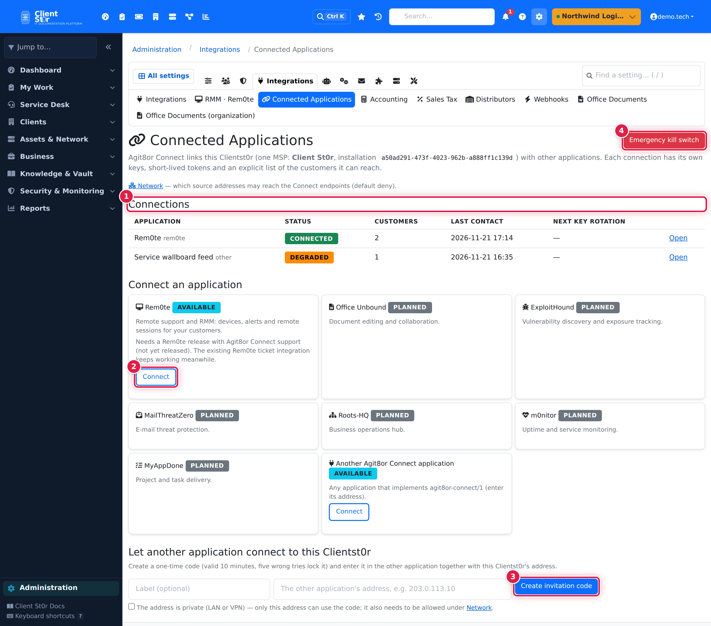

# Connected Applications (Agit8or Connect)

Agit8or Connect pairs this installation with another application so the two can exchange signed events and
reach an explicit list of customers. It is **off by default** and still an early release: the design and code
have not been independently reviewed, so treat it as a preview and read the
[limitations](agit8or-connect/LIMITATIONS.md) before enabling it. Pairing is limited to the permissions
currently marked available (reading the connection and the granted customers, and sending events); others are
listed as planned.

Screenshots: [Connected Applications](images/github/connected-apps-dark.png) ·
[a connection](images/github/connected-app-detail-light.png) ·
[diagnostics](images/github/connected-app-diagnostics-dark.png).

<!-- guide-figure: guide-connected-apps -->

1. Connections: the applications paired with this installation, and their health.
2. Connect an application: start pairing from this side.
3. Or create an invitation code for the other application to use.
4. Emergency kill switch: stop every connection at once.
<!-- /guide-figure -->

## Turning it on

Set `AGIT8OR_CONNECT_ENABLED=True` and `AGIT8OR_CONNECT_PUBLIC_URL` (an https address in canonical form, for
example `https://psa.example.com`: lower case, no path, no trailing slash) in `.env`, then restart. The page is
**Settings → Integrations → Connected Applications**. Pairing and approval are refused until the public
address is set. The permission **Manage connected applications** is needed to change anything.

## Connecting

- **Pairing code.** Create a one-time code (valid 10 minutes, five wrong tries lock it) and enter it, with this
  installation's address, in the other application. Works with any application that implements
  `agit8or-connect/1`.
- **Quick Connect** (protocol 1.1, optional, separate switch under **Connected Applications → Network**, which
  needs your password to turn on). A five-step wizard checks the other application's address and certificate,
  you approve its addresses, permissions and customers, and you finish in the other application's own admin
  page. No passwords are exchanged. Applications without Quick Connect keep using pairing codes.

A connection goes live only after both sides approved the permissions and customers, each side approved the
other's addresses (a different address, a range or a private address needs a second administrator), and a full
connection test passed. Until then the other application can reach only its test, capability and health
endpoints.

## Network rules (default deny)

Every Connect endpoint refuses a request (403 `source_not_authorised`) until its source address is allowed
both installation-wide (Connected Applications → Network) and on the connection. Rules cover exact addresses
and ranges, IPv4 and IPv6, and a deny always wins. Allow-all and over-broad ranges are refused. Outbound,
each connection sends only to an approved host and port, with every resolved address checked on every send
(DNS rebinding is refused), certificates always verified, no redirects or proxies, and loopback, link-local and
metadata addresses always refused. Network changes show a preview, need your password, and need a second
administrator when they widen access. Recovery from the server:
`manage.py connect_source_rules list|add|remove|enforce`.

## Health, reconnection and alerts

Active connections show **Connected**, **Degraded**, **Offline** or **Security Blocked** next to their setup
status. A monitor task (**Agit8or Connect Monitor**) checks healthy connections every minute and retries
network failures with growing delays. Security problems (key or certificate mismatch, identity change, invalid
signature, changed destination) never retry: the connection is **Security Blocked** until an administrator
retests it. Events wait while a peer is offline and are delivered oldest first on recovery; after 7 days they
move to the failed list.

Alerts (email, system warning, bell notification) fire for Degraded, Offline and Security Blocked, at most one
per connection and status every 30 minutes. Each connection has an Alerts card: **Mute** for 1 hour to 7 days
(Security Blocked always notifies) and an optional ticket per incident under a chosen customer record.
Incidents also appear in the Events list under the source *Connected applications*, and the webhook
`connected_app.status_changed` is sent.

## Application switcher

When at least one other application is ready to open, a **Switch application** button (a grid icon) appears in
the top bar, right of the logo. Without one there is no button and no empty space.

The menu lists:

- connections that are **Connected**, **Degraded** or **Offline**, for people with the connected-applications view permission (`view_app_connections`);
- RMM connections whose console address passes the console-link check, for people with **View integrations** (`integrations_view`)
  who can reach that connection's customer.

Suspended, Security Blocked, revoked and unfinished connections are not listed, and customer users never see
the menu.

Each entry shows:

- the application's name;
- its status from the last stored check, with the time of that check. A result that is too old reads
  **Status unknown**, never Connected.

Opening the menu never contacts the other application. An Offline entry still links, because the browser may
reach it when this server cannot.

Links open the other application's home page in a new tab, using the address approved at pairing (or the RMM
console address). Only the scheme, host and port are used: no path, query, customer, user or credential is
added. The other application asks for its own sign-in.

When a customer is selected, an application where that customer is not mapped is shown disabled, with the
reason. Opening a specific customer in the other application needs a link format the other application
advertises. None is agreed yet (proposals CX-1/CX-2 in `docs/ux/CROSS_APP_UX_CONTRACT.md`), so the
`APP_SWITCHER_CUSTOMER_LINKS` setting stays off and has no effect until then.

## Diagnostics

**Run diagnostics** on a connection checks fifteen steps (DNS, approved destination, TCP, TLS, certificate,
discovery and protocol, identity, source address, key and token, permissions, customer mapping, an authorised
operation, a signed test event, reverse connectivity, last success), each with a result and a next step. It
never changes the connection and never sends customer data; 6 runs per 10 minutes per connection. The history
shows each run and compares it with the previous one. **Export** gives JSON or text with tokens, keys,
signatures and pairing codes removed. The emergency **kill switch** blocks approvals while it is engaged; releasing it activates nothing.

The Rem0te link keeps working as before, and existing connections are not retested when upgrading.
