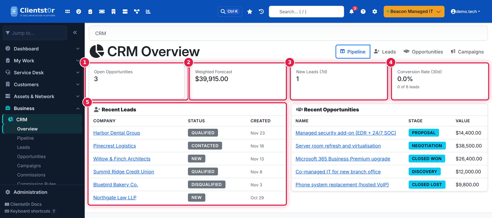
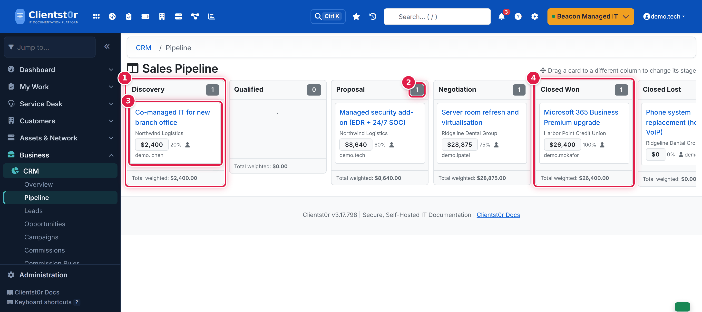
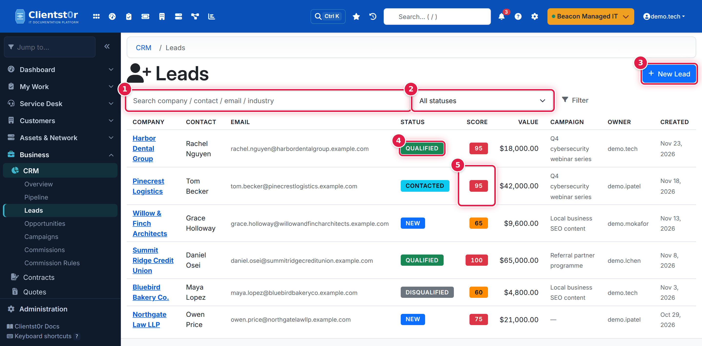
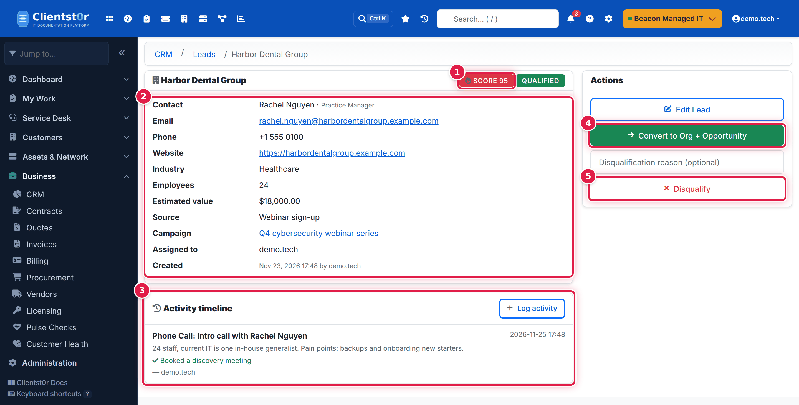
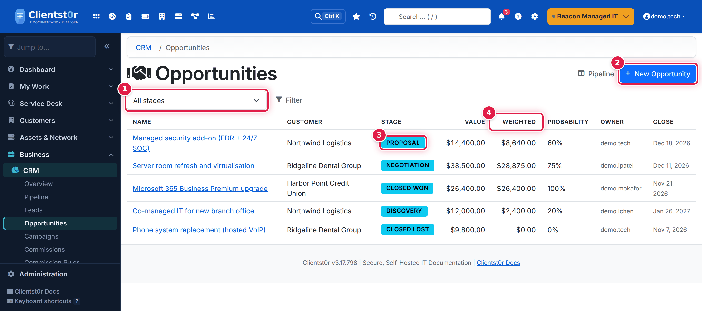
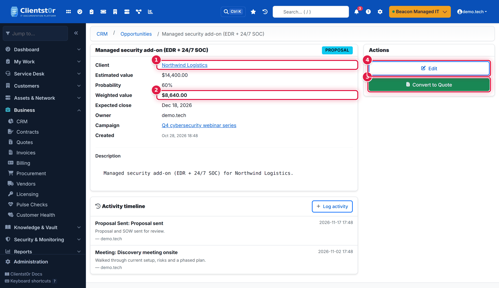
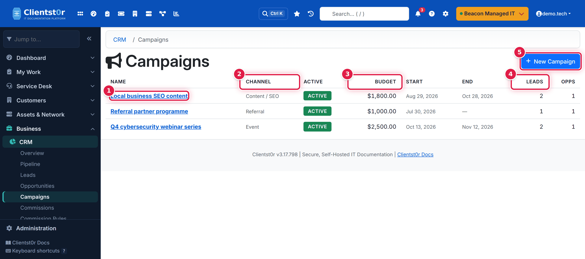
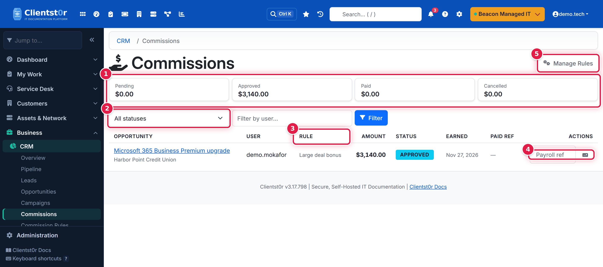
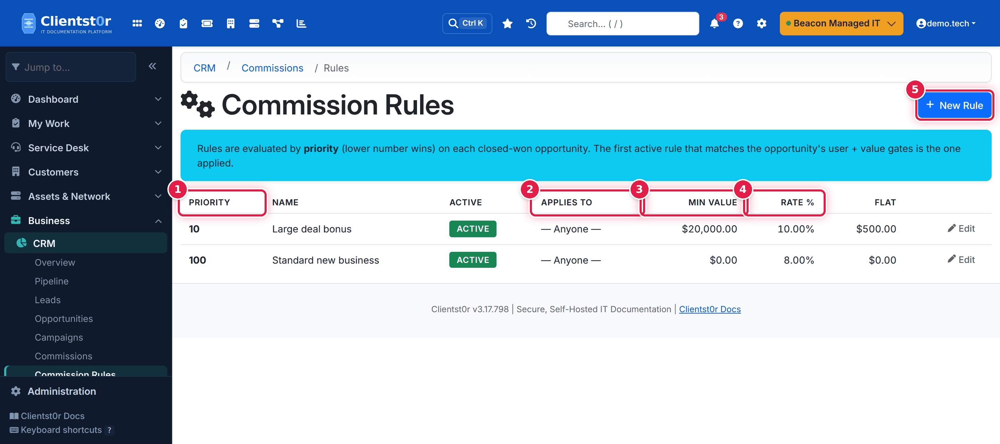

# CRM: leads, opportunities and commissions

The CRM is the MSP's own sales pipeline. It tracks people who might become customers (leads), the deals being worked
(opportunities), the marketing efforts that bring them in (campaigns) and the commission a salesperson earns when a
deal is won. It is in **Business → CRM** in the sidebar (**Overview**, **Pipeline**, **Leads**, **Opportunities**,
**Campaigns**, **Commissions** and **Commission Rules**) and is for MSP staff only: customer users never see it.
The numbers in each screenshot match the list under it. Every screenshot is a capture of the application against a
demo database; the customers and people in it are invented.

The CRM is **off by default**. A superuser switches it on in **Administration → Modules → Feature Toggles**
(*CRM*); until then the sidebar has no CRM section.

## How a deal moves through the CRM

1. A **lead** comes in: typed in by hand, from the public web form, or from the REST API.
2. When the lead is worth pursuing, **Convert to Org + Opportunity** creates a customer organization and a first
   opportunity in the **Qualified** stage, and marks the lead *Converted*.
3. The opportunity moves across the **pipeline** (Discovery, Qualified, Proposal, Negotiation, then Closed Won or
   Closed Lost). From Proposal onward you can draft a **quote** for the customer from it.
4. Moving it to **Closed Won** stamps the close date and works out a **commission** for the person it is assigned to.
5. A manager approves the commission and marks it paid, with a payroll reference.

A lead that is not worth pursuing is **disqualified** instead. Nothing is deleted.

## Who can see and do what

Every CRM page belongs to the MSP organization you are working in (the one in the customer switcher). You see that
organization's leads, opportunities, campaigns and rules; superusers see all of them. Customer organizations created
by converting a lead are ordinary customers, with their own records, and appear in **Customers**.

Access comes from the role's permissions. The built-in *Sales Rep* role has the first three of these; *Sales Manager*
has all five:

| Permission | What it allows |
|---|---|
| `crm_view` | Overview, Leads, Opportunities, lead and opportunity pages, logging activities |
| `crm_create_lead` | New Lead and Edit Lead |
| `crm_manage_pipeline` | Pipeline board, creating and editing opportunities, changing stages, converting or disqualifying leads, drafting a quote, the Commissions page |
| `crm_manage_campaigns` | The Campaigns pages |
| `crm_view_forecast` | The weighted forecast tile, Commission Rules, and seeing and deciding everyone's commissions |

All five are for MSP staff; a customer user gets an access-denied page even if given a customer role that includes
them.

## Overview

**Business → CRM → Overview** (`/crm/`).

<!-- guide-figure: guide-crm-overview -->

1. Open opportunities: every deal not yet closed won or lost.
2. Weighted forecast: estimated value times probability, summed over open deals. Shown only with the forecast permission.
3. Leads created in the last seven days.
4. Leads created in the last 30 days that are now converted, as a share of all created in that period.
5. Recent Leads: the eight newest. Recent Opportunities, beside it, lists the eight newest deals.
<!-- /guide-figure -->

- **Open Opportunities** counts deals that are not Closed Won or Closed Lost.
- **Weighted Forecast** is the sum, over open deals, of estimated value times probability. It appears only for people
  with `crm_view_forecast`.
- **Conversion Rate (30d)** is leads created in the last 30 days that are now Converted, divided by all leads created
  in those 30 days. A lead created a year ago and converted today does not count.
- The buttons at the top (Pipeline, Campaigns) show only for people who may open those pages.

## Pipeline

**Business → CRM → Pipeline** (`/crm/pipeline/`). Needs `crm_manage_pipeline`.

<!-- guide-figure: guide-crm-pipeline -->

1. One column per stage, from Discovery to Closed Lost.
2. How many deals are in the stage.
3. A deal card: name, customer, weighted value, probability and owner. Drag it to another column to change its stage.
4. Dropping a card here closes the deal as won and works out the commission.
<!-- /guide-figure -->

- One column per stage, in this order: Discovery, Qualified, Proposal, Negotiation, Closed Won, Closed Lost. Each
  column header shows the number of deals; the foot of the column shows their weighted total. The board scrolls
  sideways when the window is narrow.
- **Drag a card** to another column to change the deal's stage. The change is saved at once and written to the audit
  log. The probability does not change when you drag; edit the deal to change it.
- Moving a card into Closed Won or Closed Lost sets the **actual close date** to today (in the installation's time
  zone) if it has none.
- Moving a card into Closed Won also works out the commission (see [Commissions](#commissions)).
- Moving a deal out of Closed Won (by dragging or editing) cancels its **pending** commission, with a note saying
  why. A commission that was already **approved** or **paid** is left as it is, and you get a warning naming it, so
  someone can reverse it deliberately. Moving a deal back to an open stage also clears its close date.

## Leads

**Business → CRM → Leads** (`/crm/leads/`). Newest first, up to 500.

<!-- guide-figure: guide-crm-leads -->

1. Search company, contact name, email or industry.
2. Filter by lead status.
3. Create a lead.
4. Status of the lead.
5. Score, 0 to 100, worked out from how complete and promising the lead is.
<!-- /guide-figure -->

- Search matches company, contact first or last name, email and industry. The status filter offers New, Contacted,
  Qualified, Disqualified and Converted. You set the status by editing the lead; Converted and Disqualified are set
  by the buttons below.
- **Score** is worked out by the system every time the lead is saved, from 0 to 100: +20 for an estimated value of
  10,000 or more, +15 for a target industry (legal, healthcare, finance, professional services, accounting,
  manufacturing, medical), +15 for 50 or more employees, +20 for both email and phone, +10 for a website, +10 for a
  campaign and +10 for an owner. A lead that is no longer *New* starts at 10; a *New* lead starts at 0. Colours:
  red from 70, amber from 40. It is a rough hint for ordering your calls, not a forecast.
- **New Lead** and **Edit Lead** need `crm_create_lead`. The campaign list on the form is limited to the current
  organization's campaigns.

### A lead's page

<!-- guide-figure: guide-crm-lead-detail -->

1. The lead score.
2. Contact, company details, source, campaign and owner.
3. Calls, emails and notes logged against the lead. Web form and API leads add an Inbound entry themselves.
4. Create the customer organization and the first opportunity.
5. Mark the lead disqualified, with an optional reason added to its notes.
<!-- /guide-figure -->

- **Convert to Org + Opportunity** (needs `crm_manage_pipeline`) asks for confirmation, then in one step creates a
  customer organization from the lead (company name, email, phone, website, and the contact as the primary contact),
  and an opportunity named "*Company* — Initial Opportunity" in the **Qualified** stage at 20% probability, with the
  lead's estimated value, notes, campaign and owner. The lead becomes *Converted* and links to both. You land on the
  new opportunity. Converting a lead twice just takes you to the existing opportunity.
- The new organization is created from the lead alone. It is not linked to any existing customer, so convert only
  leads that are not already customers; for new business with an existing customer, create an opportunity instead.
- **Disqualify** marks the lead Disqualified and, if you typed a reason, adds it to the lead's notes with the date.
  Both buttons are hidden once a lead is Converted or Disqualified. A disqualified lead cannot be re-opened with a
  button; edit it and change its status.
- **Log activity** records a call, email, meeting, demo, note, proposal sent or contract signed, with an optional
  duration and outcome, in the **Activity timeline** (the latest 15 show). Leads that arrive from the web form or
  the API get an *Inbound* entry holding what was submitted.

### Getting leads in automatically

- **Web form.** A public form on your website can POST to `/crm/leads/capture/` (fields `company_name` and `email`
  are required; `first_name`, `last_name`, `phone`, `website` and `notes` are optional). It is limited to 10
  submissions a minute per visitor, and a hidden `website_url` field catches simple bots: a submission that fills it
  in is accepted and silently dropped. The lead goes to the first active organization on the installation, so on an
  installation with several organizations, check where web leads land.
- **REST API.** `POST /crm/api/leads/capture/` with `Authorization: Bearer <API key>` and the same fields as JSON or
  form data. The lead is filed under the API key's organization, and only if the key's owner is active and has
  `crm_create_lead` in that organization.

## Opportunities

**Business → CRM → Opportunities** (`/crm/opportunities/`). Newest first, up to 500.

<!-- guide-figure: guide-crm-opportunities -->

1. Filter by stage.
2. Create a deal against an existing customer organization.
3. The deal's stage.
4. Weighted: value times probability.
<!-- /guide-figure -->

- Filter by stage. **Value** is the estimated value; **Weighted** is that times the probability.
- **New Opportunity** and the Pipeline button need `crm_manage_pipeline`. An opportunity is always **with an
  existing customer organization** (the *Client* field); to start from someone who is not a customer yet, use a lead.
- Probability defaults to 20% and is a judgement you set, not something the stage changes.

### An opportunity's page

<!-- guide-figure: guide-crm-opportunity-detail -->

1. The customer organization the deal is with.
2. Estimated value times probability.
3. Draft a quote for this customer from the deal. Offered in Proposal, Negotiation and Closed Won.
4. Edit every field, including stage.
<!-- /guide-figure -->

- The client name links to the customer's workspace, and the quote number (once there is one) to the quote, but only
  when you are allowed to open those pages.
- **Edit** changes every field, including the stage, close dates, lost reason, campaign and owner. Setting the stage
  to Closed Won or Closed Lost in the form works the same as dragging the card: the close date is filled in if left
  blank and, for Closed Won, the commission is worked out.
- **Convert to Quote** appears when the stage is Proposal, Negotiation or Closed Won and no quote is linked yet. It
  creates a **draft quote** for the client, titled with the deal's name and carrying its description, and links the
  two; you land on the quote to add lines and send it. It copies no value onto the quote: price the quote there.
  Each opportunity can have one linked quote.
- The activity timeline works as on a lead.

## Campaigns

**Business → CRM → Campaigns** (`/crm/campaigns/`). Needs `crm_manage_campaigns`.

<!-- guide-figure: guide-crm-campaigns -->

1. Open the campaign for its leads, deals, won value and ROI.
2. Channel.
3. Budget, used for the ROI figure.
4. Leads attributed to the campaign.
5. Create a campaign.
<!-- /guide-figure -->

- A campaign has a name, channel (email, cold call, referral, event, social media, paid ads, content / SEO, partner
  or other), dates, a budget and an active flag. Leads and opportunities are attributed to it by choosing it on
  their forms; converting a lead carries the campaign across.
- The list shows how many leads and opportunities each campaign has. Opening a campaign shows its leads, deals, how
  many leads converted, the number and estimated value of won deals, and **ROI**.
- **ROI** is (estimated value of won deals − budget) ÷ budget, as a percentage. It uses the deals' *estimated
  value*, not invoiced revenue, and shows "no budget" when the budget is 0.

## Commissions

**Business → CRM → Commissions** (`/crm/commissions/`). Needs `crm_manage_pipeline`.

<!-- guide-figure: guide-crm-commissions -->

1. Totals by status for the rows listed.
2. Filter by status or by user name.
3. The rule that produced the amount.
4. Approved commissions get a payroll reference box and Mark Paid; pending ones get Approve and Cancel.
5. The commission rules.
<!-- /guide-figure -->

### How the amount is worked out

When a deal reaches **Closed Won** (by drag-and-drop or the edit form), Clientst0r looks for a commission rule:

1. The deal must have an **owner** (*Assigned to*). With no owner, no commission is created.
2. The organization's **active** rules are tried in order of **priority**, lowest number first (ties go to the older
   rule). The **first rule that matches wins**; rules do not add up.
3. A rule matches when it is active, its *Applies to* is blank or is the deal's owner, and the deal's estimated
   value is at least the rule's *Min value* (0 means no floor).
4. The amount is **estimated value × rate % ÷ 100 + flat amount**. If it is zero or less, or no rule matched, no
   commission is created.
5. One commission exists per deal and person. It is created as **Pending**, with the rule that produced it recorded.
   If the deal is won again after being reopened, a pending or cancelled commission is recalculated and set to
   **Pending**; one that was already approved or paid is never changed.

For example, with the demo rules *Large deal bonus* (priority 10, from 20,000, 10% + 500) and *Standard new business*
(priority 100, 8%): a 26,400 deal earns 3,140 (10% of 26,400 plus 500) and a 12,000 deal earns 960 (8%). The
standard rule is never added to the larger one.

### Working the list

- The four tiles total the rows shown by status (the list shows the newest 500). Filter by status, or by part of a
  user name.
- **Pending** commissions can be **approved** or **cancelled**; **Approved** ones can be **marked paid**, with an
  optional payroll reference (up to 80 characters). Approving records who approved it and when. Paid and cancelled
  rows have no buttons.
- Deciding a commission needs `crm_view_forecast`, and **nobody can decide their own commission**: another manager
  must. People with only `crm_manage_pipeline` (such as a Sales Rep) see only their own commissions, and see no
  buttons that would work for them. Everyone with `crm_view_forecast` sees everyone's commissions and the **Manage
  Rules** button.
- Every decision is written to the audit log.

## Commission Rules

**Business → CRM → Commission Rules** (`/crm/commission-rules/`). Needs `crm_view_forecast`.

<!-- guide-figure: guide-crm-commission-rules -->

1. Priority: the lowest number is tried first.
2. A named user, or anyone.
3. The deal must be worth at least this.
4. Percent of the deal's estimated value.
5. Add a rule.
<!-- /guide-figure -->

- A rule has a name, a **priority** (lower is tried first, default 100), an active flag, an optional **applies to**
  user, a **minimum value**, a **rate %** of the deal's estimated value, a **flat amount**, and notes.
- Use the flat amount alone (rate 0) for a fixed bonus, or both for a percentage plus a bonus.
- Put specific rules (one person, or large deals) at a lower priority number than the general rule, because the
  first match wins. A general *Standard* rule at 100 catches everything the specific rules do not.
- Changing a rule does not recalculate commissions already created; they keep the amount they were given.

## Limits

- There are no buttons for the stage on a deal's page: use the pipeline board or the edit form.
- Rates apply to the deal's estimated value, not to invoiced or collected revenue.
- There is no way to split a commission between people; it goes to the deal's owner only.
- The Campaigns, Pipeline and Commission Rules pages are reached only through the sidebar and the buttons on the
  other CRM pages; each shows an access-denied page to people without the permission.
