# Customer portal

The customer portal is what your customers see: a separate, stripped-down site where their own people sign in,
raise and follow tickets, read the articles you chose to share, sign agreements and pay invoices. This guide is
written for the MSP, so you know exactly what a customer sees, and it can be handed to customers as it stands:
the sections on signing in, tickets, the knowledge base, agreements and billing describe the portal from the
customer's side.

Portal pages live under `/portal/` (or on their own host name, see [Address](#where-the-portal-lives)). They have no
sidebar, no customer switcher and none of the staff pages. The numbers in each screenshot match the list under it.
Every screenshot is a capture of the application against a demo database; the customers and people in it are
invented.

## Who can use the portal

A person can use the portal when all of these are true:

- the Service Desk is switched on;
- they are not MSP staff (not a superuser, not a Django staff account, and their user type is not Staff);
- they hold an active membership of a customer whose portal is switched on (Administration → General →
  Customer Portal → **Customers**, or the customer's own Service Desk settings);
- their account is active.

A customer user whose customers all have the portal off has nowhere to go and keeps the staff sign-in, where
their role limits what they see. A person who belongs to several customers gets a **customer switcher** in the
portal menu and works in one customer at a time.

You invite people from the customer's page in Clients (Invite portal user): they get an e-mail with a link to
set a first password, valid for three days. An invited person starts with the simple Read-Only role, which in the
portal can file tickets, reply and see the customer's shared tickets; give them one of the customer roles in
[ROLES_AND_ACCESS.md](ROLES_AND_ACCESS.md) to change that. Inviting someone who already has an account at
another customer adds them without a password link, and an MSP staff account can never be invited.

## Signing in

**Address:** `/portal/login/`, or the same `/portal/login/` path on the portal host name.

<!-- guide-figure: guide-portal-login -->
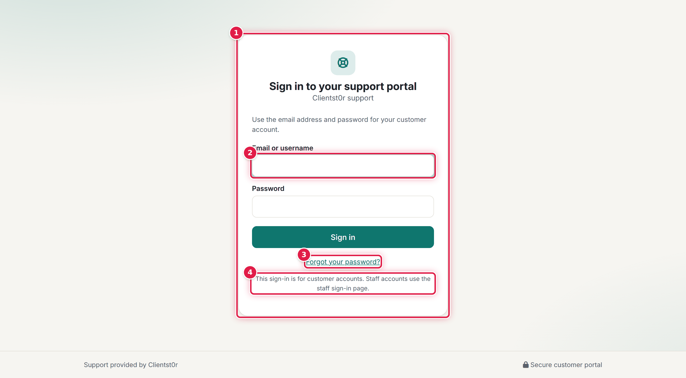

1. The portal sign-in, at /portal/login/ (or on the portal host name). It shows your provider's name, logo and welcome message.
2. Customers sign in with the email address or username of their customer account.
3. Forgot your password: a reset link is sent to portal accounts only.
4. Staff accounts cannot sign in here, and customer accounts cannot sign in to the staff pages.
<!-- /guide-figure -->

- Customers sign in with their **email address or username** and password. The page shows your portal name, logo,
  background and welcome message (see [Branding](#branding-layout-and-features)).
- **Forgot your password?** sends a reset link by e-mail to portal accounts only. The page never says whether an
  address matched, and requests are rate limited.
- After too many wrong attempts the sign-in locks for a while and shows the portal's own lockout page.
- **Two-factor sign-in.** If the person has an authenticator set up they are asked for the code. Whether
  two-factor is required is the installation-wide setting under Settings → Security: when it is required, a
  customer without a device is sent to the portal's own setup page (`/portal/account/two-factor/setup/`) and can't
  skip it; when it is optional they are offered it once per session with **Skip for now**. The last setup page
  has **Get recovery codes**, which makes ten one-time recovery codes and shows them once; **Sign-in security**
  in the menu returns to that page for a fresh set.
- **Change password** (key icon in the menu) needs the current password and applies the password rules, signs
  every other device out and e-mails the account holder. **Sign out of all other sessions** does the same
  without changing the password.

### How the portal sign-in differs from the staff sign-in

| | Portal sign-in | Staff sign-in |
|---|---|---|
| Address | `/portal/login/` | `/account/login/` |
| Who | Customer accounts | MSP staff accounts |
| A staff account's right password | Refused with the same message as a wrong password | Works |
| A customer account | Works | Refused, with a pointer to the portal sign-in |
| Where you land | `/portal/` | The dashboard |

A customer who is signed in and types a staff address (for example `/psa/` or `/assets/`) is sent back to the
portal home: their session never reaches the staff pages. A staff account that opens a portal page without a
portal membership gets a 404, not the portal. With a **portal host name** set, the portal and the staff site also
use separate session cookies.

## Where the portal lives

**Administration → General → Customer Portal** (`/core/settings/portal/`, superusers only). This one page
holds everything about the portal. What each setting changes:

<!-- guide-figure: guide-portal-settings -->
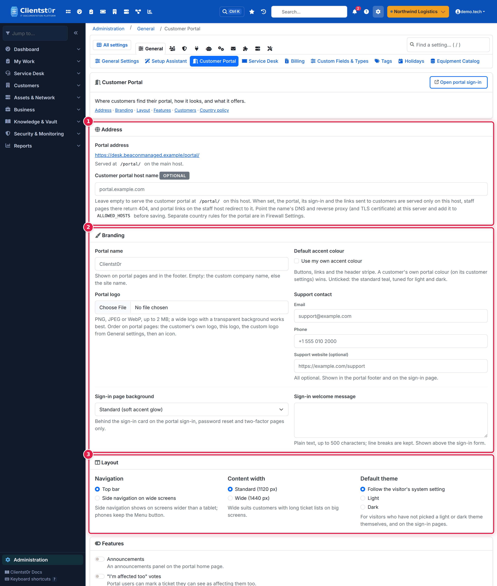

1. Address: the portal host name, and the effective sign-in address.
2. Branding: portal name, logo, accent colour, sign-in background and message, support contacts.
3. Layout: top bar or side navigation, content width and default theme.
<!-- /guide-figure -->

- **Address.** Shows the portal address. **Customer portal host name** is optional: empty means the portal is
  served at `/portal/` on the main host. When set, the portal, its sign-in and the links sent to customers are
  served only on that host, staff pages there return 404, and portal links on the staff host redirect to it. The
  name must differ from the staff host, be in `ALLOWED_HOSTS`, and have DNS and a certificate pointing at this
  server. It can be locked by the `PORTAL_HOSTNAME` environment variable.
- **Branding.** Portal name, logo, accent colour, support e-mail, phone and web address (shown in the footer and
  on the sign-in page), the sign-in background (standard, a colour or an image) and a plain-text welcome message
  above the sign-in form. A customer's own colour and logo (its customer settings) win over these.
- **Layout.** Top bar or side navigation, standard or wide content, default light or dark theme.

<!-- guide-figure: guide-portal-settings-features -->
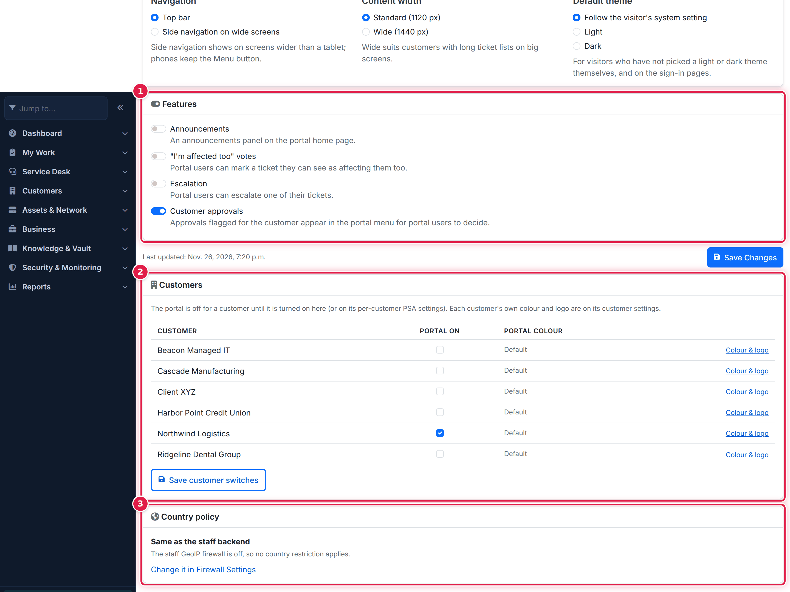

1. Features: the four switches that turn portal pages and buttons on.
2. Customers: switch the portal on or off for each customer.
3. Country policy: shown here, set on the firewall page.
<!-- /guide-figure -->

- **Features** (only while the Service Desk is on). Four switches, all off until you turn them on:

  | Switch | What it turns on |
  |---|---|
  | Announcements | The banner panel on the portal home page |
  | "I'm affected too" votes | The **I'm affected** button on a ticket |
  | Escalation | **Escalate this ticket** on an open ticket |
  | Customer approvals | The **Approvals** menu item and the approval pages |

  When a switch is off, the page behind it answers 404 and the button is not drawn.
- **Customers.** The portal on or off for each customer, in bulk. A customer with the portal off has no portal
  at all. Each change is written to the audit log.
- **Country policy.** Shows whether the portal follows the staff GeoIP rules or has its own; it is changed on
  the firewall page.

Other things that decide which pages a customer sees:

| Page in the portal menu | Shown when |
|---|---|
| My Tickets, New Ticket, Approvals | the Service Desk is on for that customer (a customer on an external PSA only gets the rest); Approvals also needs the *Customer approvals* switch |
| Knowledge Base, Credentials, Agreements, Service Status | Always in the menu (each page says so when there is nothing in it) |
| Billing | The person's role holds `portal_billing_contact` |
| Feedback | Pulse checks are switched on (Administration → Modules) |
| Menu items for the account | Always: notification preferences, change password, sign-in security |

## The home page: My Tickets

**Menu → My Tickets** (`/portal/`).

<!-- guide-figure: guide-portal-home -->
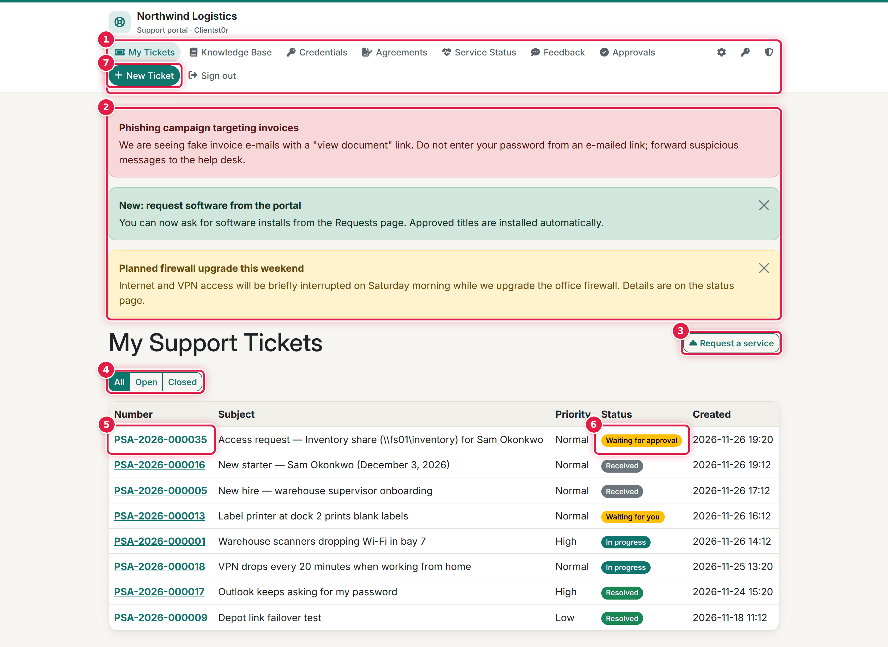

1. The portal menu. Which items appear depends on the customer's settings and the person's role.
2. Announcements your provider posted for this customer. A person can dismiss one for the rest of the session.
3. Request a service: the list of request types.
4. Show all, open or closed tickets.
5. The ticket number opens the ticket.
6. The status is one of five plain phrases, not the internal status name.
7. New Ticket: pick what you need help with.
<!-- /guide-figure -->

- Lists up to 200 tickets, newest first, with number, subject, priority, **status** and created time. The
  All / Open / Closed buttons filter by whether the status is a closing one.
- **Which tickets.** Only tickets that are *shared with the customer* and belong to the customer the person is
  working in. A role with `portal_tickets_view_org` (Customer Administrator, Customer Manager, and every simple
  role that existed before the roles update) sees all of the customer's shared tickets; a role without it, such
  as Customer Standard User, sees only the tickets they filed or that name them as the requester.
- **Status wording.** Customers see one of five plain phrases instead of your status names: Received, In
  progress, Waiting for you, Waiting for approval, Resolved. Which phrase each of your statuses shows can be
  changed per status; a ticket with an open customer approval always reads *Waiting for approval*.
- **Announcements** appear above the list while the Announcements switch is on, posted per customer with a
  severity, an optional expiry and an optional dismiss button (a dismissed banner stays hidden for that session).
- A customer with the Service Desk switched off lands on the Knowledge Base instead.

Tickets get into the portal in these ways: the customer raised them there, they arrived by e-mail from a known
requester, or they came from a guided request (all of these are shared automatically), or a technician shared
them. A ticket a technician creates in the staff pages is **not** shared unless they turn on **Visible to
customer** on the New Ticket form. On an existing ticket, the Details card shows *Visible to customer* with a
**Share with customer** / **Hide from customer** link, for anyone whose role may edit the ticket; each change is
noted on the ticket and audit-logged. Internal notes stay hidden either way.

## Raising a ticket and guided requests

**New Ticket** or **Request a service** (`/portal/new/`). A role without `portal_tickets_create` gets a 403 here.

<!-- guide-figure: guide-portal-new -->
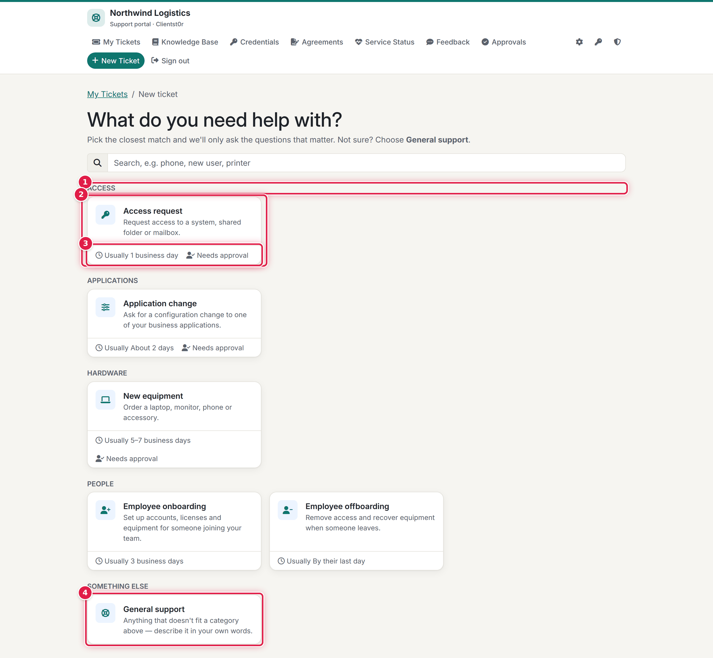

1. Request types are grouped by category.
2. Each card is a request type your provider published for this customer.
3. The usual turnaround, and whether an approver at the customer must say yes first.
4. General support: describe anything else in your own words.
<!-- /guide-figure -->

- The picker lists the **request types** published for this customer, grouped by category, each with its usual
  turnaround and a note when an approver at the customer has to say yes first. A request type can be limited to
  chosen customers, copied for one customer, or offered to the customer's administrators only. **General
  support** is always there.
- Request types and their forms are built in the service catalog; see [TICKET_ROUTING.md](TICKET_ROUTING.md)
  and [SERVICE_MANAGEMENT.md](SERVICE_MANAGEMENT.md).

<!-- guide-figure: guide-portal-form -->
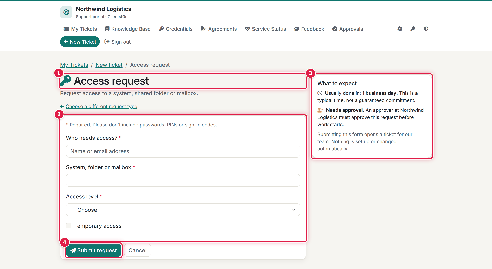

1. The request type and what it is for.
2. The questions for this request type. Required ones are marked with a red asterisk.
3. What to expect: turnaround and whether approval is needed.
4. Submit request creates one ticket, routed by the request type.
<!-- /guide-figure -->

- A guided form asks only the questions of that request type. People are reminded not to type passwords or
  sign-in codes. As they fill in the form, matching articles from the customer-visible knowledge base are suggested. Submitting creates one ticket, shared with the customer, routed as the request type says.
  A double click does not create two tickets.
- **General support** (`?form=general`) is a subject, details, an optional site (only the customer's own active
  sites) and up to five attachments of 25 MB each.
- A guided request shows its answers on the ticket. The answers are visible to the person who asked, the
  request type's approvers and the customer's portal administrators, not to every colleague.

## Following a ticket, replying and Cc

**Click a ticket** (`/portal/t/PSA-2026-000018/`).

<!-- guide-figure: guide-portal-ticket -->
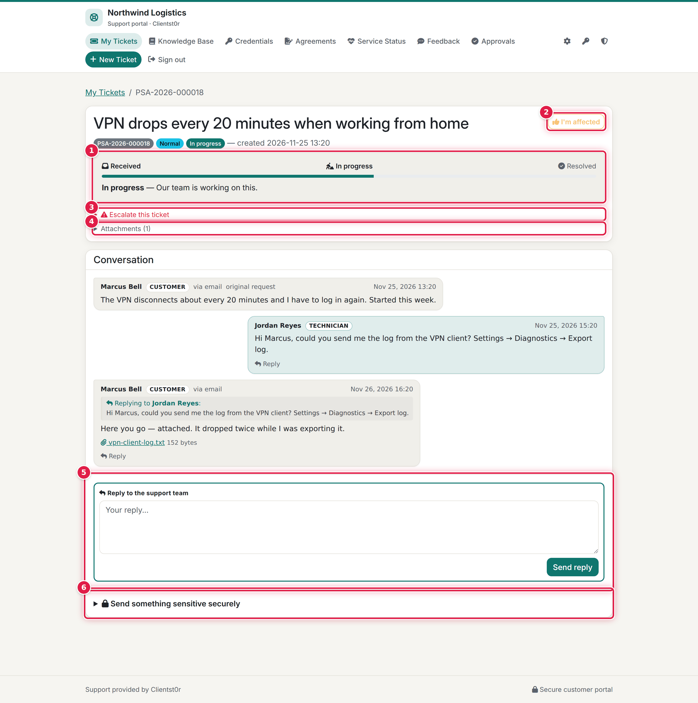

1. Progress in three steps: Received, In progress, Resolved, with a plain sentence about what is happening.
2. I'm affected: a vote that tells the support team more people are hit. Off unless your provider turns it on.
3. Escalate this ticket, with a reason. Off unless your provider turns it on.
4. Files from the conversation that are not internal.
5. Reply to the support team.
6. Send something sensitive securely: stored encrypted, never e-mailed, and read only by the support team.
<!-- /guide-figure -->

- The progress bar and sentence say where the request stands. **Waiting on your side** lists approvals the
  customer has to decide and the last question the support team asked.
- **Reply to the support team** posts a public comment from the customer, which also takes the ticket out of a
  waiting-on-client status. Reply buttons on a message thread the answer under it. A role without
  `portal_tickets_reply` sees the ticket read-only: no reply boxes, no vote and no escalation. A closed ticket
  has no reply boxes.
- **Send something sensitive securely** is for a password or other secret. It is stored encrypted, is never
  e-mailed, can be opened only by the support team, and is erased after the retention period (the page states
  it). The customer sees only whether it was received and read.
- **Escalate this ticket** (switch needed) records a reason and adds a public "Escalated by client" comment.
  **I'm affected** (switch needed) is a toggle vote.
- Attachments listed are only the non-internal ones. Customers can add files on a new ticket; the reply box
  takes text only.

<!-- guide-figure: guide-portal-conversation -->
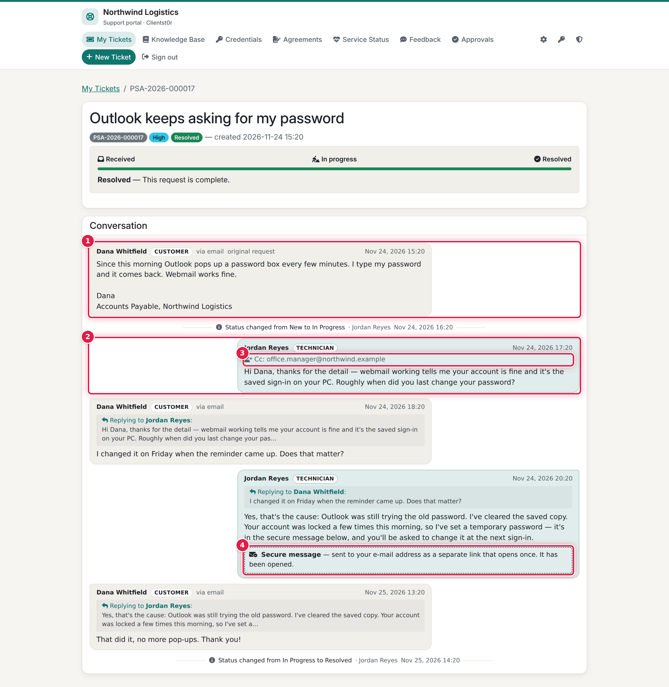

1. The customer's own messages.
2. Replies from the support team, with their name.
3. Cc: who was copied on an e-mailed reply.
4. A secure message: the password itself went to the requester's e-mail as a separate link. The ticket shows only whether it was opened.
<!-- /guide-figure -->

**Cc.** Cc is an e-mail feature. When a technician e-mails a reply and copies colleagues, the Cc line shows on
that message in the portal. The portal itself has no Cc box: a customer adds colleagues by copying them on an
e-mail reply, and the addresses are kept on the ticket for later e-mailed replies.

**Secure messages from the support team.** When a technician puts a password in a secure message, the customer
gets it as a separate link in the e-mail to the requester, which shows a **Show the message** button and opens
once. The ticket in the portal shows only the state: not opened yet, opened, or no longer available. The secret
itself is never in the ticket. A secure message is never combined with Cc.

What the customer never sees on a ticket: internal notes, internal attachments and files on internal notes,
replies quoting an internal note, technician time, charges and assets, and system events that staff marked
internal. See [CLIENT_DATA_PROTECTION.md](CLIENT_DATA_PROTECTION.md) for the complete list.

## Approvals

**Menu → Approvals** (`/portal/approvals/`, needs the *Customer approvals* switch).

<!-- guide-figure: guide-portal-approvals -->
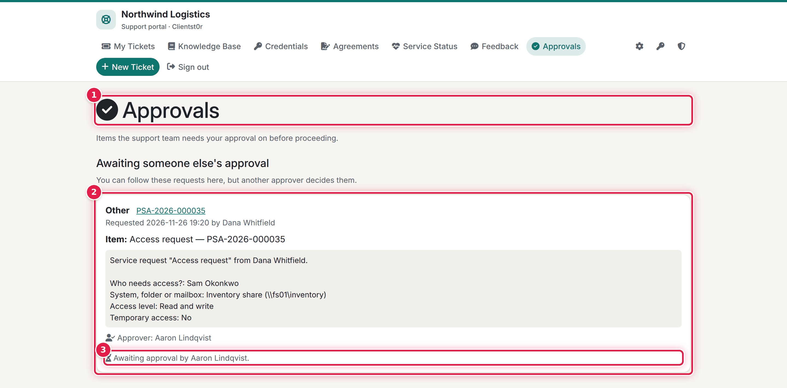

1. Approvals waiting on this customer. The menu item appears only when your provider turns customer approvals on.
2. One request, with who asked, the ticket and what was asked.
3. Someone who is not an approver for this request sees it, with who it is waiting on, but cannot decide it.
<!-- /guide-figure -->

- Lists requests waiting on the customer, with who asked, the ticket and the details. The person who asked is
  never the one who approves a service request.
- For a **guided request**, the approvers are the request type's named approvers for that customer; with none
  named, the customer's portal administrators. Requests the person can decide are listed under *Awaiting your
  decision*; one they can't decide is listed under *Awaiting someone else's approval* with "Awaiting approval by"
  and the named approvers, or the customer's administrators, and no buttons. Other approvals can be decided by anyone whose role holds
  `portal_approve_requests` (Customer Administrator, Customer Manager, Request Approver).
- Every decision, and every refusal, is audited; a decision adds a public line to the ticket.

## Knowledge base

**Menu → Knowledge Base** (`/portal/kb/`).

<!-- guide-figure: guide-portal-kb -->
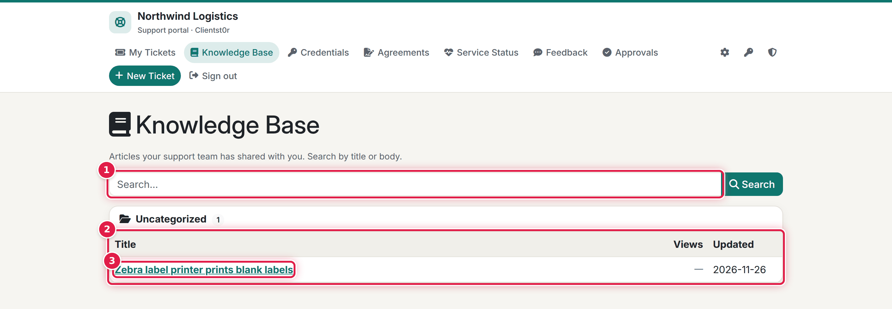

1. Search the titles and the customer-visible text of articles.
2. Only articles your provider marked visible in the customer portal appear, grouped by category.
3. An article title opens the article.
<!-- /guide-figure -->

- An article reaches a customer only when staff tick **Visible in customer portal** on it and it is live:
  published, approved and not archived. It must be the customer's own article, or a global article whose
  audience includes the customer (all customers, or shared with the customer or a customer group).
- Search covers titles and the customer-visible text. Featured articles come first.
- Technician-only parts of a customer-visible article, written as `:::internal` ... `:::` (or
  `
`), are removed from the page, search, suggestions and downloads.
- An "Uploaded File" article shows a Download button; every download is audited.
- Everything else in Documentation (assets, documents, passwords, runbooks) is staff only.

## Agreements, quotes and contracts

**Menu → Agreements** (`/portal/agreements/`).

<!-- guide-figure: guide-portal-agreements -->
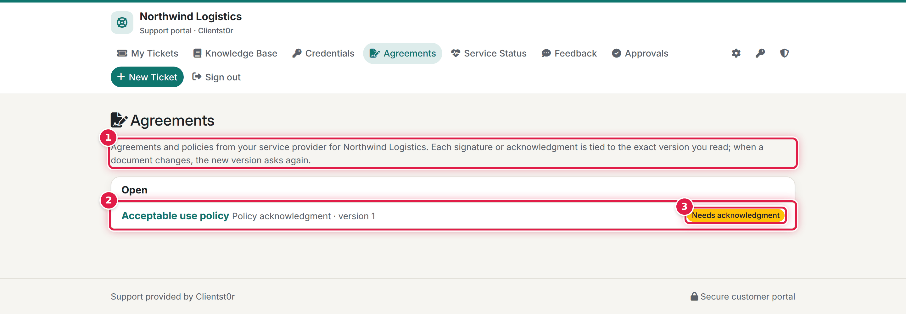

1. Each signature or acknowledgment is tied to the exact version the person read.
2. Open: documents waiting for a signature or acknowledgment, and those already done.
3. Needs signature or Needs acknowledgment, depending on the document.
<!-- /guide-figure -->

- Shows the customer's agreements (master agreements, statements of work, policies) that are open, whether each
  needs the person's signature or acknowledgment, and the signed history with an **Evidence** download.
- A signature or acknowledgment is tied to the exact version read; editing the document issues a new version
  that asks again. Who may sign is set per agreement: any portal user, only administrators, or named people.
- A role without `portal_agreements_view_org` sees only its own signatures; others see colleagues' too.

**Quotes** are signed from a private link e-mailed to the customer, without signing in
(`/portal/quote/<token>/sign/`). The page shows the quote, takes a drawn signature, name and e-mail, and
records the time, address and a hash of the exact content. A quote that has expired, is waiting for internal
approval, or was changed while the customer read it can't be signed.

**Contracts** are signed from their own e-mailed link under `/sign/`, which opens exactly one contract version.
Who may review and sign contracts for a customer is decided by the Contract Reviewer and Authorized Contract
Signer roles; see [ROLES_AND_ACCESS.md](ROLES_AND_ACCESS.md#contracts).

## Billing, invoices and paying

**Menu → Billing** (`/portal/billing/`) appears only for people whose role holds `portal_billing_contact`
(the **Billing Contact** role; nobody gets it automatically, not even a Customer Administrator). Everyone else
gets a 403 on those addresses.

<!-- guide-figure: guide-portal-billing -->
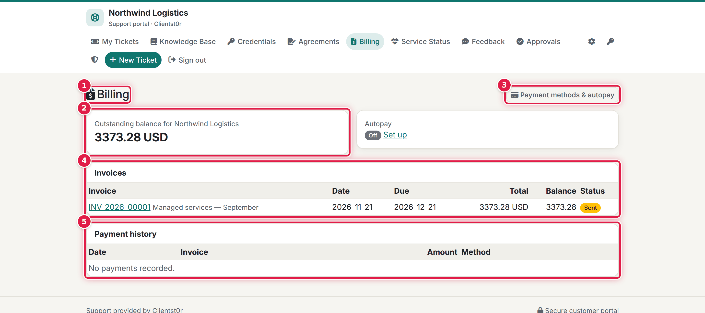

1. Billing appears only for people whose role is Billing Contact.
2. What is outstanding for this customer.
3. Saved payment methods and autopay.
4. Invoices billed to this customer. Drafts are never shown.
5. Payments and receipts.
<!-- /guide-figure -->

- Shows the outstanding balance for the customer, invoices billed to it (never drafts, and no internal fields
  such as cost, GL codes or notes), payment history with PDF receipts, saved payment methods and autopay.
- **Pay now** appears on an invoice when a payment provider is connected and online payment is on for the
  portal; the customer pays on the provider's hosted page and the receipt appears on return. Autopay needs the
  customer's recorded consent. Setup of providers, refunds and the money flow are in
  [PAYMENTS.md](PAYMENTS.md); invoices, quotes and their layout are in [BILLING.md](BILLING.md).
- Opening an invoice records that this person viewed it.

## Service status

**Menu → Service Status** (`/portal/status/`).

<!-- guide-figure: guide-portal-status -->
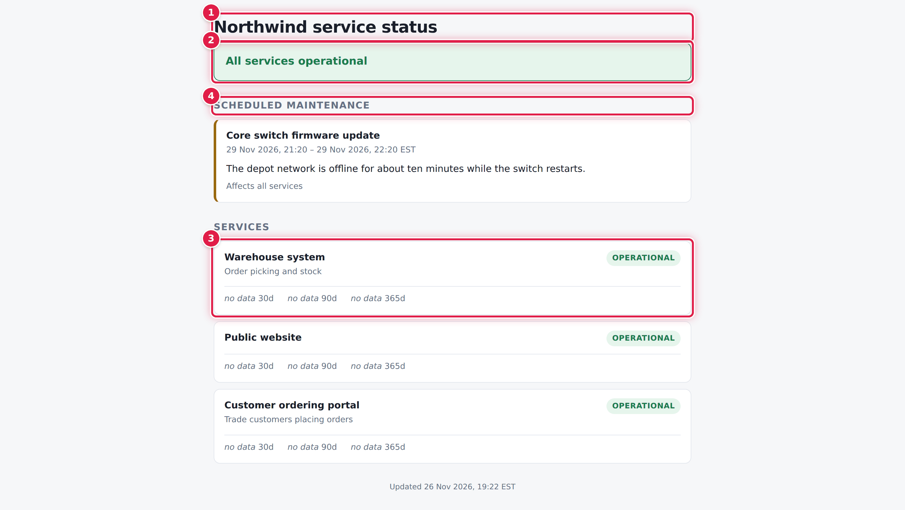

1. The status page your provider published for this customer. Without one, the portal says nothing is published yet.
2. The overall state; the worst service decides it.
3. One service with its current status and uptime over 30, 90 and 365 days ("no data" until it has been monitored that long).
4. Planned work is posted before it starts.
<!-- /guide-figure -->

- Shows the status page you published with **Portal** visibility: the one scoped to the customer, otherwise one
  scoped to no customer. A page with Public visibility is not reused here. With nothing published the page says
  so and offers to open a ticket.
- It lists the services you chose to show under the names you gave them (never the internal monitor name or
  address), the overall state, planned maintenance and incidents.
- It is not in the portal layout: it is the same standalone status page, marked not to be cached or indexed.

## Credentials and customer administrators

**Menu → Credentials** (`/portal/vault/`).

<!-- guide-figure: guide-portal-credentials -->
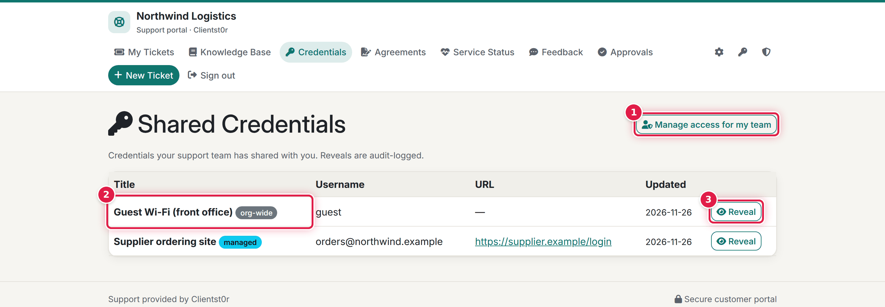

1. Manage access for my team: only for a customer administrator.
2. A credential your provider shared. The badge says who may see it.
3. Reveal shows the password once; every reveal is audited.
<!-- /guide-figure -->

- Shows vault entries staff marked **client visible**, never personal ones. The access mode decides who: all
  members of the customer, an explicit list of people, or *delegated*, where the customer's administrator picks
  the people. **Reveal** shows the password once, applies the same approval and access rules as a technician's
  reveal, shares the 30 reveals per hour limit, and is audited before anything is shown.

A **portal administrator** is a membership marked *Org admin* (the invite form has the tick box; it needs
`org_manage_members`). It is separate from the customer role. A portal administrator can:

<!-- guide-figure: guide-portal-credentials-admin -->
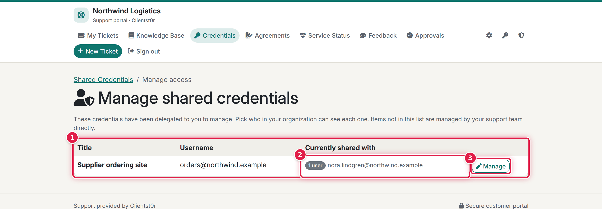

1. Credentials your provider delegated to the customer administrator.
2. Who in the organization can see it now.
3. Manage: tick the people who may see this credential.
<!-- /guide-figure -->

- manage who sees credentials delegated to them (**Manage access for my team**);
- see and sign agreements set to "customer org admins only";
- see request types limited to administrators, and see guided-request answers;
- approve guided requests that have no named approvers.

Everything else comes from the customer role, not from the administrator mark.

| | Customer Administrator | Customer Manager | Standard User | Read-Only | Billing Contact |
|---|---|---|---|---|---|
| See every shared ticket of the customer | yes | yes | own only | own only | no |
| File tickets and requests | yes | yes | yes | no | no |
| Reply, secure reply, escalate, vote | yes | yes | yes | no | no |
| Decide client approvals | yes | yes | no | no | no |
| Coworkers' agreement signatures | yes | yes | no | no | no |
| Billing pages | no | no | no | no | yes |

Roles are assigned in Clients and Roles (see [ROLES_AND_ACCESS.md](ROLES_AND_ACCESS.md)); this table is the
default roles' effect in the portal only. Customers cannot manage their own users in the portal; a customer
administrator who needs that is asked to contact you, because the staff pages are closed to portal accounts.

## Notification preferences, feedback and surveys

- **Notification preferences** (`/portal/preferences/`): e-mail on a reply, e-mail on a status change, survey
  invitations, a weekly digest of the customer's open security alerts, and an optional mobile number with an SMS
  text on status changes (only when SMS is on).

<!-- guide-figure: guide-portal-prefs -->
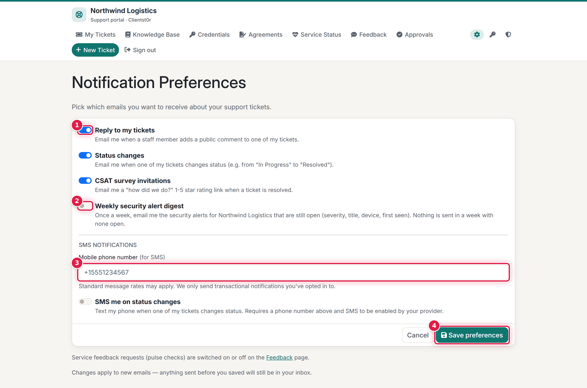

1. Reply to my tickets, status changes and survey invitations: each its own switch.
2. A weekly summary of open security alerts for this customer.
3. A mobile number for SMS, used only if your provider has SMS on and the status-change text switch is on.
4. Save preferences.
<!-- /guide-figure -->

- **Feedback** (`/portal/feedback/`, when pulse checks are on): the person's own pulse surveys, answered in the
  portal or from a single-use e-mailed link, with an opt-out. See [PULSE_CHECKS.md](PULSE_CHECKS.md).
- A satisfaction survey link e-mailed when a ticket is resolved works without signing in.

<!-- guide-figure: guide-portal-password -->
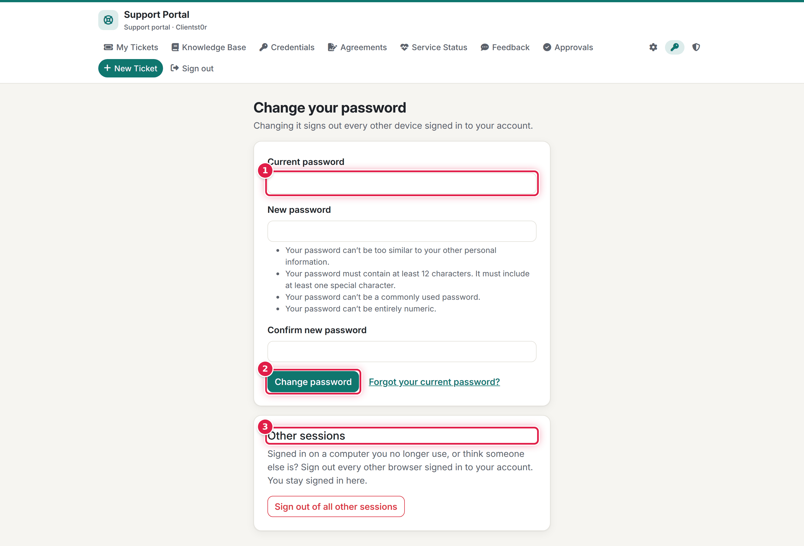

1. The current password is required, and the new one follows your provider's password rules.
2. Change password. Every other device signed in to the account is signed out, and an e-mail tells the account holder.
3. Other sessions: sign out of every other browser without changing the password.
<!-- /guide-figure -->

## What customers never see

Checked against the code, in the order a customer could try to reach it:

- **Staff pages.** Any staff address, including `/psa/`, `/assets/`, `/vault/`, `/docs/`, `/integrations/`,
  and `/accounts/`, redirects a signed-in portal user to the portal home.
- **Other customers.** Every portal lookup is limited to the customer the person is working in; a ticket,
  invoice, agreement, credential, article or evidence file of another customer answers 404. Uploaded files are
  served per file by the same rules.
- **Internal ticket content.** Internal notes, internal attachments, attachments of notes, and tickets not
  shared with the customer.
- **Internal knowledge.** Articles not marked visible in the portal, drafts and archived articles, and the
  technician-only blocks inside visible ones.
- **Internal money fields.** Draft invoices, cost, GL codes, approval and accounting fields and internal notes.
- **Credentials** not marked client visible, personal entries, and entries the person is not on the list for.
- **Monitor names and addresses** behind status page services.

## Known limits

- Customers cannot add Cc addresses in the portal, only by e-mail.
- Customers cannot manage their own users in the portal.
