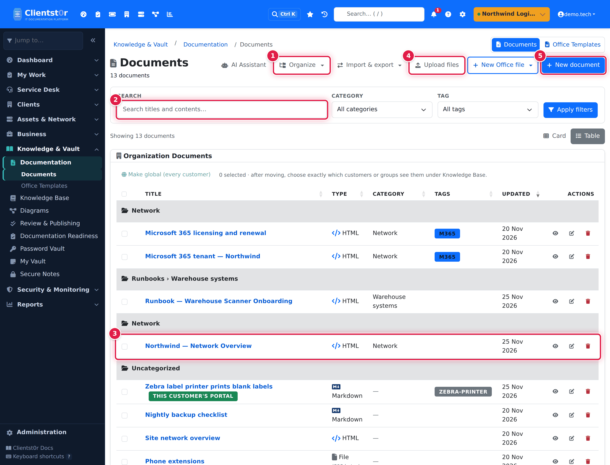
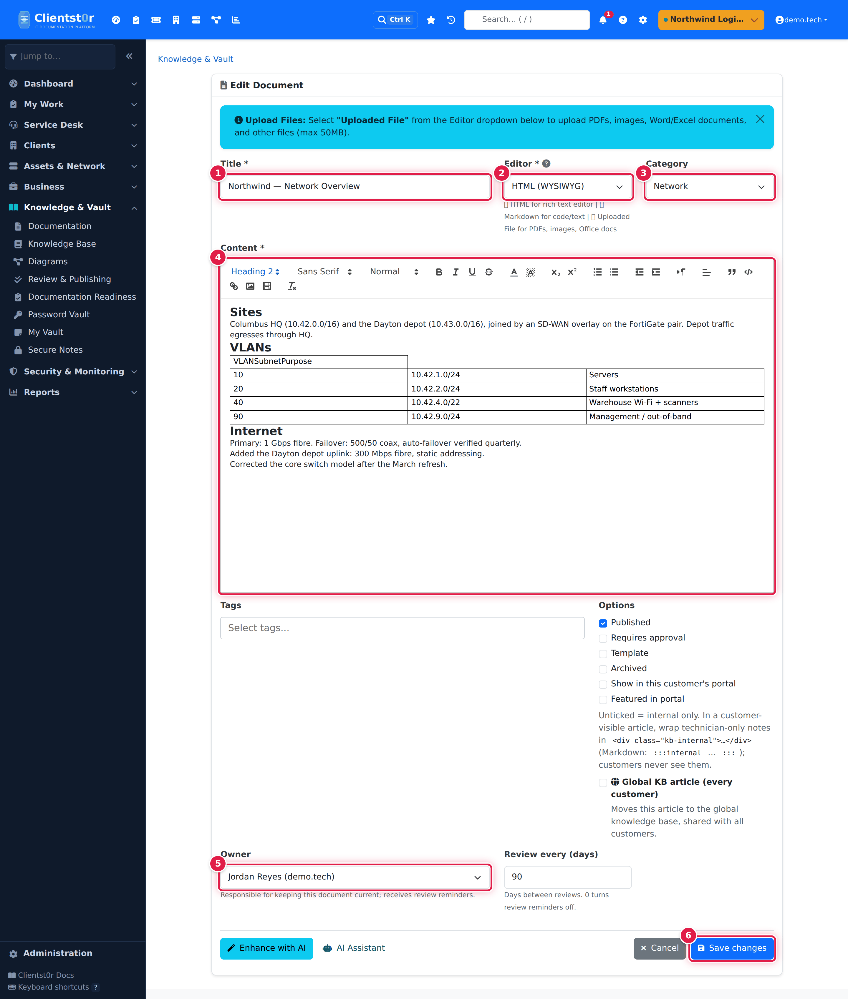
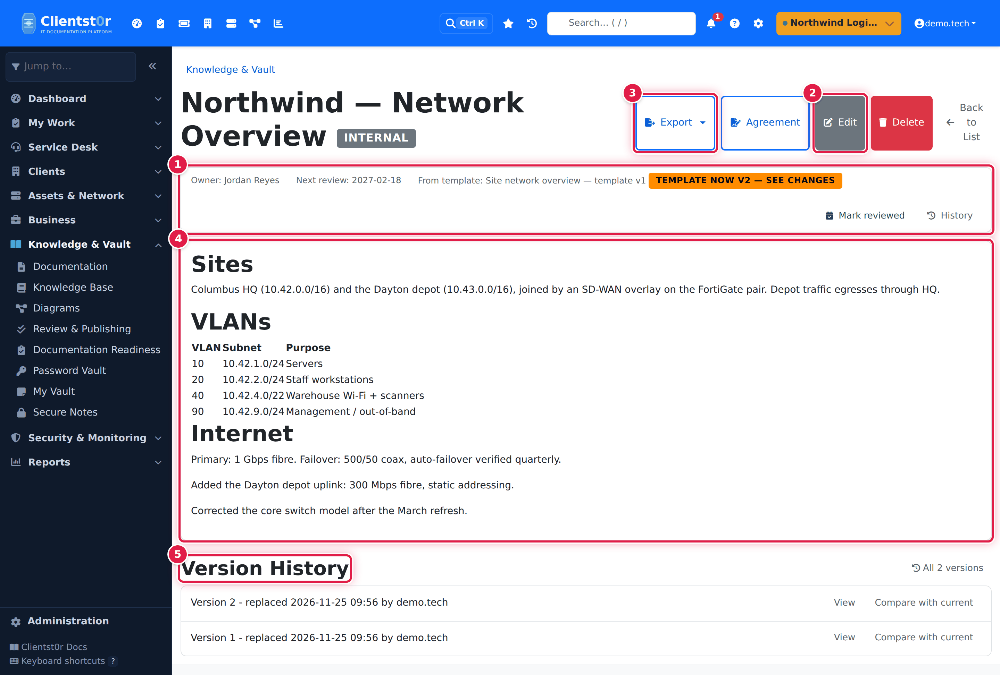
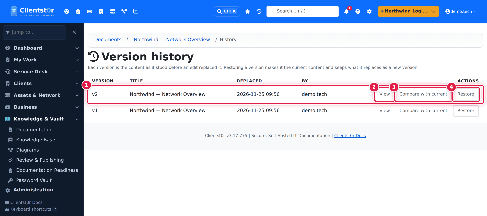
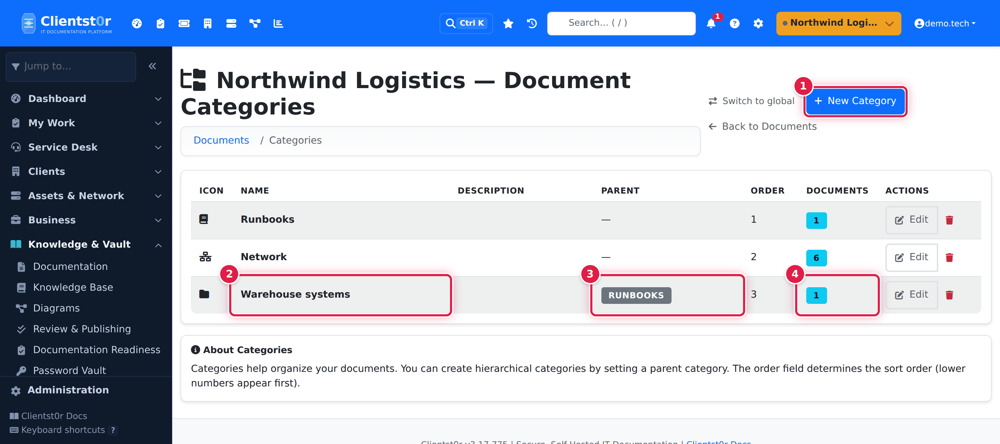
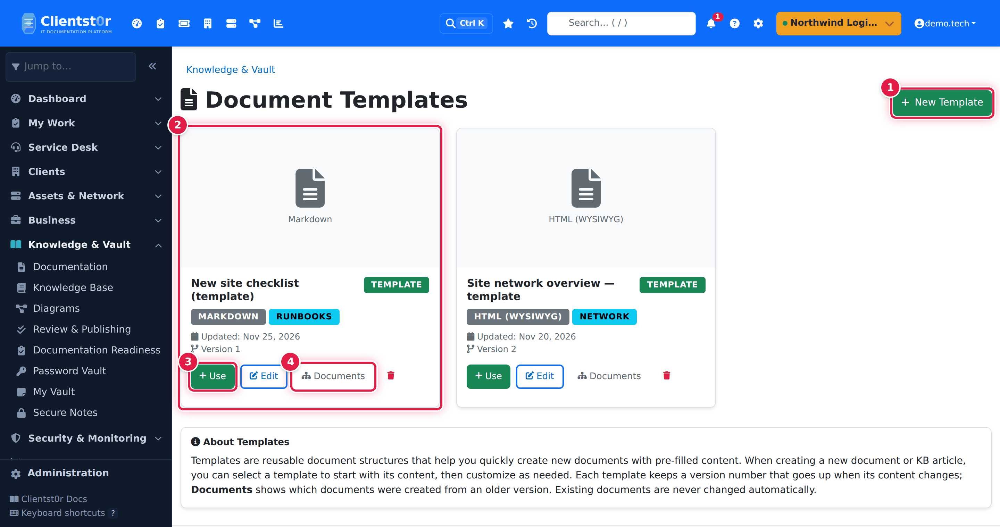
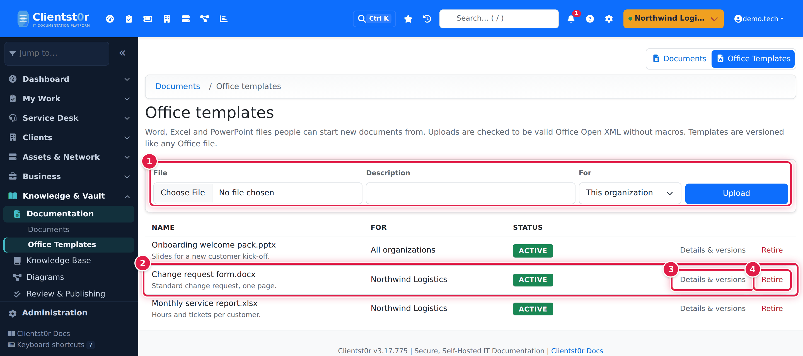
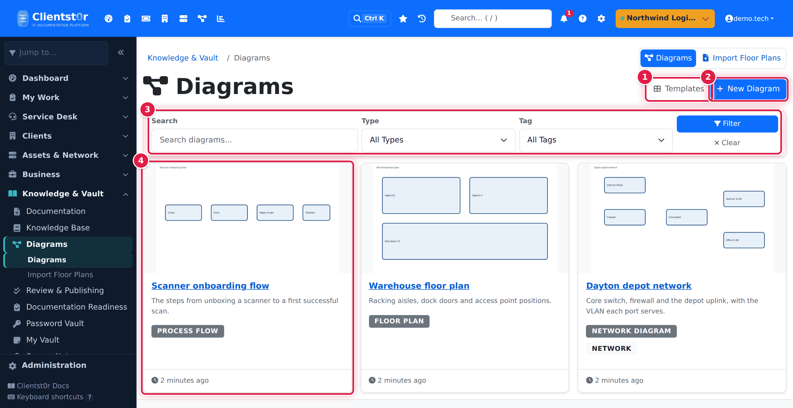
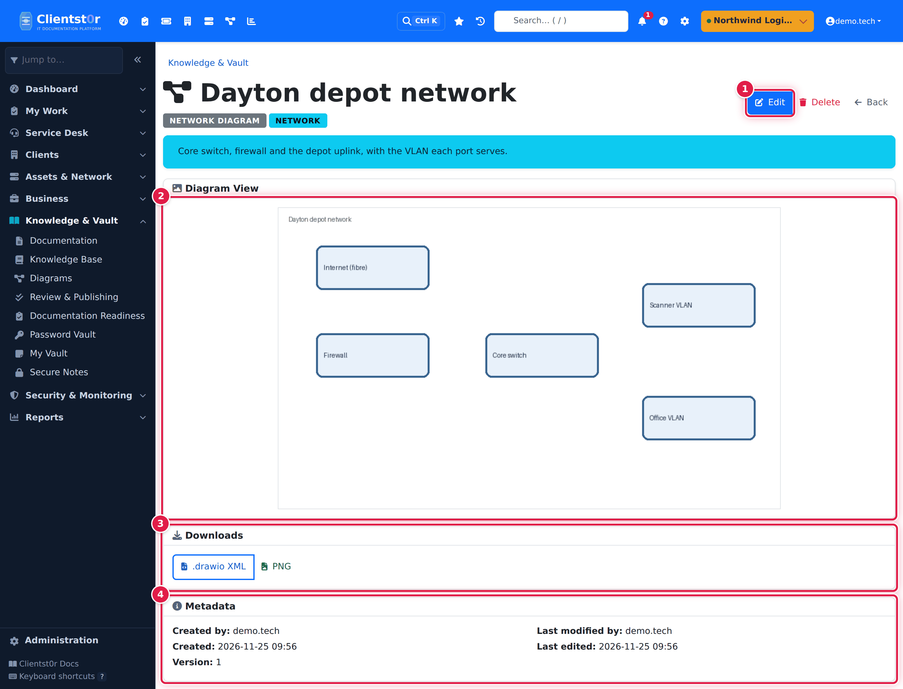
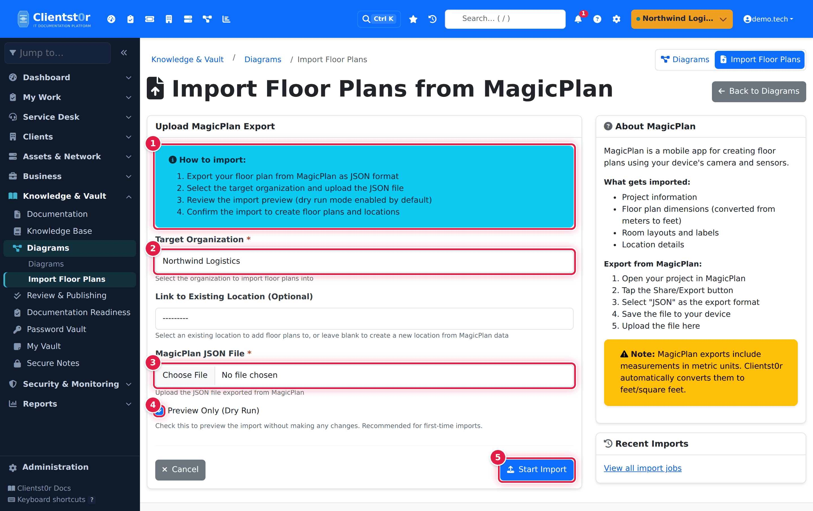

# Documents and diagrams

How technicians write, organise and version a customer's documentation, keep reusable templates, and draw
network and floor diagrams. Everything here is in **Knowledge & Vault** in the sidebar, under
**Documentation** (*Documents* and *Office Templates*) and **Diagrams** (*Diagrams* and *Import Floor
Plans*). The Knowledge Base, Review & Publishing and Documentation Readiness entries next to them are
separate sections. The numbers in each screenshot match the list under it. Every screenshot is a capture of
the application against a demo database; the customers and people in it are invented.

Documents and diagrams belong to the customer in the client switcher (see
[Choosing the customer you work for](GETTING_STARTED.md#choosing-the-customer-you-work-for)). Pick a customer
before you create anything. Editing Word, Excel and PowerPoint files in the browser is covered in
[Office documents](OFFICE_DOCUMENTS.md); this guide only covers the template pages.

## Documents

**Knowledge & Vault → Documentation → Documents** (`/docs/`). The live documents of the selected customer
(and of customers below it, when it is a parent organization), newest edit first, grouped under their
category.

<!-- guide-figure: guide-kdoc-list -->

1. Organize: Categories, Templates, Drafts, Approval queue, Review queue and Archived.
2. Search titles and contents, then narrow by category or tag.
3. One row per live document, grouped under its category: type, category, tags and last update. The eye, pencil and bin open, edit and delete it.
4. Upload files: store PDFs, Office files and images as documents.
5. New document: write one in the editor.
<!-- /guide-figure -->

- **Search** looks in titles and in the body of every document, not only in the rows on screen. Narrow it
  with **Category** and **Tag**, then **Apply filters**. A search that finds nothing is recorded, and shows
  up in **KB Analytics** under Review & Publishing.
- **Card** and **Table** switch the layout. The list shows only *live* documents: drafts, documents waiting
  for approval and archived ones are in **Organize**.
- **Organize** holds Categories, Templates, and the lists from Review & Publishing (Drafts, Approval queue,
  Review queue, Archived).
- **Import & export** brings in Word, PDF, text and Markdown files as editable documents (see
  [Files, import and export](#files-import-and-export)) and exports **exactly the documents the list is
  showing**, with the current search and filters applied, as a ZIP of PDF, Word, Markdown or print-ready
  HTML files with an index.
- **AI Assistant** is **OPTIONAL AI**. It is off unless an administrator turns AI features on, and nothing in
  this guide needs it.
- With no customer selected (Global View, superusers and MSP staff), the list shows every customer's
  documents. Two customers can have a document with the same title; opening one by its address then asks
  you which customer's you mean. Pick a customer before editing or deleting.
- Rows show an eye, a pencil and a bin to everyone whose role can write. Whether you may actually edit or
  delete is decided when you click (see [Permissions](#permissions)); a role without the permission gets a
  "does not include" message instead.

## Writing and editing a document

**New document** (`/docs/create/`) and the pencil on a document (`/docs/<address>/edit/`) open the same form.

<!-- guide-figure: guide-kdoc-form -->

1. Title. The address of the document is made from it.
2. Content type: HTML (rich text), Markdown, or Uploaded File.
3. Category: this customer's own categories.
4. The content editor.
5. Owner, who gets the review reminders; and how many days between reviews.
6. Save changes: the replaced content is kept as a version.
<!-- /guide-figure -->

- **Editor** chooses how the body is written. *HTML (WYSIWYG)* is a rich-text editor. *Markdown* is plain
  text with Markdown formatting. *Uploaded File* stores one file as the document instead of text (see
  [Files, import and export](#files-import-and-export)).
- The document's address is made from its title when it is created (`Network Overview` becomes
  `network-overview`) and does not change when you rename the document. A second document with the same
  title in the same customer gets `-2`, and a title that equals a built-in page (such as *Templates* or
  *Create*) is numbered too, so it can always be opened.
- **Published** makes the document live. **Requires approval** takes it offline after *every* edit until it
  is submitted for review and approved. Without the publish permission you do not see these two boxes: an
  edit to a live document keeps it live, and anything else is saved as a **draft** to submit for review. Both
  are covered in the Review & Publishing section.
- **Template** turns the document into a reusable template, and **Archived** hides it from lists, search,
  exports and the customer portal. On a *new* document the Template box is ignored: create templates from
  Organize → Templates.
- **Show in this customer's portal** makes a document readable by that customer's portal users (*External*);
  unticked it is *Internal*, staff only. Inside an external document, put technician-only notes in a
  `kb-internal` block (in Markdown, between `:::internal` and `:::`): staff see them marked, customers never
  do. **Featured in portal** pins it to the top of the portal knowledge base.
- **Owner** is the person responsible for keeping it current, and gets the review reminders (it defaults to
  the author). **Review every (days)** sets the interval; 0 turns reminders off.
- **Global KB article** appears only for staff who may edit and publish global articles. Ticking it moves
  the document into the global Knowledge Base for every customer; the customer's own categories and tags are
  dropped on the way. See [Per-customer and global documents](#per-customer-and-global-documents).
- **Enhance with AI** (editing only) is **OPTIONAL AI**, gated by the AI master switch.

## A document page, history and versions

**Click a title** (`/docs/<address>/`). A banner shows when the document is a draft, waiting for review or
archived. The panel above the body shows the owner, the next review date and, for a document started from a
template, which template version it was based on.

<!-- guide-figure: guide-kdoc-detail -->

1. Owner, next review date and, when set, the template it came from. Mark reviewed and History are on the right.
2. Edit opens the editor.
3. Export the document as PDF, Word, Markdown or print-ready HTML.
4. The document body, as readers see it.
5. Version History: earlier content, kept on every edit that changes the title or body.
<!-- /guide-figure -->

- **Mark reviewed** (owner or editor) moves the next review date forward without changing the content.
- **Agreement** manages signatures and acknowledgements per version of the document; it is shown to people
  who can write, on customer documents only.
- A document started from a template shows an orange *template now vN* badge when the template has changed
  since; it links to a comparison.
- Page views are counted for **KB Analytics** (most viewed, never viewed).

**History** (`/docs/id/<number>/versions/`) lists the earlier versions, newest first.

<!-- guide-figure: guide-kdoc-versions -->

1. One row per earlier version: when it was replaced and by whom.
2. View shows that version as it was.
3. Compare with current: added and removed lines.
4. Restore makes it current and keeps what it replaces as a new version.
<!-- /guide-figure -->

- A version is saved when an edit **changes the title, the body or the editor type**; the version holds what
  was there *before* the edit, and the "replaced" time and name are those of the edit that replaced it.
  Changing only the category, tags, owner, publish state or the "Archived" box saves no version.
- **Compare with current** shows removed and added lines as plain text; a version can also be compared with
  another version.
- **Restore** needs the edit permission. It makes the old title and body current, and keeps what it replaces
  as a new version, so a restore can itself be undone. Publish rules apply as for any edit.
- Versions record text only. Replacing the *file* of an Uploaded File document is not versioned here (Office
  files have their own version history, see [Office documents](OFFICE_DOCUMENTS.md)).
- Customer users see the history only of documents written by customer-side users, because older versions
  can contain internal-only notes.

## Categories

**Documents → Organize → Categories** (`/docs/categories/`). Admin or Owner role (or a superuser or staff
account); Editors cannot open it.

<!-- guide-figure: guide-kdoc-categories -->

1. New Category: name, description, parent, icon and sort order.
2. Categories are listed per customer.
3. A parent makes it a sub-category; the document list shows Runbooks › Warehouse systems.
4. How many documents use it. Deleting a category leaves its documents uncategorised.
<!-- /guide-figure -->

1. New Category asks for a name, a description, a parent, an icon (a Font Awesome class such as `fa-folder`)
   and a sort order; lower numbers come first.

- Categories belong to the customer you have selected, and the document form offers only that customer's
  categories. A superuser can switch the page to the global categories used by the global Knowledge Base
  (*Switch to global*); changing those needs the global category permission.
- Setting a **parent** makes a sub-category. The document list shows it as *Parent › Child*.
- **Deleting a category does not delete its documents**: they become uncategorised. It does delete the
  category's sub-categories.
- A category with the same name as an existing one gets its own address, so creating a second *Runbooks* is
  allowed (but confusing; rename instead).

## Document templates

**Documents → Organize → Templates** (`/docs/templates/`). Reusable document structures written in the same
editor. These are for text documents; for Word, Excel and PowerPoint, see
[Office templates](#office-templates) below.

<!-- guide-figure: guide-kdoc-templates -->

1. New Template.
2. A template card: type, category and last update.
3. Use opens a new document pre-filled with the template.
4. Documents shows every document made from it and whether it is behind.
<!-- /guide-figure -->

- The list shows this customer's templates and any **global** templates shared by every customer. There is no
  button to create a global template here; templates you create belong to the selected customer.
- **Use** opens a new document pre-filled with the template's content, type, category and tags. On the New
  document page the same choice is the *Start from Template* box (**Load Template**). The new document
  remembers which template, and which version of it, it started from.
- Each template has a **version** that goes up whenever its title or body changes. **Documents** lists every
  document made from it, shows which are behind, lets you compare, and lets you mark one as reviewed. Existing
  documents are never changed automatically.
- Templates are always published. Only MSP staff may change a global template; customer users manage their own
  customer's templates. Creating, editing and deleting need the document create, edit and delete
  permissions.

## Files, import and export

- **Upload files** (`/docs/upload/`) stores each file as its own document of type *Uploaded File*, using the
  file name as the title. There is no separate "attachment" on a text document: to keep a PDF next to a
  runbook, upload it as a document in the same category and link to it.
- Up to **50 MB** per file. Executables, installers, scripts and web pages (`.exe`, `.msi`, `.bat`, `.ps1`,
  `.js`, `.html` and similar, anywhere in the name) are refused, as are files whose content does not match
  their extension. The type shown comes from the file name.
- Without the publish permission an upload or import lands as a **draft**.
- A file document is shown on its page as an image, an inline PDF, a preview for supported Office and text
  types, or a download button. Word, Excel and PowerPoint files also get the Office editor actions when an
  editor is set up.
- **Import & AI review** (`/docs/import/`) reads `.docx`, `.pdf`, `.txt` and `.md` files and turns their text
  into editable Markdown documents (the original file is kept too). Text beyond 60,000 characters is cut off
  and the result says so. Formatting, tables and images from the original are not carried over. Running the
  AI review after the import is **OPTIONAL AI**; the import itself does not use AI.
- **Export** on a text document's page (and in the list menu) gives PDF, Word, Markdown or print-ready HTML.
  For an external document there is also a **customer copy** without the internal-only blocks. Exports are
  never cached by the browser or a proxy.

## Per-customer and global documents

- A document in **Documents** belongs to one customer, and only that customer's members (and MSP staff who
  reach that customer) can open it. The list never shows global articles.
- A **global** article belongs to the **Knowledge Base** section, is written by MSP staff, and is shared with
  every customer, or with chosen customers and customer groups. It is not listed here. Staff can move a
  customer document into the global Knowledge Base with the *Global KB article* box, or select several rows in
  the list and use **Make global (every customer)**, which appears only for staff with global edit and
  publish permission. After moving, choose who sees it under Knowledge Base.
- **Customer users** (anyone who is not MSP staff) see only a customer's documents that staff marked *Show in
  this customer's portal*, plus documents written by customer-side users. Internal-only blocks are stripped
  from what they read. They never see global articles through Documents.

## Permissions

Documents follow the document permissions of the role you hold **in that customer**:

| Action | Permission | Owner / Admin | Editor | Read-only |
|---|---|---|---|---|
| Open and search documents | read access to the customer | yes | yes | yes |
| New document, upload, import, new template, new diagram | `docs_create` | yes | yes | no |
| Edit a document, template or diagram, restore a version, archive | `docs_edit` | yes | yes | no |
| Delete a document, template or diagram | `docs_delete` | yes | no | no |
| Publish, approve, reject | `docs_publish` | yes | no | no |
| Categories | Admin or Owner role | yes | no | no |

Superusers and Django staff accounts pass these checks everywhere; roles can be customised, so your own
roles may differ from the table (see [Roles and access](ROLES_AND_ACCESS.md)). Global Knowledge Base
articles use their own `kb_*` permissions instead, and only superusers delete them.

## Office templates

**Documentation → Office Templates** (`/office/templates/`). Word, Excel and PowerPoint files that people
start new documents from. The tab appears for a superuser or someone who holds **manage settings** for the
selected customer. Setting up the editor itself (providers, policies, sessions) is in
[Office documents](OFFICE_DOCUMENTS.md).

<!-- guide-figure: guide-kdoc-office -->

1. Upload a .docx, .xlsx, .pptx, .dotx, .xltx or .potx file, a description, and who it is for.
2. A template: its name, who it is for and its status.
3. Details and versions.
4. Retire hides it from New from template. Documents already made from it are not affected.
<!-- /guide-figure -->

- Uploads must be valid Office files without macros (`.docx`, `.xlsx`, `.pptx`, `.dotx`, `.xltx`, `.potx`).
  **For** chooses *This organization* or, for a superuser, *All organizations*; a global template is offered
  to every customer, a customer template only to that customer.
- People use a template from **Documents → New Office file → From a template…** (needs `docs_create`): they
  name the new file, and a **copy** is created in the selected customer. The template is never changed.
- **Details & versions** shows the template's own revision history. **Retire** hides it from the picker
  (the row stays, marked *retired*) and does not touch documents already created from it.
- A customer administrator sees only that customer's templates on this page. A superuser sees the customer's
  and the global ones, or every template when no customer is selected.

## Diagrams

**Knowledge & Vault → Diagrams → Diagrams** (`/docs/diagrams/`). Drawings stored per customer, edited in the
browser with the draw.io editor.

<!-- guide-figure: guide-kdoc-diagrams -->

1. Diagram templates.
2. New Diagram: title, description, type and tags, then the editor.
3. Search by title or description; filter by type or tag.
4. A diagram card: preview image, type badge and time since the last edit.
<!-- /guide-figure -->

- The list shows the customer's published diagrams and any diagram marked **Global**, newest edit first.
  Unpublished diagrams are hidden from the list and, by address, from everyone except MSP staff and people
  who may edit. Diagrams have no internal/external setting: whoever can open Diagrams for the customer sees
  them all.
- **New Diagram** asks for a title, a description, a **type** (network, floor plan, rack layout, process
  flow, flowchart, organisational chart, ERD, architecture or other), tags and whether it is published, then
  opens the editor. Starting from a template (`?template=` on the new-diagram page, or *Use* on the
  template list) copies the template's drawing and type.
- Like documents, a second diagram with the same title gets `-2`.
- **Templates** (`/docs/diagrams/templates/`) are reusable starting drawings, created and edited the same way
  and listed separately from diagrams.

### A diagram page

<!-- guide-figure: guide-kdoc-diagram-detail -->

1. Edit opens the full-screen editor.
2. The preview: the picture saved by the editor.
3. Download the .drawio file, the PNG, or the SVG when there is one.
4. Who created and last changed it, and the version number.
<!-- /guide-figure -->

- The preview is the PNG the editor saved the last time you saved. A diagram that has never been saved from
  the editor shows "No preview available".
- Downloads: the **.drawio XML** (opens in any draw.io editor), the PNG and, when present, the SVG.
- Delete asks for confirmation and says how many processes are linked to the diagram; deleting it leaves
  those processes in place without a diagram.

### The editor

**Edit** opens a full-screen editor (`/docs/diagrams/<address>/edit/`) with a floating toolbar: **Save** and
**Close**.

- The editor is the draw.io editor, loaded from `embed.diagrams.net` inside the page. **The browser needs
  internet access to that address**; if it is blocked the editor stays on "Loading editor...". The drawing is
  passed between the page and the editor in your browser; Clientst0r stores the result.
- **Save** stores the drawing and a PNG preview. The page also saves by itself every 60 seconds while there
  are unsaved changes. **Close** asks whether to save unsaved changes first; closing the browser tab does not.
- Each save keeps the previous drawing as an earlier version of the diagram and raises the version number
  shown on the diagram page. There is no page to browse or restore those earlier drawings yet; they are kept
  in the database.
- Editing needs `docs_edit` and a customer selected; the diagram must belong to that customer. A **global**
  diagram has no Edit or Delete in the customer view.

## Import Floor Plans

**Diagrams → Import Floor Plans** (`/locations/floor-plan-import/`). Brings floor plans exported from the
MagicPlan app into a customer's locations. The tab is offered to anyone with the `assets_create` permission,
but see the limits below.

<!-- guide-figure: guide-kdoc-floorplan -->

1. The steps.
2. Target organization (required).
3. The MagicPlan JSON file.
4. Preview only: lists what would be created, changes nothing.
5. Start Import creates an import job; it does not import yet.
<!-- /guide-figure -->

- It creates **floor plan records on a location** (floor name, level, width and length, area; the rooms in the file are kept with the record),
  shown on the location's **Floor Plans** tab. It does **not** create a draw.io diagram, and nothing appears
  in the Diagrams list.
- Pick the file, the target customer and optionally an existing location. With no location chosen, a new one
  is created from the project name and address in the file. MagicPlan measures in metres; sizes are stored
  in feet and square feet.
- **Start Import** only **creates an import job** and opens it. With *Preview Only (Dry Run)* ticked (the
  default) the job's log lists what would be created and nothing is written. To import for real, use
  **Promote** on the finished dry-run job, then **Start Import**; or repeat the upload with the box unticked.
  An import can be rolled back from its job page.
- **Who can run it.** Anyone who may add assets at the selected customer can upload a file and then open the
  job, start it, promote a dry run and read its log. Rolling the import back or deleting the job needs
  permission to delete assets there. The job is always filed under the selected customer. Imports of other
  kinds (IT Glue, Hudu, CSV) stay with superusers.

## Known limits

- Diagram earlier-version history is stored but has no page.
- A document's version history does not cover replaced files.
- Slugs are fixed when a document, template or diagram is created; renaming does not change its address.
