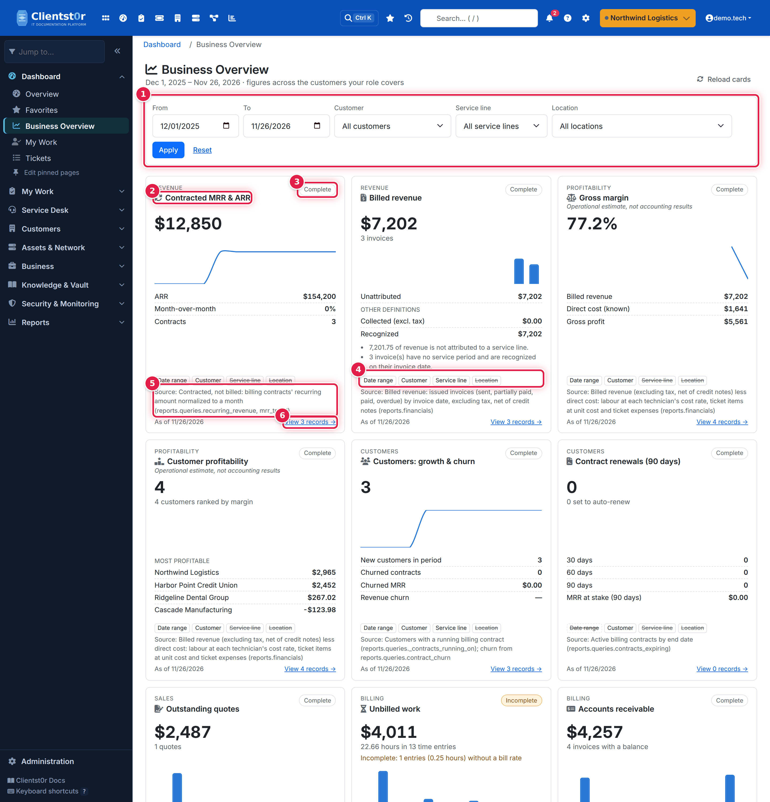
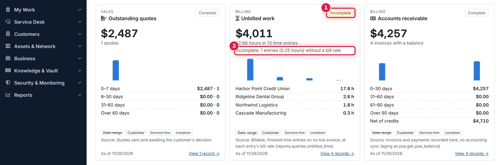
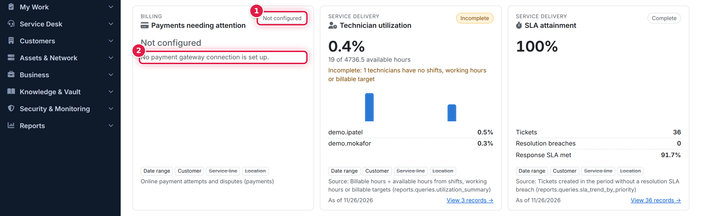
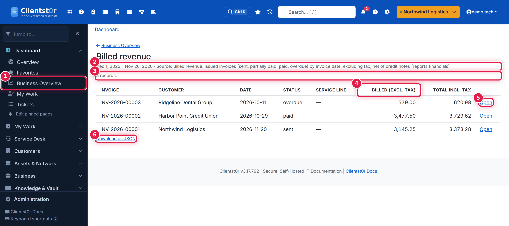
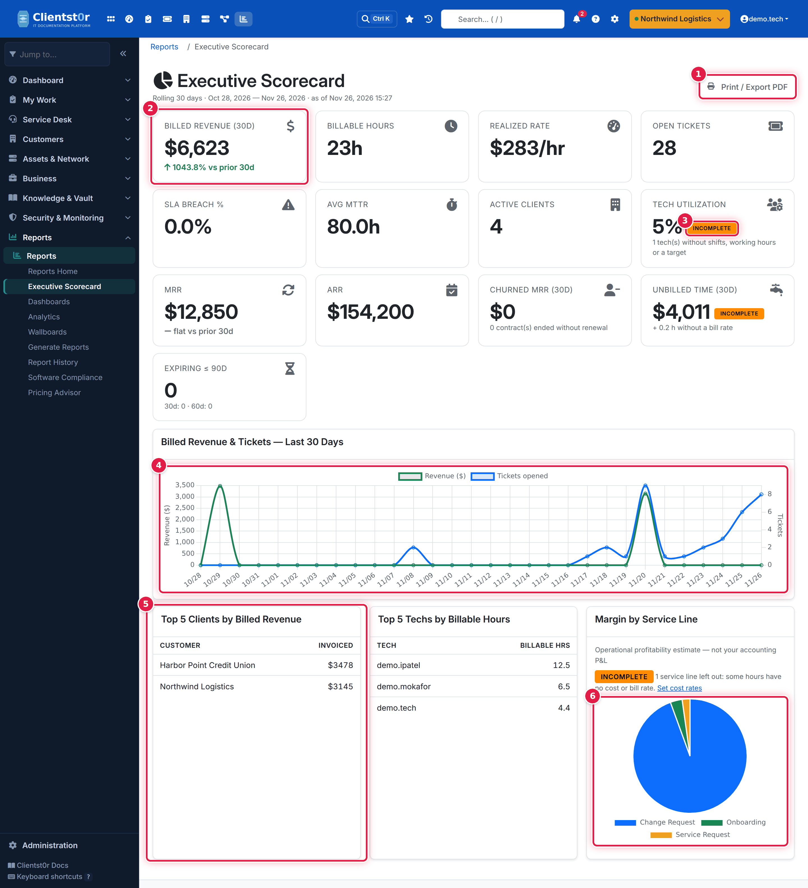
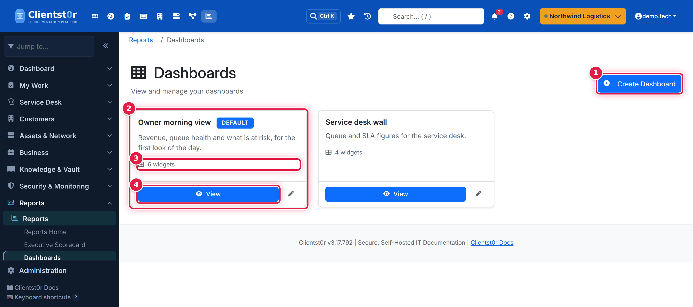
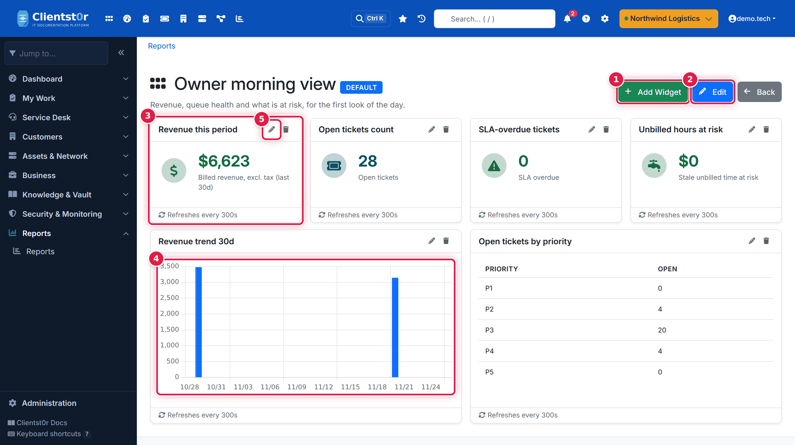
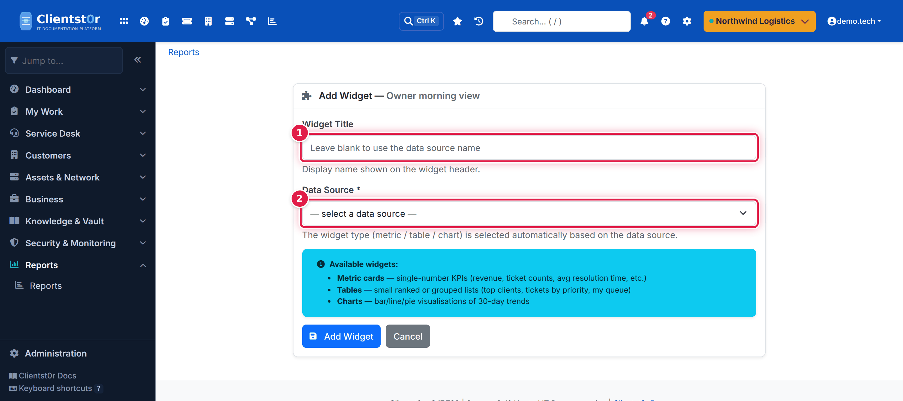
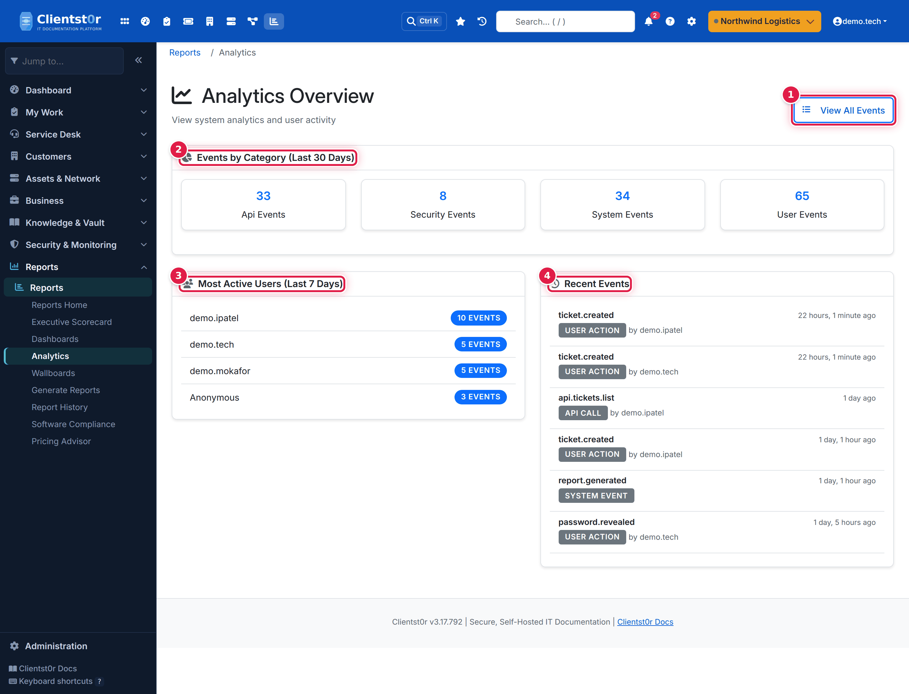

# Executive reporting: Business Overview, Executive Scorecard, Dashboards and Analytics

The pages an owner or manager opens to see how the business is doing. They are in two places in the
sidebar: **Dashboard → Business Overview**, and **Reports** with the tabs **Executive Scorecard**,
**Dashboards** and **Analytics**. All of them are for MSP staff; each needs a role permission, named
under its heading. The numbers in each screenshot match the list under it. Every screenshot is a capture
of the application against a demo database; the customers and people in it are invented.

The other Reports tabs have their own guides: [Reports Home, Generate Reports, Report History and
Software Compliance](REPORTS.md), and [Wallboards and the Pricing Advisor](WALLBOARDS_AND_PRICING_ADVISOR.md).

Two rules hold on every page here:

- **Customers you may see.** Figures add up the customers in the technician's client scope (all customers,
  or the ones the technician is limited to), never more. A permission that is held only through one
  customer's membership does not open an all-customers figure; it has to be part of the technician's own
  role.
- **Unknown is not zero.** When a figure cannot be worked out completely (an hour with no cost rate, a
  contract with no end date), the page shows the number it can prove, marks it **Incomplete** (or
  **Partial**) and says what is missing.

## Business Overview

**Dashboard → Business Overview** (`/reports/business-overview/`). One page of cards, each answering one
question about the business from the same sources the reports use.

<!-- guide-figure: guide-exec-overview -->

1. The filters: date range, customer, service line and location. Apply reloads every card; Reset clears them.
2. A card title. The small label above it is the section (here Revenue).
3. The state badge: Complete, Incomplete or Partial. A card that cannot be computed says Not configured or No access instead of showing a zero.
4. The filter chips: a chip with a line through it is a filter this card does not use.
5. The source line: what the number is counted from.
6. View records opens the list of records behind the figure.
<!-- /guide-figure -->

The page is one grid of cards. Above each card title a small label names its section (Revenue,
Profitability, Customers, Sales, Billing, Service delivery, Risk, Operations). Each card loads on its own, so
a slow or broken source shows on that card only.

- **Who sees it.** MSP staff who hold `reports_view_dashboards` for every customer. Customer users and other
  accounts are refused (403). Cards you have no permission for are left out, and a line at the foot says how many.
- **Reload cards** asks for every card again. The answers are kept for five minutes for the same person,
  scope and filters, so a change you just made can take up to five minutes to show.
- **Filters.** From and To default to the first day of the month eleven months ago through today. A
  reversed range is swapped, and a range longer than three years is cut back to the latest three. Customer
  lists the customers you may see. Service line is the contract type (managed services, block hours, and so
  on). Location lists locations of those customers. **Apply** sets them and **Reset** clears them. The
  filters are kept in the address, so a filtered page can be bookmarked.
- **Filter chips.** Every card shows four chips (Date range, Customer, Service line, Location). A plain chip
  means the card uses that filter. A chip with a line through it means the card does not use it; if you have
  set that filter, the chip is dashed as well, to say that this card ignored it. Cards that show a state of
  "now" (receivables, quotes, backlog and so on) ignore the date range and say "As of" the current time.
- **The source line** under the chips says what the figure is counted from. The date at the foot is the
  end of the period, or the moment of the reading for a "now" card.
- **Records.** **View N records** opens the list behind the number (see [The records
  page](#the-records-page)).
- **Only MSP staff, only your customers.** Each card needs its own permission across all customers (named in
  the table below) and adds up only the customers in your client scope. Choosing a customer outside your scope
  gives **No access**, not a zero.

### The three states of a card

<!-- guide-figure: guide-exec-incomplete -->

1. Incomplete: the figure is shown, but something it could not price is left out.
2. The reason, in words: here time entries without a bill rate.
<!-- /guide-figure -->

- **Complete.** Everything the figure needs was known.
- **Incomplete** or **Partial.** The value is shown, but part of the data was unknown, and the reason is
  printed under the figure. Margin cards say *Partial* when an hour or item has no cost; the others say
  *Incomplete*. The unknown part is never guessed: unpriced hours are not valued, an unknown margin is not
  shown as a percentage.
- **Not configured.** The data source is not set up on this install, or the module is off. No value is
  shown, and the card says why.

<!-- guide-figure: guide-exec-notconfigured -->

1. Not configured: the data source is not set up on this install (here, no payment gateway connection). There is no value and no zero.
2. The reason is printed on the card.
<!-- /guide-figure -->

Two more states can appear: **No access** (your role does not include the card, or the customer you picked)
and **Unavailable** (the card could not be worked out; the error is written to the server log, not shown).

### Every card

Each row gives what the figure counts and which filters it uses (D date range, C customer, S service line,
L location). Amounts exclude tax unless the card says otherwise. "Needs" is the permission to see the card.

**Revenue**

- **Contracted MRR & ARR** (D end date only, C). *Needs `reports_view_financial`.* Monthly recurring revenue
  *contracted*, not billed: for every contract that was running on the end date (not a draft; active and not
  paused today, or cancelled and expired contracts for a date in the past while they were still running),
  the contract's recurring amount divided to a month (quarterly by 3, yearly by 12). Contracts with
  recurring billing off or no amount add nothing, and a note says how many. ARR is MRR times 12. The chart is
  the last 12 months; *Month-over-month* is the change from the month before. Incomplete when stopped
  contracts have no end date and so cannot be placed in a past month. Records: the contracts.
- **Billed revenue** (D, C, S). *Needs `reports_view_financial`.* Issued invoices (sent, partially paid, paid
  or overdue; drafts and void are out) dated in the period by **invoice date**, **excluding tax**, **net of
  credit notes** (a credit memo is a negative invoice, counted under the service line of the invoice it
  credits). The bars are months. Below the chart: revenue by service line (the contract type of the
  invoice's source contract; *Unattributed* has no contract), and two other definitions shown for comparison,
  *Collected (excl. tax)* (payments received in the period, net of refunds, with the tax share removed) and
  *Recognized* (contract invoices spread over the period they pay for, everything else on its invoice date;
  a straight-line estimate from billing data, not accounting-system recognition). With a service line chosen
  only that line is added up and the comparison lines are hidden. Records: the invoices.

**Profitability** (both marked *Operational estimate, not accounting results*; both need `view_profitability`)

- **Gross margin** (D, C). Billed revenue (as above) minus *direct cost*, over billed revenue. Direct cost is
  labour (every time entry started in the period at the technician's cost rate on that day), ticket items at
  unit cost, ticket expenses, and invoice lines carrying a cost. Purchase orders, licences and overheads are
  not counted. The chart is the margin per month. **Partial** while any hour has no cost rate: the cost
  shown is the known part, and the margin is withheld, not overstated. Records: one row per customer.
- **Customer profitability** (D, C). The number of customers with billed revenue or cost in the period, with
  the five most and the five least profitable by gross profit below. Incomplete when some customers' margin
  is unknown; those are listed after the ranked ones in the records.

**Customers**

- **Customers: growth & churn** (D, C, S). Customers with at least one running billing contract on the end
  date; the chart counts them at each month end. *New customers in period* are customers whose first
  non-draft contract started inside the range. *Churned contracts* and *Churned MRR* are contracts that were
  cancelled or expired with an end date in the range and *Revenue churn* is that MRR divided by the MRR at the
  start of the range. Churn covers every service line even when one is chosen (the card says so). Incomplete
  when stopped contracts have no end date.
- **Contract renewals (90 days)** (C). Active contracts whose end date falls in the next 90 days, with
  cumulative 30, 60 and 90 day counts, the recurring revenue at stake and how many are set to auto-renew.
  Incomplete when some have no recurring amount.

**Sales**

- **Outstanding quotes** (C). Quotes with status *Sent*, still waiting for the customer; the figure is
  their total. Bands by days since sent (0–7, 8–30, 31–60, over 60); the line under the figure counts quotes
  past their valid-until date.

**Billing**

- **Unbilled work** (D, C). *Needs `reports_view_financial`.* Billable, finished time entries in the range that
  are on no live invoice, at each entry's bill rate. Entries with no bill rate are counted but not priced and
  make the card **Incomplete**; if none can be priced the value is a dash. The list shows hours per customer.
- **Accounts receivable** (C). *Needs `billing_view_aging`.* What customers owe now, **including tax**, from
  the same balance calculation as the aging report: every non-void invoice's balance, in aging bands by
  days since due (0–30, 31–60, 61–90, over 90), and the total *net of credits*. Records: the invoices with a
  balance. When invoices carry a status synced from an accounting provider the source line says how many and
  when it was last read.
- **Payments needing attention** (D, C). *Needs `billing_view_invoices`.* Failed online payment attempts in
  the range plus every dispute that is still open (the range does not apply to disputes), with how many
  failed attempts were autopay, and the amount collected online in the range. **Not configured** when online
  payments are not installed or no payment gateway connection exists.

**Service delivery**

- **Technician utilization** (D, C). *Needs `reports_view_capacity`.* Billable hours divided by available
  hours across the technicians who logged time in the range and have something to measure against (shifts,
  working hours or a billable target). Technicians with none are left out and make the card Incomplete. The
  list is each technician's own percentage.
- **SLA attainment** (D, C). *Needs `reports_view_sla`.* Of the tickets created in the range, the share that
  did not breach their **resolution** SLA, with the share that met the **response** SLA below it. The chart
  is by month. Records: every ticket counted, with its response and resolution breach flags.
- **Ticket backlog** (C, L). *Needs `reports_view_sla`.* Open tickets (status not closed) by age: under 1 day,
  1–3, 3–7, 7–30, over 30, with the average age. The location filter is the ticket's site.

**Risk**

- **Critical customer issues** (C, L). *Needs `tickets_view`.* Open P1 tickets plus open high or critical
  security incidents (status open, investigating or contained). Incidents carry no location, so with a
  location chosen only P1 tickets are counted (a note says so). Without `security_alerts_view` the incidents
  are hidden and the card is Incomplete.
- **Security alerts** (C). *Needs `security_alerts_view`.* Alerts not yet resolved or dismissed (new or
  acknowledged) by severity. Incomplete while a security source behind them has not been verified recently
  (the card quotes the source health reading). **Not configured** until a security vendor connection, a SIEM
  endpoint or an alert exists.
- **Backup failures** (C). *Needs `view_backup_status`.* Open and acknowledged backup alerts by kind.
  Incomplete when backup sources were not verified recently. **Not configured** when backup monitoring is not
  installed or has no connection.

**Operations**

- **Procurement** (C). *Needs `procurement_view`.* Requisitions awaiting approval, open purchase orders (sent,
  acknowledged or partly received) and open back-orders. Each line of the list opens that group's records.
- **License renewals (90 days)** (C). *Needs `reports_view_financial`.* Live (active or trial) licence
  subscriptions renewing in the next 90 days, valued at the customer price times seats. Subscriptions with no
  customer price make it Incomplete. **Not configured** when licence tracking is not installed or empty.

Cards for the Service Desk (every card except payments, security, backup and licensing) say **Not configured** when the Service Desk
module is switched off in Administration → Modules.

### The records page

<!-- guide-figure: guide-exec-records -->

1. Back to the Business Overview with the same filters.
2. The period, the filters in force and the source of the figure.
3. How many records make up the figure (a list stops at 2,000 and says so).
4. The amount columns: the first is the number the card adds up.
5. Open goes to the record itself.
6. The same rows as JSON.
<!-- /guide-figure -->

**View N records** opens `/reports/business-overview/metric/<card>/records/` with the same filters. The
rows are the very records the card added up (the figure and the list come from one calculation), so they
cannot disagree. The page shows the period, the filters in force and the source, repeats an Incomplete
reason, and says when the card ignores a filter you set. **Open** goes to the invoice, ticket, contract or
other record. A list stops at 2,000 rows and says so. Cards with parts (Procurement, Payments, Critical
issues) link each part's line to just those rows. **Download as JSON** gives the same rows as data; a card you
may not see answers 403. The page needs the same permission as the card.

## Executive Scorecard

**Reports → Executive Scorecard** (`/reports/exec-scorecard/`). A single printable page for the owner: a
fixed rolling 30 days (today and the 29 days before) with no filters. *Needs `reports_view_financial` for every
customer.* The margin chart additionally needs `view_profitability`.

<!-- guide-figure: guide-exec-scorecard -->

1. Print / Export PDF prints the page without the menus.
2. A KPI card; where there is one, the line under the figure compares with the 30 days before.
3. Incomplete: the figure leaves something out; the note under it says what.
4. Billed revenue and tickets opened for each of the last 30 days.
5. Top 5 clients by billed revenue, then top 5 technicians by billable hours.
6. Margin by service line, for people who hold view_profitability.
<!-- /guide-figure -->

It adds up only the customers in your client scope. **Print / Export PDF** prints the page without the menus,
so "Save as PDF" in the browser's print dialog produces the file. A badge **Incomplete** on a card has the same
meaning as on the Business Overview, and the line under the figure says why.

The cards, in order:

- **Billed revenue (30d).** Billed revenue as defined above for the 30 days; the arrow compares with the 30
  days before.
- **Billable hours.** Hours on billable time entries in the window.
- **Realized rate.** Billed revenue divided by billable hours, per hour. A measure of what the hours yielded
  in invoices, not a rate card.
- **Open tickets.** Tickets whose status is not closed, now.
- **SLA breach %.** Of tickets created in the window, the share whose resolution SLA was breached.
- **Avg MTTR.** Average hours from creation to closing, over tickets closed in the last 30 days.
- **Active clients.** Customers that had a ticket created in the window.
- **Tech utilization.** Billable ÷ available hours, as on the Business Overview; *Unknown* when nobody can be
  measured; Incomplete with a count of technicians that cannot.
- **MRR** and **ARR.** Contracted recurring revenue today, as in Contracted MRR & ARR. The trend line is
  month-over-month growth, although it is worded "vs prior 30d".
- **Churned MRR (30d).** MRR of contracts that ended without renewal in the window, with their count.
- **Unbilled time (30d).** Unbilled work for the window; the note adds hours that have no bill rate.
- **Expiring ≤ 90d.** Active contracts ending in the next 90 days, with the 30 and 60 day counts.

Below the cards: **Billed Revenue & Tickets**, a two-scale chart of billed revenue by invoice date and tickets
created per day; **Top 5 Clients by Billed Revenue**; **Top 5 Techs by Billable Hours**; and **Margin by
Service Line**, a pie of gross profit per ticket type (the first five and the rest as *Other*). The pie leaves
out any slice whose margin is not fully known, and says how many were left out, with a link to set the missing
cost rates. Without `view_profitability` the pie is replaced by a note.

## Dashboards

**Reports → Dashboards** (`/reports/dashboards/`). Boards of small widgets (a number, a table or a chart)
that you put together. They are not the Business Overview: you choose the widgets, and each widget is a
fixed 30-day or "now" figure with no filters.

<!-- guide-figure: guide-exec-dashboards -->

1. Create Dashboard (needs reports_manage_dashboards).
2. One dashboard: name, Default or Global badge, description.
3. How many widgets it holds.
4. View opens it.
<!-- /guide-figure -->

- **Who sees what.** Anyone with `reports_view_dashboards` (on by default) sees the dashboards of the customers
  they belong to (superusers see all) plus global ones, marked **Global**. A **Default** badge is only a
  label. A global dashboard is set up by an administrator; there is no switch for it on the form.
- **Sharing.** A dashboard belongs to one customer organization, the first one you are a member of when you
  create it, and everyone who can see that customer's dashboards can open it. There is no per-person sharing and
  no link to send.
- **What a viewer sees in a widget depends on the viewer, not the author.** Each widget needs the permission
  of the report it mirrors (for example `reports_view_financial` for revenue, `tickets_view` for ticket counts,
  `reports_view_sla` for SLA). A viewer without it sees a "Restricted" note in that widget instead of numbers,
  and the figures only cover the customers they may see. A dashboard can therefore be shared widely without
  exposing money to someone who may not read it.

### Building a dashboard

<!-- guide-figure: guide-exec-dashboard -->

1. Add Widget.
2. Edit the dashboard's name, description and Default flag.
3. A metric widget: one figure with its caption.
4. A chart widget.
5. Edit or delete a widget (the pencil and the bin).
<!-- /guide-figure -->

1. **Create Dashboard** (needs `reports_manage_dashboards`). Give a name, a description, and tick *Set as
   default dashboard* if you want the badge.
2. Open it and choose **Add Widget**. Give the widget a title (blank uses the data source name) and pick a data
   source. The widget type, number, table or chart, follows from the source.

<!-- guide-figure: guide-exec-widget-form -->

1. Widget title; blank uses the data source name.
2. Data source: the widget type (number, table or chart) follows from it.
<!-- /guide-figure -->

3. The pencil and bin on a widget edit or delete it. **Edit** on the dashboard changes its name, description
   and Default flag, and the form has a **Delete Dashboard** button.

The sources are: revenue this period; open tickets; SLA-overdue tickets; unbilled hours at risk; active
technicians in 30 days; average time to resolve; top clients by revenue; open tickets by priority; my assigned
tickets; at-risk clients; revenue trend (bars); tickets opened (line); billable and non-billable hours (pie); SLA
breach trend; client health breakdown (pie); low stock; recent sales activity; security alerts in 24 hours and
open critical or high alerts; technicians logged in; monitors down; SSL, domain and warranty expiries; failed
logins; vault events in 24 hours; open alerts by severity; monitor status breakdown.

Limits to know:

- Widgets sit in a fixed order of the grid by when they were added; there is no drag to rearrange, and no
  per-widget filters or sizes.
- Under a widget, "Refreshes every 300s" is a stored setting; the page does not refresh itself. Reload the page
  to update the figures.
- Changing a dashboard needs `reports_manage_dashboards` and being its creator, or holding that permission at
  its customer (at every customer for a global one). Without both, the Add Widget, Edit and pencil buttons are
  not shown and the server refuses the request.
- Wallboards are the TV-ready sibling of dashboards; see [Wallboards and the Pricing
  Advisor](WALLBOARDS_AND_PRICING_ADVISOR.md).

## Analytics

**Reports → Analytics** (`/reports/analytics/`). A look at the application's own event log. *Needs
`reports_view_dashboards`.* The tab appears for people holding it.

<!-- guide-figure: guide-exec-analytics -->

1. View All Events opens the full event log with filters.
2. Counts of events in the last 30 days, one tile per category.
3. The ten users with the most events in the last 7 days.
4. The latest 20 events.
<!-- /guide-figure -->

There are no charts on this page; it is counts and lists of logged events:

- **Events by Category (last 30 days).** One tile per category that had events: user actions, system events, API
  calls and security events.
- **Most Active Users (last 7 days).** The ten users with the most events; events with no user show as
  *Anonymous*.
- **Recent Events.** The latest events with name, category, user and how long ago.
- **View All Events** (`/reports/analytics/events/`) lists up to the 500 most recent, filtered by category and by
  part of the event name.

Only events recorded against a customer you belong to are counted (superusers: all customers); events with no
customer never show. The application does not itself write events to this log yet, so the page shows
whatever has been added to it through the administration site or another integration, and says "No events
recorded" when there is none. Use [Reports Home](REPORTS.md) and the [Business Overview](#business-overview)
for business figures, and the audit log for who did what.

## Permissions at a glance

| To | You need |
| --- | --- |
| Open the Business Overview | MSP staff with `reports_view_dashboards` for every customer |
| See a Business Overview card | the card's permission (listed on the card above) for every customer |
| Open the Executive Scorecard | `reports_view_financial` for every customer |
| See the margin chart | `view_profitability` as well |
| View dashboards and Analytics | `reports_view_dashboards` |
| Create, edit and delete dashboards and widgets | `reports_manage_dashboards` (creator, or holding it at the customer) |
| See a widget's figures | the permission of the report it mirrors; otherwise it reads "Restricted" |

Among the built-in role templates, Owner, Administrator and IT Manager hold `reports_view_financial`; Editor, Help
Desk, Documentation Writer and Read-Only do not, and the technician roles do not hold profitability access. The
Scorecard and the money cards are therefore closed to roles without it until an administrator grants it
([Roles and access](ROLES_AND_ACCESS.md)). `reports_manage_dashboards` is off in a new role unless it is turned
on; the older Owner and Admin membership roles include it.
