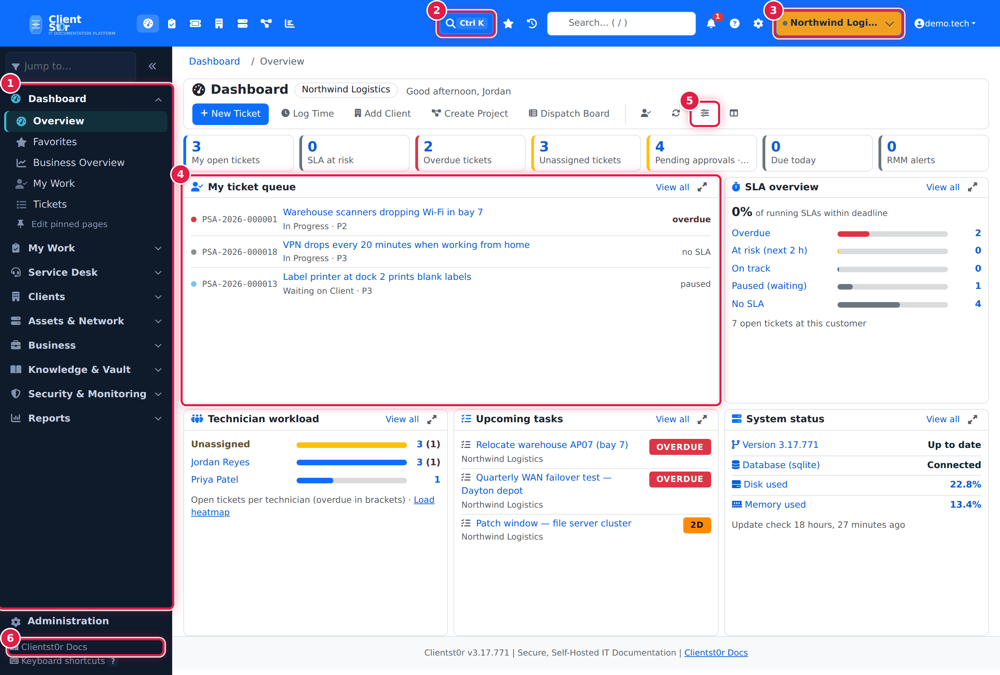
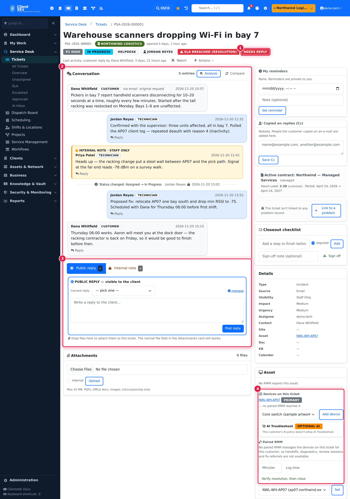
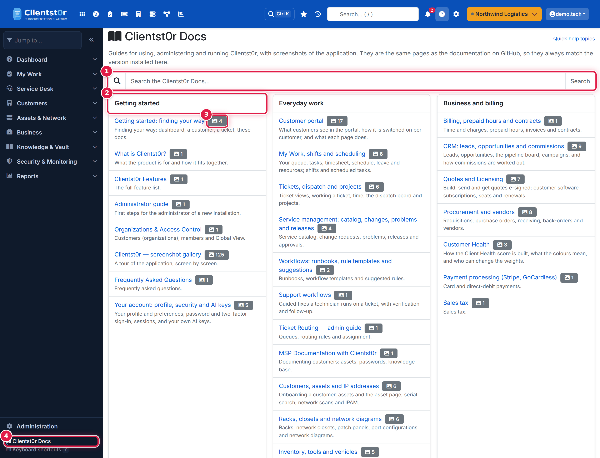

# Getting started: finding your way

A tour of the screens you use every day: the dashboard and navigation, a customer's workspace, a ticket,
and these docs. The numbers in each screenshot match the list under it. Every screenshot is a capture of
the application against a demo database; the customers and people in it are invented.

## The dashboard and navigation

<!-- guide-figure: guide-dashboard -->

1. The sidebar: nine work sections. Only the current one is open; type in Jump to to filter every page you may open.
2. Go to (Ctrl+K): open any page, setting or record by name.
3. The client switcher: the customer you are working for. Pages show that customer's records. Superusers can also choose Global View.
4. Your ticket queue, with SLA due times.
5. Customize: choose and arrange the dashboard panels.
6. Clientst0r Docs: these guides, searchable, in the app.
<!-- /guide-figure -->

- **Sections.** The sidebar holds Dashboard, My Work, Service Desk, Clients, Assets & Network, Business,
  Knowledge & Vault, Security & Monitoring and Reports, with Administration at the foot. You see only the
  sections and pages your role allows. Collapse the sidebar to an icon rail with the « button.
- **Pages inside a section** carry their own tabs, and some have a *Configure* menu for that area's
  settings. The breadcrumb reads Section › Workspace › Page.
- **Keyboard.** Ctrl+K opens Go to; `?` lists every keyboard shortcut; `g` followed by a letter jumps to a
  section (the shortcuts list shows which).
- **Favorites and Recent** (the star and clock in the top bar) keep the pages you pin and the ones you
  opened last.

## Choosing the customer you work for

Most pages show the records of one customer at a time: the one in the client switcher. Pick another
customer there, or open **Customers → All Customers**. A new sign-in opens where you left off: the last
customer you worked in. Superusers and staff who can reach every customer can choose **Global View**
instead, which shows all customers together. A customer set as *Default organization* in My Profile always
opens first.

<!-- guide-figure: guide-client-overview -->
.")

1. The customer you are viewing, with links back to all clients and to Global View.
2. Quick actions for this customer: ticket, contact, asset, project, document, quote.
3. Key figures: open tickets, SLA at risk, managed assets and more.
4. Open tickets, with SLA breaches and those at risk.
5. Open invoices and the balance owed.
<!-- /guide-figure -->

The workspace's tabs (Tickets, Assets, RMM, Contacts, Documents, Passwords, Contracts, Billing, Projects)
open the same lists filtered to this customer. More about customers, members and access is in
[Organizations & Access Control](ORGANIZATIONS.md) and [Roles and access](ROLES_AND_ACCESS.md).

## Working a ticket

<!-- guide-figure: guide-ticket -->

1. Next step: what the ticket is waiting for (here, a reply to the customer).
2. The conversation: the request, replies, internal notes (marked STAFF ONLY) and status changes, oldest first.
3. Reply or add an internal note. Pick a canned response, attach files, copy people in (Cc).
4. Devices on this ticket, with RMM tools when an RMM is paired.
<!-- /guide-figure -->

- **Public reply or internal note.** The composer starts on *Public reply*; press `n` for an internal note,
  which the customer never sees, and `r` to switch back. The composer's label and colour always say which
  one you are writing.
- **Time.** Log time in *Time & Charges*, further down the ticket. Time marked billable or covered by an
  agreement is what [billing](BILLING.md) picks up.
- **Closing.** Steps added to the closeout checklist as *required* must be ticked before the ticket can be
  resolved or closed.
- **Alerts.** A ticket raised from a monitoring alert can open a [support workflow](SUPPORT_WORKFLOWS.md):
  evidence, likely causes, a fix and a check that it worked.

## Finding help: Clientst0r Docs

<!-- guide-figure: guide-docs-viewer -->

1. Search every guide. Results list the matching sections with your words highlighted, and open the guide at that section.
2. Guides by subject.
3. The number of screenshots in a guide.
4. Open the docs from any page, at the foot of the sidebar (also linked in the page footer).
<!-- /guide-figure -->

The guides are the Markdown files in the repository's `docs/` folder, so the copy in the app always matches
the version installed. Search matches every word you type and opens the guide at the section it found.
For a short answer about one screen, **Help** in the top bar opens the quick help topics.

## Next steps

- Administrators: [Administrator guide](ADMIN_GUIDE.md) lists where each optional feature is switched on.
- [Billing, prepaid hours and contracts](BILLING.md)
- [Backing up and restoring Clientst0r](BACKUP_AND_RESTORE.md)
- [Screenshot gallery](screenshots.md): every area of the application, in light and dark themes.
