# Hardware catalog and visual inventory

Document a client's physical network: choose a model, see its generated front
and rear panel, click a port, record its configuration and cable, trace the
path through patch panels and wall jacks, and print labels.

Open it from **Assets → Hardware & Ports** (`/hardware/`). Select a client
first; every inventory page works on the selected client only.

[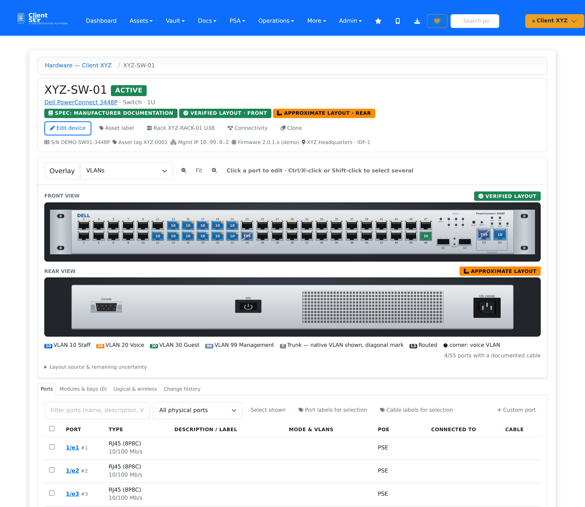](images/github/hardware-device-light.png)

More views: [screenshot gallery → Hardware and cabling](screenshots.md#hardware-and-cabling).

## Daily workflow

1. **Assets → Hardware & Ports → Add device.** Search the catalog by
   manufacturer, model or part number (empty search lists the generic
   templates). Give the device its name/hostname, serial, asset tag,
   management IP, site/room and, optionally, a rack position. Save.
2. The device page shows the generated artwork. **Click a port** to open the
   port editor: description, technician label, admin state, speed, mode,
   untagged/native, tagged and voice VLANs, LAG, PoE setting, notes.

   [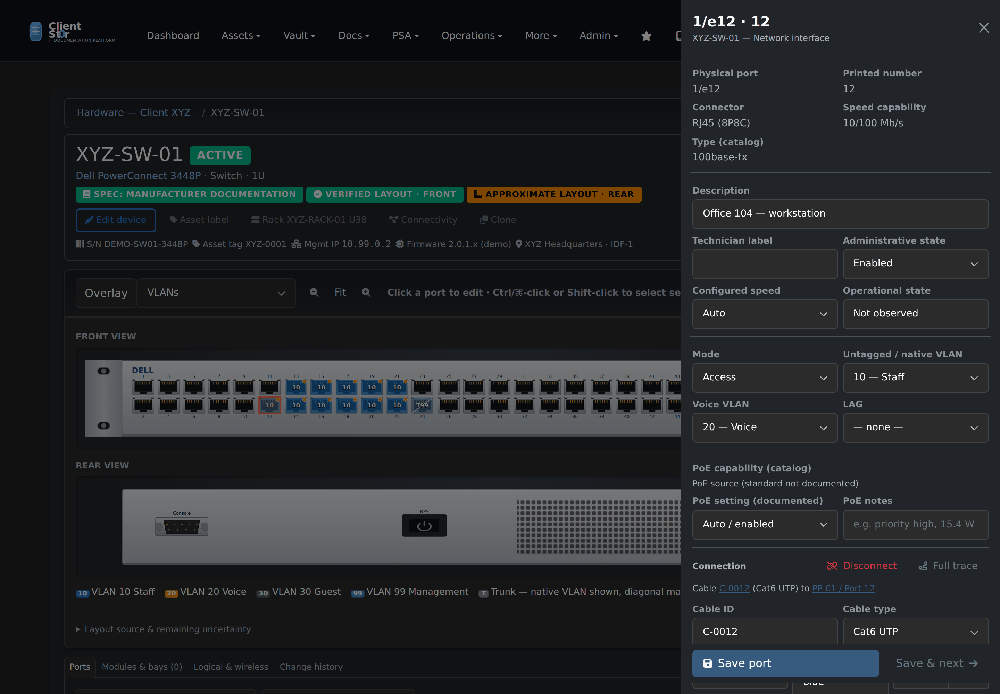](images/github/hardware-port-editor-dark.png)
3. **Connect…** in the editor picks the far end from this client's free ports
   and records the cable (ID, type, colour, length, end labels).
4. **Ctrl/⌘-click or Shift-click** several ports for bulk changes: description,
   sequential technician labels (`Desk-{n:02}`), mode, VLANs, PoE, or
   **Patch to a panel** (cables the selection, in order, to consecutive panel
   front ports with sequential cable IDs).
5. **Full trace** shows the physical path in both directions —
   switch port → patch cable → panel front → panel rear → permanent link →
   wall jack → patch cable → endpoint — and names any gap.

[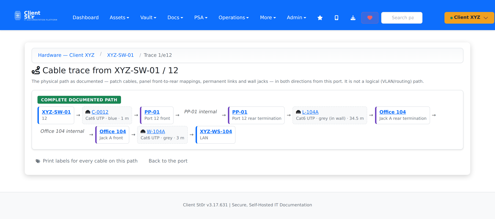](images/github/hardware-trace-light.png)

## Patch panels and port mapping

A patch panel, keystone wall plate or fibre cassette has **front ports** and
**rear ports**, and the catalog model records which front port maps to which
rear port and position. Those mappings are copied to each installed panel, so a
trace can pass through a panel: patch cable into the front, out the mapped rear
port, along the permanent link to the jack.

* **Panel mapping** on the panel's device page (`/hardware/devices/<id>/patch-panel/`)
  lists every front port with what is patched into it, the patch cable, the rear
  port it maps to, the permanent link and the device at the far end. Each path
  is marked *complete*, *incomplete* (documentation stops part-way, with a link
  to the trace) or *unused*. **In use only** hides the empty ports. **Print patch
  strip** prints the panel's port labels.
* **Bulk patching:** select several switch ports, then **Patch to a panel**. The
  selection is cabled in order to consecutive front ports, with sequential cable IDs.
* The **connected overlay** marks each port with a documented cable, on both
  faces, so a rear port with only its permanent link stands out.

[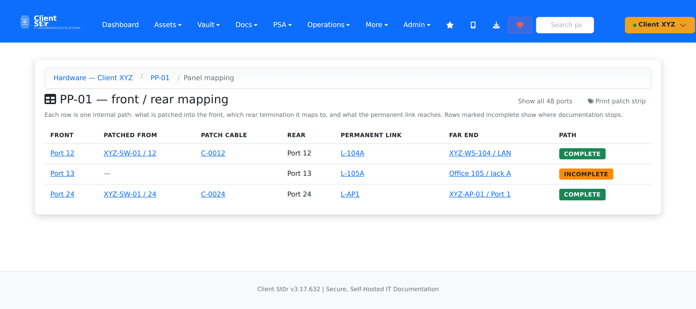](images/github/hardware-panel-mapping-light.png)

[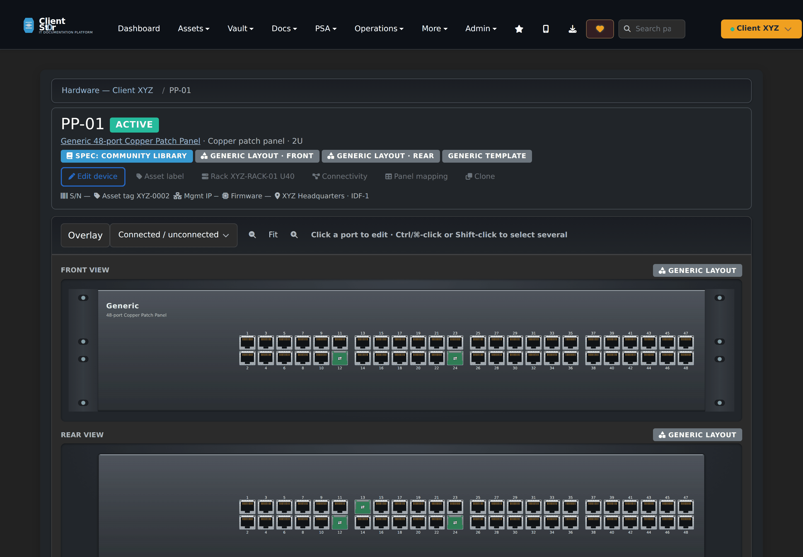](images/github/hardware-panel-device-dark.png)

Overlays (VLANs, connected/unconnected, PoE, documented usage) always carry a
legend and a text mark, never colour alone. A documented cable is shown as
documentation, never as link state; *operational state* stays "Not observed"
unless an import supplies an observation with its source.

## Catalog

[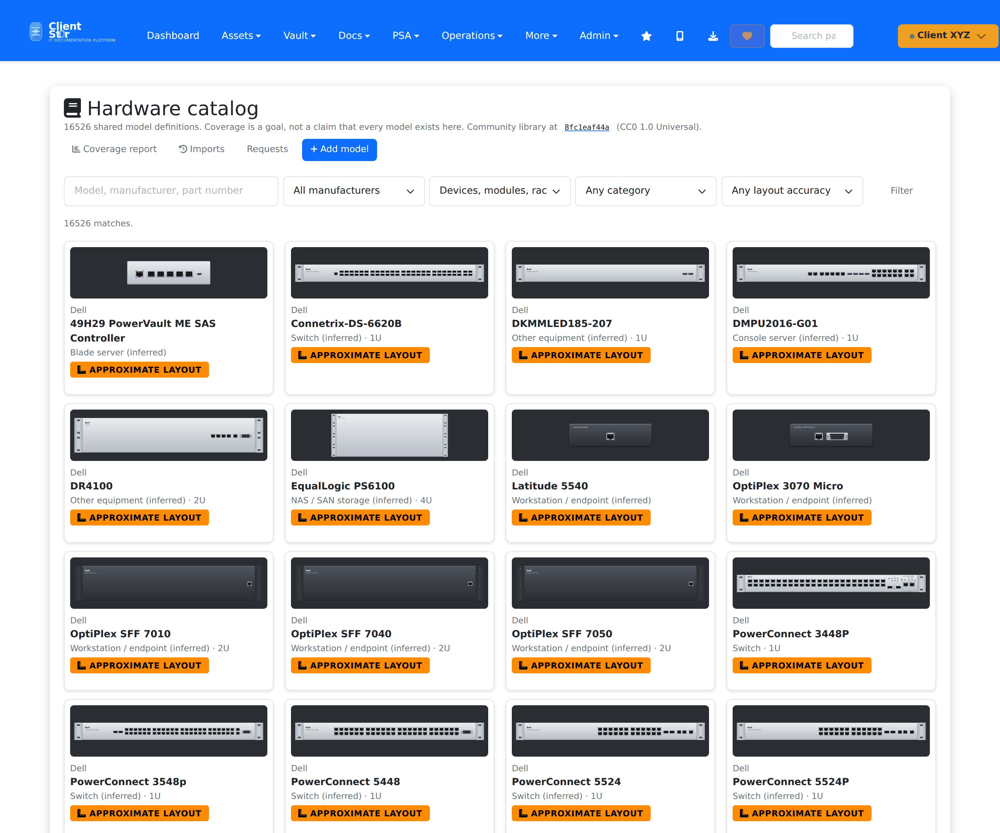](images/github/hardware-catalog-light.png)

**Assets → Hardware Catalog** (`/hardware/catalog/`) is shared by every
client. It holds manufacturers and device, module and rack models with their
components and front→rear port mappings. Client devices keep their own copy of
the ports, linked to the catalog component by a stable key.

### Where the data comes from

The bulk of the catalog is imported from the community
[devicetype-library](https://github.com/netbox-community/devicetype-library)
(CC0 1.0) — read directly from its YAML files; no NetBox installation is
involved. Each model records its upstream path, revision, file hash, import
date and licence, and keeps the definition verbatim (*Upstream definition as
imported*). Fields this application has no column for are listed on the model
and in the coverage report.

The library has no device-role field, so categories (switch, firewall, AP …)
are inferred from components and model names and marked *inferred*; staff can
correct them per model.

### Updating the catalog

Run on the server (re-running is always safe):

```bash
# What would change, without writing anything
python manage.py import_hardware_catalog --revision latest --preview

# Apply a specific upstream commit (recommended: the one you previewed)
python manage.py import_hardware_catalog --revision <commit>

# Continue an interrupted run
python manage.py import_hardware_catalog --resume <job id>

# Optional: pre-render artwork so catalog pages never write while browsed
python manage.py render_hardware_artwork
```

* Files are processed in batches with a record per file; an unchanged file is
  `unchanged`, a changed one `updated`, a broken one `failed` with the reason.
* A model staff edited locally is reported as `conflict` and left alone unless
  `--overwrite-local` is given.
* An updated model gets a new revision. Installed devices do **not** change
  until a technician opens the device and applies **Preview update**, which
  matches ports by key (renames keep the port id, cable and settings), adds new
  components and keeps ports removed upstream.

**On SQLite, run a full import outside working hours.** The first import
writes about 16,500 models in about seven minutes. While each batch holds the
database write lock, other writes, including saving a sign-in session, can
time out. Users then get a plain *Bad Request (400)* until the import finishes.
Later imports only touch changed files. MariaDB/MySQL installs are not
affected.

Import history: **Catalog → Imports**. Coverage by manufacturer and category:
**Catalog → Coverage report**. Coverage is a goal, not a claim that every
model exists.

### Missing models

* Technicians: **Add device → Request the model** (or `/hardware/request-model/`),
  then use a Generic template meanwhile.
* Catalog administrators (MSP staff who can edit assets for every client):
  **Catalog → Add model** — start blank, from a generic template, or as a copy
  of a similar model; record the source document. Then **Edit components**
  and **Layout editor**.

Software platforms (OPNsense, pfSense, Proxmox, Windows …) are recorded in the
device's *Platform* field. They never imply a chassis.

## Artwork and accuracy

Artwork is generated SVG — not photographs — drawn from each model's layout:
element rectangles in millimetres from the top-left of each face (a rack
device is 482.6 mm wide and `U × 44.45` mm tall). The clickable target of each
connector is exactly its drawn rectangle, and the same geometry is used for
exports. Artwork is cached per model and layout version and holds no client
data; client overlays are added in the browser.

| State | Meaning |
|---|---|
| **Verified layout** | Placement checked by a person against the manufacturer's documentation (the source document is recorded). |
| **Approximate layout** | The components are known but their placement is not verified. Every automatically generated layout is approximate. |
| **Generic layout** | A user-configurable representation of a generic template. |

Faces are whatever the hardware has: front and rear for rack equipment, top and
bottom for a ceiling access point. The same artwork appears on the asset record.

<table>
<tr>
<td width="50%" valign="top"><a href="images/github/hardware-ap-light.png">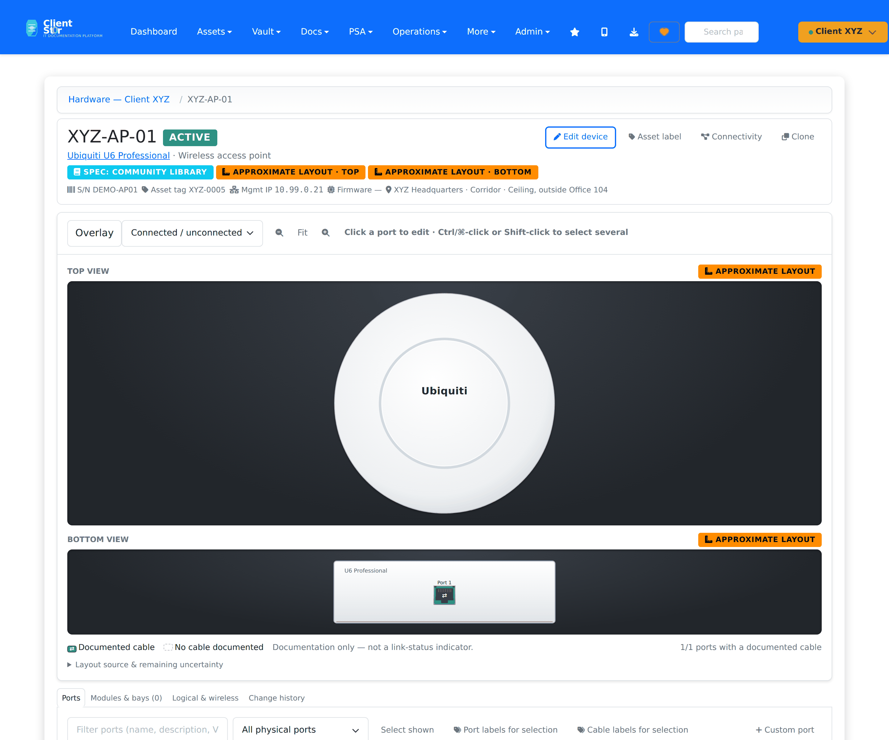</a></td>
<td width="50%" valign="top"><a href="images/github/hardware-asset-artwork-light.png">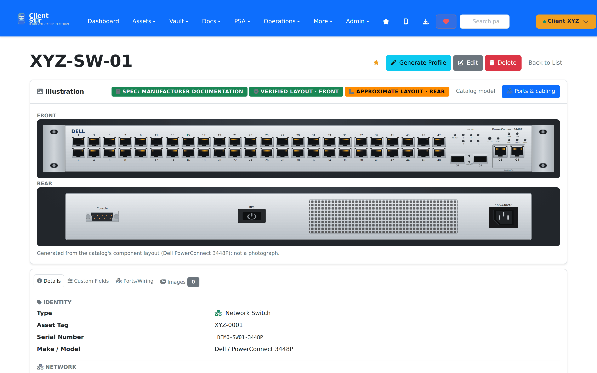</a></td>
</tr>
</table>

A correct port count does not make an arrangement verified. Accuracy is stored
per face, and specification provenance (where the component list comes from)
is recorded separately from layout provenance.

[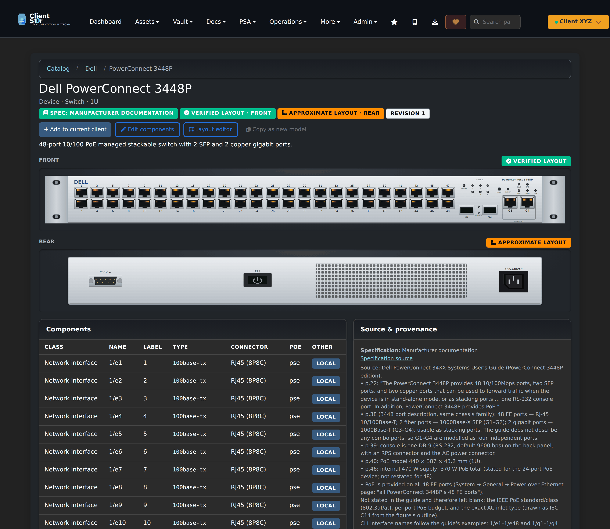](images/github/hardware-model-dark.png)

The **layout editor** (catalog administrators) places, numbers, rotates and
arranges components, moves them between faces, previews the exact artwork and
saves a new layout version. Marking a face verified requires the source
document.

## Racks, diagrams and labels

<table>
<tr>
<td width="50%" valign="top"><a href="images/github/hardware-rack-dark.png">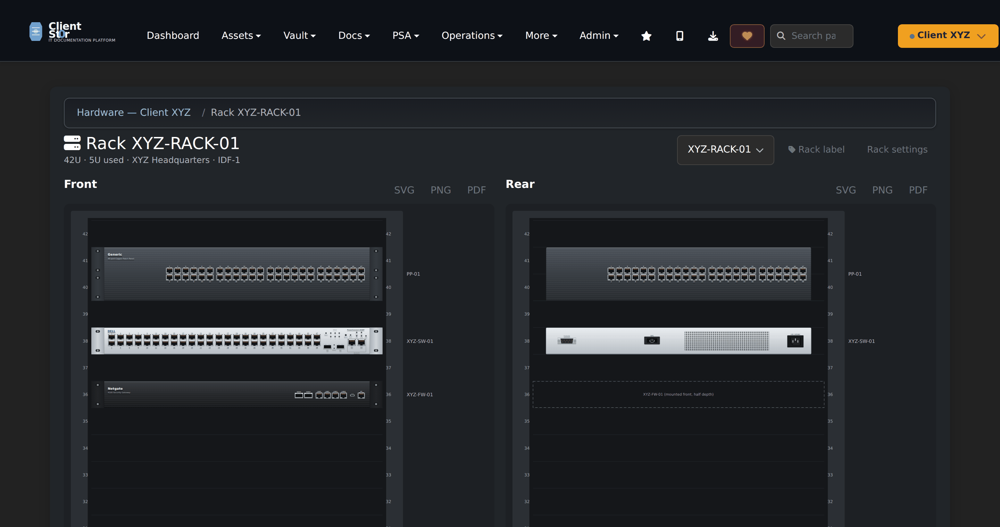</a></td>
<td width="50%" valign="top"><a href="images/github/hardware-connectivity-dark.png">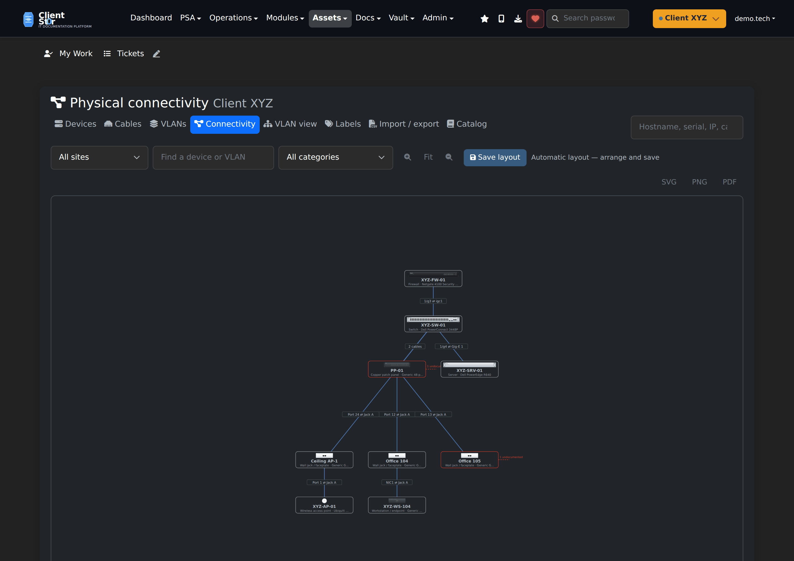</a></td>
</tr>
</table>

* **Rack elevations** (`/hardware/racks/<id>/`): front and rear, drawn from
  catalog artwork; full-depth devices occupy both faces, a half-depth device
  on the other face is outlined. Overlaps are refused. SVG / PNG / PDF export.
* **Connectivity** and **VLAN** diagrams: drawn only from documented cables and
  configured VLAN memberships. A path that continues but is undocumented gets a
  dashed *undocumented* marker. Drag to arrange; **Save layout** keeps your
  positions (new devices get an automatic place). Export SVG / PNG / PDF with
  title, client/site, legend and date.
* **Labels** (`/hardware/labels/`): device asset labels, rack IDs, port labels,
  patch-panel strips, wall jacks and cable labels (two per cable — each end
  says where the other goes, or a concise `SW/12 ⇄ PP/12` form). Templates are
  defined in millimetres (label size, margins, font size, sheet grid or one per
  page) and can be customized per client. The PDF is drawn at true size: print
  at **100 % / Actual size**. *Print calibration page* draws 100 mm rulers and
  every label outline; adjust the template's X/Y offsets if your printer is
  shifted. QR codes link to `/hardware/q/…/<opaque id>/`, which opens only for
  a signed-in user with access to that client and carries no credentials.

## Import / export

**Import / export** accepts device and cable CSVs, validates every row, shows a
preview and imports all-or-nothing. Exports are per client.

Read-only REST endpoints (existing API keys and scoping):
`/api/hardware/models/`, `/api/hardware/devices/`, `/api/hardware/ports/`,
`/api/hardware/cables/`. Changes go through the application, where the
occupancy, tenant, connector and VLAN rules are enforced.

## Permissions

| Action | Role flag |
|---|---|
| View inventory, diagrams, labels | `assets_view` (in that client) |
| Add devices, import CSV | `assets_create` |
| Document ports, cables, VLANs, racks; apply template updates | `assets_edit` |
| Delete devices | `assets_delete` |
| Change the shared catalog, layouts, imports | MSP staff with `assets_edit` for every client |

## Demonstration data

`python manage.py seed_hardware_demo` creates **Client XYZ** — an invented,
clearly labelled demo client — with a Dell PowerConnect 3448P (XYZ-SW-01), a
48-port patch panel (PP-01), a Netgate 4100 firewall, a Dell PowerEdge R640
with a NIC module, a Ubiquiti U6 Pro access point, a workstation, wall plates,
rack XYZ-RACK-01 and VLANs 10 Staff, 20 Voice, 30 Guest and 99 Management.
Switch port 12 is cabled through PP-01 port 12 and Office 104 jack A to the
workstation; the AP uplink is a trunk with native VLAN 99 and tagged 10 and 30.
`--reset` rebuilds it.

### About the PowerConnect 3448P model

The community library has no 3448P, so the model was entered from Dell's
*PowerConnect 34XX User's Guide*: 48 × 10/100 Base-T ports (PoE), G1–G2
1000Base-X SFP, G3–G4 1000Base-T (also stacking ports); no combo ports are
documented. The front layout is **verified** against the guide's front-panel
figures; the **rear is approximate** because the guide pictures only the
non-PoE 3448's back panel. The PoE standard and per-port budget are not stated
in the guide and are left blank. The model page lists the full source notes.

## Limitations

* Category is inferred for imported models; check it before relying on it.
* Every imported layout is approximate until someone verifies it.
* Transceivers can be recorded where a model defines a bay for them; a fixed
  SFP cage itself is documented as a port, with the optic in its notes.
* This is documentation only. Nothing is pushed to switches, firewalls or servers.
