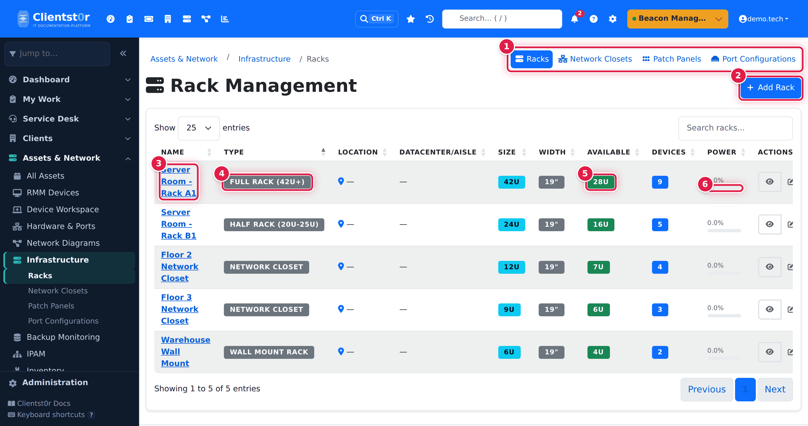
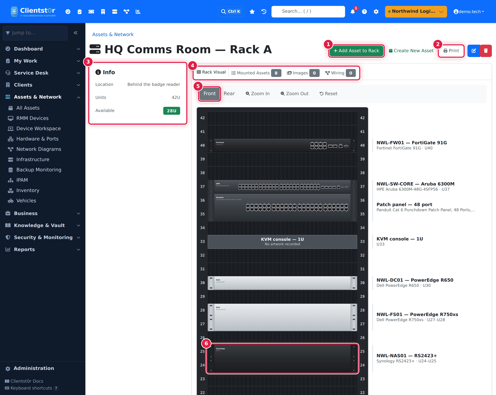
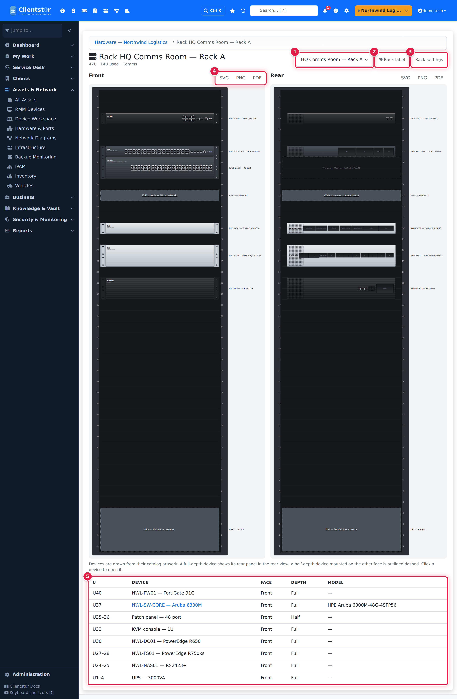
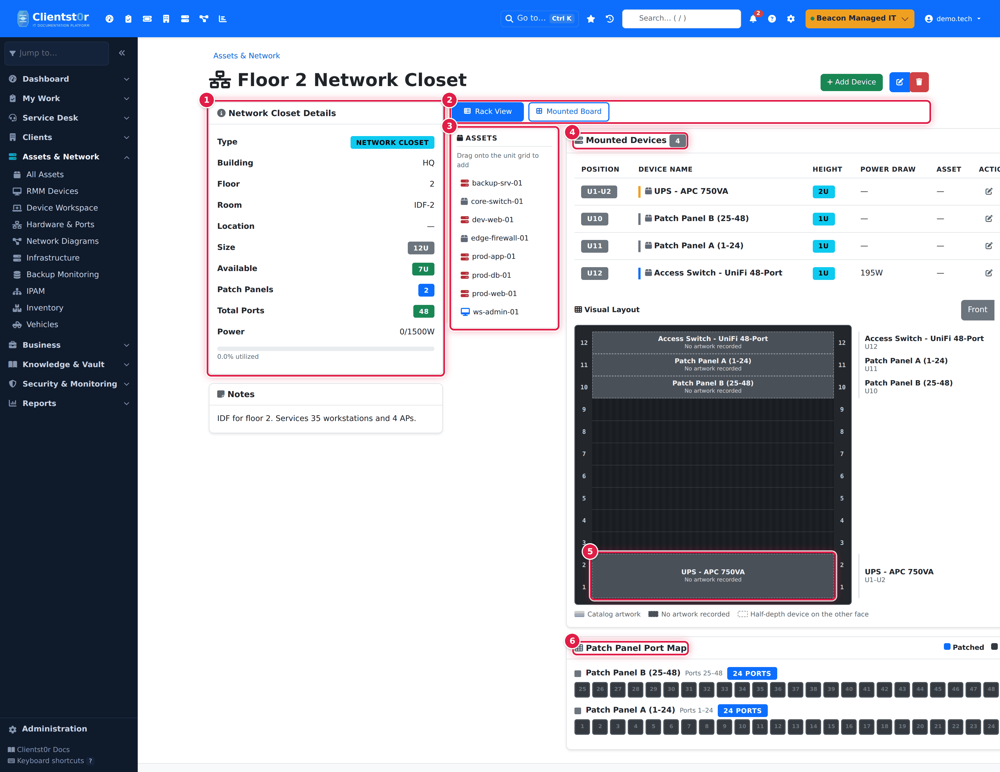
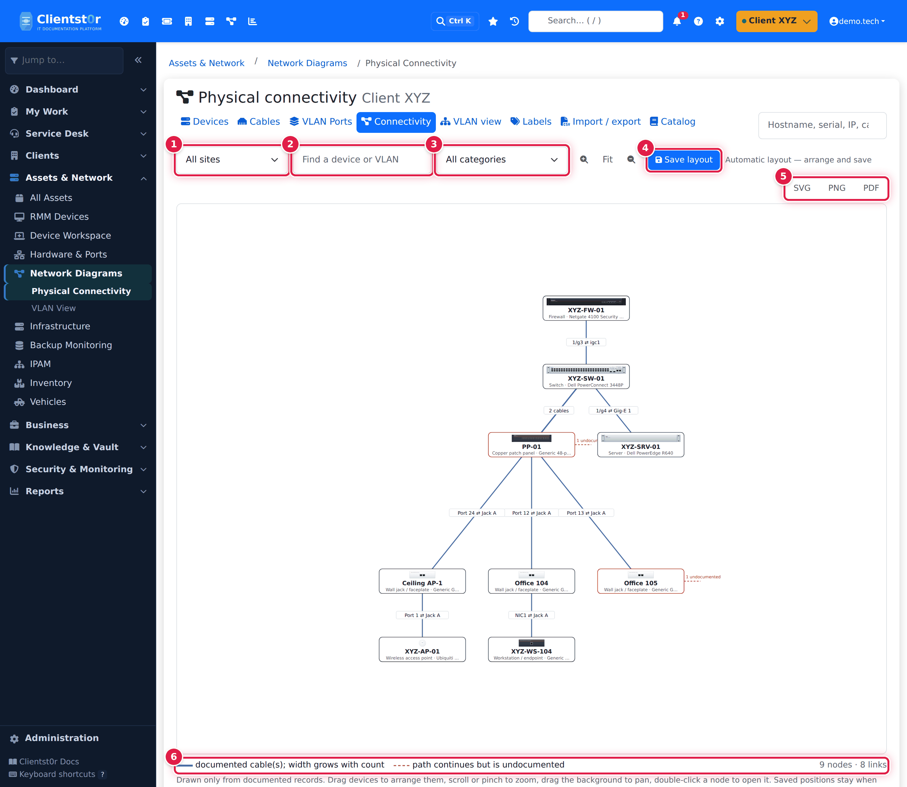
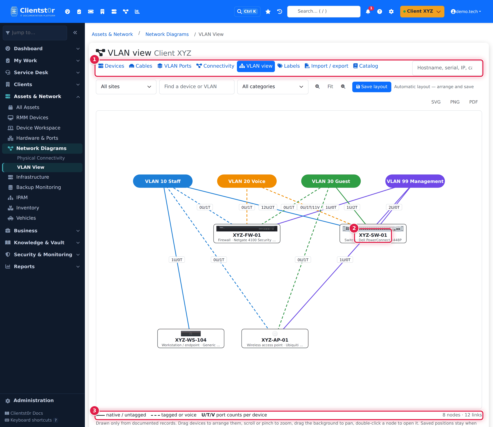

# Racks, closets and network diagrams

How to document where a customer's equipment physically sits and how it is connected: racks and network
closets, the older patch panel and port configuration records, and the two network diagrams. Everything here
is in **Assets & Network**, under **Infrastructure** and **Network Diagrams**, and works on the customer
selected in the client switcher. The numbers in each screenshot match the list under it. Every screenshot is
a capture of the application against a demo database; the customers and people in it are invented.

The device artwork, port editor, cables, cable trace, labels and hardware catalog are described in
[Hardware catalog and visual inventory](HARDWARE_INVENTORY.md); this guide goes deeper on the rack, closet
and diagram pages. Assets themselves are in [Customers, assets and IP addresses](ASSETS.md).

## Who sees these pages

| Pages | Needed to open them | To change them |
|---|---|---|
| Racks, Network Closets, Patch Panels (`/monitoring/…`) | permission to view monitoring (`monitoring_view`) at that customer | `monitoring_create`, `monitoring_edit`, `monitoring_delete` |
| Port Configurations (`/assets/port-configs/`) | permission to view assets (`assets_view`) | `assets_create`, `assets_edit`, `assets_delete` |
| Rack elevation and Network Diagrams (`/hardware/…`) | `assets_view` at the selected customer | Save layout needs only `assets_view`: it saves your own layout |

Adding a rack, closet, patch panel or port configuration needs a customer selected. With no customer
selected (Global View), superusers and MSP staff see the racks and closets of every customer in one list;
the patch panel and port configuration lists are then empty. See
[Roles and access](ROLES_AND_ACCESS.md) for how these permissions are granted.

## Racks

**Assets & Network → Infrastructure → Racks** (`/monitoring/racks/`). Every rack at the customer, whatever its
type: full and half racks, open frames, server cabinets, wall-mount racks, and network and data closets.

<!-- guide-figure: guide-infra-rack-list -->

1. The Infrastructure tabs: Racks, Network Closets, Patch Panels and Port Configurations.
2. Add Rack. A customer must be selected first.
3. The rack name opens the rack page with its elevation.
4. Rack type. Network and data closets also appear under Network Closets.
5. Free units: the rack's size minus the units its placements take.
6. Allocated against capacity power, shown only when the rack has a power capacity.
<!-- /guide-figure -->

- **Add Rack** asks for a name, type, location (datacenter, building, floor, room, aisle and a free-text
  location), size in U, width (19" or 23"), depth, power capacity, cooling capacity, PDU count, patch panel
  and port counts, ambient temperature and notes.
- **Available** is the rack's size minus the units of everything placed in it. **Power** compares the watts
  allocated with the rack's capacity; it shows a dash when no capacity is set. The bar turns amber above 60 %
  and red above 80 %.
- The list can be searched and sorted in the page; it shows 25 racks at a time.
- A rack whose type is *Network Closet* or *Data Closet* also appears under Network Closets, which opens it
  on the closet page.

### A rack

Click a rack's name. The page shows the elevation and everything placed in it.

<!-- guide-figure: guide-infra-rack-detail -->

1. Add Asset to Rack places an asset (or a named item with no asset) at a start unit; Create New Asset makes the asset first.
2. Print a rack sheet.
3. Location, size, free units and, when set, power allocated against capacity.
4. Rack Visual, Mounted Assets (a table with edit and remove), Images and Wiring.
5. Show the front or the rear of the rack.
6. The elevation. A device with a catalog model is drawn from its artwork; anything else is a plain face with its saved name. Drag a device to another unit to move it; click it for details and Edit.
<!-- /guide-figure -->

- **Rack Visual** draws one block per placement across all the units it takes. A placement linked to a
  hardware device or catalog model is drawn from the same catalog artwork as the device page; anything else
  is a plain face with its saved name and *No artwork recorded*. **Front** and **Rear** switch faces: a
  full-depth device shows its rear panel from the back, and a half-depth device mounted on the other face is
  outlined dashed.
- **Move a device** by dragging it to another unit. **Available Assets** (beside the rack, when the customer
  has rack-mount assets not yet in it) can be dragged onto a free unit to place them.
- **Click a device** for its details, then **Edit** for name, start unit, height, power draw, colour, linked
  asset and notes. When the device is linked to an asset, **Asset Info** edits the asset's network, operating
  system and hardware fields, and **Ports** (shown when the asset has a port count) edits a simple per-port
  record on that asset: description, status, type, VLAN, speed and what it connects to. Saving a port needs
  permission to edit both monitoring and assets. These are the asset's own port notes, not the ports on the
  [hardware device page](HARDWARE_INVENTORY.md#daily-workflow).
- **Add Asset to Rack** places an asset, or a named item with no asset (label only), at a start unit with a
  height, power draw, colour, photo and notes. A placement that overlaps another, or does not fit in the
  rack, is refused with the clash named. Placements added here are front-mounted and full depth; a device's
  face and depth come from its rack position on the hardware device page.
- **Mounted Assets** lists the placements with edit and remove. **Images** holds photos of the rack (you need
  permission to view files to see them, and to upload files to add one). **Wiring** records connections
  between placements in this rack (from device and port, to device and port, type: network, fiber, power,
  console or storage, colour and speed) and draws them over the elevation.
- **Print** prints a rack sheet.

### The rack elevation

**Hardware & Ports** has its own view of the same rack (`/hardware/racks/<id>/`), reached from the rack badges
on the Devices list or the *Rack* button on a hardware device. It shows front and rear side by side and
exports them.

<!-- guide-figure: guide-infra-rack-elevation -->

1. Jump to another rack at this customer.
2. Rack label opens Labels with this rack selected.
3. Rack settings opens the rack page under Infrastructure, where placements are added and edited.
4. Export the front as SVG, PNG or PDF. The rear has its own buttons.
5. Every placement with its units, face, depth and hardware model. A name links to the hardware device when there is one.
<!-- /guide-figure -->

- **SVG / PNG / PDF** export one face of the rack, drawn from the same artwork.
- The table lists every placement with its units, face, depth and hardware model. The name links to the
  hardware device when the placement belongs to one; other placements show a dash for the model.
- Placements are edited on the rack page under Infrastructure (**Rack settings**), or by giving a hardware
  device a rack position.

## Network Closets

**Assets & Network → Infrastructure → Network Closets** (`/monitoring/closets/`). The racks whose type is
*Network Closet* or *Data Closet*: IDF and MDF rooms and wiring closets. The list shows building, floor and
room, size, the patch panel and port counts typed on the closet, and the number of devices; it can be
searched by name, building, floor, room or location. **Add Network Closet** uses the rack form; a closet saved
with another type is stored as a network closet.

### A network closet

<!-- guide-figure: guide-infra-closet-detail -->

1. Type, building, floor, room, location, size and free units.
2. Rack View shows the unit elevation; Mounted Board is a free-form wall board where items are placed and resized anywhere.
3. This customer's assets. Drag one onto the unit grid to mount it.
4. Mounted Devices: every placement with its units, with edit and delete.
5. The same elevation as a rack, with a Front and Rear switch. Click a device to edit it and its ports.
6. Patch Panel Port Map: one grid for each placement whose name contains patch or panel. A port with a wiring connection is Patched; the rest are Empty.
<!-- /guide-figure -->

- **Rack View** shows the mounted devices as a table and as the same elevation as a rack, with a Front and
  Rear switch. Drag an asset from the **Assets** list onto the unit grid to mount it; click an empty unit to
  add a device there; click a device for its details and the same Details, Asset Info and Ports editor as on
  a rack.
- **Mounted Board** is for equipment fixed to a backboard rather than a rack: drag assets onto the board,
  drag to reposition, drag a corner to resize, click to edit. Board items are not shown in the unit grid.
- **Patch Panel Port Map** appears when a placement's name contains *patch* or *panel*. Each such placement
  gets a row of ports: the range in its name, such as *Patch Panel B (25-48)*, or 1–24 when the name has none.
  A port is *Patched* when a Wiring connection on the rack uses that port number, otherwise *Empty*. The map
  is worked out from names and wiring; it is not the panel mapping of a hardware patch panel.

**Limit.** On a normal laptop screen the right-hand column of the closet page runs wider than the window,
so the end of the device table and the port map are cut off; widen the window or zoom out to see them.

## Patch Panels

**Assets & Network → Infrastructure → Patch Panels** (`/monitoring/patch-panels/`). An older, simpler patch
panel record: a panel in a rack with a port count (8, 12, 24 or 48), manufacturer, model, serial, U position,
notes and a label and destination for each port. The demo database has no panels of this kind, so there is no
screenshot.

- **New Patch Panel** creates one panel; **Quick Create** creates several in one rack with a name prefix
  (PP-01, PP-02 …) at consecutive U positions, 48-port panels taking 2U. Both need *create* in Monitoring.
- Changing a panel's ports needs *edit* in Monitoring; a read-only role can look at them.
- A panel's page shows its ports as a grid with counts of available and connected ports. Click one port and
  then another to record a connection between them; right-click an in-use port to disconnect
  it. **Clear All Connections**, **Export Config** (a JSON download) and **Toggle Labels** are in the toolbar,
  with a choice of cable colour.
- **Edit** changes the panel's details and its port list.

For new documentation, model panels as hardware devices instead: they get catalog artwork, real cables,
front-to-rear port mapping and a full trace through the panel. See
[Patch panels and port mapping](HARDWARE_INVENTORY.md#patch-panels-and-port-mapping).

## Port Configurations

**Assets & Network → Infrastructure → Port Configurations** (`/assets/port-configs/`). A named port and VLAN
plan for a switch, router or firewall model from the equipment model list, optionally linked to one of the
customer's network or server assets. The demo database has no equipment models of these types, so there is no
screenshot.

- **New Configuration** asks for a name, the equipment model, an optional asset and whether it is a
  *template*. Add ports (description, access or trunk, VLAN, active or inactive) and VLANs (ID, name,
  description) row by row, or edit either list as JSON. *Quick Templates* fill in a 24-port access switch, a
  48-port access switch or a firewall with WAN, LAN and DMZ ports.
- A configuration's page shows the model's picture, the ports as a grid (click one for its status, type,
  VLAN, description and speed), the VLAN list and the notes. The list page shows each configuration's port
  and VLAN counts and whether it is a template.

Port Configurations are notes about intended settings. Nothing is pushed to the equipment, and they are
separate from the per-port settings on the [hardware device page](HARDWARE_INVENTORY.md#daily-workflow).

## Network Diagrams

**Assets & Network → Network Diagrams** has two drawings of the selected customer's hardware devices. Both are
drawn only from what is documented under Hardware & Ports, so a device with no cables or VLANs has no links.

### Physical Connectivity

**Network Diagrams → Physical Connectivity** (`/hardware/diagrams/connectivity/`). One box per hardware
device, with its front artwork, name, category and model; one link per pair of devices joined by documented
cables, labelled with the ports (or *2 cables* when there are several).

<!-- guide-figure: guide-infra-connectivity -->

1. Limit the diagram to one site, or All sites.
2. Find a device by name or model: matches are highlighted, the rest dimmed, and the view moves to the first match.
3. Show one device category only (firewall, switch, patch panel and so on).
4. Save layout keeps the positions you dragged, for you.
5. Export SVG, PNG or PDF with the title, customer, legend and date.
6. A link is one or more documented cables; a red dashed mark is a path that continues but is not documented.
<!-- /guide-figure -->

- Devices are laid out in rows by category, firewalls at the top and endpoints at the bottom, until you
  move them. Drag a box to move it, scroll or pinch to zoom, drag the background to pan, and double-click a
  box (or press Enter on it) to open the device.
- A device with a red outline and an *undocumented* mark has a cable with only one end recorded, or a patch
  panel port cabled on one side but not the other: the path continues, but nobody has documented where.
- **Save layout** stores your positions for this customer and site. Other people keep their own; anyone
  who has not saved one sees the automatic layout. Saved positions stay when records change, and new devices
  get an automatic place.
- **Export** draws the diagram as SVG, PNG or PDF with title, customer, site, legend and date. When a
  category is chosen, only those devices are exported.

### VLAN View

**Network Diagrams → VLAN View** (`/hardware/diagrams/vlan/`). The customer's VLANs along the top, and every
device with at least one port in a VLAN linked to each VLAN it carries.

<!-- guide-figure: guide-infra-vlan-view -->

1. The hardware pages: the two diagrams sit between VLAN Ports and Labels.
2. A device with ports in a VLAN is linked to that VLAN. The label counts its untagged, tagged and voice ports (U/T/V). Double-click a device to open it.
3. A solid line is native or untagged membership, a dashed one tagged or voice; U/T/V count the ports of each kind.
<!-- /guide-figure -->

- A link counts that device's ports in the VLAN as untagged, tagged and voice (`12U/2T` is twelve untagged
  ports and two tagged). It is solid when any port carries the VLAN untagged and dashed when it is only tagged
  or voice. Colours are the VLAN colours from VLAN Ports.
- Every VLAN is drawn, even one with no ports yet. The site, search, category filter, Save layout and export
  work as on Physical Connectivity; the category filter never hides VLANs.
- VLANs are added on **Hardware & Ports → VLAN Ports**, and assigned to ports in the port editor.

## Limitations

- Racks, closets, wiring and the closet port map are separate from the cables documented under Hardware &
  Ports. A Wiring connection on a rack does not appear in the diagrams or the cable trace, and a hardware cable
  does not appear in Wiring.
- The rack page edits placements; a placement's face and depth can only be set through a hardware device's
  rack position.
- The diagrams show only hardware devices (Hardware & Ports), not plain assets or rack placements without a
  hardware device.
- Everything here is documentation. Nothing is read from or pushed to switches, panels or firewalls.
