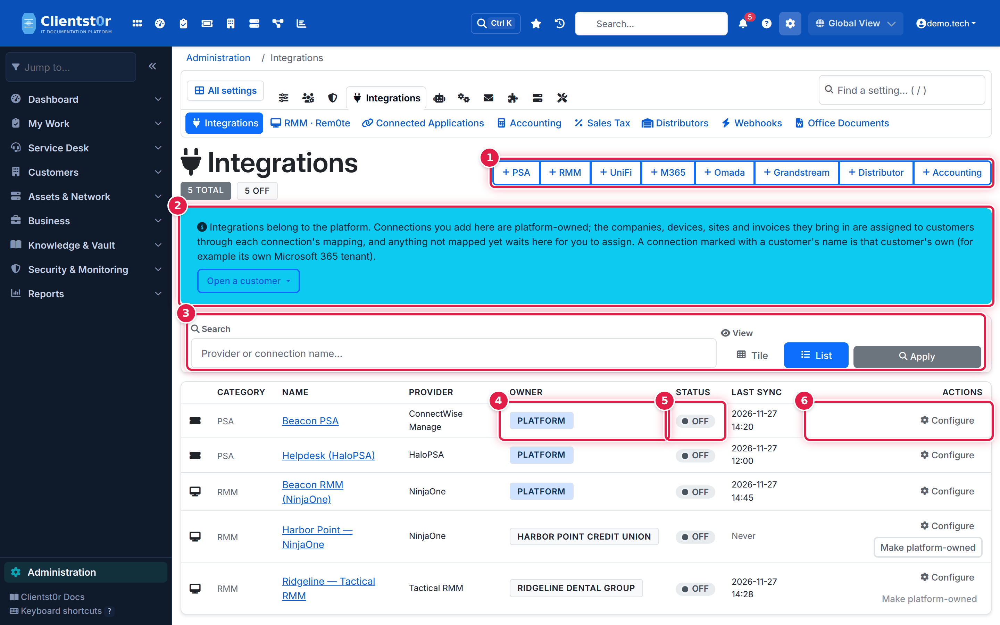
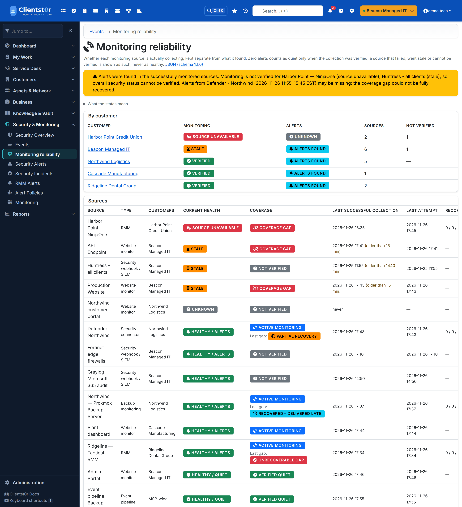
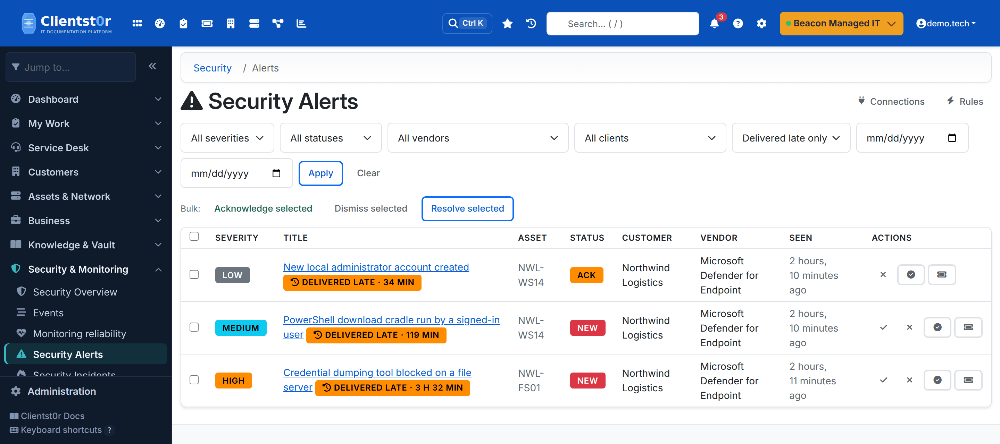
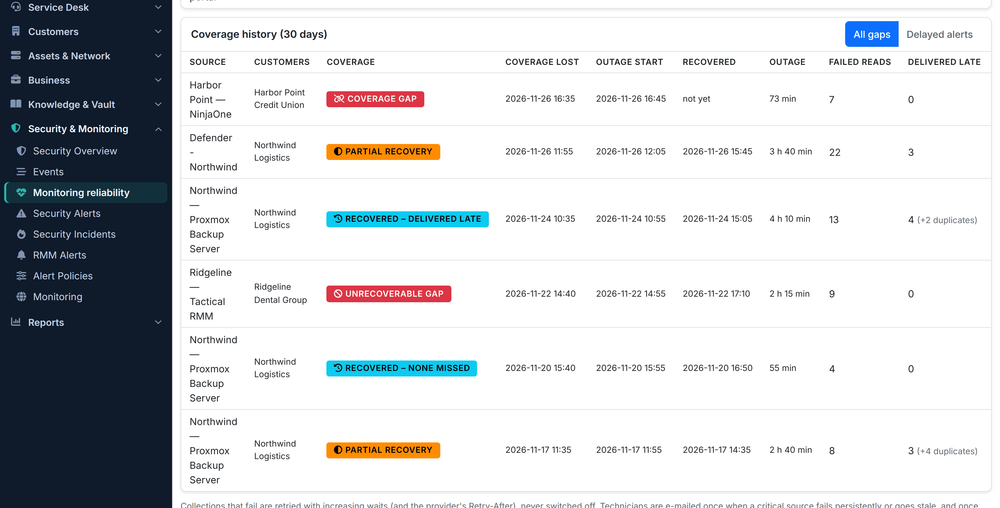
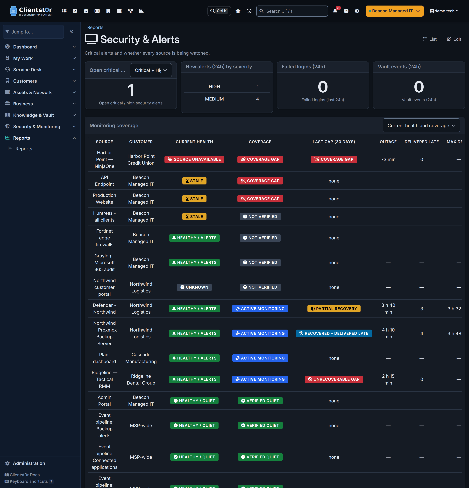

# Clientst0r Integration Setup Guide

Complete guide for connecting PSA and RMM platforms to Clientst0r with exact connection parameters and setup instructions.

---

## Who owns a connection

Integrations belong to the platform owner (the MSP). Add them from **global
view** (no customer selected) under **Administration → Integrations**
(`/integrations/`): a new connection is **platform-owned** by default. The
page lists every connection (PSA, RMM, UniFi, M365, Omada, Grandstream,
distributor and accounting) as tiles or a list, with its owner, status and last
sync; the buttons at the top add one.

<!-- guide-figure: guide-x3-integrations -->


1. Add a connection: PSA, RMM, UniFi, M365, Omada, Grandstream, Distributor or Accounting.
2. Global view: new connections are platform-owned, and what they bring in reaches customers only through each connection's mapping.
3. Search by provider or connection name; Tile and List switch the layout.
4. Owner: Platform, or the one customer whose own connection it is.
5. Status of each connection (Off here: sync is switched off).
6. Configure opens the connection; Make platform-owned (customer-owned rows only) moves it to the platform.
<!-- /guide-figure -->
 Its data reaches customers only through the
connection's mapping:

| Type | How data is assigned to a customer |
|---|---|
| PSA | Each PSA company is mapped to a customer (**Administration → Integrations →** the connection **→ Map organizations**); its contacts and tickets follow the company |
| RMM | Each RMM customer (client) is mapped or imported as a customer; devices whose customer is not settled wait in **Review** |
| UniFi, Omada, Grandstream | Each controller site is mapped to a customer on the connection page; unmapped sites are skipped by imports |
| Accounting | Invoices belong to the customer billed; a platform connection handles every customer without its own connection |
| Distributor, payment, warranty, tax | Platform data with no per-customer split |

Data that maps to no customer stays unassigned and is shown only to platform
staff in global view. It is never filed under "some" customer.

A connection can instead be owned by **one customer**, for example that
customer's own Microsoft 365 tenant or on-site controller: pick the customer
under **Owner** when you add it, or add it from inside that customer.
Rem0te connections, and RMM connections paired for tickets, are always a
customer's own.

Who may manage what:

| Who | Platform-owned connections | A customer's own connections |
|---|---|---|
| Superuser, Django staff | Everything, from global view | Everything |
| MSP technician whose global role grants `integrations_configure` | Add, edit, delete, test, mappings, "Make platform-owned" | As today (per-customer role) |
| MSP technician whose global role grants `integrations_sync` | Sync and import | As today |
| MSP technician whose global role grants `integrations_view` | View, including unassigned data | As today |
| MSP technician without a global role | Nothing | As today |
| A customer's Owner or Admin | Nothing: not listed, not reachable, no credentials | Their own customer's connections, as before |
| Customer portal users | Nothing | Nothing beyond what they had before |

The **Administration → Integrations → Integrations** tab is shown to exactly these people: in global
view, superusers, Django staff and technicians whose global role grants `integrations_configure`,
`integrations_sync` or `integrations_view` (the `/integrations/` pages also need `integrations_view`);
inside a customer, MSP staff whose role there grants `integrations_view` (a technician with no global
role holds it there by the legacy rule). Customer users are not offered the tab. What each can do on the
page follows the table above.

Inside a customer, the Integrations page lists only that customer's own
connections, plus a read-only note naming the platform integrations that
supply its mapped data (customer users see only the kind of integration).

**Moving an existing connection to the platform.** Connections created before
platform ownership keep their customer. In global view, platform
administrators see a **Make platform-owned** button on each customer-owned
connection (or run `python manage.py integrations_ownership --make-platform
<type> <id>`; `--list` shows every connection's owner). Everything the
connection already assigned keeps its customer, and the mapping it used
implicitly is written out (RMM customers, a controller's sites). From then on,
new data that maps to no customer waits for platform staff instead of going to
the former owner. The change is audit-logged under both the former owner and
the platform.

---

## PSA Integrations

### ConnectWise Manage

**Base URL Format:**
```
https://na.myconnectwise.net
https://eu.myconnectwise.net
https://au.myconnectwise.net
https://your-custom-url.connectwise.com
```

**Required Credentials:**
1. **Company ID**: Your ConnectWise company identifier (e.g., `yourcompany`)
2. **Public Key**: API member public key
3. **Private Key**: API member private key
4. **Client ID**: Integration application ID (from Developer Network)

**Setup Instructions:**
1. Log in to ConnectWise Manage
2. Go to **System → Members** → Select API member
3. Navigate to **API Keys** tab
4. Click **New** to generate new API keys
5. Copy the **Public Key** and **Private Key** (save immediately - shown only once)
6. Get your **Company ID** from System → Company settings
7. Register at ConnectWise Developer Network to get **Client ID**
8. In Clientst0r, use full URL including region (na/eu/au)

**API Documentation:** https://developer.connectwise.com/

---

### Autotask PSA

**Base URL Format:**
```
https://webservices1.autotask.net/atservicesrest
https://webservices2.autotask.net/atservicesrest
https://webservices3.autotask.net/atservicesrest
...up to webservices20
```

**Required Credentials:**
1. **Username**: API user email address
2. **API Secret**: Generated API tracking identifier
3. **Integration Code**: Your integration vendor code

**Setup Instructions:**
1. Log in to Autotask PSA
2. Go to **Admin → Resources (Users)** → Select API user
3. Navigate to **Security** tab
4. Generate **API Tracking Identifier** (Secret)
5. Get your **webservices zone number** from API documentation
6. Request **Integration Code** from Autotask (required for production)
7. Base URL must match your assigned zone (webservices1-20)

**API Documentation:** https://www.autotask.net/help/DeveloperHelp/

---

### HaloPSA

**Base URL Format:**
```
https://yourtenant.halopsa.com
https://yourtenant.haloitsm.com
```

**Required Credentials:**
1. **Client ID**: OAuth2 application client ID
2. **Client Secret**: OAuth2 application secret
3. **Tenant**: (Optional) Multi-tenant identifier

**Setup Instructions:**
1. Log in to HaloPSA
2. Go to **Configuration → Integrations → HaloPSA API**
3. Click **View Applications**
4. Create **New Application**
5. Set **Authentication Method** to **Client ID and Secret (Services/Daemons)**
6. Select appropriate **Permissions** (read tickets, contacts, companies)
7. Copy **Client ID** and **Client Secret**
8. Base URL is your HaloPSA tenant URL

**API Documentation:** https://haloservicedesk.com/apidoc/

---

### Kaseya BMS

**Base URL Format:**
```
https://your-instance.kaseya.net
https://bms.kaseya.com
```

**Required Credentials:**
1. **API Key**: Generated API authentication key
2. **API Secret**: API secret token

**Setup Instructions:**
1. Log in to Kaseya BMS
2. Go to **System → Security → API Users**
3. Create **New API User**
4. Generate **API Key** and **Secret**
5. Assign appropriate **Role** (minimum: read companies, tickets, contacts)
6. Copy credentials immediately
7. Use your Kaseya instance URL as base URL

**API Documentation:** https://helpdesk.kaseya.com/hc/en-gb/categories/202373247

---

### Syncro

**Base URL Format:**
```
https://yourdomain.syncromsp.com
```

**Required Credentials:**
1. **API Key**: Generated API token
2. **Subdomain**: Your Syncro subdomain (e.g., `yourcompany` from `yourcompany.syncromsp.com`)

**Setup Instructions:**
1. Log in to Syncro
2. Go to **Admin → API Tokens**
3. Click **New API Token**
4. Enter **Name** (e.g., "Clientst0r Integration")
5. Copy the **API Key** (shown only once)
6. Extract subdomain from your Syncro URL
7. Base URL: `https://[subdomain].syncromsp.com`

**API Documentation:** https://api-docs.syncromsp.com/

---

### Freshservice

**Base URL Format:**
```
https://yourdomain.freshservice.com
```

**Required Credentials:**
1. **API Key**: Generated API key from profile
2. **Domain**: Your Freshservice domain (e.g., `yourcompany` from `yourcompany.freshservice.com`)

**Setup Instructions:**
1. Log in to Freshservice
2. Click your **Profile Picture** → **Profile Settings**
3. Scroll to **Your API Key** section
4. Copy or regenerate **API Key**
5. Extract domain from your Freshservice URL
6. Base URL: `https://[domain].freshservice.com`

**API Documentation:** https://api.freshservice.com/

---

### Zendesk

**Base URL Format:**
```
https://yoursubdomain.zendesk.com
```

**Required Credentials:**
1. **Email**: Admin email address
2. **API Token**: Generated API token
3. **Subdomain**: Your Zendesk subdomain (e.g., `yourcompany` from `yourcompany.zendesk.com`)

**Setup Instructions:**
1. Log in to Zendesk
2. Go to **Admin Center** → **Apps and integrations** → **APIs**
3. Navigate to **Zendesk API** tab
4. Enable **Token Access**
5. Click **Add API Token**
6. Enter **Description** (e.g., "Clientst0r")
7. Copy the **API Token** (shown only once)
8. Use admin email as username
9. Base URL: `https://[subdomain].zendesk.com`

**API Documentation:** https://developer.zendesk.com/api-reference/

---

### Alga PSA

**Base URL Format:**
```
https://algapsa.com
https://your-self-hosted-alga.example.com
```

**Required Credentials:**
1. **API Key**: from the Alga PSA settings
2. **Tenant ID**: your tenant's UUID

Clientst0r sends them as the `x-api-key` and `x-tenant-id` headers. Alga PSA support is newly added and has not been checked against a live instance.

---

### ITFlow

**Base URL Format:**
```
https://your-itflow-instance.com
https://yourdomain.com/itflow
```

**Required Credentials:**
1. **API Key**: Generated API key from ITFlow

**Setup Instructions:**
1. Log in to ITFlow
2. Go to **Settings → API Keys**
3. Click **Create API Key**
4. Enter **Name** (e.g., "Clientst0r Integration")
5. Copy the **API Key**
6. Use your ITFlow installation URL as base URL

**API Documentation:** https://docs.itflow.org/api_getting_started

---

### RangerMSP (CommitCRM)

**Base URL Format:**
```
https://api.commitcrm.com/api/v1 (Cloud)
https://your-server.com:8443/api/v1 (Self-Hosted)
```

**Required Credentials:**
1. **API Key**: Generated from RangerMSP admin panel
2. **Account ID**: (Optional) For cloud-hosted multi-account setups

**Setup Instructions:**
1. Log in to RangerMSP Admin Panel
2. Go to **Setup → Security → API Access**
3. Click **Generate New API Key**
4. Enter **Application Name** (e.g., "Clientst0r")
5. Select **Permissions** (Companies, Contacts, Tickets, Contracts)
6. Copy the **API Key**
7. **Cloud URL:** Use `https://api.commitcrm.com/api/v1`
8. **Self-Hosted:** Use `https://[your-server]:8443/api/v1`

**API Documentation:** https://api.commitcrm.com/docs

---

## RMM Integrations

### Customers, sites and device links

Each RMM connection is either **single customer** (every device belongs to the
customer that owns the connection) or **multiple customers** (each device is
filed under the customer the RMM reports for it). Set this under **Customers** on
the connection form. A platform-owned connection is always multiple customers.

On a multiple-customer connection a device is only shown on a customer's assets,
tickets, alerts and reports once its customer is settled: by an imported or mapped
RMM customer ID, or by a technician in **Administration → Integrations →** the connection **→ Review**.
A device the RMM moves to another customer is hidden until a technician confirms
the move. Devices are never filed under the connection owner as a fallback.
Review for a platform-owned connection is in global view.

| RMM | Customer | Site | Alerts tied to a device by | Open the device in the RMM | How verified |
|---|---|---|---|---|---|
| NinjaOne | Organization ID | Location ID (kept separate from the organization) | `deviceId` | Yes: a short-lived link from the documented dashboard-URL endpoint, fetched by the server when you click | Fixture tests against the v2 API spec. Not yet checked against a live account |
| Datto RMM | Site UID (Datto's site is the customer, so one site is one customer) | Same site | `alertSourceInfo.deviceUid` | Yes: the device's `portalUrl`, shown only on the platform's web host (for example `pinotage.centrastage.net`) | Fixture tests against the API v2 spec. Not yet checked against a live account |
| Atera | `CustomerID` | None (Atera has no site level) | `DeviceGuid`, matched to an agent of the same customer | Yes: the agent's `AppViewUrl`, only on `app.atera.com` | Fixture tests against a published copy of the v3 API spec. Not yet checked against a live account |
| ConnectWise Automate | Client ID | Location ID | `Computer.Id` | No documented URL. The page shows a copyable name and ID | Fixture tests against a published copy of the REST v1 spec. Not yet checked against a live server |
| Tactical RMM | Client ID from one `/clients/` read per sync. If that read fails, the client name (needs a one-time mapping) | Site ID (site names may repeat across customers) | `agent_id` | Yes, when **Web console URL** is set on the connection: `<console>/agents/<agent id>` | Fixture tests against the Tactical RMM source. Not yet checked against a live server |
| Rem0te | Always the connection's own organization: a Rem0te API key sees one business only. The business is recorded on the first sync and a key for a different business stops the sync | Site ID, shown for reference | No alerts in the Rem0te API | **Connect with Rem0te**: `<Rem0te>/endpoints/<computer id>`, opened with the technician's own Rem0te sign-in. No key or remote access credential is stored or put in the link | Fixture tests against the Rem0te public API docs and source. Not yet checked against a live instance |

Device asset links follow the same rules for every RMM. They never cross customers:

- A unique serial matches. Placeholder serials ("To Be Filled By O.E.M.", "0", etc.) are ignored.
- A unique hostname matches only when the serial and site don't conflict.
- IP addresses are never used to identify a device.
- Duplicates and conflicts go to the review queue with the candidates and a plain explanation.
- A technician's link, "create new" or "leave unlinked" decision is kept across syncs.
- An RMM fills empty asset fields. It updates a field only while that field still holds the value the RMM last wrote, so technician edits are kept.

**After upgrading**, run one sync on each connection, then preview and apply reconciliation:

```bash
python manage.py rmm_reconcile                 # dry run: counts only, nothing saved
python manage.py rmm_reconcile --apply         # make the changes
python manage.py rmm_reconcile --connection 3  # one connection only
```

It is safe to run again. Links to another customer's assets stop showing as soon as the update is applied, before reconciliation runs.

### NinjaOne (NinjaRMM)

**Base URL Format:**
```
https://app.ninjarmm.com
https://eu.ninjarmm.com
https://oc.ninjarmm.com
```

**Required Credentials:**
1. **Client ID**: OAuth2 application client ID
2. **Client Secret**: OAuth2 application secret
3. **Refresh Token**: OAuth2 refresh token

**Setup Instructions:**
1. Log in to NinjaOne
2. Go to **Administration → Apps → API**
3. Click **Add** to create new application
4. Select **OAuth** authentication
5. Set the **Redirect URI** the NinjaOne application requires (Clientst0r has no sign-in callback for NinjaOne: it takes the token you paste in)
6. Copy **Client ID** and **Client Secret**
7. Complete the OAuth flow in NinjaOne to get a **Refresh Token**; Clientst0r's connection form asks for exactly these three values
8. Use region-specific URL (app/eu/oc based on your instance)

**API Documentation:** https://ninjarmm.zendesk.com/hc/en-us/sections/360001438632-API

---

### Datto RMM

**Base URL Format:**
```
https://pinotage-api.centrastage.net
```

**Required Credentials:**
1. **API Key**: Platform API key
2. **API Secret**: Platform API secret

**Setup Instructions:**
1. Log in to Datto RMM
2. Go to **Setup → Account Settings → API Credentials**
3. Click **New**
4. Enter **Name** (e.g., "Clientst0r")
5. Copy **API URL**, **API Key**, and **Secret Key**
6. Use the provided API URL as base URL

**API Documentation:** https://help.aem.autotask.net/en/Content/2SETUP/APIv2.htm

---

### ConnectWise Automate (LabTech)

**Base URL Format:**
```
https://your-automate.server.com
https://automate.yourcompany.com
```

**Required Credentials:**
1. **Server URL**: Your Automate server URL
2. **Username**: API user account
3. **Password**: API user password

**Setup Instructions:**
1. Log in to ConnectWise Automate
2. Go to **Tools → User Accounts**
3. Create new user or use existing
4. Set **Security Class** with API permissions
5. Enable **API Only** account (recommended)
6. Use credentials for authentication
7. Base URL is your Automate server address

**API Documentation:** https://docs.connectwise.com/ConnectWise_Automate/ConnectWise_Automate_Documentation

---

### Atera

**Base URL Format:**
```
https://app.atera.com
```

**Required Credentials:**
1. **API Key**: X-API-KEY header value

**Setup Instructions:**
1. Log in to Atera
2. Go to **Admin → API**
3. View your **API Key** (shown as **X-API-KEY**)
4. Copy the API key
5. Base URL is always `https://app.atera.com`

**API Documentation:** https://app.atera.com/api/

---

### Tactical RMM

**Base URL Format:**
```
https://rmm.yourdomain.com
https://your-tactical-instance.com
```

**Required Credentials:**
1. **API Key**: Generated API token

**Setup Instructions:**
1. Log in to Tactical RMM
2. Go to **Settings → API Keys**
3. Click **New**
4. Enter **Name** (e.g., "Clientst0r")
5. Select **Permissions** (read agents, alerts, software)
6. Copy the **API Key** (shown only once)
7. Use your Tactical RMM API URL as the base URL (for example `https://api.yourdomain.com`)
8. Optional: set **Web console URL** to the address you open Tactical RMM at (for example `https://rmm.yourdomain.com`) to get "Open in Tactical RMM" links

**API Documentation:** https://docs.tacticalrmm.com/api/

### Rem0te

Rem0te is a self-hosted remote support portal on RustDesk. The connection syncs a
business's computers so they link to that customer's assets, and puts a
**Connect with Rem0te** button on the asset and ticket pages for technicians.

**Base URL Format:**
```
https://remote.yourdomain.com
```

**Required Credentials:**
1. **API Key**: a Rem0te API key (`rk_…`) with the `computers:read` scope

**Setup Instructions:**
1. In Rem0te, go to **Administration → API Keys**
2. Create a key for the customer's business with the `computers:read` scope
3. Copy the key (shown only once)
4. In Clientst0r, switch to that customer's organization and add an RMM integration with provider **Rem0te** (superusers can also use the checklist at **Administration → Integrations → RMM · Rem0te**)
5. Use your Rem0te address as the base URL

A Rem0te key belongs to exactly one business, so each connection is single
customer and organization import doesn't apply. Add one connection per customer.
If the key on a connection is later replaced with a key for a different business,
the sync stops with an error instead of filing that business's computers here.

The button opens the computer's page in Rem0te. The technician's own Rem0te
account decides whether they can see it and connect. Clientst0r never holds a
RustDesk password or a session credential. Customers don't see the button or any
Rem0te details.

**API Documentation:** `docs/PUBLIC-API.md` in the Rem0te repository (https://github.com/agit8or1/rem0te)

---

## Monitoring health (is the integration really collecting?)

Security connectors, RMM connections and polled backup connections record whether each collection actually
worked, separately from what it found. **Security & Monitoring → Monitoring reliability** lists every
monitoring source per customer with its state — Healthy / quiet, Healthy / alerts, Degraded, Permission denied,
Source unavailable, Ingestion failed, Stale or Unknown — the last successful collection and the record counts.

- *Zero alerts is not the same as healthy.* A source shows Healthy / quiet only when an empty result was verified
  (a bounded check that the API really could have returned data). A webhook-only source cannot prove a quiet
  period and shows Unknown until something arrives.
- *Failures are retried, never switched off.* Waits grow after each failure (and follow the provider's
  Retry-After); technicians get one e-mail when a critical source fails persistently or goes stale, and one when
  it recovers.
- *Building a connector?* Follow the [Monitoring Health Standard](standards/MONITORING_HEALTH_STANDARD.md):
  raise on HTTP, permission and malformed-response errors, and implement the empty-window probe for your
  provider.

### Coverage gaps and alerts delivered late

When a source fails to collect — even once — Clientst0r records a **coverage gap** for that customer and source:
when coverage was last verified, when the outage started, how many reads failed and when collection worked again.
The page shows **Current health** (does collection work now?) and **Coverage** (were the alerts seen as they
happened?) in separate columns, each with an icon, a text label and a tooltip:

| Coverage | Meaning |
|---|---|
| Verified Quiet | Collection verified and uninterrupted; no alerts. |
| Active Monitoring | Collection verified and uninterrupted; alerts arriving in real time. |
| Coverage Gap | Interrupted now, or collecting again but the missed window is not resolved yet. The source shows *Healthy / recovering*, never quiet. |
| Recovered – Delivered Late | The missed window was retrieved and proven complete; its alerts were not seen in real time (*Recovered – None Missed* when it held none). |
| Partial Recovery | Only part of the window could be retrieved, or completeness could not be proven: alerts may be missing. |
| Unrecoverable Gap | The source cannot return past events for that window: alerts may be missing permanently. |
| Not Verified | No coverage claim is possible (webhook and SIEM push sources). |



- *Backfill.* After a recovery the scheduler asks the source for the window it missed, page by page, where the
  source supports it. Progress is saved after every page, so a restart continues where it stopped. Nothing runs
  while a page loads. Today **Proxmox Backup Server** backup runs are backfilled (up to 7 days back). The shipped
  security vendor adapters cannot return history yet, and RMM sync reads the current alert list only, so their gaps
  end as Partial Recovery (what the first read after recovery returned) or Unrecoverable Gap.
- *A 200 response is not proof.* A gap counts as fully recovered only when the provider declares how far back it
  keeps events, how results are ordered and how it signals the last page, **and** the retrieval reached that last
  page with nothing rejected and nothing older than the lookback.
- *Delivered late.* Each alert keeps the vendor's own event time next to the time Clientst0r received it, and the
  delay. Alerts first received after a gap carry a **Delivered late** badge on the security alert list and detail,
  the incident, the event list and detail, and the reliability page (**Delayed alerts** filter); the alert lists
  have a *Delivered late only* filter.

  
- *Normal workflows, no shortcuts.* Backfilled alerts are deduplicated like any other (no second alert, ticket or
  incident), follow your alert-to-ticket rules — the ticket subject starts with `[Security][Delivered late]` — and
  join incidents as usual. A matching playbook still waits for approval unless it is set to run automatically.
- *Gap history.* Every gap stays listed (30 days on the page, longer in the database) after the source recovers;
  a later outage gets its own entry.

  
- *Notifications.* **Security & Monitoring → Events → Ingestion health → Monitoring coverage**: e-mail technicians
  once when a critical source has been interrupted longer than a threshold (default 60 minutes, 0 = off) and once
  when a gap cannot be fully recovered (default on); switch backfill off or cap how far back it asks (default 168
  hours). Changes are recorded in the audit log.
- *Wallboards.* Add the **Monitoring coverage** widget (also in the *Security & Alerts* wallboard template). Its
  menu switches between current health and coverage per source, historical gaps (outage duration, alerts delivered
  late, maximum delay) and recent delayed alerts. It shows only the customers the viewer may see.

  
- *JSON feed.* `/security/events/sources.json` (schema 1.1.0) adds a `coverage` object per source; see the
  [standard](standards/MONITORING_HEALTH_STANDARD.md#65-coverage-gaps-recovery-and-backfill-110).

## Troubleshooting

### Common Issues

**401 Unauthorized:**
- Verify credentials are correct
- Check if API user has proper permissions
- Ensure API access is enabled in source system
- Check if API keys have expired

**403 Forbidden:**
- User/API key lacks required permissions
- IP whitelist restrictions (if configured)
- Resource access limitations

**404 Not Found:**
- Base URL is incorrect
- Wrong API version in URL
- Endpoint doesn't exist (check provider API docs)

**429 Rate Limited:**
- Too many requests in time window
- Lengthen the connection's sync interval
- Contact provider to increase rate limits

**SSL/TLS Errors:**
- Self-signed certificates not trusted
- Certificate expired
- Wrong hostname in certificate

### Testing Connections

1. Save connection with all required credentials
2. Click **Test Connection** button
3. Review error messages for specific issues
4. Check application logs: `/var/log/itdocs/django.log`
5. Verify base URL is accessible: `curl -I [base_url]`
6. Test API credentials with provider's API explorer

### Getting Help

- Check provider's API documentation
- Review error logs for specific error messages
- Contact provider support for API access issues
- Open GitHub issue: https://github.com/agit8or1/clientst0r/issues

---

## Security Best Practices

1. **API Keys:**
   - Use dedicated API-only accounts
   - Grant minimum required permissions
   - Rotate keys regularly (quarterly recommended)
   - Never commit keys to version control

2. **Network Security:**
   - Use HTTPS for all connections
   - Implement IP whitelisting when available
   - Use firewall rules to restrict API access

3. **Monitoring:**
   - Enable audit logging in source systems
   - Monitor API usage and patterns
   - Set up alerts for failed authentications
   - Review sync logs regularly

4. **Access Control:**
   - Limit who can create/edit integrations
   - Use role-based access control
   - Platform-owned connections are managed by superusers, Django staff and technicians whose global role grants `integrations_configure` (see the table at the top)
   - Document integration ownership

---

See also: [Connected Applications](CONNECTED_APPLICATIONS.md) for Agit8or Connect and Quick Connect, which are separate from the provider integrations on this page.
