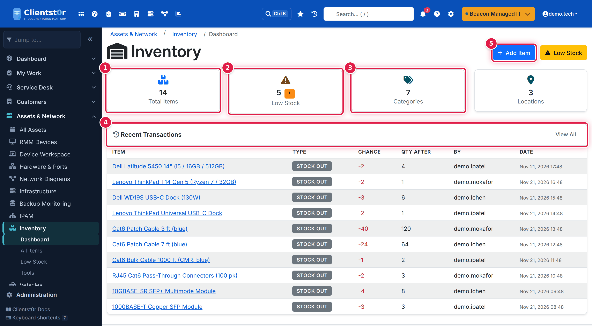
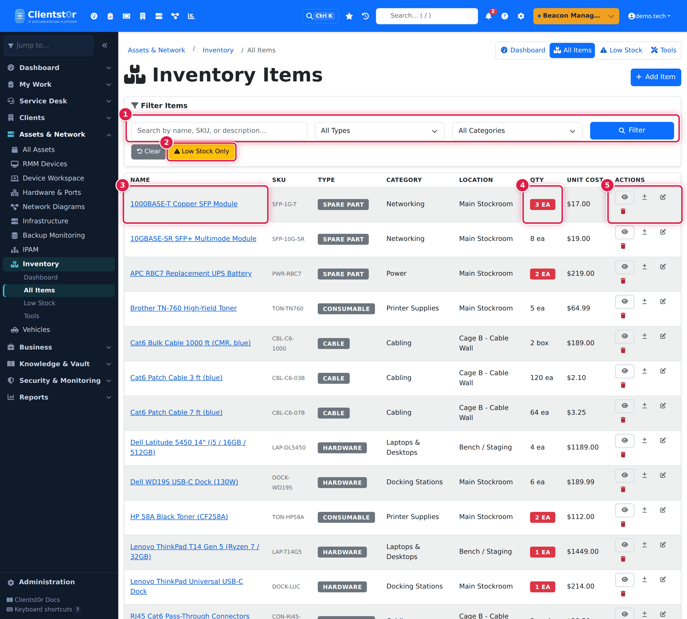
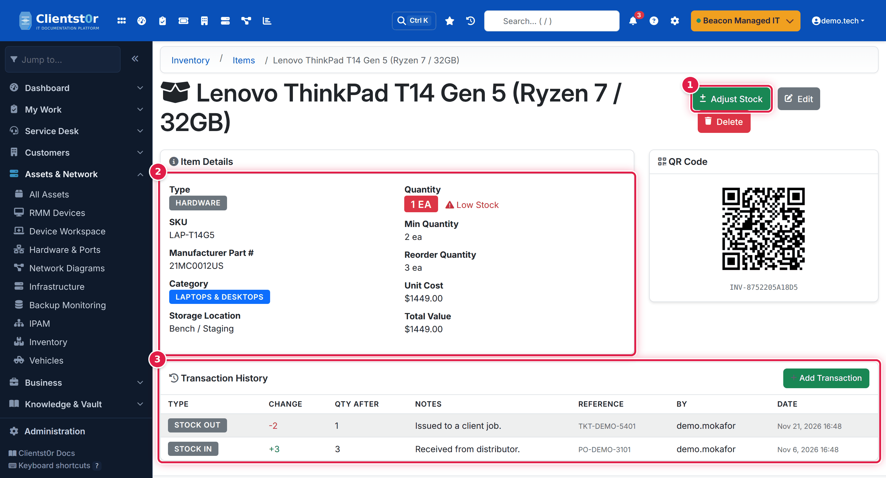
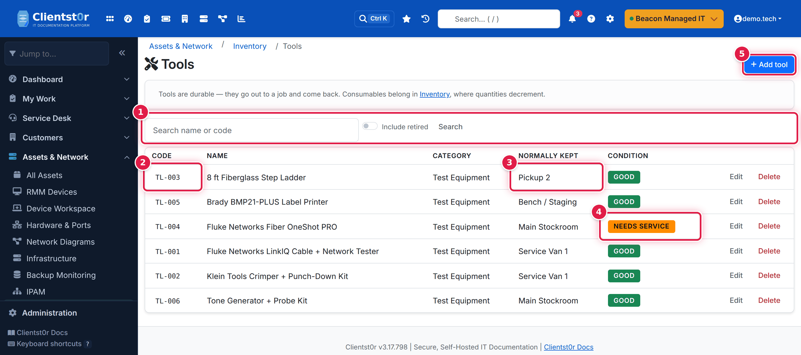
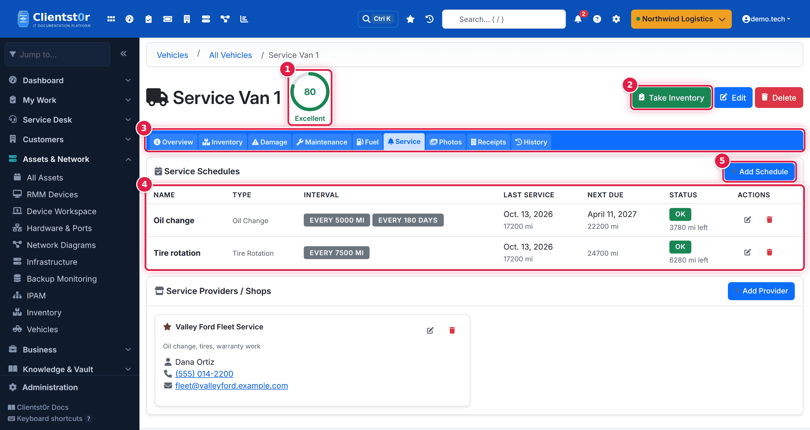

# Inventory, tools and vehicles

How the MSP keeps track of its own stock (spare parts, hardware, consumables), the durable tools technicians
take to jobs, and its service vehicles. Everything here is in **Assets & Network** in the sidebar, under
**Inventory** and **Vehicles**, and is for MSP staff only: customer users never see these pages. The numbers
in each screenshot match the list under it. Every screenshot is a capture of the application against a demo
database; the customers and people in it are invented.

Both modules can be switched off by a superuser in **Administration → Modules → Feature Toggles**
(*Inventory Management* and *Service Vehicles*); both are on by default.

## Inventory belongs to the selected customer

Inventory items, categories, storage locations and tools are recorded under an organization: the one picked
in the client switcher when you open the page. Most MSPs keep their stock under their own organization; the
demo keeps it under its MSP organization, *Beacon Managed IT*. Switch to another customer and the inventory
pages show that customer's stock instead (often none).

This matters on tickets: a ticket's **From stock** and kit lists offer only the stock recorded under that
ticket's customer (see [Using stock on a ticket](#using-stock-on-a-ticket)).

**Who sees it.** MSP staff (superusers and users whose type is Staff). Anyone else gets "Inventory is
available to MSP staff only." Adding, editing and adjusting stock needs an Editor role or above; deleting
items, categories, locations and tools needs an Admin or Owner role.

## The inventory dashboard

**Assets & Network → Inventory → Dashboard** (`/inventory/`). A summary of the selected organization's stock.

<!-- guide-figure: guide-stock-dashboard -->

1. How many items this customer's inventory holds. Click to open All Items.
2. Items at or below their minimum quantity. Click to open Low Stock.
3. Categories. Locations, next to it, works the same way: click either to add, rename or remove them.
4. The last ten stock movements. View All opens the full transaction log.
5. Add an inventory item.
<!-- /guide-figure -->

- **Low Stock** counts items whose quantity is *at or below* their minimum, so an item with a minimum of 2
  and two on the shelf already counts.
- **Recent Transactions** shows the last ten stock movements; **View All** opens the full log
  (`/inventory/transactions/`, 50 per page).
- **Categories** (name, description, colour) and **Locations** (a shelf, a cage, a bench) are plain lists
  you manage from their own pages; there is no tab for them, so reach them from these tiles.

## All items and Low Stock

**Assets & Network → Inventory → All Items** (`/inventory/items/`). Every item, sorted by name.

<!-- guide-figure: guide-stock-items -->

1. Search by name, SKU or description, and filter by type and category.
2. Show only items at or below their minimum.
3. The name opens the item, its QR code and its transaction history.
4. A red quantity means the item is at or below its minimum.
5. View, Adjust Stock, Edit and Delete.
<!-- /guide-figure -->

- **Add Item** asks for the name, SKU, manufacturer part number, type (spare part, hardware, consumable,
  tool, cable, license, other), category, storage location, description and notes, the quantity and unit
  (ea, box, pack…), the minimum quantity, the reorder quantity, a reorder link and the unit cost.
- **Low Stock** (`/inventory/low-stock/`, its own tab) lists the same at-or-below-minimum items with their
  minimum, reorder quantity, a **Reorder** button when the item has a reorder link, and **Adjust Stock**. It
  places no order.
- A scheduled task, *Stock Minimum Scan*, runs daily and writes the items below minimum to its run log. It
  skips items whose minimum is 0 and creates nothing by itself.
- Quantities shown here are stock on hand. Stock reserved for tickets is not subtracted (the ticket's
  *From stock* list shows what is available).

## An item and how stock moves

Click an item's name to open it.

<!-- guide-figure: guide-stock-item -->

1. Adjust Stock: record stock coming in, going out or a correction.
2. Quantity on hand, the minimum that triggers Low Stock, the reorder quantity and the stock value.
3. Every recorded change: type, change, quantity after, reference (a PO or ticket), who and when.
<!-- /guide-figure -->

Every change to the quantity is recorded as a transaction with the type, the change, the quantity after,
notes, a reference, who made it and when. Stock moves in three ways:

- **Adjust Stock** (or **Add Transaction**). Pick a type, enter the change (a positive number adds, a
  negative one removes), and optionally notes and a reference such as a PO or ticket number. Use *Stock In*
  when goods arrive, *Stock Out* when they leave, *Adjustment* after a count. Stock cannot go below zero.
  *Stock Out* always removes stock, so `3` and `-3` both take three away. Leave *Reserved for a ticket* and *Reservation released* to tickets; they are listed but meant for
  ticket items.
- **Tickets**: see the next section.
- **The mobile app** can also record stock in, stock out and adjustments.

The **QR code** on the item page links to `/inventory/items/scan/<code>/`, which opens the item. Each item
gets its own code when it is created.

## Using stock on a ticket

On a ticket's **Time & Charges** card (MSP staff, service desk on), **Add Item** has a **From stock** list.
It offers the items recorded under the ticket's customer with how many are available (on hand minus what
other tickets have reserved). Then:

1. **Adding the line reserves the stock.** The quantity on hand does not change; a *Reserved for a ticket*
   transaction is logged. If there are not enough, the line is added anyway with a warning saying how many
   are short.
2. **Used** deducts the stock once (a *Stock Out* transaction referencing the ticket). Clicking it again
   deducts nothing more.
3. **Removing the line** releases a reservation (*Reservation released*), or puts used stock back
   (*Stock In*, "Returned from …"). A line already on an invoice cannot be removed.

Quantities from stock must be whole numbers, and a credit line cannot come from stock. See
[Billing](BILLING.md) for how ticket items reach invoices.

The ticket's **kit** list (things to take to the job) can name tools and inventory items and warns when
there is less stock than the kit asks for. The kit is a packing list: it reserves and deducts nothing.

## Tools

**Assets & Network → Inventory → Tools** (`/inventory/tools/`). Durable equipment that goes out to a job and
comes back: testers, crimpers, ladders, label printers. Consumables belong in items, where quantities go
down.

<!-- guide-figure: guide-stock-tools -->

1. Search by name or code. Include retired also lists tools you have taken out of use.
2. The tool's code, for example its asset tag.
3. Normally kept: the van it rides in, or else its storage location.
4. Condition: good, needs service, out of service or lost.
5. Add a tool.
<!-- /guide-figure -->

- A tool has a name, an optional code (unique within the organization), a category, a description, where it
  lives (a storage location, a van, or both; the van wins in *Normally kept*), a condition and notes.
- **Retire** a tool by unticking *Active* on its edit page. It leaves the list (tick *Include retired* to
  see it) and the pick-lists, and kit lines that named it keep their text. **Delete** removes it outright.
- Tools appear in a ticket's kit list. There is no check-out: the list records where a tool normally lives
  and its condition, not who has it right now.

## Vehicles

**Assets & Network → Vehicles → All Vehicles** (`/vehicles/vehicles/`). The MSP's own fleet. Vehicles are
not tied to any customer: every MSP staff member sees the same fleet whichever customer is selected, and any
MSP staff member may add, edit or delete a vehicle and its records. Customer users are refused.

The list filters by status (active, inactive, in maintenance, retired) and condition, and searches name,
make, model, licence plate and VIN. It shows mileage and who the vehicle is assigned to. **Add Vehicle**
asks for the name (the nickname people use, such as "Van 3"), type, make, model, year, colour, VIN,
licence plate, status, condition, current mileage, insurance and registration details, purchase details,
map coordinates, who it is assigned to, notes, and a diagram type (cargo van or pickup) for damage reports.

### A vehicle

Open a vehicle from the list.

<!-- guide-figure: guide-stock-vehicle -->

1. Health score out of 100, from the vehicle's condition, open damage, overdue maintenance and pending service alerts.
2. Take Inventory: count the van's stock by scanning QR labels.
3. Overview, Inventory, Damage, Maintenance, Fuel, Service, Photos, Receipts and History.
4. Service schedules: the interval, the last service and when the next is due, with OK, Due Soon or Overdue.
5. Add a schedule, such as an oil change every 5,000 miles or 180 days.
<!-- /guide-figure -->

The tabs:

| Tab | What it holds |
|---|---|
| Overview | Vehicle details, the current assignment (**Assign** / **Reassign**), insurance, registration and notes. Assigning records the start mileage; ending an assignment records the end mileage and clears it. |
| Inventory | Stock carried in this vehicle, with the place in the vehicle, minimum and reorder quantity, low-stock marks and printable QR labels. |
| Damage | Damage reports (date, severity, repair status, costs, insurance claim, repair shop) marked on a van or pickup diagram, with photos. |
| Maintenance | Service records with cost, mileage and the next due date or mileage. |
| Fuel | Fill-ups: mileage, gallons, price and station. Miles per gallon is worked out from the previous fill-up, and a higher mileage updates the vehicle's current mileage. |
| Service | Pending service alerts, service schedules and service providers (shops, with a preferred one). |
| Photos | Pictures of the vehicle (needs the file upload permission to add, file delete to remove). |
| Receipts | Expense receipts by category with totals. **Phone Shortcut** gives a link and QR code that opens Add Receipt for this vehicle on a phone. |
| History | Past assignments. |

The health score starts from the condition (Excellent 100, Good 80, Fair 60, Poor 40, Needs Repair 20) and
loses 10 per open damage report, 15 per overdue maintenance record and 5 per pending service alert.

**Receipts, OPTIONAL AI.** When AI is on (`psa_ai_enabled`, with a provider set in Settings → AI), Add
Receipt can read a photo of the receipt and fill in the date, vendor, amounts and odometer for you to check.
The same image cannot be imported twice. With AI off you type the details in.

**Take Inventory** is a counting mode for phones: scan each QR label in the van, set the count or use plus
and minus, then end the session to see a summary. Vehicle stock changes are not written to a transaction
log the way inventory items are.

## Service alerts

**Assets & Network → Vehicles → Service Alerts** (`/vehicles/service-alerts/`). Pending service alerts for the
whole fleet, plus the last 20 completed. The demo has none pending, so there is no screenshot.

- An alert comes from a **service schedule** on the vehicle's Service tab: an interval in miles, days or both,
  the last service, and a warning margin (default 500 miles and 7 days). When the vehicle comes within the
  margin, a "*Name* due" alert is raised, marked *Due Soon*, or *Overdue* once the date or mileage passes.
- Schedules are checked **every hour** for every vehicle that is not retired, and again whenever someone opens
  a vehicle's page. A schedule gets one pending alert at a time, however often it is checked.
- **Acknowledge** opens a form. With *Record service as completed now* ticked (the default) it creates a maintenance
  record from the date, mileage, notes and who did it, moves the schedule's last service to that date and
  mileage, and completes the alert. Unticked, the alert is only acknowledged and leaves this list; the
  schedule is unchanged, so the next visit to the vehicle raises it again.

The **Vehicles dashboard** (`/vehicles/`, reached from the breadcrumb) also warns about insurance and
registration expiring within 30 days and overdue maintenance.

## Vehicle Inventory

**Assets & Network → Vehicles → Vehicle Inventory** (`/vehicles/inventory/`). Stock carried in vehicles and
kept in the shop, in one place. The demo has none, so there is no screenshot.

- **All**, **Vehicles (flat)**, **By Vehicle** and **Shop** switch the view; search covers name and category.
- **Shop** items are stock kept at the shop rather than in a van, with their place in the shop. **Add Shop
  Item** adds one; vehicle items are added from the vehicle's Inventory tab or the plus button in By Vehicle.
- **QR Codes** prints labels for every item. Scanning a vehicle item's label opens a page with plus, minus
  and set-count buttons.
- This stock is separate from the Inventory module's items: it does not appear on tickets, and a ticket's
  *From stock* list never draws from it. The daily *Stock Minimum Scan* does include it.

## Related guides

- [Tickets, dispatch and projects](TICKETS.md): Time & Charges and the kit list on a ticket.
- [Billing](BILLING.md): how ticket items become invoice lines.
- [Getting started](GETTING_STARTED.md): the client switcher and the sidebar.
