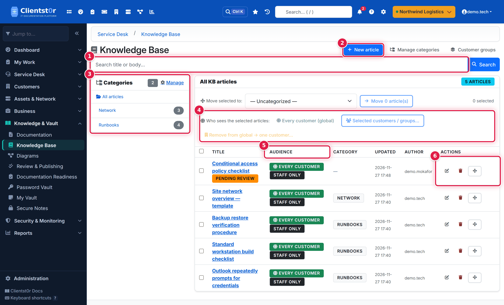
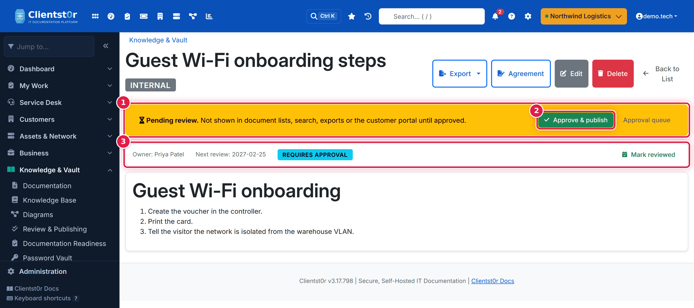
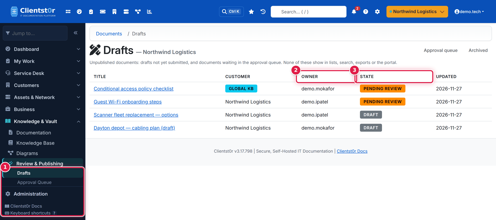
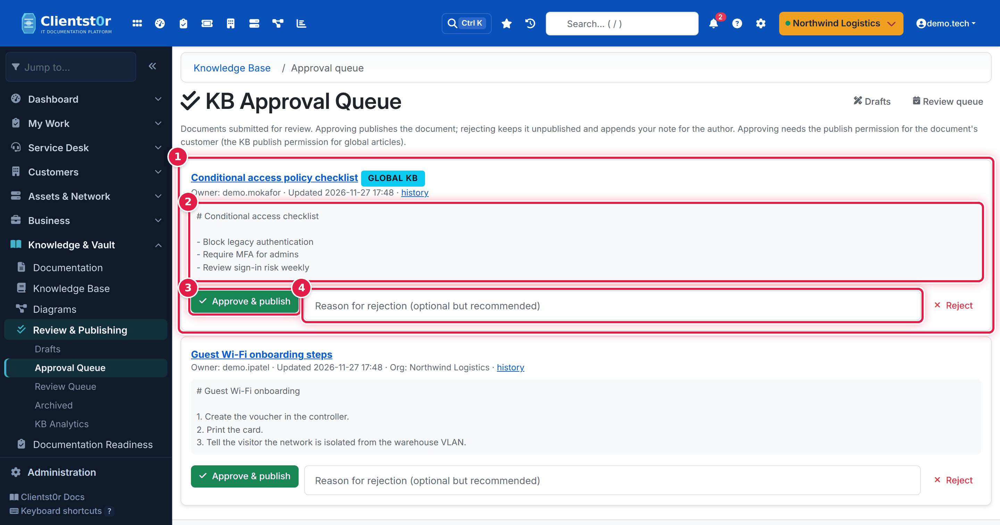
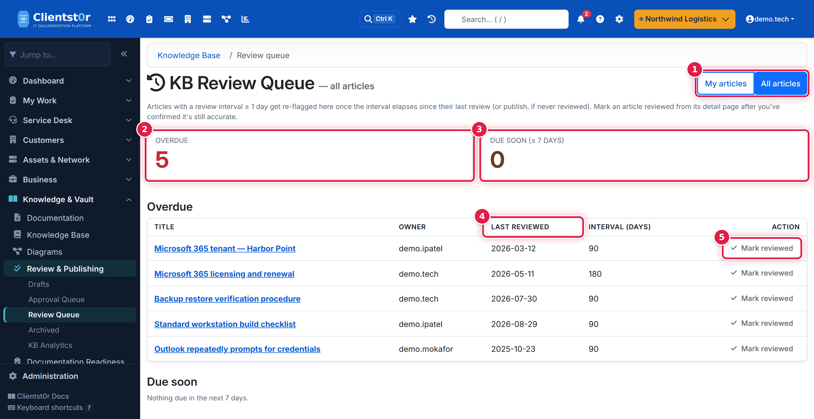
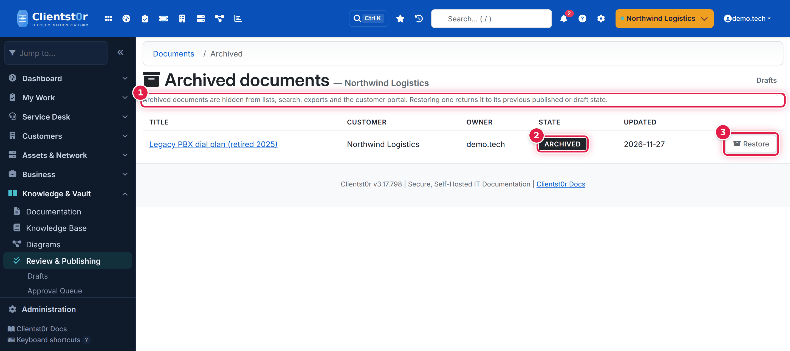
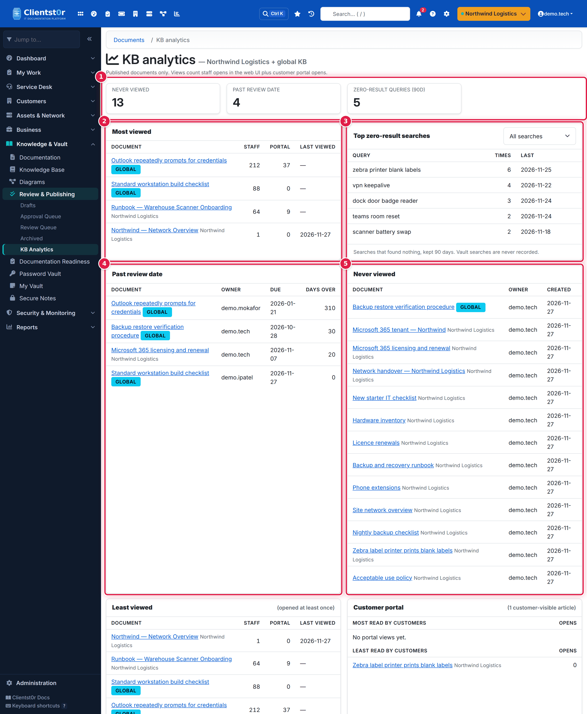
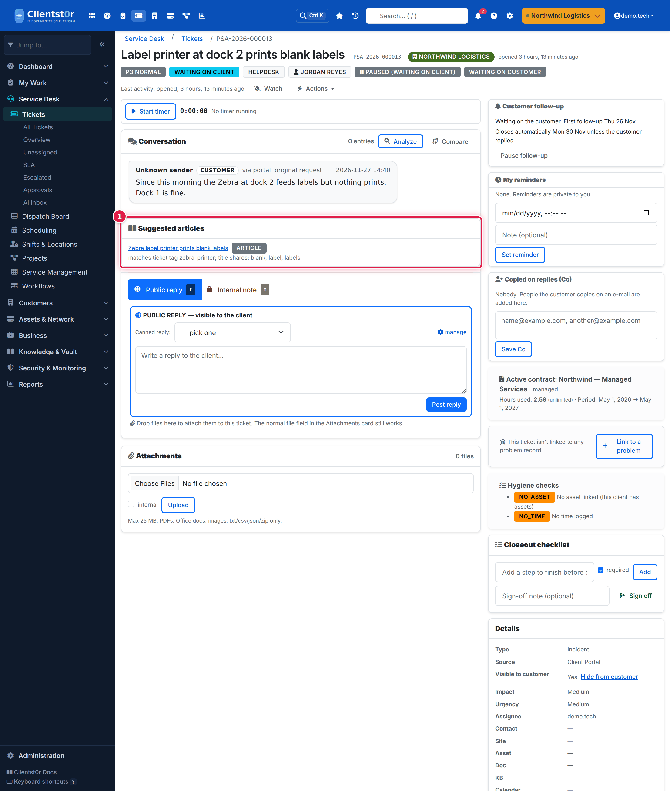
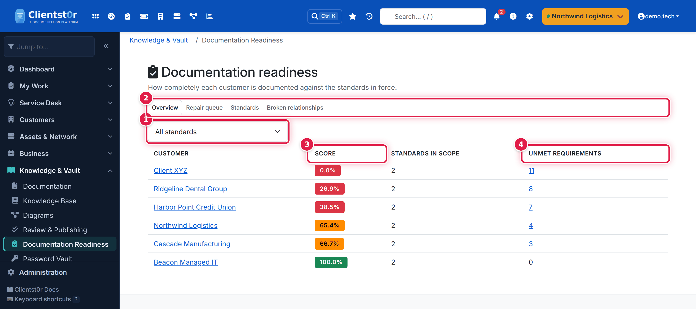
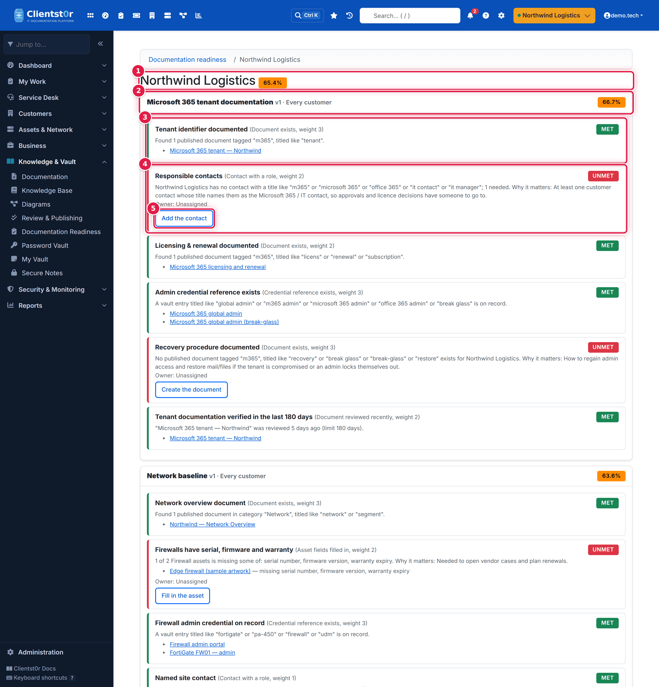

# Knowledge Base, Review & Publishing and Documentation Readiness

How articles are written, who sees them, how they are reviewed and published, how stale ones are found, and how
the MSP checks that each customer is documented to a standard. These pages are in **Knowledge & Vault** in the
sidebar: **Knowledge Base**, **Review & Publishing** (Drafts, Approval Queue, Review Queue, Archived, KB Analytics)
and **Documentation Readiness**. The numbers in each screenshot match the list under it. Every screenshot is a
capture of the application against a demo database; the customers and people in it are invented.

Two kinds of article are involved, and the pages below handle both:

- **Global KB articles** belong to the MSP, not to one customer. They are the **Knowledge Base** page. Only MSP
  staff see that page; the customer portal shows a global article only when it is marked as visible there.
- **Customer documents** belong to one customer and are listed under **Documentation** (covered in the
  documentation guides). They use the same editor, the same draft and approval flow and the same review dates, and
  they appear in the Review & Publishing pages next to global articles.

## Internal or customer-visible

Every article is either **internal** (staff only) or **customer-visible**. Customer-visible articles are the ones
customers can read in the customer portal under **Knowledge Base** (`/portal/kb/`).

- The setting is the **Show in this customer's portal** box (**Show in every customer portal** for a global
  article) in the editor. New global articles start with it ticked; new customer documents start unticked.
- A customer-visible article reaches a customer's portal only while it is live: published, not a draft or pending
  review, and not archived. A global article also has to include that customer in its **audience** (every
  customer, or selected customers and customer groups).
- **Featured in portal** pins an article to the top of the portal list.
- Technician-only notes can stay inside a customer-visible article. Wrap them in an internal block (in Markdown
  `:::internal` … `:::`, in HTML `
…
`). Staff see the block; the portal copy has it
  removed.
- The box is a publishing decision: only people who may publish the article see it in the editor, and the bulk
  actions on the Knowledge Base page need publish rights too.
- Customer users can never open the global Knowledge Base pages; for them a global article exists only as the
  portal copy. Customer users also never see internal customer documents, except ones a customer-side user wrote.

## The Knowledge Base list

**Knowledge & Vault → Knowledge Base** (`/psa/kb/`). The global articles. MSP staff only; anyone else gets "The
knowledge base is available to MSP staff only." (With Service Management switched off, the same list is at
`/docs/kb/`.)

<!-- guide-figure: guide-kb-browse -->

1. Search article titles and bodies.
2. Write a new global article.
3. The category tree. Click a category to filter; Manage edits the categories.
4. Who sees the selected articles: every customer, selected customers or groups, or move one to a single customer.
5. Audience: which customers get the article. A black Staff only badge means it is not shown in any customer portal.
6. Edit, delete and move.
<!-- /guide-figure -->

- Search looks in titles and bodies. A search with no result is recorded (see [KB Analytics](#kb-analytics)).
- Articles are grouped by category. A category shows its own articles and those of its subcategories. Click
  **Manage** to add, rename or remove categories (needs the category permission).
- **Pending review** and **Draft** badges appear beside titles, but only for people who can edit KB articles. Other
  staff see published articles only.
- The Audience column shows who gets an article: every customer, or the selected customers and groups. A black
  **Staff only** badge means it is not shown in any customer portal.
- The row buttons are Edit, Delete and Move to category. Each needs the matching KB permission (edit, delete,
  move); superusers can delete global articles.
- To change the audience of several articles at once, tick them and use **Who sees the selected articles**:
  every customer, selected customers and groups, or move them out of the global KB into one customer's
  documentation. This needs both KB edit and KB publish rights.
- The list shows the newest 100 articles that match.

## Writing an article

**Knowledge Base → New article** for a global article, or **Documentation → New** for a customer document. Both use
the same editor. Edit an article from its row or its page.

<!-- guide-figure: guide-kb-editor -->
.")

1. The article title.
2. Tags. Ticket suggestions match on tags and categories.
3. Published, Requires approval, Template and Archived. Only people who may publish see Published and Requires approval.
4. Show in this customer's portal. Off means internal only.
5. Owner: who keeps the article current and gets the review reminders.
6. Review every N days; 0 turns reminders off.
<!-- /guide-figure -->

- Choose the **Editor**: HTML (rich text), Markdown, or an uploaded file such as a PDF or Office document.
- A template can be loaded to start from. The article remembers which template version it came from, and its page
  tells you when the template has since changed. Changes are never copied in automatically.
- **Category** and **Tags** organise the article. They also drive the [suggestions on tickets](#suggested-articles-on-tickets).
- **Owner** is the person responsible for keeping the article current. They get the review reminders. The choices
  are MSP staff and, for a customer document, members of that customer.
- **Review every N days** sets how often the article must be looked at again. 0 turns reminders off. The default
  is 90 days.
- Every change to the title, body or editor creates a version. **History** on the article lists them and lets
  you compare and restore one.
- A global article has a **Scope**: every customer, selected customers and groups, or only one customer (which
  moves it out of the global KB). A customer document can be moved into the global KB with **Global KB article**,
  which needs both KB edit and KB publish rights; customer tags and categories do not follow it.
- Moving an article into the global KB, or ticking **Show in every customer portal**, is a publishing act: it
  needs publish rights.
- **AI**: **Enhance with AI** and **AI Assistant** buttons appear in the editor. They are OPTIONAL AI features and
  work only when AI is enabled for the installation; the rest of this guide does not need them.

## Draft, review, approval and publishing

An article is always in one of four states, shown on its page and in the lists:

| State | Meaning | Where it is listed |
|---|---|---|
| **Draft** | Saved but not published, and not submitted. | Drafts |
| **Pending review** | Submitted; waiting for someone who may publish. | Drafts and Approval Queue |
| **Published** | Live. Appears in lists, search, exports and, if customer-visible, the portal. | The normal lists |
| **Archived** | Retired. Hidden everywhere readers look. | Archived |

A draft, a pending article and an archived article are all hidden from the normal lists, search, exports, ticket
suggestions and the customer portal.

**What each person may do.** The permissions are per customer for customer documents (`docs_edit`, `docs_publish`)
and global for global articles (`kb_edit_articles`, `kb_publish_articles`). Superusers hold all of them. A customer
Owner or Admin holds the customer ones for their own customer; an Editor can edit but not publish. For the global
KB, only MSP staff can hold the KB permissions, and a staff role that has no global role is treated as having them.

| Step | Who |
|---|---|
| Write and save | Anyone who may edit. Without publish rights the article saves as a draft; a live article an editor changes stays live. |
| **Submit for review** | The article's owner, or anyone who may edit it. The button is on a draft's page. |
| **Approve & publish** | Anyone who may publish that article. The article goes live and the action is audited. |
| **Reject** | Anyone who may publish. The article stays unpublished and in the queue, and the note is added to the end of the body for the author. |
| Edit, restore a version, archive or restore from the archive | Anyone who may edit. |
| Mark reviewed | The owner, or anyone who may edit. |
| Publish directly (ticking Published) | Anyone who may publish, unless the article **requires approval**. |

**Requires approval.** A publisher can tick **Requires approval** on an article. From then on every edit takes it
offline into a draft, even for the publisher; it goes live again only through Submit for review and Approve. Use
it for procedures nobody should change without a second pair of eyes.

<!-- guide-figure: guide-kb-lifecycle -->

1. The Pending review banner. The article is not in lists, search or the portal.
2. Approve and publish: shown only to someone who may publish this article.
3. Owner and next review date. A badge shows when it is due soon or overdue.
<!-- /guide-figure -->

- The banner at the top of an article page shows its state. People who may publish see **Approve & publish**
  there as well as in the queue.
- Below it are the owner, the next review date and, when it applies, the Requires approval badge. A draft that
  may be submitted shows **Submit for review** in its banner.
- Drafting from a ticket: a closed ticket with a resolution summary has **Draft KB article from resolution** in
  its Knowledge base card. It creates an unpublished draft that requires approval, owned by you, in that
  customer. The draft holds the resolution and the public replies; internal notes only if you tick **Include
  internal notes**. People are labelled Technician or Requester, never named. Nothing is published until it goes
  through the Approval Queue.

## Drafts

**Review & Publishing → Drafts** (`/docs/lifecycle/drafts/`). Everything unpublished and not archived in the
customer you are working in: drafts nobody has submitted, and articles pending review. MSP staff also see the
global articles.

<!-- guide-figure: guide-kb-drafts -->

1. Review & Publishing in the sidebar: Drafts, Approval Queue, Review Queue, Archived and KB Analytics.
2. The owner of each document.
3. State: Draft is private; Pending review is waiting in the approval queue.
<!-- /guide-figure -->

- Titles open the article; the State column tells Draft from Pending review.
- Customer users see only the customer documents they are allowed to read.
- The list holds the 500 most recently updated.

## Approval Queue

**Review & Publishing → Approval Queue** (`/docs/approval-queue/`). The articles pending review, newest first.

<!-- guide-figure: guide-kb-approval -->

1. One submitted article: title, owner, customer, last update and a link to its history.
2. A preview of the body.
3. Approve and publish.
4. The reason for a rejection. It is appended to the article body for the author.
<!-- /guide-figure -->

1. One submitted article, with its owner, update time, customer (global articles carry a Global KB badge) and
   a link to its version history.
2. A preview of the first part of the body. Open the article to read all of it.
3. **Approve & publish** makes it live.
4. **Reject** keeps it pending and, if you type a reason, adds it to the body so the author sees it. Rejecting
   does not email anyone; the author finds the note when they open the article.

- Everyone who can see an article's customer sees it in the queue. The Approve and Reject controls appear only
  for people who may publish it; everyone else sees "Awaiting review by someone with publish permission."
- MSP staff see every customer's submissions and the global ones. Other users see only the customers they can
  read documents in.
- The queue shows up to 500 articles.

## Review Queue and stale articles

**Review & Publishing → Review Queue** (`/docs/review-queue/`). Articles whose review date has passed or is near.

<!-- guide-figure: guide-kb-review -->

1. My articles or All articles (MSP staff).
2. Overdue: past the review interval.
3. Due soon: within 7 days.
4. Last reviewed; "never" counts from the publish date.
5. Mark reviewed restarts the clock.
<!-- /guide-figure -->

An article's **review date** is its last review plus its review interval. If it has never been reviewed the clock
starts at the day it was first published, or created if it was never published. An article with an interval of 0
is never due.

- **Overdue** is past the date. **Due soon** is within 7 days. Only published, non-archived articles that are not
  templates are counted.
- MSP staff see **All articles** (every customer and the global KB) by default and can switch to **My articles**
  (those they own). Everyone else sees only the articles they own.
- **Mark reviewed** says "I checked this and it is still right". It restarts the clock but does not change the
  article's content or create a version. It is on each overdue row and on the article page, for the owner or
  anyone who may edit.
- The owners of overdue articles get a reminder email digest from the scheduled task `kb_review_reminders`
  (owners without an email address, or who no longer have access to the article, are skipped).
- The same overdue articles appear in [KB Analytics](#kb-analytics) under Past review date, and a
  [readiness requirement](#documentation-readiness) can demand that a document was reviewed recently.

## Archived

**Review & Publishing → Archived** (`/docs/lifecycle/archived/`). Documents taken out of use.

<!-- guide-figure: guide-kb-archived -->

1. Archived documents are hidden everywhere readers look.
2. State.
3. Restore from the archive (needs edit permission).
<!-- /guide-figure -->

- To archive an article, tick **Archived** in its editor. Nothing is deleted: its content, history and links are
  kept.
- **Restore** unticks the flag, so the article returns as it was: published if it was published, otherwise as a
  draft. Restoring needs edit permission on the article; without it the button does not show and the request is
  refused.
- Archived articles are left out of lists, search, exports, ticket suggestions, readiness checks and the portal.
- To remove an article for good use Delete instead: customer documents need the delete permission for that
  customer, and global articles can be deleted by superusers.

## KB Analytics

**Review & Publishing → KB Analytics** (`/docs/lifecycle/analytics/`). MSP staff only; others get a "KB analytics
is available to MSP staff only." refusal, and the tab is hidden from them. It covers the global KB and the
customer you are working in, published articles only.

<!-- guide-figure: guide-kb-analytics -->

1. Never viewed, past review date and zero-result searches.
2. Most viewed, with staff and customer-portal opens.
3. Searches that found nothing in the last 90 days.
4. Articles past their review date.
5. Published articles nobody has opened.
<!-- /guide-figure -->

1. The three headline counts: never viewed, past review date, and distinct searches that found nothing in the
   last 90 days.
2. **Most viewed**: staff opens in the web interface and customer-portal opens, with the last time it was read.
3. **Top zero-result searches**: what people typed and found nothing for, from the global search, the documents
   search, the Knowledge Base search and the portal search. Filter by source. Vault searches are never recorded,
   and entries are kept for 90 days. A repeated query is a sign an article is missing.
4. **Past review date**: the articles overdue for review, oldest first, with days over.
5. **Never viewed**: published articles nobody has opened (oldest 50 are shown; the full count is above).

Further down the page: **Least viewed**, **Customer portal** (most and least read by customers among the
customer-visible articles), and **Dead links**: broken links to other articles and, from a scheduled check, to
external pages. **Re-check internal links now** reruns the internal check.

Views are counted when someone opens the article page; they are an indication, not an audit.

## Suggested articles on tickets

A ticket page shows a **Suggested articles** card to MSP staff when something matches. No AI is involved: the
rules are fixed and the card says why each article was suggested.

<!-- guide-figure: guide-kb-suggest -->

1. Suggested articles, with the reason each one matched.
<!-- /guide-figure -->

An article or runbook is offered when it matches the ticket on one of these, strongest first:

1. the ticket came from an alert and the article carries that alert kind as a tag or category;
2. a ticket tag equals an article tag or category;
3. the type of the ticket's devices (for example Printer) equals an article tag or category;
4. the ticket type or queue name equals an article tag or category.

Words shared between the ticket subject and the article title only break ties between articles that already
matched. Up to five are shown.

- Only live articles are offered: published, not a draft, not pending review, not archived. Templates are not.
- Only this ticket's own customer's documents and global articles whose audience includes that customer are
  considered; another customer's documents are never looked at.
- Runbooks (Processes) that match by tag or category are suggested the same way and marked Runbook.
- An article already linked to the ticket is not offered again.
- Suggestions only help if articles have tags and categories, so tag the way you tag tickets. The article in the
  screenshot carries the tag the ticket has.
- Customers do not see the card.

## Documentation Readiness

**Knowledge & Vault → Documentation Readiness** (`/readiness/`). How completely each customer is documented against
the MSP's own standards. Nothing here changes data; the scores are worked out each time the page opens.

<!-- guide-figure: guide-kb-readiness -->

1. Show the score for one standard only.
2. Overview, Repair queue, Standards and Broken relationships (staff).
3. Score: share of the applicable requirement weight that is met.
4. Unmet requirements; click to open the repair queue for that customer.
<!-- /guide-figure -->

1. Show the scores for one standard only.
2. The pages: Overview, and for MSP staff Repair queue, Standards and Broken relationships.
3. A customer's score.
4. How many requirements are unmet; click to open the repair queue for that customer.

Customers are sorted lowest score first. The colour of the badge goes from red to green. A customer with no
applicable requirements shows no score.

**What the score measures.** A *standard* is a list of requirements that applies to a set of customers: every
customer, customers of one type, or customers that have assets of one type. Each requirement has a weight. A
requirement is:

- **met** when the rule holds;
- **unmet** when it does not;
- **excepted** when it does not hold but the MSP has accepted the gap for that customer;
- **not applicable** when there is nothing to check (for example there are no assets of that type).

The score is the weight of met and excepted requirements divided by the weight of all applicable ones. A
customer's overall score combines every standard that applies to it.

The kinds of requirement a standard can contain:

| Kind | Holds when |
|---|---|
| Document exists | A published, non-archived, non-draft document matching a tag, category or title text exists for the customer. |
| Document reviewed recently | The newest matching document was reviewed (or reviewed or updated) within N days. |
| Document has an owner | Every matching document has an owner. |
| Asset fields filled in | Assets of a type have the chosen fields (and custom fields) filled in. |
| Contact with a role | The customer has at least N contacts whose title matches. |
| Credential reference exists | A vault entry with a matching title or tag is on record. Only the entry's name is checked; secrets are never read. |
| Assets linked to docs/contacts | Assets are linked to a document or contact. |

So **KB articles count towards readiness only when they are published and not archived**: a draft or a pending
article scores nothing. A document counts for "reviewed recently" through **Mark reviewed** or an edit.

### One customer's readiness

Click a customer's name in the Overview (`/readiness/customer/<id>/`).

<!-- guide-figure: guide-kb-readiness-org -->

1. The customer's overall score.
2. A standard that applies to this customer, with its own score.
3. A met requirement.
4. An unmet requirement, with the reason and the owner.
5. The fix button: opens the page that creates or edits the record.
<!-- /guide-figure -->

1. The customer's overall score.
2. One standard that applies, with its own score and version.
3. A met requirement, with the records that satisfied it.
4. An unmet requirement: the reason in plain words, why it matters and who owns it.
5. The fix button. It opens the page that creates or edits the missing record, in this customer. If you are
   working in another customer or in Global View, the button switches you first.

Raising the score:

- Work down **Repair queue**, which lists every unmet requirement across customers (filter by customer,
  standard or owner), and use each fix button.
- For document rules: publish the missing article with the right tag, category or title; assign an owner; and
  **Mark reviewed** on articles that are older than the limit.
- For asset rules, fill in the listed fields on the assets named.
- If a customer genuinely does not need a requirement, MSP staff can record an **accepted exception** on the
  customer's page: the whole standard or one requirement, a reason and an optional expiry. An excepted
  requirement counts as met until the exception expires or is removed.
- **Broken relationships** lists links between records that point at nothing, so they can be repaired.

**Permissions.** Anyone with documentation access to a customer can read that customer's readiness page, read
only; record names they may not open are shown as "(hidden …)" and fix buttons are not shown. The repair queue,
the standards, exceptions and the broken-relationship report are for MSP staff only. **Standards** (staff) is where
requirements are written and edited; editing a standard raises its version. If no standard exists yet the Overview
says so; `manage.py readiness_seed_samples` creates examples.
