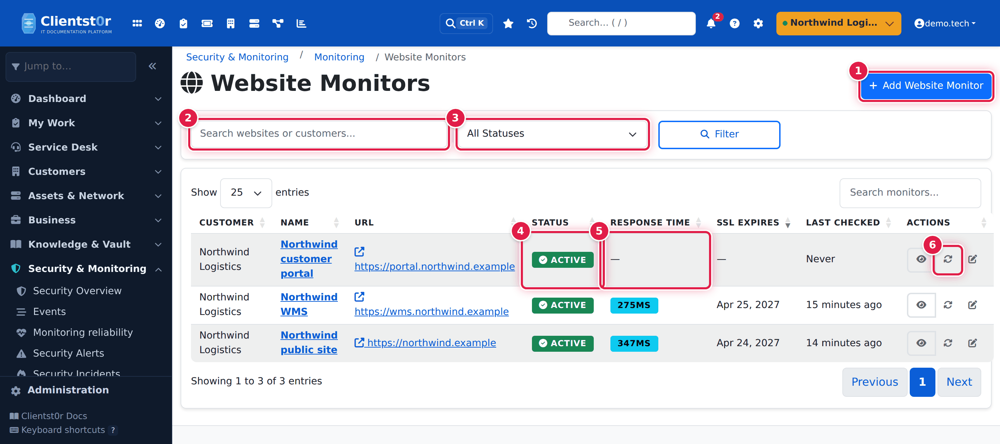
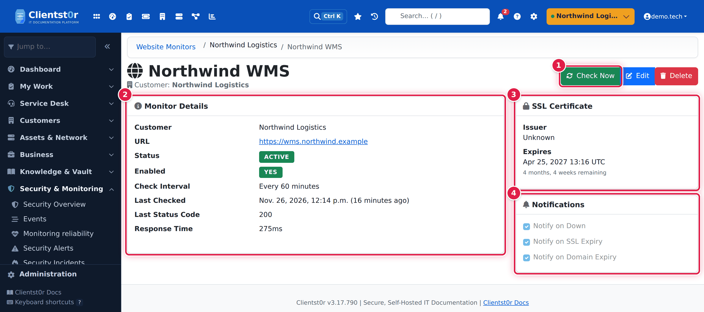
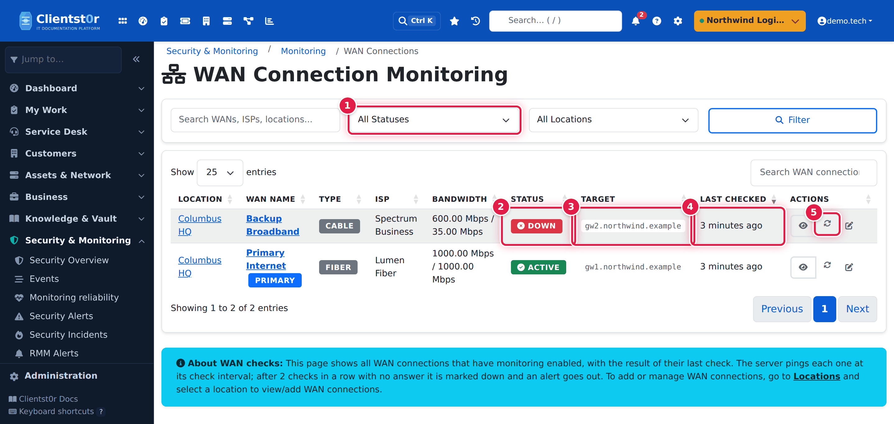
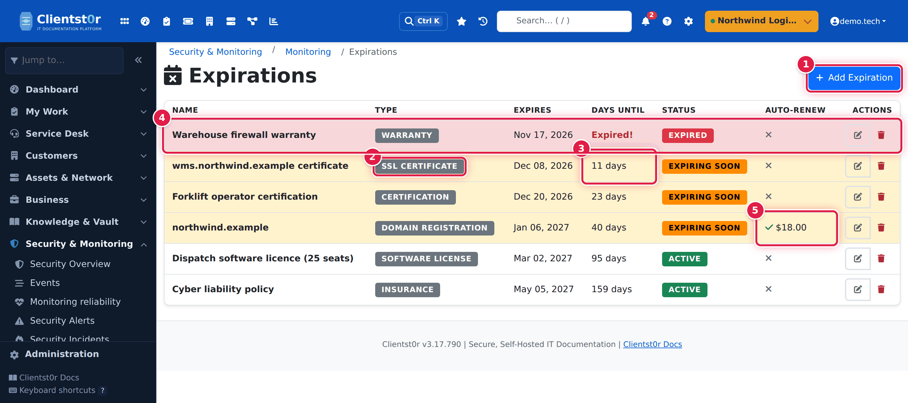
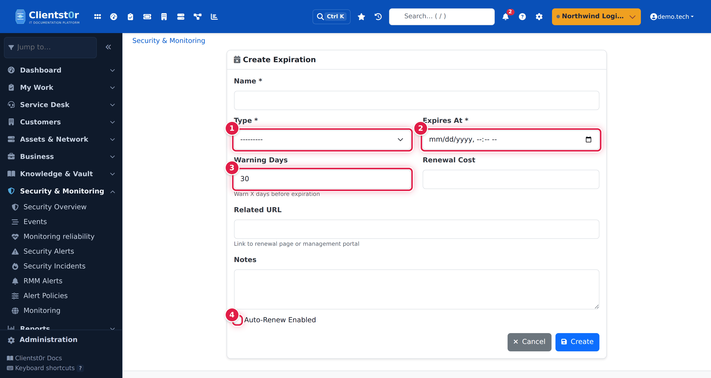

# Website monitors, WAN connections and expirations

How to watch a customer's websites and internet connections, and how to keep a list of things that expire.
These pages are in **Security & Monitoring → Monitoring** in the sidebar, on the tabs **Website Monitors**,
**WAN Connections** and **Expirations**. The other two tabs of that section, **Status Pages** and
**Configuration Backups**, are described in
[Status pages and configuration backups](STATUS_PAGES_AND_CONFIG_BACKUPS.md). The numbers in each screenshot
match the list under it. Every screenshot is a capture of the application against a demo database; the
customers and people in it are invented.

Everything here shows the records of the customer in the customer switcher (see
[Choosing the customer you work for](GETTING_STARTED.md#choosing-the-customer-you-work-for)). Staff with no
customer selected (Global View) see the rows of every customer they may view. The whole Monitoring section can
be switched off by a superuser in **Administration → Modules → Feature Toggles**.

Checks run from the Clientst0r server, so a site or address that the server cannot reach shows as down even
if it works from your own network.

## Website Monitors

**Security & Monitoring → Monitoring → Website Monitors** (`/monitoring/websites/`). One row per monitor, sorted
by customer and name.

<!-- guide-figure: guide-mon-websites -->

1. Add a monitor for the selected customer.
2. Search by name, URL or customer.
3. Show only Active, Warning, Down or Unknown monitors.
4. The result of the last check.
5. How long the last request took.
6. Check Now: run this monitor immediately and update the row in place.
<!-- /guide-figure -->

- **Status** is Active (the site answered with a 2xx code), Warning (a 3xx redirect), Down (a 4xx or 5xx code,
  no answer in time, or no connection) or Unknown (not checked yet, or the check was refused, see below).
- The list can be filtered by status and searched by name, URL or customer. **Check Now** runs one monitor at
  once and updates its row without reloading the page.
- **SSL Expires** shows the certificate date read at the last check, with a **Soon** badge inside the
  monitor's warning window.
- Click a name to open the monitor, which also has **Edit** and **Delete**.

### Adding a monitor

Click **Add Website Monitor**. A customer must be selected first (the button is refused in Global View).

<!-- guide-figure: guide-mon-website-form -->

1. The full address to check, including https://.
2. Minutes between checks. The scheduler looks every 5 minutes, so a value under 5 behaves as 5.
3. Email when the site goes down and when it recovers.
4. Email before the certificate expires (needs an https address).
5. How many days before expiry the warnings start.
<!-- /guide-figure -->

- **Name** and **URL** are required. Include `https://` or `http://`.
- **Check Interval** is in minutes and defaults to 60. See [How checks are scheduled](#how-checks-are-scheduled).
- **Monitoring Enabled** off keeps the monitor but stops checking it.
- **SSL Warning Days** (default 30) and **Domain Warning Days** (default 60) set how early the expiry emails
  start for this monitor.

### What a check does

- It requests the URL with a GET and waits at most **10 seconds**. It does **not** follow redirects: a
  monitor for `http://example.com` that redirects to https shows Warning. Enter the address people really
  land on.
- The response time is how long that request took; the HTTP status code is saved with it.
- For an `https` address it then opens a second connection (5 second limit) and reads the certificate:
  subject, issuer, valid-from and expiry dates, protocol version and serial number. If that fails, the
  site's status is unchanged and the reason is added to the error text ("Certificate details unavailable").
- Addresses on private networks, and cloud metadata addresses, are refused: the monitor shows Unknown with a
  "Security" error. An administrator can allow private addresses by setting `ALLOW_PRIVATE_IP_INTEGRATIONS=True`
  in the server's `.env` file.
- Every check is also written to a history. Uptime figures (used by status pages) are worked out from that
  history, counting only Down checks as downtime. History older than 400 days is deleted by a daily task.

<!-- guide-figure: guide-mon-website-detail -->

1. Check Now: run the check immediately.
2. The last result: status, check interval, when it was last checked, the HTTP status code and the response time.
3. The certificate read on the last check: subject, issuer, validity dates and protocol.
4. Which emails this monitor sends. Change them with Edit.
<!-- /guide-figure -->

- The domain registration card appears only when a domain expiry date has been entered on the monitor. The
  application does not look domains up by itself, so for domains use [Expirations](#expirations).
- The notification boxes on this page are read-only; change them with **Edit**.

### Alerts when a site goes down

- A monitor must fail **two checks in a row** before it is declared down. One dropped check sends nothing.
- When it is declared down, one email goes out. It is not repeated for later failed checks.
- The first successful check after that sends one "has RECOVERED" email.
- Emails go to the active superusers and the administrators and owners of the monitor's customer, and only if
  email is set up (an SMTP server configured in the settings). With email off, the outage is still recorded and the webhooks
  fire, but no email is sent later for it.
- **Notify on Down** off on a monitor turns off both emails for that monitor.
- The webhook events `monitor.down`, `monitor.up` (same moments as the emails) and `monitor.check_failed`
  (every failed check) are sent to the customer's webhooks.
- A redirect (Warning) and a refused check (Unknown) are not failures and do not count towards the two.

Certificate and domain warnings are separate emails, described under [Expiry emails](#expiry-emails).

## WAN Connections

**Security & Monitoring → Monitoring → WAN Connections** (`/monitoring/wans/`). The internet and circuit
connections that have monitoring switched on. A WAN connection is a record on a customer's location: you
create and edit them on the WAN tab of the customer's location page, and tick **Monitoring enabled** there.
This page only lists, filters and checks them; it has no Add button.

<!-- guide-figure: guide-mon-wans -->

1. Filter by status or by location, or search by name, provider or location.
2. Status. Down appears after two checks in a row get no answer.
3. The address or hostname that is pinged.
4. When it was last checked.
5. Check Now: ping the target immediately.
<!-- /guide-figure -->

- Connections without monitoring enabled are not listed here. You can filter by status and location and search
  by name, provider or location.
- **Target** is the address or hostname the server pings. It must be an IPv4 address or a hostname (letters,
  digits, dots and hyphens). Typically it is the customer's gateway or public IP.
- Each connection has its own **check interval** (1 to 1440 minutes, default 5), set on the connection.
- A connection that has missed a check but is not yet down shows "N missed checks" under Active.
- **Check Now** pings once straight away.

What is recorded: the time and result of every check (answered, no answer, or check error), the response time
of the last answer, the time it last went down, and the uptime percentage over the last 30 days. The connection
page shows these together with the provider, circuit, bandwidth and contract details you entered.

How a check works:

- The server sends 3 pings (2 second wait each). Any answer counts as up.
- **Two checks in a row** with no answer mark the connection **Down**, send one email to the customer's
  administrators and owners and the superusers (with the provider's support phone and circuit ID when entered),
  and fire the `wan.down` webhook. The first answer afterwards sets it back to Active and sends one recovery
  email (`wan.up`). `wan.check_failed` fires on every failed check. **Notify on down** on the connection turns
  the emails off.
- A name that does not resolve counts as no answer. A check that cannot run at all (no `ping` program on the
  server) is recorded as a check error and counts neither way, since a missing program is not an outage.
- Connections you set to **Inactive**, **Planned** or **Under Maintenance** are skipped by the scheduler. Use
  Under Maintenance during planned work so that no alert goes out. Check Now on one of these records the
  result but leaves the status alone and sends nothing.
- Check history is kept for 400 days, the same as website checks.

## Expirations

**Security & Monitoring → Monitoring → Expirations** (`/monitoring/expirations/`). A list of dates you enter
by hand, soonest first.

<!-- guide-figure: guide-mon-expirations -->

1. Add an item by hand.
2. What kind of item it is.
3. Days left. Rows inside their warning window turn yellow.
4. A red row is past its date.
5. Auto-renew, and the renewal cost when one is entered.
<!-- /guide-figure -->

Every row is entered by someone on this page. **Nothing is imported**: the list does not read domain,
warranty or licence dates from other pages, from registrars or from vendors. The certificate date that a
website monitor reads on its own is shown on the monitor (and on the monitor list), not copied here.

- **Type**: SSL Certificate, Domain Registration, Software License, Contract/Agreement, Warranty, Insurance,
  Certification or Other.
- **Status** is Active, Expiring Soon (inside the row's warning days, the row turns yellow) or Expired (red).
- Pencil edits a row and the bin deletes it. The list has no customer column; in Global View rows of different
  customers are mixed, so select a customer to work on one.

<!-- guide-figure: guide-mon-expiration-form -->

1. What the item is. Only Domain Registration items send emails.
2. When it expires.
3. Days before expiry that it turns yellow (and, for domains, that the warning email starts).
4. Mark items that renew themselves, with the renewal cost.
<!-- /guide-figure -->

- **Name**, **Type** and **Expires At** are required. **Warning Days** defaults to 30.
- Optional: auto-renew, renewal cost, a link to the renewal page and notes.
- A customer must be selected to add a row.

### Expiry emails

Emails about expiry are sent by two daily tasks, and only for some kinds of item:

| What | Where the date comes from | Emailed |
| --- | --- | --- |
| SSL certificate of a website monitor | Read from the certificate at each check | Yes, by the SSL expiry task, if the monitor's **Notify on SSL Expiry** is on |
| Expiration row of type **Domain Registration** | Entered by hand | Yes, by the domain expiry task |
| Domain date on a website monitor | Entered by hand or through the API; no automatic lookup | Yes, if **Notify on Domain Expiry** is on |
| Expiration rows of any other type (SSL Certificate, licence, contract, warranty, insurance, certification, other) | Entered by hand | No email; they show on this page, on the dashboard's upcoming-tasks list and, for SSL and domain types, in the customer's operations summary |

- The warning starts at the larger of the item's own warning days and the system-wide setting (30 days for
  SSL, 60 for domains by default), and the system-wide switches for SSL and domain notifications must be on.
- An item gets one email when it enters the warning window and one more when it has expired. Renewing it
  (entering a new date) re-arms the warning. Items already expired are included.
- Emails list the items for one customer together and go to the same people as the down alerts. If email is
  not set up, nothing is marked as sent, so the next run after you set it up sends them.
- The separate **Warranty Expiry Check** task looks up vendor warranty dates for assets when warranty
  lookups are enabled in the system settings. It does not read or write this list.

## How checks are scheduled

The checks are run by the application's own scheduler (the `clientst0r-scheduler` timer runs it every minute),
not by a separate service. The jobs are in the scheduled tasks list:

| Task | Default | What it does |
| --- | --- | --- |
| Website Monitoring Checks | every 5 minutes | Checks each enabled monitor that is due |
| WAN Connection Checks | every minute | Pings each monitored WAN that is due, in parallel |
| SSL Certificate Expiry Check | daily | Sends the certificate warnings |
| Domain Expiry Check | daily | Sends the domain warnings |
| Prune Website and WAN Check History | daily | Deletes check history older than 400 days |

A monitor is due when its own interval has passed since its last check, but the website job itself only
wakes every 5 minutes, so the real minimum is 5 minutes and a longer interval is rounded up to the next
5-minute run. WAN jobs run every minute, so a 1 or 5 minute interval is honoured closely. Disabling a task in
the scheduled tasks list stops those checks and alerts. A task that fails shows its error there.

## Monitoring reliability

**Security & Monitoring → Monitoring reliability** is a different page: it belongs to the Events area, not to
this section, and shows whether each alert source (backup, RMM and other connectors) is really being read.
It does not report on website monitors or WAN checks.

## Who can do what

Access follows the role flags **monitoring_view**, **monitoring_create**, **monitoring_edit**,
**monitoring_delete** and **monitoring_trigger** in the customer concerned (see
[Roles and access](ROLES_AND_ACCESS.md)).

- Viewing the three lists and a monitor needs `monitoring_view`. In Global View you see only the customers
  where you hold it.
- Adding a monitor or an expiration needs `monitoring_create`; editing needs `monitoring_edit`; deleting
  needs `monitoring_delete`; **Check Now** (website or WAN) needs `monitoring_trigger`.
- In the built-in roles, Owner and Administrator have all five, Service Manager, Level 3 Technician and
  Security Administrator can add, edit and check but not delete, Level 2 Technician can only view and check,
  and Level 1 Technician, Security Analyst and the Internal Read-Only / Auditor role can only view. Sales and billing roles have no monitoring
  access. Roles can be changed under Administration, so check the role if a button is missing.
- A record of another customer than the selected one answers "not found", not "forbidden".
- WAN connections are created and edited on the location page, under that page's own access rules.
