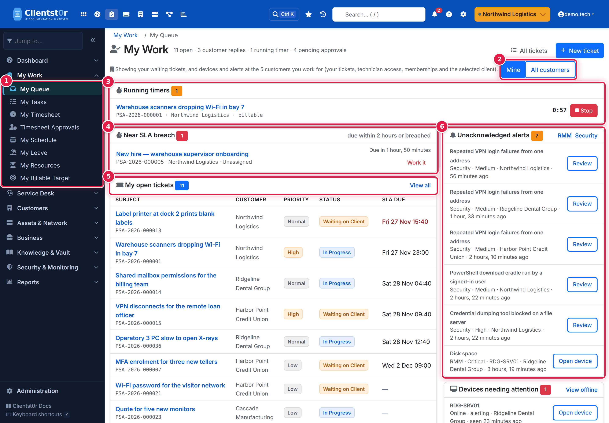
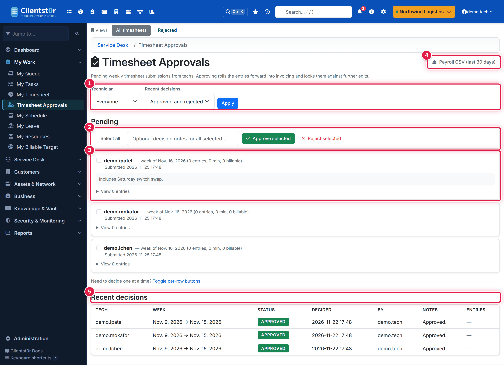
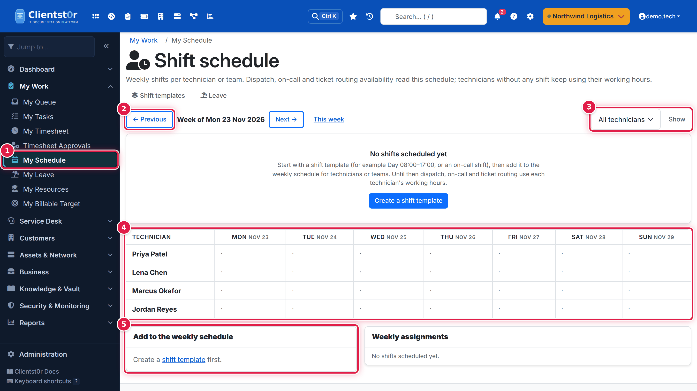
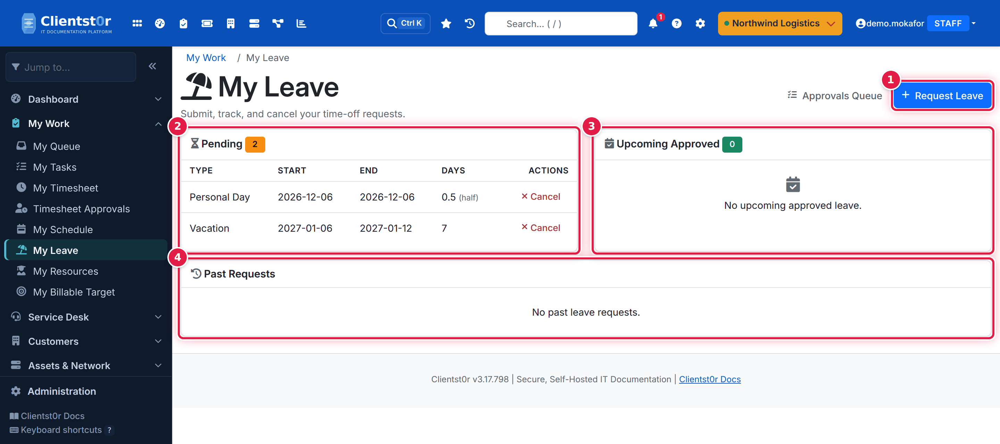
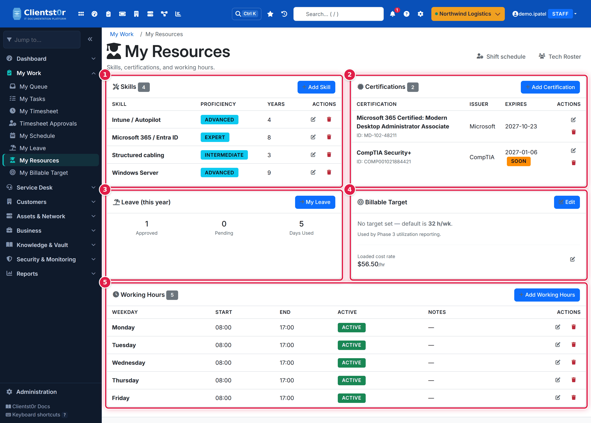
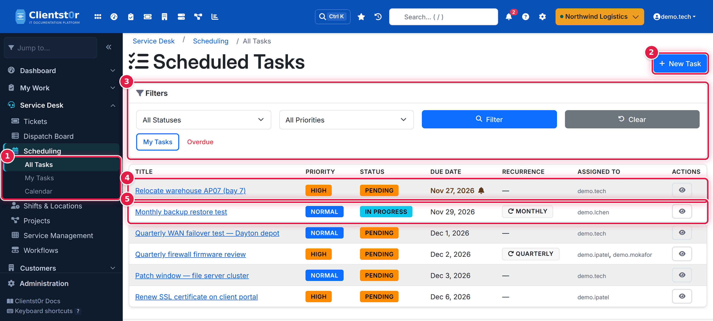

# My Work, shifts and scheduling

The pages a technician uses to run their own day: the work queue, scheduled tasks, the weekly timesheet,
leave, skills and working hours, the shift schedule, location sharing for dispatch, the timeclock and the
task calendar. The numbers in each screenshot match the list under it. Every screenshot is a capture of the
application against a demo database; the customers and people in it are invented.

Most of these pages need the native service desk (`psa_enabled`); Scheduling needs `scheduling_enabled`.
Both are switched on by an administrator ([Administrator guide](ADMIN_GUIDE.md)). You see only the tabs
your role allows ([Roles and access](ROLES_AND_ACCESS.md)).

## My Queue

**My Work → My Queue** (`/psa/my-work/`) is everything waiting on you, in one page.

<!-- guide-figure: guide-my-queue -->

1. My Work in the sidebar: your queue, tasks, timesheet, schedule, leave and more. You see only the pages your role allows.
2. Mine shows the customers you work for; All customers widens the waiting queues, devices and alerts to every customer you can reach.
3. Timers you left running, with Stop.
4. Tickets due within two hours or already breached. Work it opens the ticket.
5. Your open tickets, soonest SLA first. View all opens the same list in Tickets.
6. Unacknowledged RMM and security alerts at your customers, each with Review or Open device.
<!-- /guide-figure -->

- **Ticket queues.** *My open tickets* and *Customer replied* list tickets assigned to you. *Waiting on us*
  and *Waiting on customer* are tabs on one card. Only public replies count: an internal note never moves a
  ticket between queues. Each count matches the ticket list its *View all* link opens.
  - *Customer replied*: the customer wrote after the last staff reply.
  - *Waiting on customer*: the status pauses the SLA and is not a vendor wait (for example Waiting on Client).
  - *Waiting on us*: the status is active and the customer spoke last, or nobody on staff has replied yet.
    A ticket where staff replied last sits in neither waiting queue.
- **Running timers** shows any timer you left running on a ticket, with **Stop**. You can start and stop the
  same timer from the top of the ticket without a page reload (see [Tickets](TICKETS.md)).
- **Workspace layout.** Under *Essentials* (My Profile or the account menu) the lower panels (Waiting on us /
  customer, Recent devices, Scheduled maintenance, remote sessions, AI suggestions) are folded behind
  **More**; *Standard* is today's layout and *Advanced* opens every optional section. Layout only; it never
  changes what you can do.
- **Panels for MSP staff.** Near SLA breach, Unacknowledged alerts, Devices needing attention (needs an RMM
  connection), Needs your review, Scheduled maintenance, Recent devices, active remote sessions, Reminders,
  Appointments (scheduled tasks assigned to you: overdue, today and the next 7 days) and Pending approvals
  (ticket approvals, timesheets, change votes, invoices on hold and RMM approvals you can act on).
  *AI suggestions to review* is **OPTIONAL AI** and appears only when `psa_ai_enabled` is on.
- **Mine / All customers.** Mine covers the customers you work for (your tickets, technician access,
  memberships and the selected client). All customers widens the waiting queues, devices and alerts to every
  customer you can reach. MSP staff only.
- **Customer users** who open this page see only their own ticket queues, built from tickets they are
  allowed to view; none of the staff panels appear.

How to log time and what happens to it afterwards is in [Getting started](GETTING_STARTED.md#working-a-ticket)
and [Billing](BILLING.md).

## My Timesheet

**My Work → My Timesheet** (`/psa/timesheet/`) lists the time you logged on tickets this week, Monday to
Sunday: start time, ticket, notes, minutes, billable, and whether the entry is already in a submission.
Each entry has a **History** link with its approval trail. Another week opens at
`/psa/timesheet/<year>/<ISO week>/`.

- **Submit week** sends every entry not yet in a submission for approval, with an optional comment.
  Nothing can be submitted twice while a week is pending.
- **Rejected:** the whole week comes back with the approver's note. Fix the entries on the tickets and submit
  again.
- **Sent back:** an approver can return single entries with a reason while approving the rest. Fix them on
  the ticket and resubmit; they go up as a new revision and the approved part stays approved and locked.
- Needs the service desk switched on. Every signed-in user sees only their own entries.

## Timesheet Approvals

**My Work → Timesheet Approvals** (`/psa/timesheet-approvals/`) is the queue of submitted weeks. It is
shown to superusers and to MSP staff whose role lets them approve leave for every customer (the leave
approval permission stands in for timesheet approval).

<!-- guide-figure: guide-timesheet-approvals -->

1. Filter by technician, and the recent decisions by approved or rejected.
2. Tick weeks, add an optional note, then Approve selected or Reject selected.
3. A submitted week: the technician, the week, entry and minute totals and their comment. Open it to send single entries back.
4. Payroll CSV: approved weeks for the last 30 days, one row per technician and week.
5. The last 50 decisions, with who decided and their notes.
<!-- /guide-figure -->

- **One week at a time.** Open *View entries* on a week, tick **Send back** with a reason on any entry that
  needs fixing, then **Approve, sending back the ticked entries**. If every entry is sent back, the week is
  rejected.
- **Several at once.** Tick weeks and choose **Approve selected** or **Reject selected**.
- Approving locks the entries against further edits. Rejecting detaches them so the technician can fix and
  resubmit.
- You cannot decide your own timesheet; only a superuser can.
- **Payroll CSV** exports approved weeks (by default the last 30 days): technician, week, total and billable
  minutes. It needs permission to view the whole team's resourcing data.
- Saved views (*All timesheets*, *Rejected*) keep the filters you use most.

## My Schedule and Shift Schedule

**My Work → My Schedule** and **Service Desk → Shifts & Locations → Shift Schedule** open the same page
(`/resourcing/shifts/`): a week grid of who works when. Dispatch, on-call and ticket routing read it;
a technician with no shift falls back to their working hours (see [My Resources](#my-resources)). More on
routing is in [Ticket routing](TICKET_ROUTING.md).

<!-- guide-figure: guide-shift-schedule -->

1. My Schedule in the sidebar opens this page. Managers also find it under Service Desk → Shifts & Locations, next to Location Sharing and Timeclock; Configure holds shift templates and dispatch locations.
2. Step a week back or forward, or return to this week.
3. People who can see the team choose all technicians or one team.
4. One row per technician: shifts, approved and pending leave, and holidays. A shift that clashes with leave is marked in red.
5. Shift managers add a shift template to a technician or team on chosen weekdays. Until a template exists, it asks you to create one first.
<!-- /guide-figure -->

- **Who sees what.** MSP staff only, with the service desk on. A technician sees their own row. People
  who can view the team (the team-view permission) or manage shifts see every technician and can filter by
  team. Customer users never reach this page.
- **The grid** shows each day's shifts (on-call shifts carry a badge), approved and pending leave and
  holidays. A shift on a day of approved or pending leave, or on a holiday, is marked in red, and the
  number of clashes is shown above the grid.
- **Managing shifts.** Superusers and MSP technicians who can approve leave or manage routing rules create
  shift templates (Configure → Shift Templates: name, start and end, on-call, colour) and add them to a
  technician or a team on chosen weekdays, from a start date and optionally until an end date. Saving warns
  straight away about clashes with leave over the next four weeks. A template already in use is switched off
  rather than deleted.

## Location Sharing

**Shifts & Locations → Location Sharing** (`/field-ops/dispatch-sharing/`) is your own choice to share your
position with dispatch. MSP staff only.

- When you share, the mobile app's on-shift location pings keep **one** last known position for you.
  Dispatchers (MSP staff) see how old it is and how far you are from a ticket's site, and routing rules can
  offer a ticket to the nearest eligible technician.
- Customers never see your position, distances or travel times. Only a recent position is used (30 minutes
  by default) and it is deleted after the retention period (8 hours by default). Pings outside your shifts
  or working hours are dropped. At a customer site in geofence-only mode, only the site's centre point is
  kept.
- **What dispatch has now** shows your stored position, if any. Turning sharing off deletes it at once.
- If geo-aware dispatch is switched off, the page says so and nothing about your location is used, whatever
  you choose. Superusers switch it on under Configure → Dispatch Locations.

## Timeclock

**Shifts & Locations → Timeclock** (`/field-ops/timeclock/`) shows clock-ins made from the mobile app. It is
for accounts with the Django staff flag and superusers.

- **Currently clocked in:** technician, customer, ticket, start and duration. Entries open longer than
  8 hours are flagged *missing clock-out*, longer than 12 hours *long shift*.
- **Pay-period totals:** hours per technician from closed entries in the last 7 days.
- **Payroll export (CSV)** covers the last four weeks: technician, week start, hours, overtime hours (above
  40 in that row) and customer.

## My Leave

**My Work → My Leave** (`/resourcing/leave/`) is where you request and track time off. Any signed-in user
can use it for their own requests.

<!-- guide-figure: guide-my-leave -->

1. Request Leave: type, dates, half day and a note for the approver.
2. Requests waiting for a decision. Cancel withdraws one.
3. Approved leave that has not ended yet.
4. Everything else: past, denied and cancelled requests.
<!-- /guide-figure -->

- **Request Leave:** type (vacation, sick, personal day, bereavement, jury duty, parental, unpaid, other),
  start and end dates, a half-day flag for a single day, and a note for the approver.
- Requests start as pending. You can cancel a request only while it is pending.
- Approvers (MSP technicians with the leave approval permission) decide requests in the approvals queue.
  Nobody decides their own request except a superuser. Pending and approved leave shows on the
  [shift schedule](#my-schedule-and-shift-schedule).

## My Resources

**My Work → My Resources** (`/resourcing/me/`) is your profile for resourcing: what you can do and when you
work.

<!-- guide-figure: guide-my-resources -->

1. Your skills, with proficiency and years of experience.
2. Certifications with issuer and expiry. SOON marks one that expires within 60 days.
3. This year's leave: approved and pending requests and days used.
4. Your weekly billable-hours target, and your loaded cost rate (MSP staff only).
5. The days and hours you work. Dispatch and routing use them when you have no shift.
<!-- /guide-figure -->

- You add, edit and delete your own skills, certifications (issuer, credential ID, issue and expiry dates,
  verification link, attachment) and working hours. Accounts with the Django staff flag and superusers can
  manage another person's rows from the roster.
- **Working hours.** With no rows you count as always working: capacity reporting and the off-shift
  location filter cannot use your hours.
- **Loaded cost rate** is shown only to MSP staff; people with the cost-rate permission can change it.

## My Billable Target

**My Work → My Billable Target** (`/resourcing/billable-target/`) shows the weekly billable hours you are
expected to log, whether the target is active, and any note. With no target set, the default is 32 hours a
week. Only MSP technicians with the cost-rate permission can set or change a target, including their own;
everyone else sees it read-only.

## Scheduling: All Tasks, My Tasks and Calendar

**Service Desk → Scheduling** holds recurring and one-off jobs for the customer selected in the client
switcher: maintenance windows, restore tests, reviews. It appears when `scheduling_enabled` is on. With no
customer selected, the lists are empty.

<!-- guide-figure: guide-scheduled-tasks -->

1. Scheduling in the sidebar: All Tasks, My Tasks, Calendar and Wallboard.
2. New Task: title, priority, due date, recurrence, who signs off and when to warn.
3. Filter by status and priority, or jump to your tasks or overdue ones.
4. An overdue task: past its due date and not yet completed.
5. A recurring task. When it is completed, the next occurrence is created.
<!-- /guide-figure -->

- **All Tasks** (`/scheduling/tasks/`) lists the customer's tasks with priority, status, due date,
  recurrence and assignees. Filter by status or priority, or jump to your tasks or overdue ones.
- **New Task** asks for a title, description, priority, due date, recurrence (daily, weekly, bi-weekly,
  monthly, quarterly or every so many days), an optional linked ticket, email or SMS alerts, how long before
  the due date to warn, and who is assigned. Assignees are active members of that customer. Creating a task
  needs Editor or above; editing, deleting, completing or cancelling one needs Admin (or a staff account).
- **My Tasks** (`/scheduling/my-tasks/`, also on the My Work tabs) shows your pending and in-progress tasks
  for the selected customer, overdue ones outlined in red. **View & Sign Off** opens the task, where you sign
  off with an optional note and can comment.
- **Sign-off and completion.** A task completes on the first sign-off, or once every assignee has signed off
  when it requires all sign-offs. A recurring task then creates its next occurrence.
- **Calendar** (`/scheduling/calendar/`) groups the next 60 days of open tasks by due date. A task inside its
  warning window shows *Due soon*.
- The **My Queue** Appointments panel lists your assigned tasks across all customers, so you can see them
  without switching customer.

## Related guides

- [Getting started](GETTING_STARTED.md)
- [Billing, prepaid hours and contracts](BILLING.md)
- [Ticket routing](TICKET_ROUTING.md)
- [Technician access](TECHNICIAN_ACCESS.md)
- [Roles and access](ROLES_AND_ACCESS.md)
