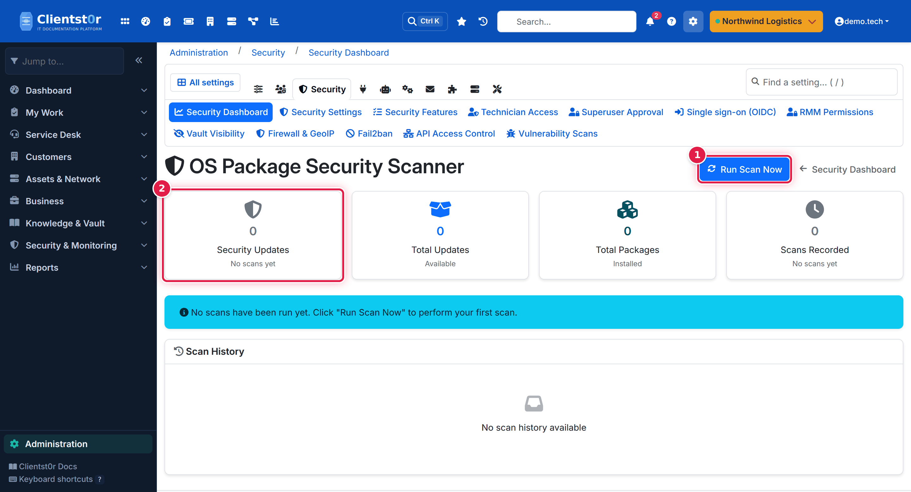

# OS Package Security Scanner

The OS Package Security Scanner monitors your system for outdated packages and security updates across Debian/Ubuntu (apt), Red Hat/CentOS (yum/dnf), and Arch Linux (pacman).

## Features

- **Security Update Detection**: Identifies packages with available security patches
- **Multi-Package Manager Support**: Works with apt, yum, dnf, and pacman
- **Web Dashboard**: View scan history and security status via web interface
- **Optional updates from the page**: *Update Security* and *Update All* install the pending packages (see [Installing updates](#installing-updates-from-the-page))
- **API Access**: a JSON endpoint with the latest result, for staff sessions
- **Automated Scheduling**: Run scans automatically using a systemd user timer or cron
- **Dashboard Widget**: The OS package card on the Security Dashboard
- **Python dependency scanner**: a sibling page for known vulnerabilities in the app's own Python packages (see [Python Dependency Scanner](#python-dependency-scanner))

The scanner is for staff only: a Django superuser, or a user with the staff flag. Anyone else is
sent back to the dashboard with a permission message. It scans the server Clientst0r runs on, not
your customers' machines.

<!-- guide-figure: guide-x4-package-scanner -->


1. Run Scan Now: refreshes the package lists if allowed, scans and saves the result. Staff and superusers only.
2. The cards: security updates, total updates, total packages and number of scans.
<!-- /guide-figure -->

The screenshot shows the page before any scan has run: the cards read 0 and the history is empty until the first scan.

## Manual Scanning

### Command Line

Run a scan and display results:
```bash
python manage.py scan_system_packages
```

Run a scan and save to database:
```bash
python manage.py scan_system_packages --save
```

Get JSON output:
```bash
python manage.py scan_system_packages --json
```

### Web Interface

1. Open **Administration → Security → Security Dashboard**, then *Details* on the OS package card
   (`/core/security/package-scanner/`)
2. Click **Run Scan Now**
3. View results in the dashboard

Before scanning, the page tries `sudo -n apt-get update` to refresh the package lists. If that is not
permitted (or there is no network) the scan continues with the cached lists and the result says
"using cached data".

## Automated Scheduling

### Setup (Systemd)

The Task Scheduler (**Administration → Automation → Task Scheduler**) has a scheduled task for the
Python dependency scan but none for the OS package scan, so schedule that one with a timer or cron.

Enable daily automated scanning:
```bash
python manage.py setup_package_scanner_schedule
```

Custom interval (`hourly`, `daily`, `weekly`, or a cron expression):
```bash
python manage.py setup_package_scanner_schedule --interval weekly
```

Check status:
```bash
python manage.py setup_package_scanner_schedule --status
```

Disable scheduled scanning:
```bash
python manage.py setup_package_scanner_schedule --disable
```

The command copies `systemd/package-scanner.service` and `.timer` into `~/.config/systemd/user/` and
enables them as a **user** unit for the account that runs it. The unit file assumes the install is in
`/home/administrator` and runs as `administrator`; edit `ExecStart`, `WorkingDirectory` and `User` in
the copied file if yours differs.

### Setup (Cron - Alternative)

If systemd is not available, use cron:

```bash
crontab -e
```

Add for daily scans at 2 AM:
```
0 2 * * * cd /home/administrator && venv/bin/python manage.py scan_system_packages --save
```

## API Endpoints

Both need a signed-in staff or superuser session (they are the page's own endpoints, not API-key endpoints).

### Get Widget Data
```http
GET /core/api/security/package-scanner/widget/
```

Response:
```json
{
    "status": "danger",
    "status_label": "High Risk",
    "security_updates": 23,
    "total_updates": 45,
    "total_packages": 1234,
    "scan_date": "2026-02-21T10:30:00Z",
    "package_manager": "apt"
}
```

### Trigger Scan
```http
POST /core/security/package-scanner/run/
```

Response:
```json
{
    "success": true,
    "message": "Scan completed successfully",
    "scan_data": { ... }
}
```

## Security Status Levels

| Security Updates | Status | Risk Level |
|-----------------|--------|------------|
| 0 | Success (green) | Secure |
| 1-4 | Warning (yellow) | Low Risk |
| 5-19 | Danger (red) | Medium Risk |
| 20+ | Danger (red) | High Risk |

## Dashboard Access

### Main Dashboard
`/core/security/package-scanner/`

Shows:
- Four cards: security updates, total updates, total packages, number of scans in the history
- Latest scan details with the security package list
- Scan history (last 30 scans)
- Buttons: *Run Scan Now*, *Update Security (n)* and *Update All (n)* (the last two only when updates are pending), and a link back to the Security Dashboard

### Individual Scan Details
`/core/security/package-scanner/scan/<id>/`

Shows:
- Complete scan overview
- All security updates available
- Other upgradeable packages
- Full installed package list

### Security Dashboard Widget
The OS package card on the Security Dashboard (`/core/security/`) loads the same data.

## Installing updates from the page

*Update Security* and *Update All* are OPTIONAL: they ask you to confirm, then run
`manage.py update_system_packages` on the server (`--security-only` for the first). Packages are installed
through the root helper when it is installed (Administration → System → System Updates installs it),
otherwise through `sudo -n`; if neither is permitted the page shows the error. Package names are checked
before they are passed on. The command also supports `--dry-run` and `--package`. Nothing is installed
unless you click, and there is no schedule for it.

`manage.py setup_package_scanner_sudo` writes an older passwordless-sudo rule
(`/etc/sudoers.d/clientst0r-package-scanner`) for `apt-get update` and `apt-get upgrade`; prefer the root
helper, which allows less.

## Python Dependency Scanner

`/core/security/python-scanner/` (staff or superuser) runs `pip-audit` against the application's own
virtual environment and lists vulnerable packages with the installed version, the fix versions and the
advisories. *Run Scan Now* starts a scan; the CLI is `manage.py scan_python_packages --save`. Superusers
also see a *Remediate* button per package that runs `pip install --upgrade` for one of the listed fix
versions; restart the web service afterwards and update `requirements.txt` yourself. Status is
Critical, High Risk, Medium Risk, Low Risk or Secure by the worst finding. The scheduled task
*Python Dependency Vulnerability Scan* in the Task Scheduler runs it automatically.

## Troubleshooting

### Permission Denied Errors

If you see permission denied for system logs:
```bash
sudo chmod +r /var/log/unattended-upgrades/unattended-upgrades.log
```

Do not run the scan with `sudo`: the saved scan and any files it creates would then belong to root.

### Systemd Timer Not Running

Check timer status:
```bash
systemctl --user status package-scanner.timer
```

View logs:
```bash
journalctl --user -u package-scanner.service -f
```

Ensure lingering is enabled (allows services to run when not logged in):
```bash
loginctl enable-linger $USER
```

### No Scans Appearing

1. Check database connection
2. Verify scan command runs successfully: `python manage.py scan_system_packages --save`
3. Check Django logs for errors
4. Verify the account is a superuser or has the staff flag

## Package Manager Support

### Debian/Ubuntu (apt)
- Detects security updates from Ubuntu Security or Debian Security repositories
- Uses `apt list --upgradeable` and `/var/log/unattended-upgrades/`
- Identifies packages from `-security` repositories

### Red Hat/CentOS/Fedora (yum/dnf)
- Uses `yum updateinfo list updates` or `dnf updateinfo list updates`
- Identifies security advisories (RHSA)
- Parses update metadata for security classification

### Arch Linux (pacman)
- Uses `pacman -Qu` for upgradeable packages
- Checks Arch Security Tracker (https://security.archlinux.org/)
- Limited security-specific detection (Arch doesn't separate security updates)

## Best Practices

1. **Run scans daily**: Enable automated scheduling for daily security checks
2. **Review regularly**: Check the dashboard at least weekly
3. **Apply updates promptly**: Security updates should be applied within 24-48 hours
4. **Test before production**: Test updates in staging environment first
5. **Monitor trends**: Watch for increasing security update counts

## Integration Examples

### Monitoring Dashboard

From a page in the same browser session (it needs a signed-in staff session):

```javascript
fetch('/core/api/security/package-scanner/widget/')
    .then(r => r.json())
    .then(data => {
        console.log(`Security Updates: ${data.security_updates}`);
        console.log(`Status: ${data.status_label}`);
    });
```

## Limitations

- Requires appropriate package manager (apt, yum/dnf, or pacman)
- Security update detection accuracy depends on package manager metadata
- Large package lists (5000+ packages) may take 30-60 seconds to scan
- Arch Linux security detection is limited (no official security repository)
- Updates are installed only when you click *Update Security* or *Update All*; there are no automatic or scheduled installs
- There are no alerts or webhooks for a bad scan result; look at the dashboard or poll the widget endpoint

## Support

For issues or questions:
- GitHub Issues: https://github.com/agit8or1/clientst0r/issues
- Documentation: https://github.com/agit8or1/clientst0r
