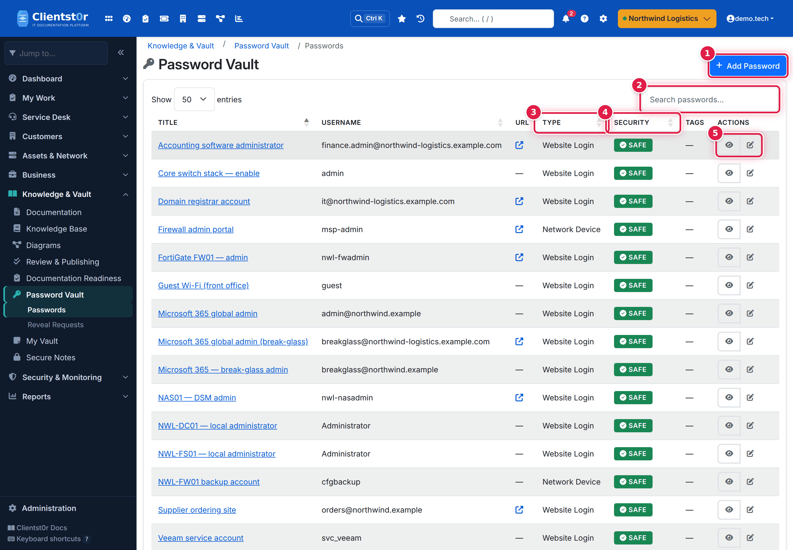
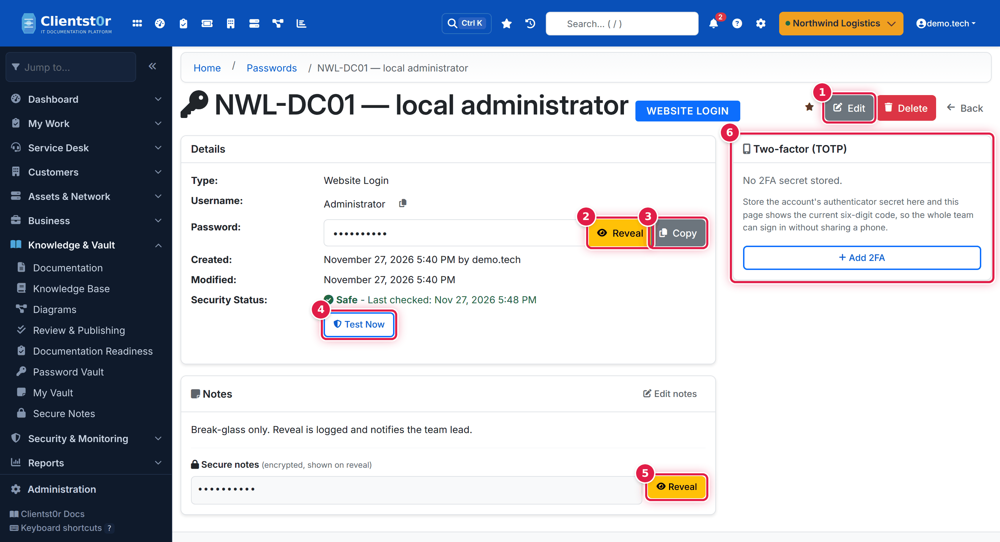
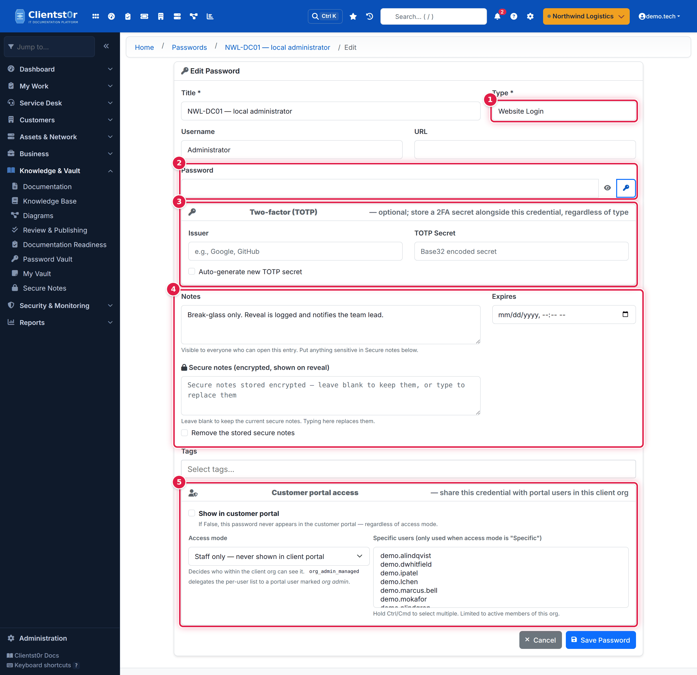
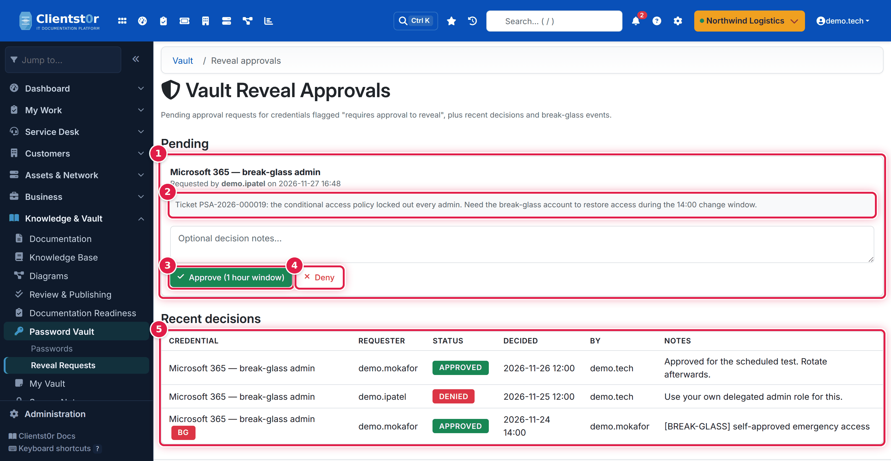
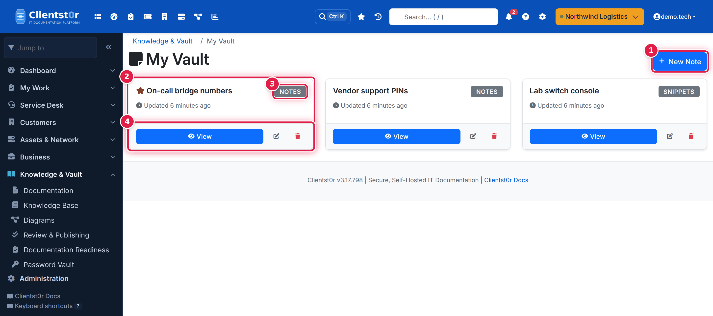
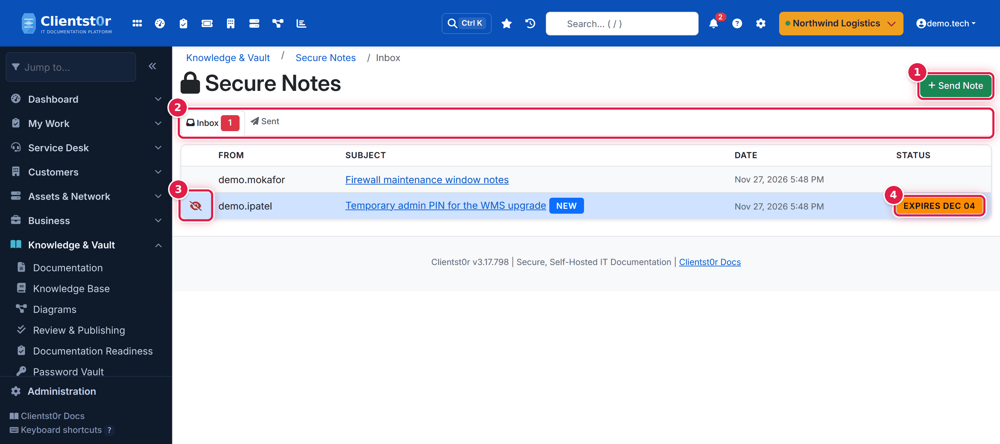
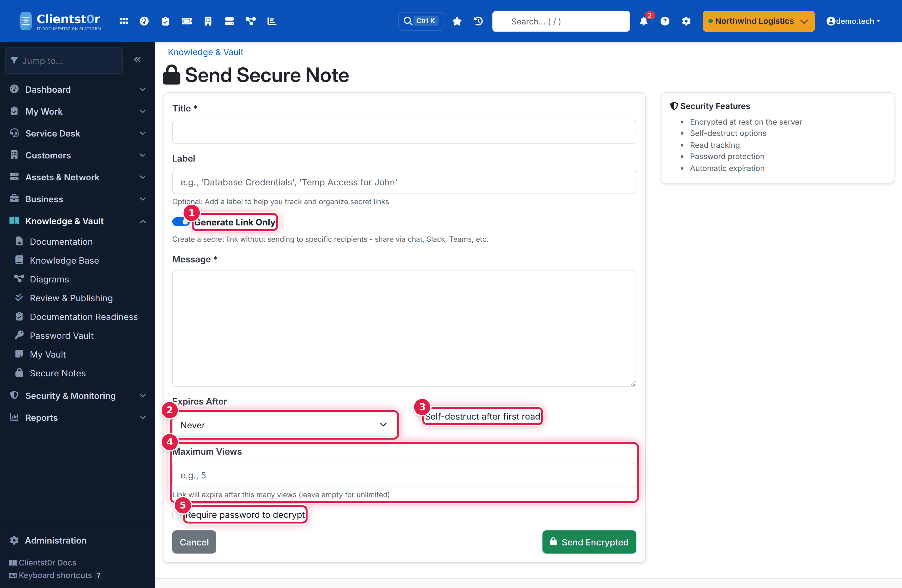
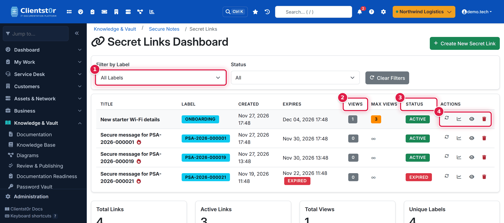

# Password Vault, My Vault and Secure Notes

Where Clientst0r keeps credentials and passes secrets on. Everything here is in **Knowledge & Vault** in the
sidebar: **Password Vault** holds each customer's shared credentials, **My Vault** holds your own private notes,
and **Secure Notes** sends encrypted messages to colleagues or as one-time secret links. Who can open the
vault depends on the role at each customer (see [Who sees the vault](#who-sees-the-vault)); My Vault and
Secure Notes are available to every signed-in user. The numbers in each screenshot match the list under it.
Every screenshot is a capture of the application against a demo database; the customers and people in it are
invented, and no screenshot shows a revealed password, TOTP code or QR code.

Passwords, secure notes, TOTP secrets, license keys, My Vault notes and secure-note messages are encrypted at
rest with AES-256-GCM, using keys derived from the server's `APP_MASTER_KEY`. The server decrypts them to show
them to you, so this is encryption at rest, not end-to-end encryption: anyone who controls the server and its
key can read them. The full rules behind this guide are in [How Clientst0r protects client
data](CLIENT_DATA_PROTECTION.md).

## Who sees the vault

Seeing an entry and revealing its secret are separate permissions, both checked at the entry's own customer:

| Permission (role flag) | What it allows |
|---|---|
| View vault (`vault_view`) | Open the Password Vault and see entries: title, username, URL, type, tags and plain notes. Never the password. |
| View actual password values (`vault_view_password`) | Reveal and copy the password, license key and secure notes, and see the TOTP code and QR code. |
| Create / Edit / Delete passwords (`vault_create`, `vault_edit`, `vault_delete`) | Add, change and delete entries. |
| Manage vault access rules (`vault_manage_access_rules`) | The Vault Access Rules page under Configure. |

- **Built-in roles.** Owner, Admin and Editor see and reveal. Read-only sees titles but cannot reveal. A new
  custom role sees titles and cannot reveal until "View actual password values" is ticked.
- **Per customer.** The vault opens only when your role at the selected customer grants *View vault*;
  otherwise the page answers 403. A role at one customer gives nothing at another.
- **Global view.** Superusers and MSP staff with no customer selected see the entries of every customer where
  they hold *View vault*, with the same reveal rule per entry. Superusers see and reveal everything.
- **Vault Visibility** (**Administration → Security → Vault Visibility**, superusers) lists MSP staff without
  a global role whose vault reach narrowed in v3.17.653, and which customers they lost. It only reports; it
  changes nothing.
- **The customer portal** never shows an entry unless *Show in customer portal* is ticked on it (see
  [Adding and editing an entry](#adding-and-editing-an-entry)).

## Passwords

**Knowledge & Vault → Password Vault → Passwords** (`/vault/`). Every vault entry of the selected customer
(and its sub-organizations).

<!-- guide-figure: guide-vault-list -->

1. Add Password: a new entry for the selected customer.
2. Search titles, usernames, URLs and plain notes. Secrets are never searched.
3. The entry type, which decides the extra fields on the form.
4. Security: Breached (found by the last breach check), Weak (strength under 50) or Safe, plus an expiry badge within 14 days.
5. View or edit the entry. The list never shows a password.
<!-- /guide-figure -->

- The list loads 50 rows at a time from the server; sort by title, username, type or security. The search box
  matches title, username, URL and the plain notes, never a secret.
- **Security** is *Breached* when the latest breach check found the password, *Weak* when its strength score
  is under 50, otherwise *Safe*. An *Expired* or *Expires in N d* badge is added within 14 days of the
  entry's expiry date.
- The Edit button is shown on every row; saving still needs *Edit passwords* at that customer.
- The list has no folder view. Folders exist only as data created by the Bitwarden import (see
  [Importing](#importing)); the entry form has no folder field.

## An entry: reveal, copy and two-factor codes

Click a title to open the entry (`/vault/<id>/`).

<!-- guide-figure: guide-vault-detail -->

1. Edit or delete the entry (needs Edit or Delete passwords at this customer).
2. Reveal: shows the password. Every reveal is checked and written to the audit log.
3. Copy: copies the password without showing it. It is the same audited reveal.
4. Test Now: checks the password against the breached-password list.
5. Secure notes are encrypted and come out through the same audited reveal.
6. Two-factor: store the account's TOTP secret here and the page shows the current code.
<!-- /guide-figure -->

- **Reveal** and **Copy** both fetch the value from the server, and both count as a reveal: Copy puts the
  password on the clipboard without showing it, but is checked and logged exactly like Reveal. The same holds
  for the license key of a *Software License* entry and for the secure notes.
- Every reveal passes, in order: *View actual password values* at the entry's customer; the approval
  requirement, if the entry has one (see [Reveal requests](#reveal-requests-and-approval)); and any vault
  access rules. Revealing is limited to 30 per hour per user, counted together with the browser extension.
- **Opening the entry page** is also checked against the vault access rules. If a rule denies you (country,
  address range or time of day), the page itself answers "access denied" and the attempt is logged.
- **Two-factor (TOTP).** When an entry holds a TOTP secret, the card shows the current six-digit code with a
  countdown and refreshes it every 30 seconds, plus a QR code to add the account to an authenticator app. Both
  load as soon as the page opens, for anyone allowed to reveal the entry; the QR code contains the secret
  itself. Each code and each QR view is written to the audit log, and codes are limited to 100 per hour per
  user, so a page left open for about 50 minutes stops refreshing.
- **Notes** are plain text that everyone who can see the entry reads. **Secure notes** (recovery codes,
  PINs, security answers) are encrypted and only come out through Reveal.
- **Test Now** checks the password against the breached-password list (see [Breach
  checks](#breach-checks)). The *Access rules apply* badge next to the title links to the rules that cover
  the entry.
- **Created** and **Modified** show the date and the person. (*Modified* was blank before this release.)

## Adding and editing an entry

**Add Password** on the list, or **Edit** on an entry (`/vault/create/`, `/vault/<id>/edit/`). Creating needs
*Create passwords* at the selected customer; editing and deleting need *Edit passwords* and *Delete passwords*
at the entry's customer.

<!-- guide-figure: guide-vault-form -->

1. The type. It shows the fields that type needs (host, port, domain, license key ...).
2. The password. Leave it blank to keep the stored one; the generator button fills a strong one.
3. TOTP: paste the account's secret, or tick Auto-generate new TOTP secret.
4. Notes are plain text anyone who can see the entry reads; secure notes are encrypted and need a reveal.
5. Customer portal access: off by default. Turn it on to share the entry with this customer's portal users.
<!-- /guide-figure -->

- **Type** decides the extra fields: Email (server, port), Windows/AD (domain), Database (type, host, port,
  name), SSH key (host, port), Software License (license key), and so on.
- **Password.** On an existing entry, leave it blank to keep the stored one. The key button opens a
  generator (8–64 characters, choice of character sets). While you type, the strength bar and a breach check
  run in your browser; the check sends only the first five characters of the password's SHA-1 hash to the
  public breached-password service.
- **Two-factor (TOTP)** is optional on any type: paste the base32 secret (not the whole `otpauth://` link),
  or tick *Auto-generate new TOTP secret*. An *OTP/TOTP (2FA)* entry needs a secret. A stored secret is never
  shown on the form again.
- **Secure notes.** Leave blank to keep the stored ones; typing replaces them; *Remove the stored secure
  notes* clears them.
- **Expires** sets an expiry date. When password-expiry notifications are switched on in the administration
  settings, the scheduler emails the customer's notification recipients before it.
- **Customer portal access** is off by default. Tick *Show in customer portal* and choose who: all members of
  the customer, specific users from the list, or *Delegated*, where a portal user marked org admin manages the
  list. Portal reveals pass the same approval requirement and access rules as staff reveals.
- Every save and delete is written to the audit log, with the names of the fields that changed. The audit
  log never stores the values of the password, TOTP secret, license key or secure notes fields.

## Reveal requests and approval

**Knowledge & Vault → Password Vault → Reveal Requests** (`/vault/reveal-requests/`). For entries marked
*requires approval to reveal*, a reveal needs an approval as well as the permission. The page is for
superusers and MSP staff, and lists requests only for customers where you hold *View vault*.

<!-- guide-figure: guide-vault-reveal-requests -->

1. A pending request: the entry, who asked and when.
2. The requester's justification.
3. Approve: the requester may reveal once within the next hour.
4. Deny, with optional decision notes.
5. Recent decisions, including break-glass (BG) reveals the requester approved themselves.
<!-- /guide-figure -->

- **Approve** gives the requester one reveal within the next hour. The reveal uses the approval up: the next
  one needs a new request. While the approval is valid the TOTP code and QR code are also shown to the
  requester.
- **Who may decide.** Superusers; MSP staff who can reveal entries at that customer; and an org admin of the
  entry's customer. Nobody may approve their own request. A customer org admin has no page for this: only the
  approve/deny endpoint accepts them.
- **Break-glass.** In an emergency the requester can approve themselves with a justification of at least 30
  characters. It is marked *BG* in Recent decisions, logged as `vault_break_glass` and emailed to every
  superuser. New requests are emailed to superusers too.
- **Limits.** The *requires approval* flag is not on the entry form; a superuser sets it on the entry in the
  Django admin (`/admin/vault/password/`). The entry page has no *Request approval* or *Break-glass* button
  yet: Reveal on an approval-gated entry only says that approval is required. Requests are made through the
  request endpoint (`POST /vault/<id>/request-reveal/` with a `justification`, or `/break-glass/`).

## Vault access rules

**Password Vault → Configure → Vault Access Rules** (`/vault/access-rules/`, needs *Manage vault access
rules*). A rule applies to one entry, one user or a whole customer and allows or denies by country, source
address range, weekday and time of day. Deny rules win; with no matching rule, access is allowed. If the rules
cannot be evaluated, the reveal is refused rather than allowed. Rules cover opening an entry, reveals, TOTP
codes and QR codes, the REST and mobile APIs and the browser extension.

## Breach checks

- **Test Now** on an entry checks it immediately and records the result; the page then shows *Safe* with
  the check time or a red *Compromised* banner with the number of breaches.
- A scheduled scan (the *password breach scan* task, also `manage.py check_password_breaches`) re-checks
  entries, by default once every 24 hours per entry.
- Saving a new password checks it as well and records the result; with `HIBP_BLOCK_BREACHED=True` a breached
  password is refused. Setting `HIBP_ENABLED=False` turns the server-side checks off.
- Only the first five characters of the password's SHA-1 hash leave the server. *OTP* entries are not checked.

## My Vault

**Knowledge & Vault → My Vault** (`/vault/personal/`). Private encrypted notes for yourself, such as bridge
numbers or console commands.

<!-- guide-figure: guide-vault-personal -->

1. New Note: a private encrypted note.
2. Favourites are listed first.
3. An optional category.
4. View, edit or delete. Only you can open your notes.
<!-- /guide-figure -->

- Only you can list, open, edit or delete your notes: every page looks the note up by your own account, and
  another user, a superuser included, gets "not found". There is no sharing.
- A note has a title, content, an optional category and a favourite star. Title and category are stored in
  plain text; the content is encrypted.
- My Vault is not tied to a customer and does not need any vault permission.
- Opening a note is recorded in the audit log (the note's title, never its content).

## Secure Notes

**Knowledge & Vault → Secure Notes** (`/core/secure-notes/`). Encrypted messages to colleagues, or secret links
for anyone. A superuser can switch the module off in **Administration → Modules → Feature Toggles** (*Secure Notes*); its pages
then answer 404, but secret links already sent keep working until they expire.

<!-- guide-figure: guide-vault-notes-inbox -->

1. Send Note: to people, or as a secret link.
2. Inbox (with the unread count) and Sent.
3. Icons: a key means password protected; the crossed eye means it is deleted after the first read.
4. When the note expires. Expired notes leave the inbox.
<!-- /guide-figure -->

- **Inbox** lists notes sent to you that have not expired; unread ones are highlighted and counted. **Sent**
  lists your notes with how many recipients have read them.
- **Recipients** are the active members of the selected customer. With no customer selected, only a secret
  link can be sent.
- **Self-destruct after first read** on a note to several people deletes it when the *first* recipient opens
  it: the others no longer see it.
- **Require password**: the recipient must enter the access password, which you pass on another way. It is
  stored hashed. Ten wrong attempts from one address lock the note for that address until 15 minutes after
  the first wrong attempt. An empty access
  password is refused.
- Only the sender can delete a note. Deleting hides it from everyone.

### Secret links

<!-- guide-figure: guide-vault-note-create -->

1. Generate Link Only: no recipients; you get a link to share once the note is saved.
2. Expires After: 1 hour to 30 days, or never.
3. Self-destruct after first read.
4. Maximum Views (links only): the link stops working after this many views.
5. Require a password, which you pass on separately.
<!-- /guide-figure -->

- With **Generate Link Only** the note has no recipients. After **Send Encrypted** the link is shown
  **once**: only a hash of it is stored, so it cannot be shown again. If you lose it, create a new link
  (the old one stops working).
- **What the recipient sees.** The link opens on the customer-portal page, without signing in. A link with
  self-destruct or a view limit first shows *You have a secure message* and a **Show the message** button,
  so that mail scanners and link previews do not use it up. Then come the password prompt (if set), the
  title, the sender's username, the dates and the message. An expired, deleted or used-up link shows *This
  secret note is no longer available*.
- **Expiry and limits.** *Expires After* is 1 hour, 24 hours, 7 days, 30 days or never. *Self-destruct*
  deletes the note at its first view; *Maximum Views* deletes it when the count is reached. *Test Link*
  opens it in your browser, and a view you make counts too.
- Secure messages sent with a ticket reply are secret links as well; their recipient can answer securely
  from the message page.

**Knowledge & Vault → Secure Notes → Secret Links** (`/core/secure-notes/links-dashboard/`) lists the links you
created.

<!-- guide-figure: guide-vault-secret-links -->

1. Filter by label or status.
2. Views so far and the maximum.
3. Active, Expired or Max Views Reached.
4. New link (the old one stops working), Analytics (each view), View, Delete.
<!-- /guide-figure -->

- Links that have been used up or deleted leave this list. The summary cards under the table count the
  listed links, their views in total, and those still active.
- **Analytics** lists each view: time, address, browser, and the user if they were signed in.

## Importing

**Administration → Maintenance → Vault Import** (`/core/settings/vault-import/`, superusers) imports a
Bitwarden or Vaultwarden JSON export (unencrypted, up to 10 MB) into the selected customer. Folders become
vault folders (with an optional prefix), logins keep their TOTP secrets, and *Update Existing Passwords*
updates entries with the same title and username instead of skipping them. To migrate from another
documentation platform, see [Importing from Hudu](importing-from-hudu.md) and [Importing from IT
Glue](importing-from-it-glue.md) (**Administration → Maintenance → Data Import**).

## The audit trail

Everything below lands in the audit log (**Administration → Users & Access → Audit Log**), filed under the
entry's customer even when done in global view:

| Event | Action recorded |
|---|---|
| Opening an entry | `read`, ALLOWED or DENIED by access rules |
| Reveal or copy of a password, license key or secure notes | `reveal`, with the field |
| TOTP code, QR code | `read`, "TOTP code generated" / "TOTP QR code viewed" |
| Reveal refused for lack of approval | `reveal_blocked_no_approval` |
| Reveal rate limit hit | `password_reveal_rate_limited` |
| Request, approval, denial, break-glass | `vault_reveal_requested`, `vault_reveal_approved`, `vault_reveal_denied`, `vault_break_glass` |
| Breach check | `check`, with the result |
| Create, update (with changed field names), delete | `create`, `update`, `delete` |
| Secret link regenerated | `update` |

Form values that are secrets (passwords, TOTP secrets, license keys, secure notes, and the content of
secure notes and My Vault notes) are recorded as `***REDACTED***`, and secret-link pages are not recorded at
all, because their address is the link itself. Views of a secret link are in its Analytics page instead.

## Related guides

- [How Clientst0r protects client data](CLIENT_DATA_PROTECTION.md): reveal checks, encryption and the browser
  extension's offline cache.
- [Roles and access](ROLES_AND_ACCESS.md): building roles with the vault flags.
- [Browser extension API](browser-extension-api.md): autofill, TOTP and reveal from the extension.
- [Getting started](GETTING_STARTED.md): the customer switcher and the sidebar.
