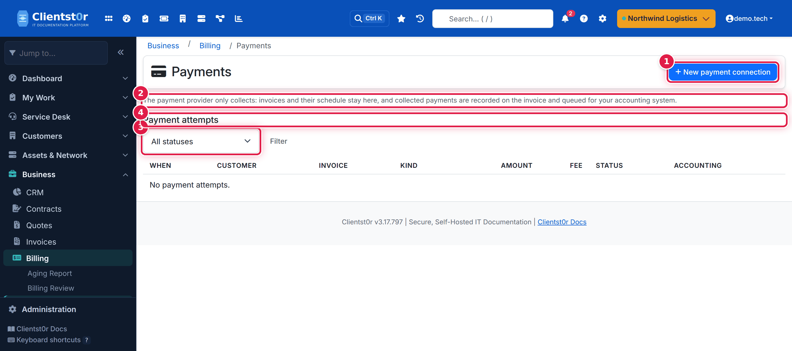

# Payment processing (Stripe, GoCardless)

Clientst0r owns invoices and the billing schedule; the payment provider only
collects; the accounting system records. No invoices, subscriptions, prices
or products are ever created at the provider, so a payment can never be
billed twice by two systems.

## The Payments page

The page lists the gateway connections (name, provider, whether collection is live, whether autopay is on) and every payment attempt, which can be filtered by status. It is for MSP staff only. The numbers in the screenshot match the list under it. The screenshot is a capture of the application against a demo database; the demo has no gateway connection, so the connections table does not show.

<!-- guide-figure: guide-x2-payments -->

1. New payment connection: add Stripe or GoCardless. Needs the manage_payment_providers permission.
2. The provider only collects: invoices and their schedule stay in Clientst0r. Connections (none in this demo) are listed below this line.
3. Filter the attempts by status.
4. Payment attempts: every collection attempt with amount, fee, status and the accounting hand-off state.
<!-- /guide-figure -->

## Setup (MSP staff)

**Business → Billing → Payments** (`/payments/`), then **New payment connection**. One install serves one
MSP and every Organization is a customer of it, so gateway connections and
autopay settings are MSP-wide: always platform-owned (no organization), and
managing them needs `manage_payment_providers` on the technician's global
role. Gateway customers, stored methods and invoices are per customer
Organization.

| Field | Stripe | GoCardless |
|---|---|---|
| Secret key / access token | `sk_live_…` / `sk_test_…` (or a restricted key) | read-write access token |
| Publishable key | `pk_…` | — |
| Webhook signing secret | endpoint `whsec_…` | webhook endpoint secret |
| Environment | follows the key | Live / Sandbox |

Credentials are sealed in `PaymentConnection.encrypted_credentials`; secret
fields are write-only in the form. Copy the webhook URL shown on the
connection page into the provider dashboard. "Live collection enabled"
(`sync_enabled`) must be on before the portal shows a Pay button.

Collection uses the oldest active, live, platform-owned connection (keep one
live connection). A PaymentConnection row with an organization set is never
used, receives no webhooks and is not editable on these pages.

## Customer portal

`/portal/billing/` for members whose role grants `portal_billing_contact`
(the built-in "Billing Contact" add-on role). Invoices (no drafts, no
internal fields), outstanding balance, Pay now (Stripe Checkout / GoCardless
hosted mandate flow), payment history, PDF receipts, saved methods, autopay
on/off with recorded consent (who, when), add / replace a method through the
provider's hosted page. Other customers' records are 404.

## Money flow

1. `PaymentAttempt` per collection attempt; its `idempotency_key` is sent as
   the provider's Idempotency-Key.
2. Webhooks (`/payments/webhooks/<provider>/<connection>/`) are signature
   verified (Stripe: `t=,v1=` HMAC-SHA256, 300 s tolerance; GoCardless:
   `Webhook-Signature` HMAC-SHA256) and recorded in `GatewayEvent`, unique
   per provider event id, so redeliveries are skipped. The portal return
   page re-reads the provider too, so a late webhook does not delay the
   receipt; both paths are idempotent.
3. Settlement writes one `psa.Payment` (gross amount) per attempt; the
   provider fee is on `PaymentAttempt.fee_amount` / `net_amount`. Refunds
   (`Refund`) and lost disputes / chargebacks (`Dispute`) write one negative
   `psa.Payment`. Invoice balance and status update through the normal
   `Payment.save()` → `recompute_totals()` / `reopen_if_unpaid()`.
4. Accounting hand-off: those records carry `accounting_post_status =
   'pending'`. The payments app never calls QuickBooks Online / Xero; the
   accounting pipeline reads `payments.accounting.pending_posts()`, posts, and
   calls `mark_posted()` / `mark_failed()`.

## Autopay

Scheduled task **Invoice Autopay** (`run_autopay`, hourly). Per invoice due
date ("cycle") at most `autopay_max_attempts` attempts; (invoice, cycle,
attempt number) is unique and the idempotency key is derived from it, so
reruns cannot double-charge. Retries wait the connection's retry days; the
final failure e-mails the configured address (or superusers and the
customer's administrators) once.

## Staff refunds

Business → Billing → Business → Billing → Payments → the attempt → Refund (full or partial), requires `process_refunds` at
the customer. Every financial operation is written to the audit log.

## Known limits

* GoCardless fees are charged on payouts, not per payment, so `fee_amount`
  stays empty for GoCardless.
* A lost dispute is reversed on the invoice when it closes as lost (Stripe
  withdraws the funds when it opens).
* Webhooks come from the providers' networks: an installation with a GeoIP
  country allowlist must allow them, or rely on the portal return page and
  provider retries.
