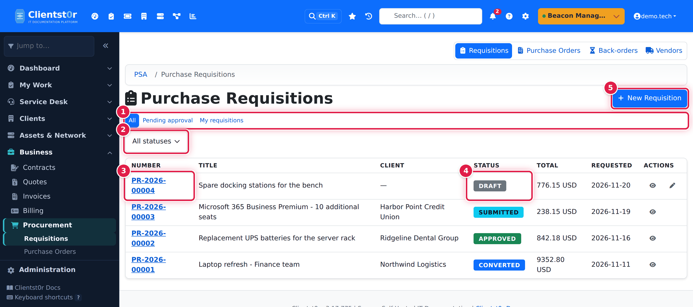
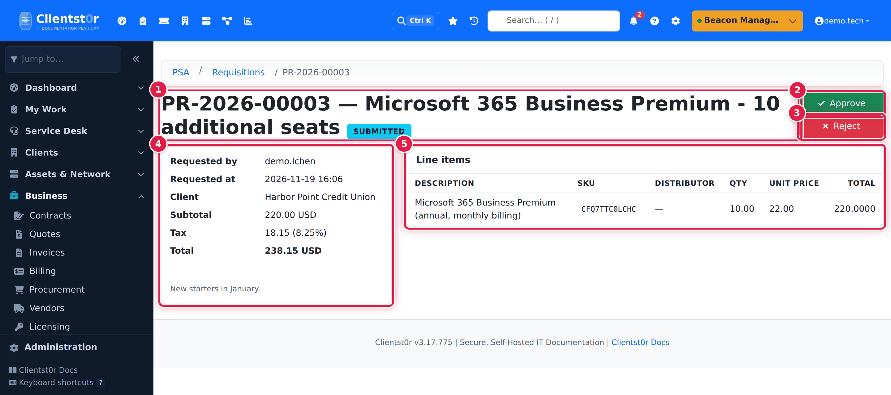
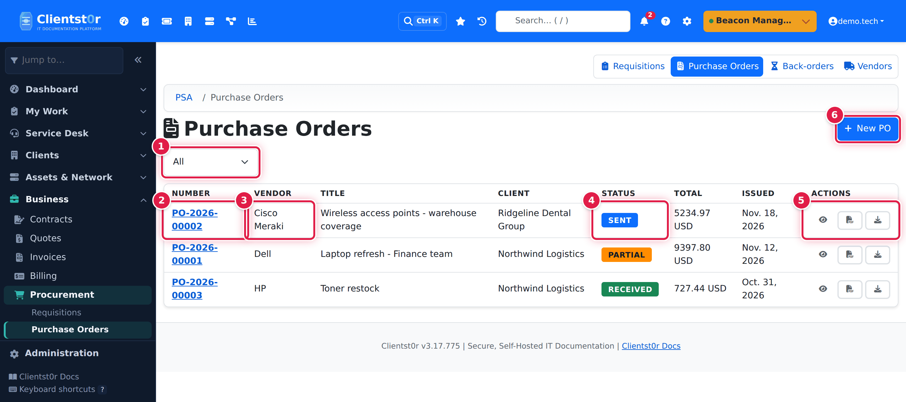
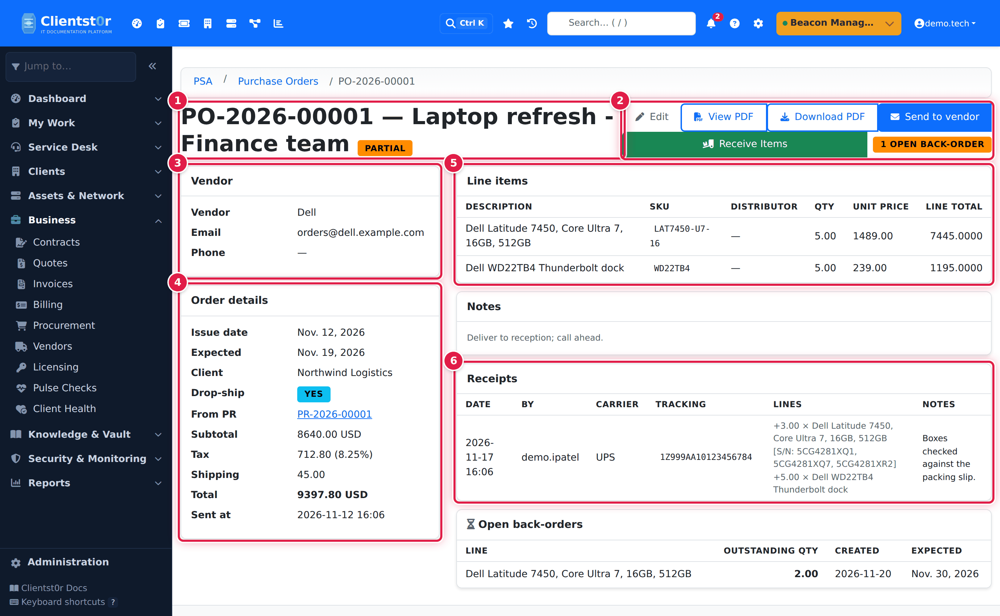
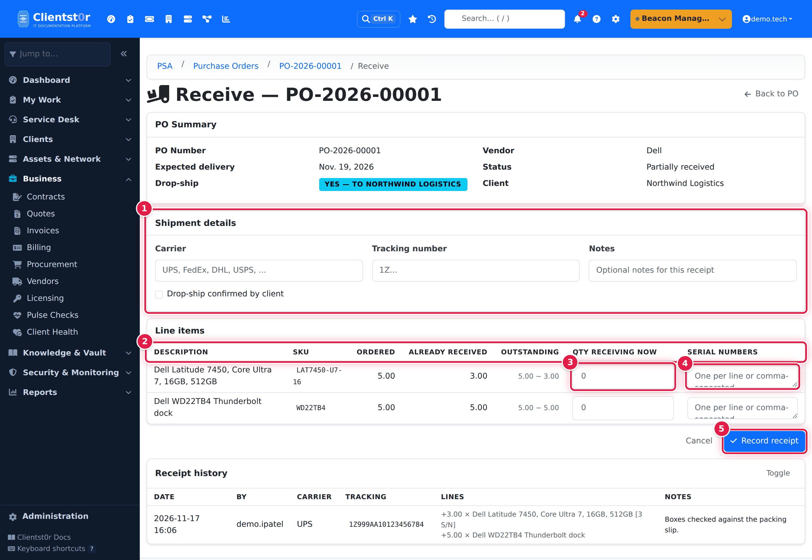
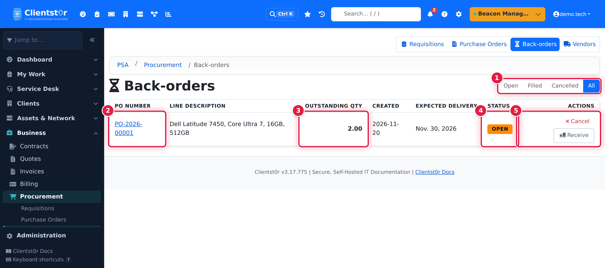
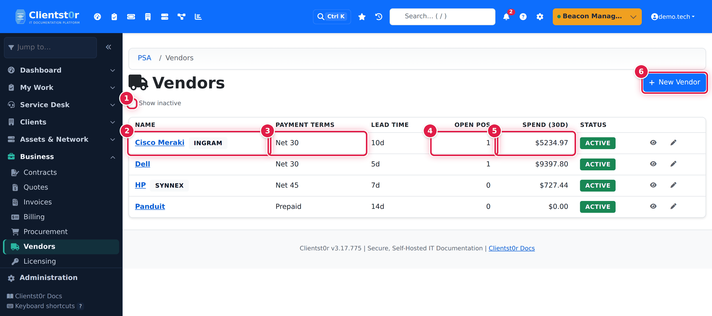
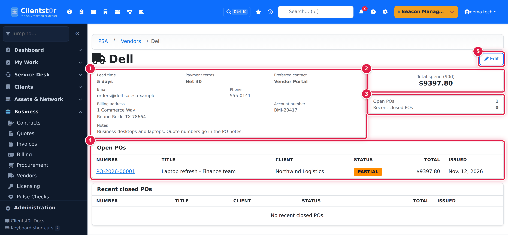

# Procurement and vendors

How the MSP buys what it resells and uses: a technician files a **requisition**, someone with approval rights
approves it, it becomes a **purchase order** sent to a vendor, deliveries are **received** against the order,
and anything that has not arrived is tracked as a **back-order**. The pages are in **Business → Procurement**
(Requisitions, Purchase Orders, Back-orders) and **Business → Vendors** in the sidebar. They are for MSP staff
only: customer users never see them, whatever their role says, because the pages show what the MSP pays. They
need the PSA module to be on. The numbers in each screenshot match the list under it. Every screenshot is a
capture of the application against a demo database; the customers and people in it are invented.

The path in one line: **requisition** (draft → submitted → approved) → **Convert to PO** → **Send to vendor** →
**Receive Items** (partial or full) → **back-order** for what is still owed. You can also start a purchase order
directly, or from an accepted quote (see [Other ways to start an order](#other-ways-to-start-an-order)).

## Who can do what

Procurement has five permissions on a role. The defaults for the built-in roles are noted; a superuser can
change them on a role (see ROLES_AND_ACCESS.md).

| Permission | Lets you |
|---|---|
| View procurement | Open the lists and detail pages, view and download PO PDFs, open the receiving page, open vendors, see back-orders. On by default. |
| Create requisitions | Create, edit and submit requisitions. On by default for staff roles. |
| Approve requisitions | Approve or reject submitted requisitions; see everyone's requisitions. Off by default except for the owner and admin roles. |
| Create purchase orders | Create and edit purchase orders and vendors, **record deliveries**, convert an approved requisition, cancel back-orders. Off by default except for the owner and admin roles. |
| Send purchase orders | Email the PO PDF to the vendor. Off by default except for the owner and admin roles. |

Two details worth knowing: recording a delivery needs *Create purchase orders* (with only *View procurement* you
can open the receiving page but not save it); and *Convert to PO* works with either *Approve* or *Create purchase
orders*.

## Requisitions

**Business → Procurement → Requisitions** (`/psa/requisitions/`). An internal request to buy something. It
carries the lines, an optional customer it is for, and an optional ticket or project it came from.

<!-- guide-figure: guide-proc-requisitions -->

1. Approvers see All, Pending approval and My requisitions. Everyone else sees only their own requisitions.
2. Filter by status: Draft, Submitted, Approved, Rejected, Converted or Cancelled.
3. The requisition number opens it. Numbers run PR-year-00001.
4. Where it is in the approval path.
5. Start a new requisition.
<!-- /guide-figure -->

- Numbers run `PR-year-00001`. Status is **Draft**, **Submitted**, **Approved**, **Rejected**, **Converted** (to a PO)
  or **Cancelled**.
- People with the approve permission see everyone's requisitions by default, with **Pending approval** and
  **My requisitions** shortcuts. Everyone else sees only the requisitions they filed.
- The list shows the newest 200.
- Only a **Draft** shows an edit pencil. Totals are the sum of quantity times unit price per line, plus tax at
  the percentage you enter on the requisition. Enter 8.75 for 8.75 percent.

### Filing and approving one

**New Requisition** asks for a title, the MSP organization it belongs to, an optional customer (the "bill to /
drop-ship to" customer), a description and notes, a tax rate and the lines. A line has a description, a vendor
SKU or part number, a distributor hint, a quantity and a unit price. A new requisition always starts as a draft.
**Submit for approval** (on the requisition page, for the person who filed it or a superuser) moves it to
Submitted.

<!-- guide-figure: guide-proc-requisition -->

1. The number, title and status.
2. Approve, with an optional note.
3. Reject. A reason is required.
4. Who asked, for which customer, and the totals.
5. The lines: description, vendor SKU, distributor hint, quantity and unit price.
<!-- /guide-figure -->

- **Approve** and **Reject** only appear on a submitted requisition and only for people with the approve
  permission. Rejecting needs a reason. Both record who decided, when, and the note, and write an audit log
  entry. A requisition can only be decided once.
- There is no approval limit by amount and no multi-step approval: one approver decides.
- On an **Approved** requisition, **Convert to PO** asks for a vendor name (and optionally an email), creates a
  draft purchase order with the same lines, customer, tax rate and notes, and marks the requisition
  **Converted**. The new PO is listed under "Resulting POs". The vendor you type here is only text; it is not
  linked to a vendor record, so open the PO afterwards and choose the vendor there if you want it counted on
  the vendor's page.

## Purchase orders

**Business → Procurement → Purchase Orders** (`/psa/purchase-orders/`). An order issued to a vendor.

<!-- guide-figure: guide-proc-pos -->

1. Filter by status.
2. The PO number opens the order.
3. The vendor named on the order.
4. Draft, Sent, Acknowledged, Partial, Received, Cancelled or Void.
5. View, open the PDF, or download it.
6. Create an order without a requisition.
<!-- /guide-figure -->

- Numbers run `PO-year-00001`. Status is **Draft**, **Sent**, **Acknowledged**, **Partial** (partly received),
  **Received**, **Cancelled** or **Void**.
- The list shows the newest 200 and can be filtered by status.
- **New PO** starts an order without a requisition. It needs a title and a vendor name. Choosing a vendor from
  the dropdown fills the name, email, phone and address from the vendor record, and if you give an issue date
  and no expected date, the expected delivery is the issue date plus the vendor's lead time. Those details are
  copied onto the order, so editing the vendor later does not change old orders.
- An order can be marked **drop-ship**, with its own ship-to name and address, for goods delivered straight to
  the customer.
- The edit form lets you set the status by hand. Setting it to Sent or Received there does not email the
  vendor or record a receipt; use **Send to vendor** and **Receive Items** so the history is right.

<!-- guide-figure: guide-proc-po -->

1. The number and status. Partial means some lines have arrived.
2. Edit, view or download the PDF, send it to the vendor, and Receive Items.
3. The vendor as it was when the order was saved.
4. Dates, drop-ship, the requisition or quote it came from, and totals.
5. The lines being bought.
6. Each delivery recorded against the order.
<!-- /guide-figure -->

- **View PDF** and **Download PDF** produce a branded order document.
- **Send to vendor** (needs the send permission) emails that PDF to the address you confirm in the dialog,
  with an optional subject and message. A draft order becomes **Sent** and the time is recorded; an order that
  is already sent stays as it is, so you can send it again. If the email fails the order is not changed.
- **Receive Items** appears for orders that are Sent, Acknowledged or Partial.
- The page also shows the requisition or quote the order came from, every receipt, and any open back-orders.
- Nothing in the application changes an order to **Acknowledged** by itself; set it from the edit form when the
  vendor confirms.

## Receiving

**Purchase Orders → open an order → Receive Items** (`/psa/purchase-orders/<id>/receive/`). Records one delivery.
Orders that are Draft, Cancelled or Void cannot be received against.

<!-- guide-figure: guide-proc-receive -->

1. Carrier, tracking number and notes for this delivery.
2. Ordered, already received and what is still outstanding.
3. How many arrived in this delivery. Anything over what is outstanding is cut back.
4. Serial numbers, one per line or comma-separated. Each creates an asset.
5. Save the receipt.
<!-- /guide-figure -->

- Enter how many of each line arrived in this delivery. Leave a line blank or 0 if it did not arrive. A quantity
  above what is still outstanding is cut back to the outstanding amount.
- Carrier, tracking number and notes are saved with the receipt. On a drop-ship order there is also a
  **Drop-ship confirmed by client** box.
- Each line's received total is updated, and the order becomes **Partial** until every line is complete, then
  **Received**. Each delivery is kept as its own receipt, so the order shows the full history.
- If a line you received is still short, a back-order is kept for the rest (next section).

### What receiving does to your records

- **Serial numbers.** Enter them one per line or separated by commas. Each one starts a serial-number history
  (first event: received on this order) and creates an **asset** named "description (serial)" under the order's
  customer, or under the MSP organization when the order has no customer. A serial the customer already has an
  asset for is skipped. The new asset has the generic type "other", with a note pointing at the order and
  receipt; fill in its real type and details afterwards.
- **Inventory is not changed.** Receiving does not add to the stock quantities in Assets & Network → Inventory.
  If the goods are stock, add them there with the inventory page's stock adjustment.
- **Tickets are not changed.** Receiving does not update or close a ticket. A requisition can be linked to the
  ticket or project it came from, but that link is for reference.
- **Billing is not changed.** Receiving does not create a charge or an invoice line.

## Back-orders

**Business → Procurement → Back-orders** (`/psa/back-orders/`). What a vendor still owes.

<!-- guide-figure: guide-proc-backorders -->

1. Open is the default. Filled and Cancelled show what has been closed.
2. The purchase order the shortfall belongs to.
3. How many units are still owed.
4. Open, Filled or Cancelled.
5. Cancel the back-order, or open the receiving form.
<!-- /guide-figure -->

- A back-order is created by a receipt that leaves a line short, one per line. A later partial receipt updates
  that same back-order to the new outstanding amount rather than adding another.
- When a line is fully received its back-order becomes **Filled**; when the whole order is received, all of its
  open back-orders are filled.
- The page shows **Open** by default, with Filled, Cancelled and All. **Receive** opens the order's receiving
  form. **Cancel** (needs *Create purchase orders*) closes a back-order you no longer expect; it does not change
  the order or its line quantities, so the order stays Partial.
- The expected-delivery column is empty unless a date has been entered on the back-order record; it is not
  copied from the order.
- There is no email or alert when a back-order becomes overdue.

## Vendors

**Business → Vendors** (`/psa/vendors/`), also reachable from the Procurement tabs. The suppliers you buy from.
Vendors are shared by the whole installation, not kept per customer, and they are the same records used as
manufacturers elsewhere in the application.

<!-- guide-figure: guide-proc-vendors -->

1. Show vendors that have been marked inactive.
2. The vendor name opens it. A badge shows the linked distributor.
3. Payment terms and typical lead time.
4. Orders still draft, sent, acknowledged or partly received.
5. Total of orders created in the last 30 days.
6. Add a vendor.
<!-- /guide-figure -->

- The list shows payment terms, lead time, the number of open orders (Draft, Sent, Acknowledged or Partial) and
  spend on orders created in the last 30 days. **Show inactive** includes vendors that are switched off.
- **New Vendor** and the pencil need *Create purchase orders*. The form holds the name, website, support URL
  and phone, a description, an active switch, and the purchasing details: lead time in days (default 7, up to
  365), payment terms (Net 15, 30, 45 or 60, Cash on Delivery, Prepaid or Credit Card), preferred contact method,
  contact email and phone, billing address, your account number with them, and notes.
- Vendors cannot be deleted here; switch **Active** off to hide one.

<!-- guide-figure: guide-proc-vendor -->

1. Lead time, payment terms, contact details, billing address and account number.
2. Spend on orders created in the last 90 days.
3. How many open and recently closed orders.
4. Orders still draft, sent, acknowledged or partly received.
5. Edit the vendor.
<!-- /guide-figure -->

- The vendor page shows the purchasing details, spend on orders created in the last 90 days, the vendor's open
  orders, and its ten most recent closed ones. Only orders linked to the vendor record count, so an order whose
  vendor was typed in by hand does not appear.

## Distributors

Distributors (Ingram, Pax8 and Synnex) appear in two places, both as labels:

- A **vendor** can name a distributor, which shows as a badge in the vendor list.
- Each requisition and order **line** has a distributor choice with the same three options, shown on the order
  page.

These labels are for your own reference. Procurement does not look up prices or stock from a distributor, place
orders with one, or fill in a SKU for you. Distributor connections for catalogue and pricing are set up
separately under their own integration pages.

## Other ways to start an order

- **From a quote.** On an accepted quote, **Convert to PO** makes a draft order with the quote's lines and
  customer, linked back to the quote (needs *Create purchase orders*). Only accepted quotes can be converted.
- **From low stock.** The daily scheduled task **Stock Minimum Scan** only logs inventory items at or below their
  minimum. Draft requisitions, one per preferred vendor, are created only when the command
  `manage.py psa_auto_replenish_suggestions --create-prs` is run by an administrator; it skips items already
  on an open draft or submitted requisition.
- **Recurring purchases.** The daily scheduled task **PSA Recurring Purchase Requisitions** creates draft
  requisitions from saved recurring-purchase templates. There is no page for editing those templates yet.

Both automatic routes only create **drafts**; a person still submits, approves and converts them.

## Limits to know about

- One approval step, no spending limits, no per-vendor approval rules.
- Receiving does not touch stock quantities, tickets or invoices.
- Prices and costs are plain numbers in one currency per document (default USD); there is no exchange rate.
- Requisitions and orders belong to the MSP organization you were working in when you created them, and the
  lists show that organization's records.
