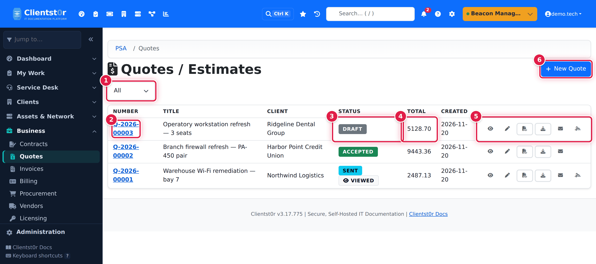
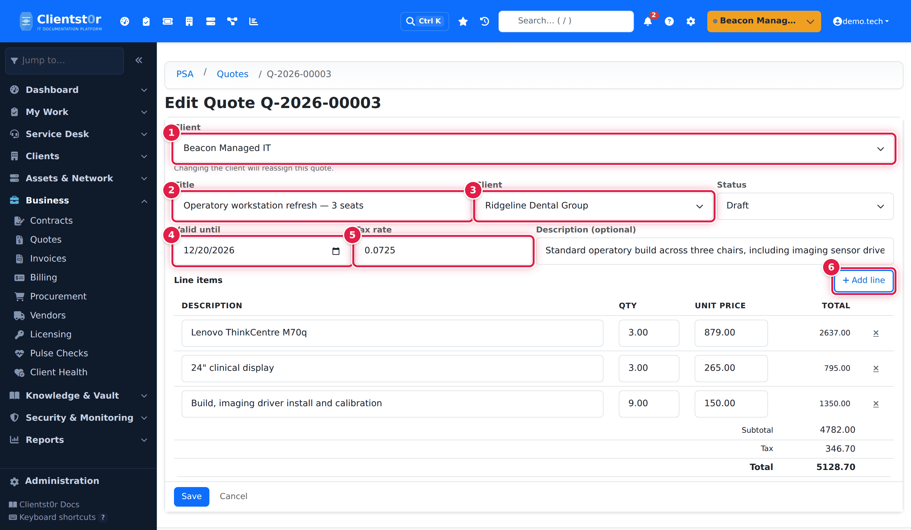
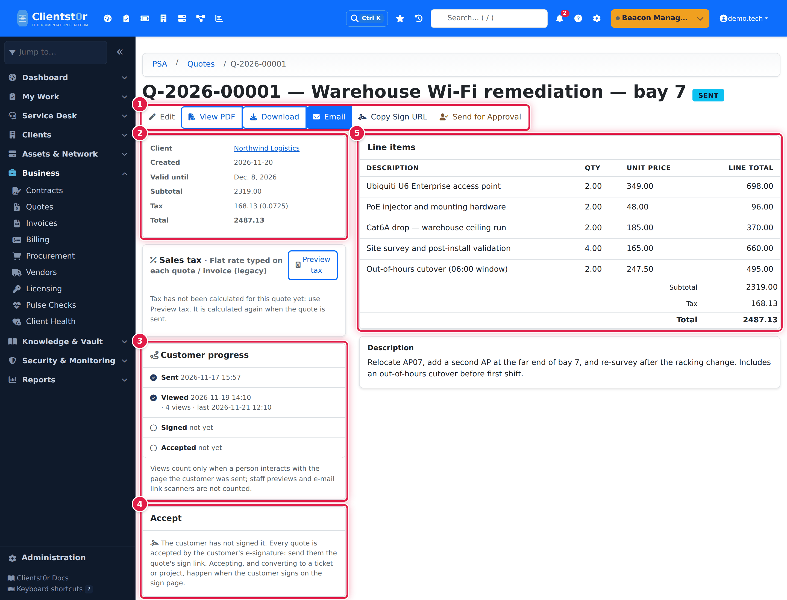
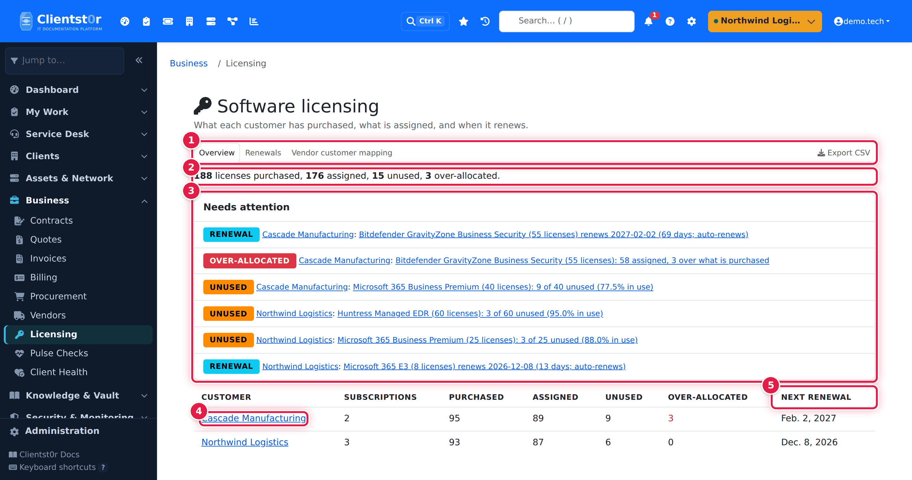
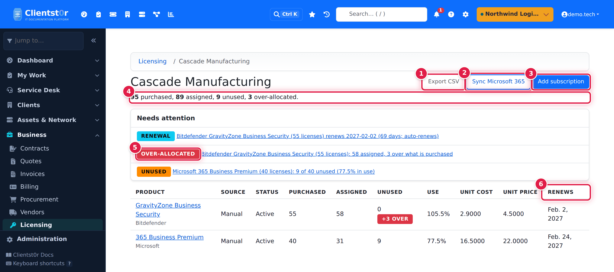
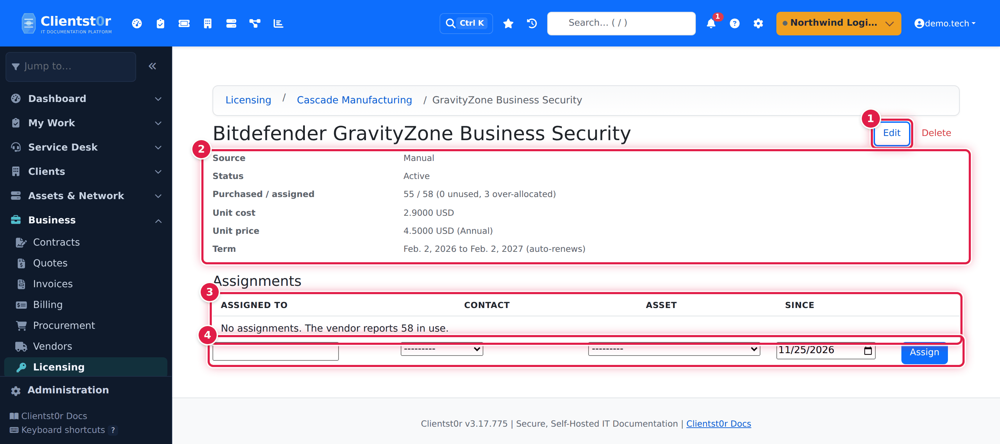
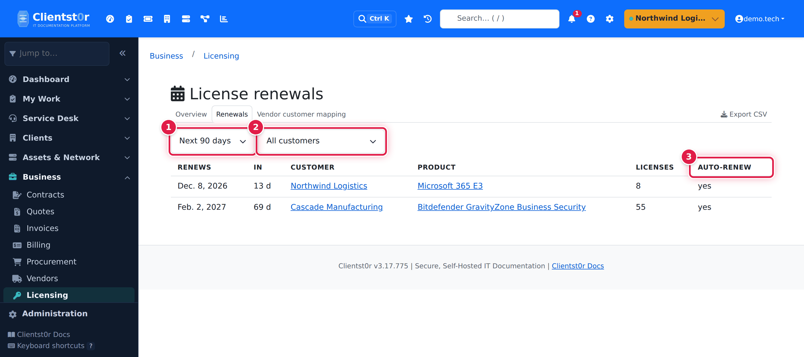

# Quotes and Licensing

How the MSP prices work for a customer and gets it accepted (**Quotes**), and how it tracks the software
subscriptions it resells or manages (**Licensing**). Both are in the **Business** section of the sidebar,
next to Contracts, Invoices and Billing, and are meant for MSP staff. A customer
sees a quote through the signing link they are sent. The numbers in each screenshot match the list
under it. Every screenshot is a capture of the application against a demo database; the customers and
people in it are invented.

Contracts, invoices, billing review, tax and payments are covered in [Billing](BILLING.md), not repeated
here. Sales tax on quotes is covered in [Tax](TAX.md).

**Quotes** needs the PSA module switched on. Writing, sending and accepting quotes needs the *manage sales
pipeline* permission for the customer. **Licensing** is for MSP staff only, with permissions listed under
[Who can do what](#who-can-do-what-in-licensing).

## The quote list

**Business → Quotes** (`/psa/quotes/`). Up to 200 quotes, newest first, for the customer picked in the
client switcher.

<!-- guide-figure: guide-quote-list -->

1. Filter by status: Draft, Sent, Accepted, Rejected or Expired.
2. The quote number opens the quote.
3. Status. A Viewed badge appears once the customer has opened the sign link.
4. Total, including tax.
5. View, Edit, PDF, Download, Email, Copy sign link, and Accept once the customer has signed.
6. Start a new quote.
<!-- /guide-figure -->

- Quote numbers are assigned automatically as `Q-YYYY-NNNNN`, counted per year.
- The status filter has Draft, Sent, Accepted, Rejected and Expired. A quote is only marked Expired when
  someone sets it; a quote past its **Valid until** date keeps its status, but its sign link refuses to
  accept it (see [Customer acceptance](#customer-acceptance-and-e-signature)).
- The **Viewed** badge means a person opened the sign link. Staff previews and e-mail security scanners are
  not counted. Hover it for the first view time and the count.
- The row buttons are the same ones the quote page has. The **Accept** tick appears only on a quote that
  already carries the customer's signature.

## Building a quote

**Business → Quotes → New Quote** (`/psa/quotes/new/`), or **Edit** on a quote (`/psa/quotes/<id>/edit/`).

<!-- guide-figure: guide-quote-form -->

1. The organization the quote is filed under.
2. Title shown on the quote and its PDF.
3. The customer being quoted.
4. Valid until. The sign link refuses to accept a quote after this date.
5. Tax rate as a fraction (0.0875 is 8.75%).
6. Add a line item: description, quantity and unit price.
<!-- /guide-figure -->

- There are two client fields. The first, at the top, is the organization the quote is filed under (it
  decides who can see it); the second is the customer being quoted. In the demo the quote is filed under the
  MSP's own organization and quotes a customer.
- **Title** and the customer are required. **Status** starts as Draft. Choosing **Sent** on a draft does not
  just flip it: the quote must pass the tax check first (see [Tax](TAX.md)) and, if it does not, it is saved
  as a draft with a warning. Choosing **Accepted** does nothing unless the customer has already signed.
- **Tax rate** is a fraction, so 0.0725 is 7.25%. A new quote takes the default from the tax settings.
  Tax is worked out on the lines marked taxable and rounded to the cent, half up. The totals shown while you
  edit are a preview that uses the same rounding; the saved totals are what the quote, its PDF and the
  customer see, and a tax calculation from the tax module replaces the flat rate when there is one.
- **Line items** are a description, quantity and unit price each. Lines are replaced as a set when you save:
  a row with an empty description is dropped, and a save with a quantity or price that is not a number
  changes none of the lines and tells you why.
- **A signed quote is locked.** Once the customer has signed, lines, totals, terms and the client cannot be
  edited; create a new quote for any change. Editing a quote before it is signed is fine, but the customer
  must then sign the new version.
- Only MSP staff can create or change quotes. A customer user who somehow reached the form is refused.

## A quote's page

Click a quote number (`/psa/quotes/<id>/`).

<!-- guide-figure: guide-quote-detail -->

1. Edit, View PDF, Download, Email, Copy Sign URL and Send for Approval.
2. Client, dates, subtotal, tax and total. After signing it also shows who signed and whether the signature still matches this quote.
3. Customer progress: Sent, Viewed, Signed, Accepted.
4. Accept. Until the customer has signed it only says so: the quote is accepted when they sign.
5. Line items with quantity, unit price and line total.
<!-- /guide-figure -->

- **Email** sends the PDF, with the signing link in the body unless the quote is already accepted. The
  recipient starts as the customer's contact address. Sending a draft marks it Sent and writes an audit
  entry. A draft whose tax is not determined is not sent.
- **Copy Sign URL** copies the customer's signing link (`/portal/quote/<token>/sign/`). Anyone with the
  link can open the quote, so send it only to the customer. The link exists from the moment the quote is
  saved, not only after it is sent.
- **Send for Approval** routes a draft or sent quote through an internal approval chain: one stage, or two
  (manager then director) when the total is at or above the threshold you type, or the invoice approval
  threshold in the billing settings. While any stage is open the quote cannot be accepted, and the
  customer's sign link says it is still being reviewed. A denied chain makes the sign link refuse too.
- **Customer progress** shows Sent, Viewed, Signed and Accepted with their times.
- **Convert to PO** appears on an accepted quote if you may create purchase orders; it starts a purchase
  order from the quote (see Procurement).
- A quote has no "convert to invoice" or "convert to contract" button. On acceptance it can create a
  ticket and, optionally, a project with one task per line. Invoicing and contracts are separate work: see
  [Billing](BILLING.md).

## Customer acceptance and e-signature

Every quote is accepted by the customer's e-signature and by nothing else. The customer opens the sign link,
reads the quote, types their name, email and optional title, draws a signature and submits.

- The sign page is public (no login), rate limited per address and per link, and refuses to sign when the
  quote has expired (status Expired, or **Valid until** has passed) or when an approval chain is open or
  denied.
- The signature is bound to the exact content the customer read. If you edit the quote while they have the
  page open, the signature is refused and they are asked to review again.
- Signing records the name, email, title, signature image, time, IP address and browser, a SHA-256 of the
  quote as signed, and a PDF of it. The quote is then marked Accepted, and a ticket is created.
- On the quote page, a signed quote shows who signed and whether the signature still *matches this quote*.
  **Download evidence** gives a ZIP of what was signed (the quote as JSON, the PDF, the signature image,
  the evidence and checksums); downloading is audited.
- Staff cannot mark a quote accepted on the customer's behalf. The **Accept** card says so until a
  signature exists; once one does, **Mark accepted** lets staff finish the acceptance, with the choice to
  create a ticket and a project.
- Accepting a quote fires the standard events: the first view of the sign page also fires `quote.viewed`
  and emails whoever created the quote (see [Billing](BILLING.md)).

## Licensing overview

**Business → Licensing** (`/licensing/`). What each customer has bought, what is assigned, and when it
renews. It lists every customer you may see, not only the one in the client switcher.

<!-- guide-figure: guide-quote-lic-overview -->

1. Overview, Renewals, Vendor customer mapping, and Export CSV for every customer you may see.
2. Totals over live (Active or Trial) subscriptions.
3. Renewals within 30, 60 or 90 days, unused licenses and over-allocation.
4. A customer opens its subscriptions.
5. The nearest future renewal date among that customer's live subscriptions.
<!-- /guide-figure -->

- Totals count only live subscriptions (Active or Trial). *Assigned* is the number of assignment rows when
  there are any; otherwise it is the figure the vendor reports as in use. *Unused* is purchased minus
  assigned, never below zero, and is shown only when assignments or a vendor figure exist: a manual entry
  with neither would otherwise read as entirely unused. *Over-allocated* is assigned minus purchased.
- **Needs attention** lists renewals within 30, 60 or 90 days (it says whether the subscription renews by
  itself), unused licenses and over-allocation. It shows the first 50 and says how many there are in all.
- **Export CSV** downloads every subscription you may see: customer, vendor, product, SKU, source, status,
  counts, unit price, currency, billing, renewal date and auto-renew. A **Unit cost** column is included
  only when you may see cost for at least one of those customers, and is blank for the others.

Subscriptions come from three places: entered by hand, synced from a customer's Microsoft 365 connection,
and imported from a Pax8 distributor connection. The daily scheduled tasks *Software License Sync* and
*License Renewal and Utilization Alerts* do the syncing and the e-mails; both do nothing without a
connection. Google Workspace appears as a source name, but there is no sync for it.

## A customer's subscriptions

**Licensing → customer name** (`/licensing/customer/<id>/`).

<!-- guide-figure: guide-quote-lic-customer -->

1. Export this customer's subscriptions as CSV.
2. Sync Microsoft 365: pull subscribed SKUs and assignments (needs an active Microsoft 365 connection).
3. Add a subscription by hand.
4. Purchased, assigned, unused and over-allocated totals.
5. More seats assigned than purchased.
6. Renewal date.
<!-- /guide-figure -->

- **Sync Microsoft 365** pulls the customer's subscribed SKUs and, unless skipped, who holds each seat. It
  needs an active Microsoft 365 connection for that customer; without one you are told so. A sync updates
  rows and never duplicates them, and never overwrites the cost, price, notes, renewal date (for Microsoft)
  or product name you set.
- **Add subscription** creates a manual one: vendor, product, optional SKU, license type, quantity, prices,
  billing frequency, term start, renewal date, auto-renew, status and notes. A subscription that came from a
  vendor keeps its vendor-owned fields (id, quantity, status and product) read-only, since the next sync
  would overwrite an edit.
- The **Unit cost** column (what the MSP pays) shows only to people with the *view internal cost rates*
  permission for that customer. **Unit price** is what the customer pays.

## One subscription and its seats

Click a product (`/licensing/subscriptions/<id>/`).

<!-- guide-figure: guide-quote-lic-subscription -->

1. Edit or delete the subscription (needs manage licensing).
2. Source, status, purchased and assigned counts, price, term and notes.
3. Who holds a seat: a person, a mailbox or a device.
4. Add an assignment: name, optional contact and asset, and the date.
<!-- /guide-figure -->

- Assignments say who holds a seat: a name or sign-in, optionally linked to a contact and an asset. Adding
  one past the purchased quantity still saves, with a warning that more are assigned than purchased.
- When there are no assignments but the vendor reports usage, the table says so ("The vendor reports 58 in
  use") and that figure counts as assigned. Adding your own assignments replaces it.
- **Delete** removes the subscription and its assignments after a confirmation. Create, edit, assign,
  unassign and delete are all written to the audit log.

## Renewals

**Licensing → Renewals** (`/licensing/renewals/`). Live subscriptions with a renewal date in the next 30,
60, 90, 180 or 365 days (90 by default), soonest first, for all customers or one.

<!-- guide-figure: guide-quote-lic-renewals -->

1. How far ahead to look: 30, 60, 90, 180 days or a year.
2. Limit to one customer.
3. Whether the subscription renews by itself.
<!-- /guide-figure -->

- Only Active and Trial subscriptions are listed, and only those with a renewal date from today onward.
  Overdue renewals do not appear here.
- Alert e-mails go once per condition: a renewal once per renewal date and window, unused and
  over-allocation once per month for an unchanged count. They go to MSP staff who may manage licensing for
  that customer, and never contain a cost figure. `manage.py licensing_alerts --dry-run` shows what would
  be sent.

## Vendor customer mapping

**Licensing → Vendor customer mapping** (`/licensing/mappings/`). Pax8 subscriptions are imported only for
vendor companies mapped to a customer here; a company whose name exactly matches one customer is mapped
automatically at sync time. Each mapping is a source, the vendor's company id, a name and the customer.
Remove a mapping to stop importing that company. This page is a plain table with an add form, so it has no
figure.

## Who can do what in Licensing

- **See** subscriptions, renewals and the CSV: the *view assets* permission for the customer. Customers you
  may not see are left out everywhere, including the overview totals and the CSV.
- **Add, edit, delete, assign, sync, map:** the *manage licensing* permission for the customer.
- **See and edit unit cost:** the *view internal cost rates* permission for the customer. Without it the
  cost field is not shown, not exported and ignored on a save, so editing a subscription never changes it.
