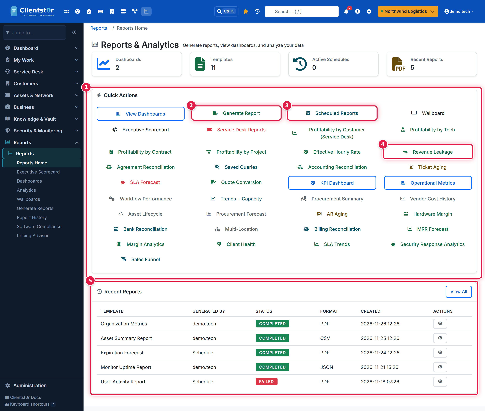
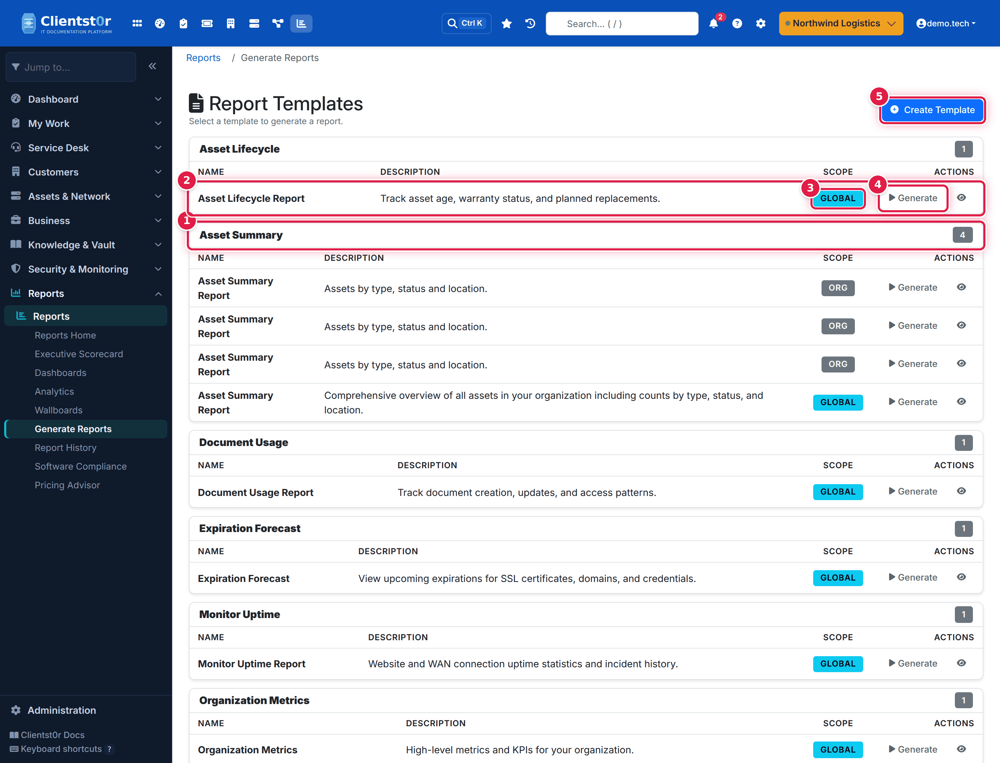
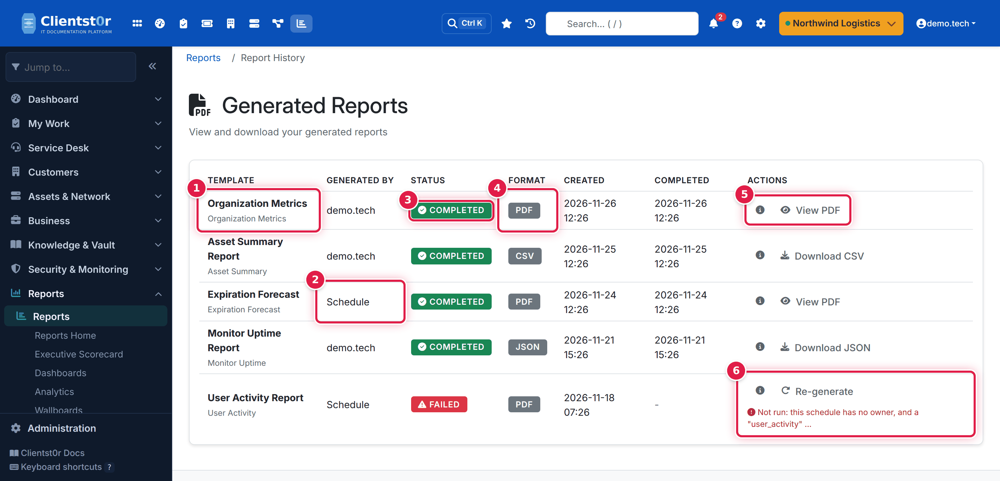
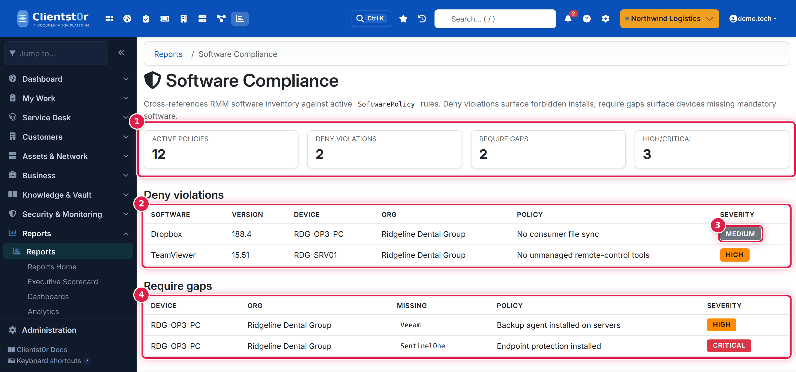

# Reports

The report generator, the catalogue of ready-made reports, the history of every report that has been generated,
and the software compliance check. Everything here is in **Reports** in the sidebar and is for MSP staff only:
customer users never see these pages. The numbers in each screenshot match the list under it. Every screenshot
is a capture of the application against a demo database; the customers and people in it are invented.

This guide covers four tabs: **Reports Home**, **Generate Reports**, **Report History** and **Software
Compliance**. The other Reports tabs have their own guides:

- Executive Scorecard, Business Overview, Dashboards and Analytics: [Executive reporting](EXECUTIVE_REPORTING.md).
- Wallboards and the Pricing Advisor: [Wallboards and Pricing Advisor](WALLBOARDS_AND_PRICING_ADVISOR.md).

The whole section can be switched off by a superuser in **Settings → Features** (*Reports & Analytics*).
While it is off every Reports page returns 404 and the scheduled-report job does nothing.

## Who can see what

Access to Reports is decided by your role's report permissions, not by being MSP staff alone.

| Permission (role setting) | What it opens |
| --- | --- |
| View dashboards | The Reports pages in general: Reports Home, Generate Reports, Report History, dashboards, wallboards, workflow performance and trends |
| Manage dashboards | Creating and editing report templates, dashboards and wallboards |
| Manage scheduled reports | Scheduled Reports (create, edit, pause, delete) |
| **View financial reports** | Executive Scorecard, Revenue Leakage, Client Health, MRR Forecast, Agreement Reconciliation, Accounting Reconciliation, Vendor Cost History, Hardware Margin, Quote Conversion, and the MRR and ARR cards of the KPI Dashboard |
| View profitability | Profitability by Client, Tech, Contract and Project; Effective Hourly Rate; Margin Analytics |
| View SLA reports | SLA Trends, SLA Forecast, Security Response Analytics |
| View capacity reports | Operational Metrics |

Other reports are gated by the permission of the data they read: AR Aging needs *view aging*, Bank
Reconciliation needs *record payments*, Billing Reconciliation needs *view invoices*, Procurement Summary and
Forecast need *procurement view*, Ticket Aging and the Service Desk report catalogue need *view tickets*, Sales Funnel
needs *view CRM forecast*, and Software Compliance needs *view assets*.

- **"Across every customer".** Most reports add up all customers, so the check is stricter than "you hold the
  permission in one customer". A technician whose own role has the flag, or a role with all-customers scope,
  passes. A permission held only through one customer's membership does not open an all-customers report.
  A refused page says which permission your role lacks.
- **Level 1 technicians** and other roles that leave *View financial reports* out do not see the financial
  buttons on Reports Home, cannot open the pages by URL, and see no MRR or ARR on the KPI Dashboard.
- Superusers see everything.
- On Reports Home a few buttons can appear for a permission you hold in one customer but whose page needs it
  across every customer; those open a "permission denied" page rather than the report.

## How the financial figures are defined

Every revenue, cost, profit and margin figure in the profitability and scorecard reports comes from one set of
definitions, so a customer and period give the same number on every page and CSV. The profitability pages show
the same list in a definitions panel.

- **Billed revenue**: issued invoices (sent, partially paid, paid or overdue; not drafts or void) by invoice
  date, excluding tax, net of credit notes.
- **Collected revenue**: payments received by payment date, net of refunds, with the tax share of each paid
  invoice removed.
- **Recognized revenue**: billed revenue spread over the service period of contract invoices; every other
  invoice on its own date. A straight-line estimate from billing data, not accounting-system revenue.
- **Direct cost**: labour at each technician's cost rate on the day of the work (time entries, billable or not),
  plus ticket items at unit cost, ticket expenses, and invoice lines that carry a unit cost. Purchase orders,
  licence subscriptions and overheads are not counted.
- **Gross profit**: billed revenue minus direct cost. **Margin**: gross profit divided by billed revenue.
- **Partial figures**: when any cost is unknown (an hour with no cost rate, an item with no unit cost) the cost
  is marked partial and gross profit and margin show as unknown instead of a number that overstates profit.
- **Contracted MRR / ARR** is the contract recurring amounts normalised to a month (and times twelve): a
  commitment, not revenue. **Attributed labour revenue** is billable hours times the entry's bill rate.
  **Receivables** (AR aging, reconciliation) are amounts owed, including tax.

The profitability pages are labelled "Operational profitability estimate — not your accounting P&L".

## Reports Home

**Reports → Reports Home** (`/reports/`). A launcher for every ready-made report, plus the newest reports that
have been generated.

<!-- guide-figure: guide-rep-home -->

1. Four counts: dashboards, report templates, active schedules and how many of the ten latest reports are listed.
2. Generate Report opens the Generate Reports tab.
3. Scheduled Reports: recurring runs that e-mail a report. Shown only with the Manage scheduled reports permission.
4. Reports with money in them. Which buttons you see depends on your role's report permissions.
5. The ten latest generated reports; View All opens Report History.
<!-- /guide-figure -->

- The four counts cover the customers you can access. **Templates** counts global templates and your
  customers' templates. **Recent Reports** is how many of the ten newest generated reports are listed, so it
  never exceeds 10.
- **Quick Actions** is the catalogue. Only the buttons your permissions allow are drawn, and the Service Desk group
  needs the Service Desk module. Pages opened from here keep **Reports Home** highlighted in the tab bar.
- The **Wallboard** button opens the fixed single-screen wallboard (`/reports/wallboard/`). Configurable,
  named wallboards are on the **Wallboards** tab, see the other guide.
- Ready-made reports on the page, grouped by what they cover (each page has its own filters, and most export
  CSV with the same filters; AR Aging, MRR Forecast, Procurement Summary and the KPI Dashboard also export a
  one-page PDF):
  - **Billing and money**: Revenue Leakage (money that should have been collected but was not, three
    categories on one page), Agreement Reconciliation (each active contract's included hours against hours
    used, with an overage estimate), Accounting Reconciliation (invoices pushed to the accounting system but not
    paid here, push errors, duplicate external ids), AR Aging (pushed, unpaid invoices in 0-30, 31-60, 61-90 and
    90+ day buckets per client), Bank Reconciliation (payments grouped by deposit batch, which you can mark
    reconciled or reopen), Billing Reconciliation (invoiced against paid per client), MRR Forecast (active
    contracts normalised to monthly, projected twelve months), Quote Conversion (quotes created, accepted and
    invoiced in a window, default 90 days).
  - **Profitability**: Profitability by Client, Tech, Contract and Project, Effective Hourly Rate (revenue
    divided by billable hours, per client or per tech), Margin Analytics (by ticket type, closure category or
    queue) and Client Health (a composite score per client).
  - **Service delivery**: Ticket Aging (open tickets by age: 0-24 h, 24-72 h, 3-7 days, 7-30 days, over 30
    days), SLA Forecast (open tickets ranked by how much of the resolution window has elapsed: under 60% ok,
    60-84% at risk, 85-99% critical, past due breached), SLA Trends, Operational Metrics (time to first response
    and to resolution, first-touch resolution rate, queue depth), Workflow Performance (every active workflow
    rule with its fire count and last error), Trends + Capacity (twelve months of tickets opened and resolved,
    MRR added, and each technician's open load against their weekly target), Security Response Analytics (mean
    time to acknowledge security alerts per client and vendor) and the KPI Dashboard (open tickets, mean open
    age, closed in the last 7 days, SLA breaches in 30 days, and MRR and ARR for those who may see money).
  - **Procurement and assets**: Procurement Summary (spend per vendor and a 12-month trend), Vendor Cost
    History (price drift per vendor and item over 730 days), Procurement Forecast (next three months from a
    three-month moving average of committed purchase orders), Hardware Margin (quotes that produced both a
    purchase order and an invoice: invoice total minus PO total), Asset Lifecycle (a 0-100 replacement score
    per asset from age, warranty and firmware), and Multi-Location (regions, parent roll-ups and shared
    services).
  - **Sales**: Sales Funnel (leads to closed-won with stage conversion rates).
  - **Saved Queries**: a custom report writer; you save a query and run or share it.
- **Service Desk Reports** opens a catalogue of eight ticket reports that run ad hoc against one customer or all of
  them (see [Service Desk report catalogue](#service-desk-report-catalogue)).
- The report pages show your customers' data as the pages' own filters and your scope allow; the customer
  switcher does not narrow most of them.

### Service Desk report catalogue

**Reports Home → Service Desk Reports** (`/reports/psa/`). Eight ticket reports. Each takes a number of days (default 30)
and an optional customer, shows the result on the page and exports CSV: Open Tickets by Client, SLA Breaches,
Response Time by Tech, Resolution Time by Client, Tickets by Queue / Type / Priority, Billable Hours by Client
(billable and non-billable hours from time entries), Noisy Assets / Recurring Issues (assets with two or more
tickets in the window) and Tickets by Assignee. Needs the *view tickets* permission across every customer.

## Generate Reports

**Reports → Generate Reports** (`/reports/templates/`). A report is made from a **template**: a name, a
description and a report type. The type decides what the report contains.

<!-- guide-figure: guide-rep-generate -->

1. Templates are grouped by report type; the badge counts the templates of that type.
2. A template: its name and description.
3. Global templates are available to every customer; Org templates belong to one.
4. Generate asks for a format (PDF, CSV or JSON) and builds the report for the selected customer.
5. Create Template (Django staff accounts only).
<!-- /guide-figure -->

The demo has several *Asset Summary Report* templates because customers each keep their own copy next to the
global one.

### What each report type contains

Every generator reports on **one customer**: the one selected in the customer switcher when you press Generate.
Each result also carries the time it was generated.

| Report type | What it contains | Needs (for that customer) |
| --- | --- | --- |
| Asset Summary | Total assets, how many need reorder, how many have an expired warranty, assets added in the last 30 days, and a count by asset type | View assets |
| Asset Lifecycle | Total assets and an age distribution by time since the asset was created here (under 1 year, 1-3, 3-5, 5+) | View assets |
| Password Security Audit | Shared vault entries only (personal My Vault entries are left out): total, how many have a one-time-password secret and the percentage, updated in the last 90 days, expired, expiring in 30 days, entries that need approval to reveal, and counts by type and by folder. No passwords are included | View vault; refused without it |
| Document Usage | Total, active and archived documents, created in the last 30 days, and counts by category and content type | View documents |
| Monitor Uptime | Website monitors over the last 30 days: counts by current status, overall uptime from the check history (a check counts as up unless it is down; no checks means no figure, not 0% or 100%), one row per monitor, and WAN connections that have monitoring on | View monitoring |
| Expiration Forecast | Tracked expirations (certificates, domains and so on) by when they fall due: expired, within 7, 30 and 90 days, later; and counts by type | View monitoring |
| User Activity | Audit-log activity for the customer over the last 30 days: total events, active users, failed sign-ins, counts by action, and the 50 busiest users with their logins and changes | View audit log |
| Organization Metrics | Member and active-member counts, and totals of assets, shared vault entries (shown only to viewers who may see the vault), documents and website monitors | View members |

These eight are the only types a template can use. A template of type *Custom Query* has no generator and
cannot be created. Financial reports are not in this list; they are the pages on Reports Home.

### Generating a report

1. Select the customer in the customer switcher.
2. Press **Generate** on a template. The form asks for a format: **PDF**, **CSV** or **JSON**.
3. The report is built at once (there is no queue) and you land on its details page. A failure is recorded
   with its error message and shows as Failed in Report History.

Formats, as the generator really writes them:

- **CSV**: a `key,value` table, one row per top-level field. A field that holds a list or a group of values
  (for example the counts by type) is written as JSON text in the value cell. Cells that start with `=`, `+`,
  `-` or `@` are neutralised so a spreadsheet does not run them.
- **JSON**: the full result, indented.
- **PDF**: a plain-text PDF of the report title followed by the result printed as JSON, Helvetica 10 pt,
  lines cut at 90 characters, at most about twelve pages. It is meant for archiving and e-mail attachments,
  not as a formatted presentation. The formatted one-page PDFs on Reports Home (AR Aging, MRR Forecast,
  Procurement Summary, KPI Dashboard) are separate.
- Excel is not offered; a schedule or form cannot choose it.

### Templates

- Anyone who may view reports sees global templates and their customers' templates and can generate from them.
- **Create Template** is drawn for Django staff accounts and needs *Manage dashboards*. A template is Global
  (every customer) or belongs to the selected customer; only Django staff accounts can make it global. Global
  built-in templates cannot be edited or deleted from the list; customer templates can.
- The built-in global templates are the eight in the table above. A superuser can recreate them with
  `manage.py create_default_reports`.
- You cannot generate a report type you could not see otherwise: the form refuses it with the missing
  permission, and a password audit also needs the vault permission.

### Scheduling and e-mail delivery

Open **Reports Home → Scheduled Reports** (`/reports/scheduled/`; there is no tab for it). It needs *Manage
scheduled reports*.

A schedule picks a template, a customer, how often it runs, the format (PDF, CSV or JSON), a delivery method
and recipients.

- **Frequency**: daily, weekly, monthly or quarterly. These are fixed intervals counted from the last run:
  1, 7, 30 and 90 days. They are not calendar dates ("the 1st of the month") and not a time of day.
- **Delivery**: *Email*, *Download Only* or *Email and Download*. Every run is saved to Report History;
  Download Only keeps it there without sending anything. Email and Email and Download need at least one
  valid recipient address (separate several with commas or semicolons).
- **Which job runs them**: the scheduled task **Scheduled Reports** (`run_scheduled_reports`), set to run every
  15 minutes. Any active schedule whose next run time has passed is run on the next tick, so a report can be
  up to about 15 minutes late. The job is listed on the Task Scheduler page in Administration (superusers).
- **E-mail**: one message per recipient (recipients do not see each other) with the file attached, subject
  `[<product name>] Scheduled report: <name>`, sent through the SMTP settings in **Settings → Email**. If SMTP
  is not configured, the report is still generated and saved, and its Report History row shows "Email not sent:
  SMTP is not configured in Settings → Email."
- **Whose access is used**: the person who created the schedule. At every run their access is checked again:
  they must still be active, MSP staff, hold *Manage scheduled reports* for that customer and hold the report
  type's permission. If not, the run is recorded as Failed with the reason and the schedule is paused. A
  schedule with no owner (its creator was deleted) runs without vault figures, and Password Audit and User
  Activity schedules do not run.
- A failure while generating leaves the schedule due, so it is retried on the next tick.
- Editing a schedule's frequency restarts its interval. The toggle on the list pauses and resumes it.
- Nobody can schedule a report they could not generate themselves.

## Report History

**Reports → Report History** (`/reports/generated/`). Every report generated for the customers you can access,
newest first, whether you made it on the Generate page or a schedule made it.

<!-- guide-figure: guide-rep-history -->

1. The template used and its report type.
2. Who generated it; a run made by a schedule shows Schedule.
3. Status: Completed, Failed, Pending or Generating.
4. The format the file was written in.
5. Details, then View PDF (opens in a new tab) or Download for CSV and JSON.
6. A failed run shows its error under the buttons.
<!-- /guide-figure -->

- **Generated By** is the person who pressed Generate; a scheduled run shows **Schedule**.
- A completed PDF opens in a new tab (**View PDF**); a CSV or JSON downloads. The information button opens the
  details page with the template, type, format, who generated it, the times and the error text if it failed, and **Download original**.
- A report whose file is missing (older rows, or a failed run) shows **Re-generate**, which builds it again in
  the same format for the selected customer.
- **Delete** removes the row and its file. You can delete any report you can see.
- To open or download a report you need the same permission the type needs to generate: a user who may not view
  the vault cannot open a Password Security Audit even when it appears in the list.
- Files are stored with the install's other uploaded files and served only to signed-in users who pass that
  check.

**Retention.** There is none. Reports, including scheduled ones, stay until someone deletes them; nothing prunes
the list or the files automatically. A daily or weekly schedule therefore adds a file each time, so delete
old ones from this page now and then.

## Software Compliance

**Reports → Software Compliance** (`/reports/software-compliance/`). Compares the software installed on
managed devices with software rules and lists what breaks them. Needs the *view assets* permission across every
customer.

<!-- guide-figure: guide-rep-software -->

1. Active policies, deny violations, require gaps, and how many are High or Critical.
2. Deny violations: software on a device that matches a Deny policy.
3. The policy's severity.
4. Require gaps: devices with no installed software matching a Require policy; Missing shows the policy's pattern.
<!-- /guide-figure -->

**What it compares.**

- **The policies.** Software policies are rules with a name, a pattern, an action (**Deny** or **Require**), a
  severity (info, low, medium, high, critical) and an optional customer. A policy with no customer applies to
  every customer. The pattern is a case-insensitive piece of text matched anywhere in the software name, so
  `TeamViewer` matches "TeamViewer 15.51". There is no regular-expression or version matching. Only active
  policies count.
- **The software.** The installed-software lists that your RMM connections synchronise for each device (the
  RMM integration's software inventory, name, version and vendor). The page does not look at the Licensing
  module, subscriptions or asset records, and it has no software of its own: a device that has not
  synchronised, or a customer without an RMM connection, shows nothing.
- **Deny violations**: any installed software whose name matches a Deny policy. One row per software item,
  device and policy.
- **Require gaps**: for each device, any Require policy that none of its installed software matches. One row
  per device and policy; *Missing* shows the policy's pattern.
- A customer-specific policy is only checked against that customer's devices.

**Limits you should know.**

- Only devices (and their software) whose customer is settled count; devices still waiting to be assigned to a
  customer are skipped.
- The checks read at most the first 5,000 software rows (by name) and 2,000 devices, and each table shows at
  most 500 rows. The counts at the top are counted before the 500-row cut.
- A Require policy treats a device as missing the software when its inventory is empty, so an RMM device that
  has not reported software yet counts as a gap.
- The page covers every customer you may see; the customer switcher does not narrow it, and it has no filters or
  export.
- This release has no screen for creating or editing software policies. They are stored with the assets
  data and are currently added by an administrator through the database tools or by the demo/sample data; the
  report only reads them.
