# Security alerts and incidents

How the MSP receives security alerts from its endpoint, antivirus, firewall and log tools, triages them, turns
them into tickets, and handles the serious ones as incidents. It covers two sidebar sections under
**Security & Monitoring**: **Security Alerts** (the alert list, plus Vendor Connections, Auto-Ticket Rules,
SIEM Endpoints and Weekly Digest under its **Configure** menu) and **Security Incidents** (Incidents, Incident
Playbooks, Threat Overview and Alert Response Times). Everything here is for MSP staff only: customer users
never see these pages. The numbers in each screenshot match the list under it. Every screenshot is a capture of
the application against a demo database; the customers and people in it are invented.

The sections need the **Service Desk** module switched on. The pages are about security *events* the MSP must act on.
Two neighbouring pages are not covered here: **Security Overview** (a read-only summary of counts) and **RMM
Alerts** with **Alert Policies** (which RMM and monitoring alerts open tickets; see [TICKET_ROUTING.md](TICKET_ROUTING.md)).
For what Clientst0r does to protect customer data in general, see [CLIENT_DATA_PROTECTION.md](CLIENT_DATA_PROTECTION.md).

## Where alerts come from

Alerts come from two kinds of source, both set up under **Security Alerts → Configure**:

- **Vendor connections.** One per security product (CrowdStrike Falcon, SentinelOne, Microsoft Defender for
  Endpoint, Sophos Central, Huntress, ThreatLocker, Bitdefender GravityZone, Webroot, Malwarebytes, ESET,
  FortiGate, Palo Alto, SonicWall, Meraki MX, Sophos XG, pfSense).
- **SIEM endpoints.** A URL for a log platform or forwarder to post events to, in CEF, generic JSON or syslog
  format.

Be clear about how they feed Clientst0r, because the provider list is longer than what is built:

- **Every connection receives alerts through its own signed webhook.** The vendor (or a script, or a SIEM)
  posts JSON to the connection's URL. The fields are `external_id`, `title`, `severity`, `description` and
  `asset_hint`; anything else is kept in the alert's raw payload.
- **Clientst0r does not poll any of these vendors' own APIs today.** The Microsoft Defender entry is a reference
  stub that returns nothing, and the others have no adapter at all. Such connections show a **Webhook only**
  badge, and the Test and Sync buttons are hidden for them. The five-minute poller skips them, so a connection
  never shows a false "OK".
- Posts are checked: a new connection or endpoint **requires a signature** (`X-Cst0r-Signature`, an HMAC-SHA256
  of the body with the connection's secret, optionally with a timestamp). A post with a wrong signature is
  refused with 403, and a repeated identical signed post is ignored. Bodies over 2 MB are refused.
- The webhook URL token and secret are shown **once**, when the connection is saved (or when you choose to
  issue new ones, which stops the old ones working). Only a hash and an encrypted copy are stored.
- Alerts are de-duplicated by the vendor's `external_id`. A repeat delivery updates the alert but **never lowers
  its severity** (the attempt is written to the audit log) and never changes its status.
- Severity words are mapped to the five levels; CEF numbers 0–3 become Low, 4–6 Medium, 7–8 High, 9–10 Critical.
  An unrecognised word becomes Medium.

### Vendor Connections

**Security Alerts → Configure → Vendor Connections** (`/security/connections/`).

<!-- guide-figure: guide-sec-connections -->
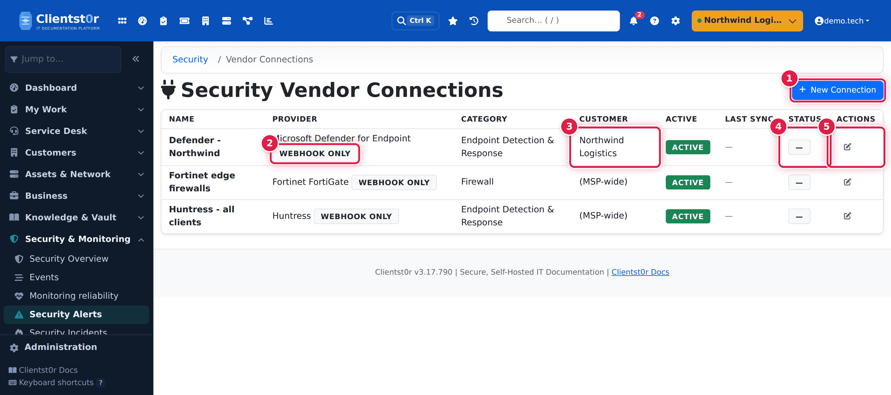

1. Add a connection for a security product.
2. Webhook only: Clientst0r cannot poll this vendor, so alerts arrive only when the vendor posts them to the connection's webhook.
3. Client: the customer this connection's alerts are filed under. (MSP-wide) means alerts name no customer.
4. Status of the last poll. Stays blank for a webhook-only connection.
5. Edit. The Test and Sync buttons appear only for a vendor Clientst0r can poll.
<!-- /guide-figure -->

- A connection belongs to the MSP organization and can be **pinned to one customer**. Alerts through a pinned
  connection are filed under that customer; an MSP-wide connection files alerts under no customer (they show as
  "unscoped" until someone reads the payload).
- **Active** and **Pull alerts on poll** are separate switches; the poll interval only matters for a vendor that
  can be polled.
- Seeing the list needs the view permission; creating, editing and issuing credentials needs the
  manage-connections permission.

### SIEM Endpoints

**Security Alerts → Configure → SIEM Endpoints** (`/security/siem/`).

<!-- guide-figure: guide-sec-siem -->
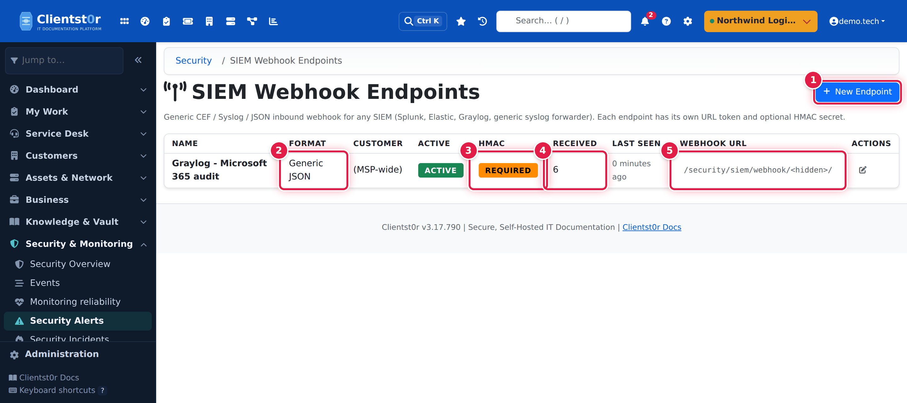

1. Add an endpoint for a SIEM or log forwarder.
2. The format this endpoint expects: CEF, generic JSON or syslog.
3. HMAC: Required means every post must carry a valid signature.
4. How many events this endpoint has received, and (next column) when it last heard from the source.
5. The URL is shown once, when the endpoint is saved, and is hidden afterwards.
<!-- /guide-figure -->

- Each endpoint has its own URL token and HMAC secret, shown once. Requiring the signature is on for new
  endpoints. You can set a **default severity** for events that carry none.
- An endpoint can be pinned to a customer in the same way as a connection. Alerts that arrive this way show **SIEM**
  in the Vendor column and in the response-time report.
- Saving or reissuing an endpoint is written to the audit log.

## The alert list

**Security Alerts → Security Alerts** (`/security/alerts/`). Newest first, at most 500 shown; narrow with the
filters. The list covers every customer you may view, not only the one picked in the customer switcher.

<!-- guide-figure: guide-sec-alerts -->
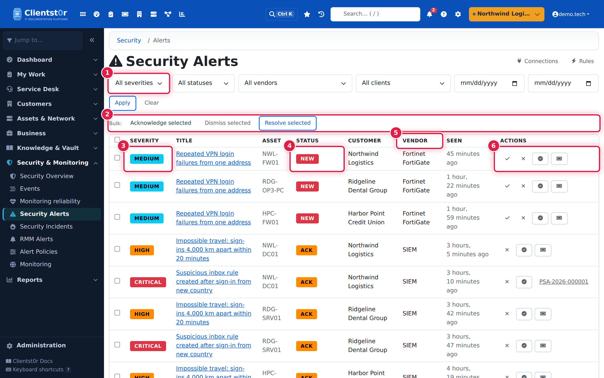

1. Filters: severity, status, vendor, client and a date range. They apply as you change them.
2. Bulk actions for the ticked rows: Acknowledge, Dismiss or Resolve. Only people who may acknowledge alerts see them.
3. Severity: Critical, High, Medium, Low or Info.
4. Status: New, Ack (acknowledged), Dismissed or Resolved.
5. Where the alert came from: the vendor connection, or SIEM for an alert that arrived through a SIEM endpoint.
6. Acknowledge, Dismiss, Resolve and Convert to ticket. A ticket number here means a ticket already exists.
<!-- /guide-figure -->

**Severity** is one of Info, Low, Medium, High or Critical. **Status** is:

| Status | Meaning |
|---|---|
| New | Nobody has looked at it. |
| Acknowledged (shown as Ack) | Someone has taken it. The time and person are recorded. |
| Dismissed | Judged not worth action. |
| Resolved | Dealt with. The time is recorded. |

What the buttons do (they need the **acknowledge** permission, held for that alert's own customer):

- **Acknowledge** (a New alert only) sets Acknowledged with your name and the time. Its time since the alert
  was first seen is the figure the [response-time report](#alert-response-times) uses.
- **Dismiss** and **Resolve** work on a New or Acknowledged alert. They do not set an acknowledge time, so an
  alert you dismiss or resolve without acknowledging counts as *unacknowledged* in the report.
- A Dismissed or Resolved alert stays as it is. A repeat click does not reopen it or change its times.
- The bulk bar applies the same rules to every ticked row and reports how many it changed.
- Dismissing or resolving an alert does **not** change an incident it belongs to, and the other way round.

### One alert

<!-- guide-figure: guide-sec-alert-detail -->
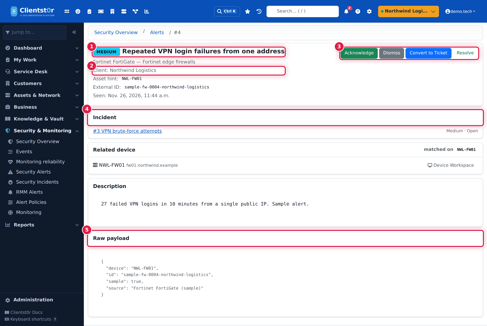

1. The alert's severity and title, as the vendor or SIEM sent them.
2. The customer the alert belongs to.
3. Acknowledge, Dismiss, Convert to Ticket or Resolve.
4. The incident this alert was grouped into. Click it to open the timeline.
5. Everything the source sent, as received. Useful when the title is not enough.
<!-- /guide-figure -->

The page shows the source (vendor and connection, or the SIEM endpoint), customer, the asset hint, the vendor's
external ID, the description and the raw payload. If the asset hint exactly matches a documented asset or RMM
device at that customer, a **Related device** card links to it. The buttons are the same as in the list; an
acknowledged alert offers Dismiss, Convert to Ticket and Resolve.

## From alert to ticket

There are two ways, and both open a Service Desk ticket with the subject `[Security] <alert title>`, the alert's
description, source *monitoring*, and a priority taken from the severity (Critical P1, High P2, Medium P3, Low
P4, Info P5). The ticket is filed under the alert's customer, or under the MSP organization if it has none. The
ticket number then appears on the alert.

- **By hand: Convert to Ticket.** Available while the alert has no ticket. It uses the first active queue and
  acknowledges a New alert for you.
- **Automatically: Auto-Ticket Rules.** See below.

### Auto-Ticket Rules

**Security Alerts → Configure → Auto-Ticket Rules** (`/security/rules/`).

<!-- guide-figure: guide-sec-rules -->
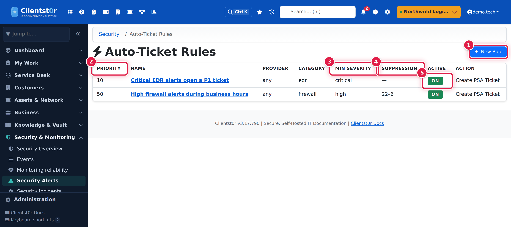

1. Add a rule.
2. Priority: rules are tried lowest number first, and the first match wins.
3. The alert must be at least this severe to match.
4. Hours of the day (UTC) when this rule opens no tickets.
5. On or Off.
<!-- /guide-figure -->

A rule matches on any of: vendor, category (EDR, antivirus, firewall), minimum severity and customer; an empty
field matches everything. Its action is to create a ticket in a chosen queue, with an optional priority and assignee.

- Rules are tried in priority order and **the first match wins**; only one ticket results from one alert.
- **Suppression hours** stop a rule opening tickets between two hours of the day. The hours are compared with
  the clock in UTC, not the MSP's local time.
- An alert that matches an open auto-ticket for the same customer, asset and title in the last 24 hours **joins
  that ticket** instead of opening another.
- One source (connection or SIEM endpoint) opens at most **20 tickets an hour**. Past that, alerts are still
  stored and no tickets are opened; this is written to the audit log once an hour.
- SIEM alerts have no vendor or category, so rules that name a vendor or category never match them.
- Viewing rules needs the view permission; creating and editing needs the **create-rules** permission.

## Incidents

**Security Incidents → Incidents** (`/security/incidents/`). An incident is a case file that groups alerts about
the same thing.

<!-- guide-figure: guide-sec-incidents -->
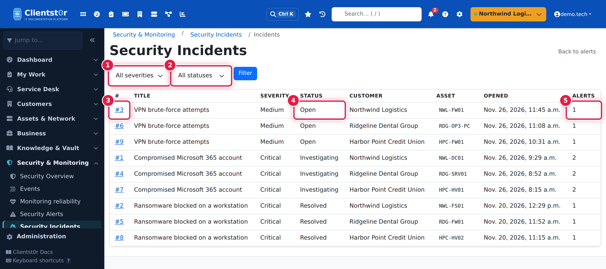

1. Filter by severity.
2. Filter by status: Open, Investigating, Contained, Resolved or Closed.
3. The incident number opens the case file.
4. Where the incident is in its life.
5. How many alerts are grouped into it.
<!-- /guide-figure -->

**How incidents are created.** There is no "new incident" button. Every alert that arrives for the first time is
passed to the correlator:

- If an Open or Investigating incident of the **same customer organization, same asset hint and same
  severity** was opened in the last 60 minutes, the alert is added to it and a timeline entry is written.
- Otherwise a **new incident** is opened from the alert, with its title, description, severity and asset hint.

So every new alert, including Low and Info ones, ends up in an incident. An alert with no asset hint always opens
its own. Alerts of a different severity on the same device do not merge.

### One incident

<!-- guide-figure: guide-sec-incident -->
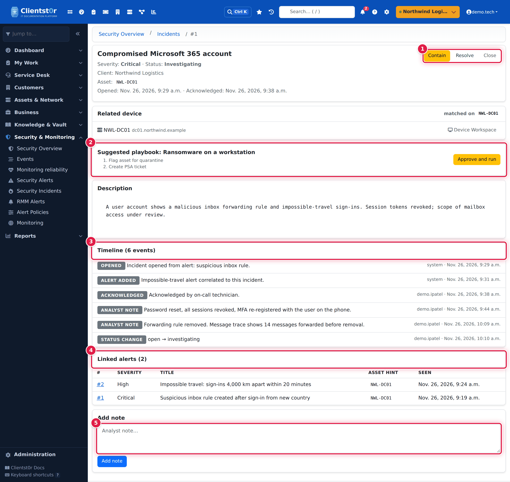

1. Move the incident along: Acknowledge, Contain, Resolve or Close.
2. A playbook whose trigger matches. Approve and run records every step under your name.
3. The timeline: every status change, note, playbook step and SLA breach, with who and when.
4. The alerts grouped into this incident.
5. Add a note to the timeline.
<!-- /guide-figure -->

**Lifecycle.** Open, Investigating, Contained, Resolved, Closed:

| Button | Result |
|---|---|
| Acknowledge (shown only while Open) | Investigating; records the acknowledge time. |
| Contain | Contained; records the contained time. |
| Resolve | Resolved; records the resolved time. |
| Close | Closed; records the closed time. |

Each press writes a timeline entry with your name and an optional note. Once an incident is Resolved or
Closed it shows no status buttons and ignores them; you can still add notes. A resolved incident therefore
stays Resolved: Close is offered only while the incident is still open.

**Roles.** Anyone with the view permission can read an incident. Anyone with the **acknowledge** permission,
in that customer, can change its status, add notes and approve a playbook run. The incident has an *assigned
to* field that the Security Overview counts, but this page has no control to set it and does not show it.

**Timeline.** Opened, Alert added, notes, status changes, Playbook suggested, Playbook action and **SLA
breach** entries, each with who and when.

**SLA targets.** An incident can have acknowledge, contain and resolve targets (in minutes from opening) per
severity, MSP-wide or for one customer. A scheduled check every 15 minutes writes an *SLA breach* entry once per
target when it is missed. The targets are set in the Django admin (**Security incident SLA policies**); there is
no page for them in the application, and without one the check does nothing.

### Incident Playbooks

**Security Incidents → Incident Playbooks** (`/security/playbooks/`). A read-only list.

<!-- guide-figure: guide-sec-playbooks -->
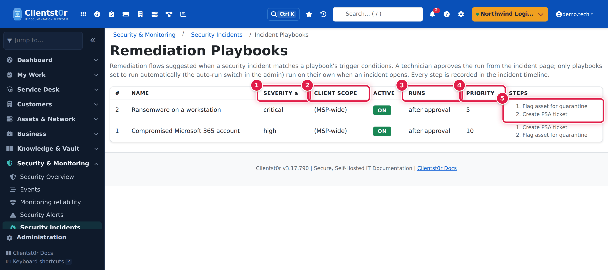

1. Trigger: the incident must be at least this severe.
2. Whether the playbook applies to one customer or to all of them.
3. After approval means a technician must approve the run; automatically means it runs when a matching incident opens.
4. Lower numbers are looked at first; only the first matching playbook is suggested or run.
5. The steps, in order.
<!-- /guide-figure -->

A playbook is an ordered list of steps with a trigger: a minimum severity and, optionally, one customer. The
steps available are:

- **Create PSA ticket**: opens a ticket for the incident (`[Security Incident] <title>`, priority from severity).
- **Send email**: to the address in the step.
- **Flag asset for quarantine**: adds the tag `security-quarantine` to the documented asset whose name or
  hostname equals the incident's asset hint. It marks the asset; it does not isolate anything.
- **Run PSA workflow rule**: does **not** run the rule. It reports "not supported" in the timeline, because
  workflow rules fire on ticket events.

**Approval.** A matching playbook never runs on its own by default. When an incident opens, the lowest-priority-number
matching playbook is only *suggested*: the incident shows a **Suggested playbook** card and a timeline entry
"awaiting approval". A technician with the acknowledge permission presses **Approve and run**; every step is
recorded in the timeline under their name. It runs only on an open incident, only for a playbook of that
incident's own organization, and only if it still matches. One step failing does not stop the next.

The only way to run without approval is a playbook whose **auto-run** switch is on, which runs when a matching
incident opens and is recorded as "automatic run". The list's **Runs** column shows which each playbook is.

Playbooks are created and edited in the Django admin (**Remediation playbooks**, with their steps inline); the
application has no editor for them.

**OPTIONAL AI.** The product contains an incident summary that adds an AI-written note to the timeline, gated
by the AI setting (`psa_ai_enabled`). The incident page does not currently offer a button for it.

## Threat Overview

**Security Incidents → Threat Overview** (`/security/threat-overview/`).

<!-- guide-figure: guide-sec-threat -->
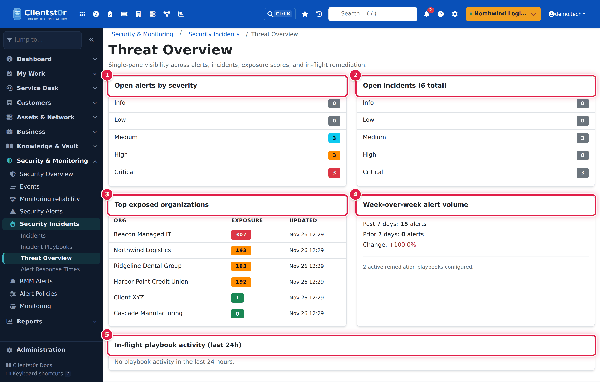

1. Open alerts (New or Acknowledged) by severity, across every customer you may see.
2. Open incidents (Open, Investigating or Contained) by severity.
3. The ten customers with the highest exposure score, refreshed hourly.
4. Alerts in the last 7 days against the 7 days before.
5. Playbook steps recorded in the last 24 hours.
<!-- /guide-figure -->

A read-only dashboard over every customer you may view: open alerts and open incidents counted by severity,
the ten customers with the highest **exposure score**, the alert count of the last 7 days against the 7 before,
and playbook steps recorded in the last 24 hours.

- The exposure score (0 to 1000) is recalculated hourly, so it can lag the numbers beside it. It is a
  severity-weighted sum of a customer's unresolved alerts, plus open vulnerabilities and a small allowance for the
  number of assets.
- The week-over-week change is a percentage; if the earlier week had no alerts and this week has some, it shows +100%.

## Alert Response Times

**Security Incidents → Alert Response Times** (`/reports/security/mtta/`). Mean time to acknowledge.

<!-- guide-figure: guide-sec-mtta -->
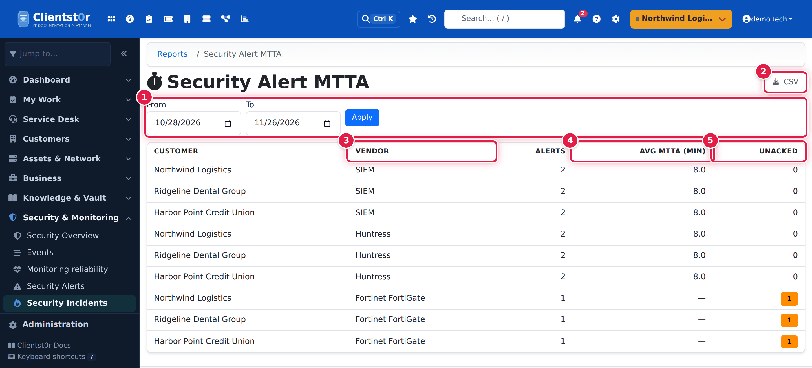

1. Choose the window by the day alerts were first seen. The default is the last 30 days.
2. Download the table as CSV.
3. One row per customer and vendor. Alerts that arrived through a SIEM show as SIEM.
4. Average minutes from first seen to acknowledged.
5. Alerts never acknowledged, including ones dismissed or resolved without being acknowledged.
<!-- /guide-figure -->

- One row per customer and vendor for alerts first seen in the date window (the last 30 days by default), with
  the number of alerts, the average minutes from first seen to acknowledged, and how many were never
  acknowledged. **CSV** downloads the same rows.
- It reads **all customers**, so it needs the SLA reporting permission across the whole MSP, not just for one
  customer.
- An alert dismissed or resolved without being acknowledged has no response time and counts as unacknowledged.
  Alerts with no customer are listed as "(unscoped)".

## Weekly Digest and customer visibility

Customers do not see the alert list, incidents, playbooks or the raw payloads. They learn about alerts in two ways:

- **Tickets.** A ticket made from an alert is an ordinary ticket and follows the usual ticket visibility rules
  (see [TICKETS.md](TICKETS.md)).
- **The weekly digest.** **Security Alerts → Configure → Weekly Digest** (`/security/digest/`).

<!-- guide-figure: guide-sec-digest -->
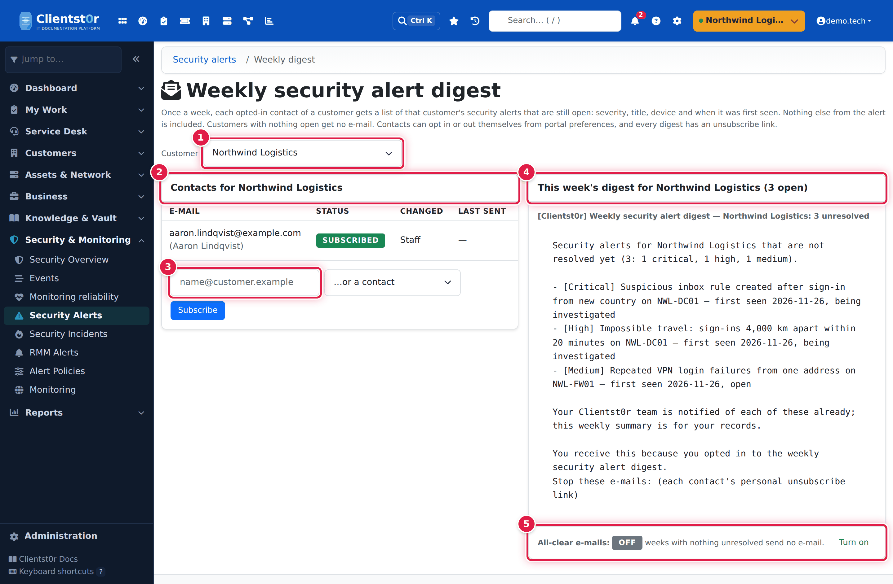

1. Pick the customer.
2. The people at this customer who get the digest, and whether each is subscribed.
3. Add a person by e-mail address, or pick one of the customer's contacts.
4. The digest as it would go out this week: severity, title, device and first-seen time only.
5. All-clear e-mails: off by default; turn on to send a short note in weeks with nothing open.
<!-- /guide-figure -->

Once a week each **opted-in** contact gets an e-mail listing that customer's New and Acknowledged alerts:
severity, title, device, when first seen and whether someone is on it. It never includes the description, the
vendor, the payload, tickets, rules or who acknowledged it. Nothing is sent to a customer with nothing open,
unless you turn on **all-clear e-mails** for that customer. Nobody is subscribed by default.

- Staff add a contact by e-mail or from the customer's contacts, and turn subscriptions on or off (needs the
  manage-connections permission). Contacts can also opt in or out in portal preferences, and every digest has a
  signed unsubscribe link that works without signing in.
- A contact mailed in the last six days is skipped. Each subscription change is written to the audit log.
- The task is scheduled weekly and sends nothing without outgoing e-mail configured.

## Permissions

All of these are staff-only permissions in the role system (see [ROLES_AND_ACCESS.md](ROLES_AND_ACCESS.md)). A
permission held at one customer applies only to that customer's records.

| Permission | What it allows |
|---|---|
| View security alerts | Open the lists, alerts, incidents, playbooks, Threat Overview, connection, rule and SIEM lists, and the digest page. |
| Acknowledge alerts | Acknowledge, dismiss, resolve and convert alerts; change incident status and add notes; approve and run a playbook. |
| Create auto-ticket rules | Create and edit Auto-Ticket Rules. |
| Manage connections | Create and edit vendor connections and SIEM endpoints, issue credentials, manage digest subscriptions. |
| SLA reports (MSP-wide) | Alert Response Times. |

The built-in Security Analyst role has view and acknowledge; Security Administrator adds rules and connections.
Pages under `/security/` are closed to customer users whatever their role holds. The vendor webhook (`/security/webhook/<token>/`), the SIEM webhook
(`/security/siem/webhook/<token>/`) and the digest unsubscribe link are the only parts reachable without signing
in, and each is protected by its own token or signature.

## Limits to know about

- No vendor is polled; everything arrives by webhook.
- Every new alert opens or joins an incident.
- Incidents have no assignee control; SLA policies and playbooks are edited in the Django admin.
- The playbook workflow-rule step runs nothing, and quarantine only tags the asset.
- The alert list shows at most 500 alerts and the incident list 300; use the filters.
