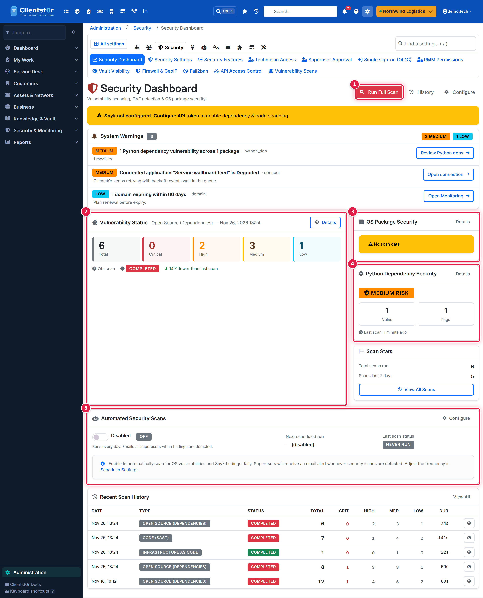
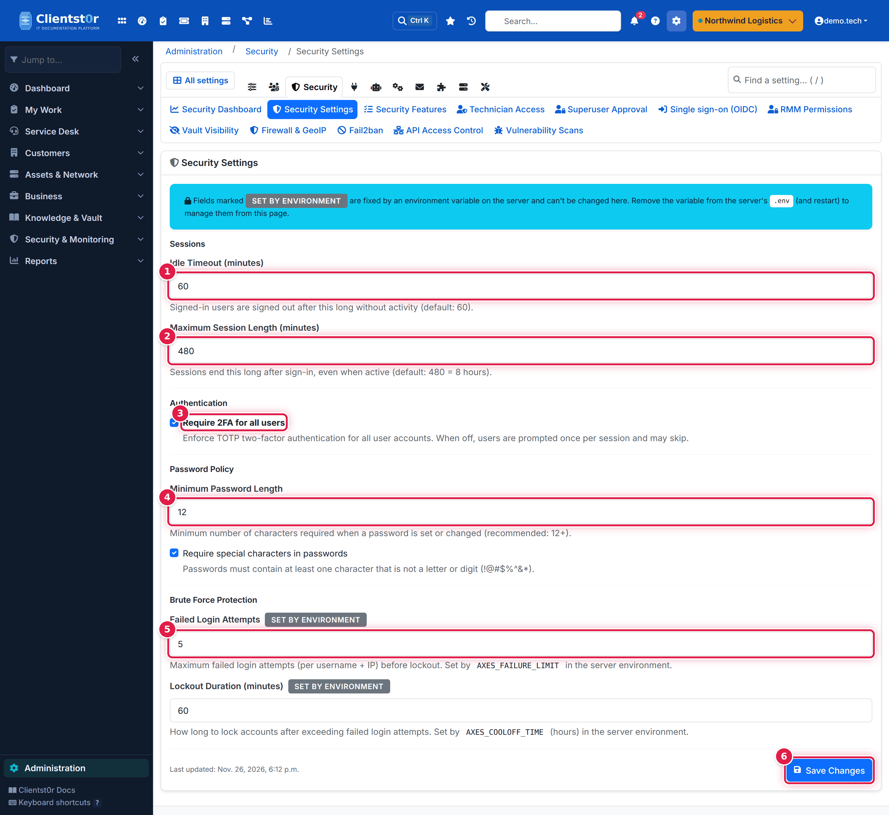
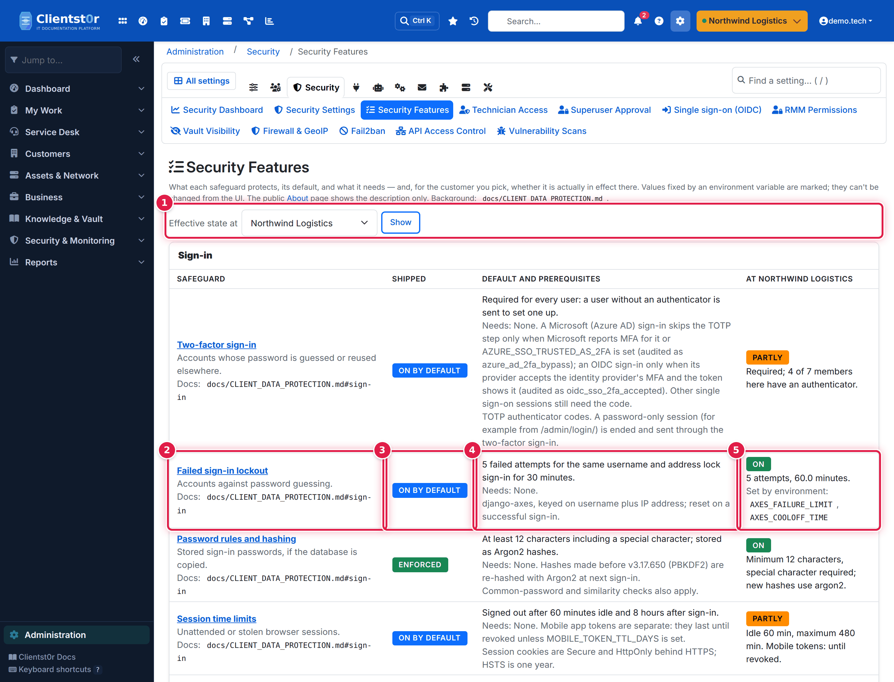
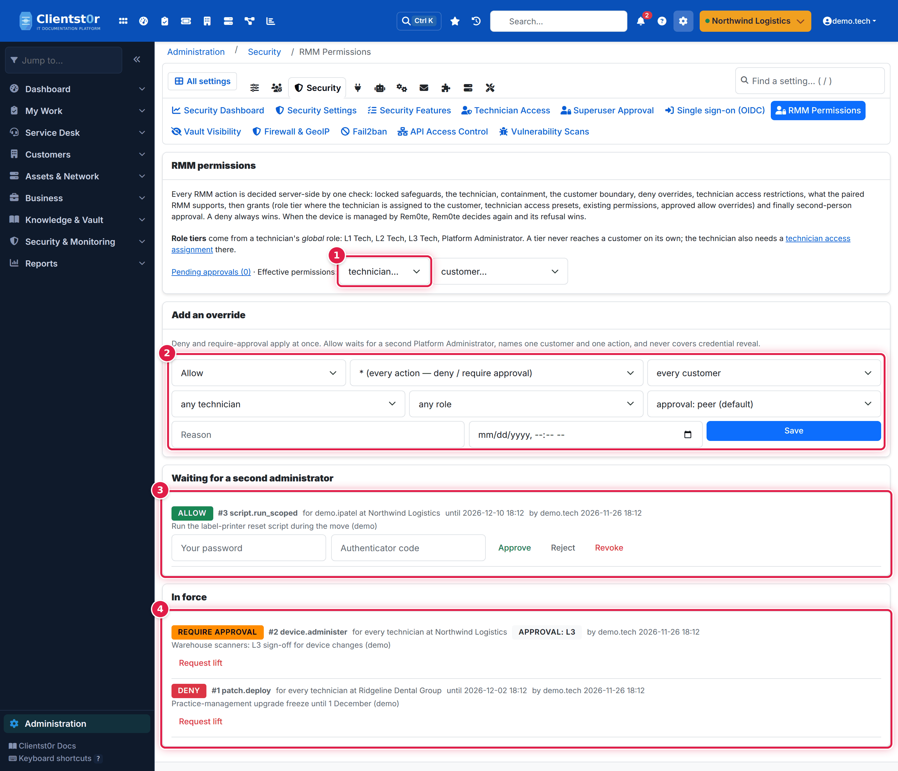
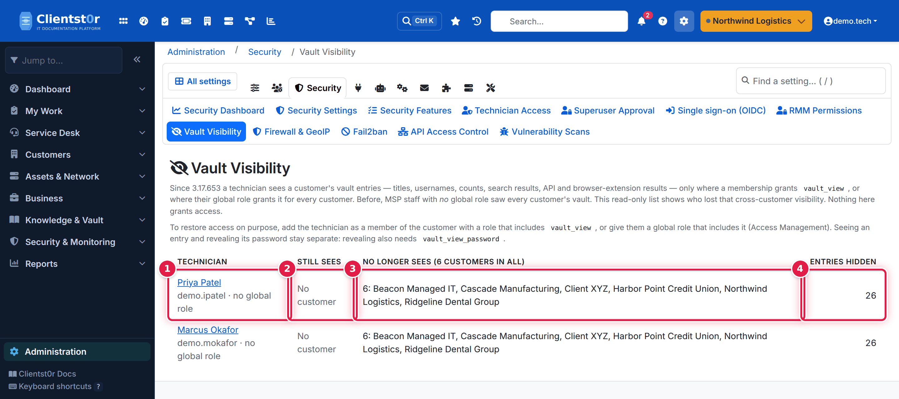
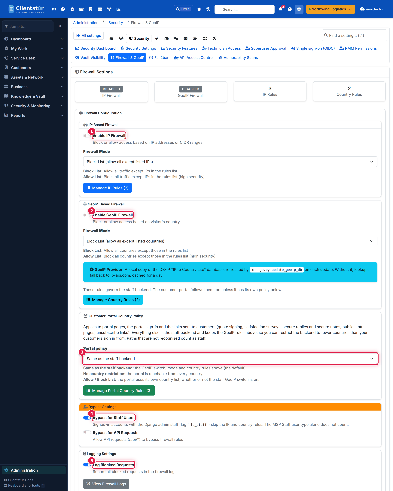
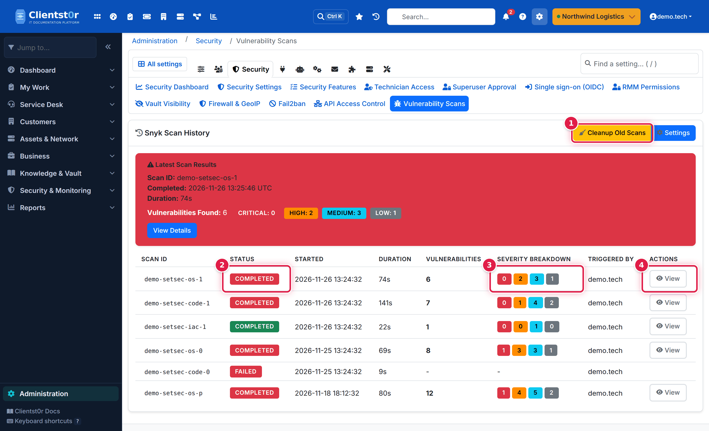

# Security settings

How an administrator sets and checks the install-wide security controls: sign-in and session rules, the
safeguard overview, technician and RMM access, superuser grants, single sign-on, the network firewall,
fail2ban, API network rules and vulnerability scans. Everything here is in **Administration → Security**
(the gear icon in the top bar, then the shield tab). The settings apply to the whole install, not to one
customer. The numbers in each screenshot match the list under it. Every screenshot is a capture of the
application against a demo database; the customers and people in it are invented.

**Who sees it.** Superusers. Two pages are the exceptions: **Single sign-on (OIDC)** is also open to MSP
staff whose global role holds *Manage SSO settings*, and **RMM Permissions** to anyone holding *Manage RMM
policy and roles* or *Review the audit log* in the RMM permission model (superusers hold the first). Anyone
else gets a 403 page or is sent back to sign in.

**Which changes take a second administrator.** Most settings on these pages apply as soon as a superuser
saves them. A *protected change* (proposed by one administrator, confirmed with their password, approved by
a different administrator) is needed only where this guide says so: widening technician access, allow
overrides on RMM permissions and lifting RMM restrictions, turning Superuser Approval off and, while it is
on, granting superuser. See [Technician access → Protected changes](TECHNICIAN_ACCESS.md#protected-changes).
Every form post on these pages is also recorded in the audit log, with password-like fields left out.

## Security Dashboard

**Administration → Security → Security Dashboard** (`/core/security/`). The state of the scanners that
check Clientst0r's own server and code: Snyk (dependencies, code, infrastructure files), the OS package
scanner and the Python dependency scanner, plus the system warnings collected across the install.

<!-- guide-figure: guide-setsec-dashboard -->

1. Run Full Scan: Snyk Open Source, Code and IaC scans (when Snyk is on) plus an OS package scan, in the background.
2. The newest completed Snyk scan: counts by severity and the change from the scan before it.
3. The latest OS package scan. Details opens the package scanner.
4. The latest pip-audit scan of the Python packages Clientst0r runs on.
5. The automated security scan task: off by default, daily once switched on, mails superusers when it finds something.
<!-- /guide-figure -->

- **System Warnings** lists everything the install currently warns about (an overdue off-host backup,
  Python vulnerabilities, a degraded connected application, expiring domains or certificates), worst first,
  each with a button to the page that fixes it.
- **Run Full Scan** starts, in the background, an OS package scan and, when Snyk is switched on and has an
  API token, Snyk Open Source, Code and Infrastructure as Code scans. Progress shows on the page. It does not
  install or upgrade anything.
- **Automated Security Scans** is the *Automated Security Scan* scheduler task. It is **off** by default;
  the switch turns it on or off, and it then runs once a day (change the interval in **Administration →
  Automation → Task Scheduler**). When it finds security updates or Snyk issues it e-mails every superuser.
- When Snyk has no token, a yellow banner says so and links to the Snyk settings. The OS package and Python
  tiles have their own pages, described in [the package scanner guide](PACKAGE_SCANNER.md).
- **Who may use the OS package scanner:** superusers only. Its pages, *Run Scan Now* and the *update
  packages* action refuse every other account, including ones with the Django admin staff flag, and the
  update buttons are shown only to superusers. The Python dependency scanner pages stay open to accounts
  with the staff flag; upgrading a Python package there needs a superuser.

## Security Settings

**Administration → Security → Security Settings** (`/core/settings/security/`). Sign-in and session rules for
every account, staff and customer portal alike.

<!-- guide-figure: guide-setsec-settings -->

1. Idle timeout: signed out after this many minutes without a request (default 60).
2. Maximum session length, counted from sign-in (default 480 minutes).
3. Require 2FA for all users (default on).
4. Minimum password length (default 12). The special-character rule is under it.
5. A field marked Set by environment is fixed by a variable in the server's .env and is read-only here.
6. Save Changes. Applies within about 30 seconds on every worker.
<!-- /guide-figure -->

| Setting | What it enforces | Default | Range |
| --- | --- | --- | --- |
| Idle Timeout | A web session with no request for this long is signed out on its next request. | 60 minutes | 5–1440 |
| Maximum Session Length | A web session ends this long after sign-in, active or not. | 480 minutes (8 hours) | 15–10080 |
| Require 2FA for all users | A user without an authenticator app is sent to set one up and can't skip it. When off, they are asked once per session and may skip. | On | — |
| Minimum Password Length | Checked whenever a password is set or changed. | 12 | 8–128 |
| Require special characters | The password must contain a character that is not a letter or digit. | On | — |
| Failed Login Attempts | Failed sign-ins for the same username *and* address before that pair is locked out. A successful sign-in resets the count. | 5 | 3–20 |
| Lockout Duration | How long the lockout lasts. | 30 minutes | 5–1440 |

- **Who may change it:** superusers. No second administrator is needed. The new values apply within about 30
  seconds on every worker, without a restart. Values outside the range are clamped to it.
- **Set by environment.** When the server's `.env` sets `SESSION_IDLE_TIMEOUT`, `SESSION_COOKIE_AGE`,
  `REQUIRE_2FA`, `PASSWORD_MIN_LENGTH`, `PASSWORD_REQUIRE_SPECIAL`, `AXES_FAILURE_LIMIT` or
  `AXES_COOLOFF_TIME`, that value wins: the field is read-only with a *Set by environment* badge and saving
  the form leaves it alone. Remove the line from `.env` (and restart) to manage it here. The two session
  variables are in seconds and `AXES_COOLOFF_TIME` in hours; the page shows them in minutes.
- **2FA and single sign-on.** A Microsoft sign-in counts as the second factor only when Microsoft reports MFA
  for it (or `AZURE_SSO_TRUSTED_AS_2FA` is set); an OIDC sign-in only when its provider is set to accept the
  identity provider's MFA. Otherwise the user still enters their code. A user who already has an authenticator
  must use it at every sign-in, whatever this switch says.
- **Limits.** The session limits apply to browser sessions. Mobile app tokens last until revoked unless
  `MOBILE_TOKEN_TTL_DAYS` is set. Existing passwords are not re-checked when you raise the minimum length; the
  rule applies at the next change.

## Security Features

**Administration → Security → Security Features** (`/core/security/features/`). A read-only list of every
safeguard: what it protects, how it ships, its default and prerequisites, and whether it is actually in
effect at the customer you pick.

<!-- guide-figure: guide-setsec-features -->

1. The customer whose effective state the last column shows.
2. The safeguard, what it protects and the document that explains it. The title links to where it is set.
3. How it ships: Enforced, On by default, Opt-in or Partial.
4. The default, what it needs, and how it works.
5. Its state at that customer, read from the live settings, with any environment variable that fixes it.
<!-- /guide-figure -->

- The groups are Sign-in, Client access, Vault and secrets, Tickets and AI (OPTIONAL AI), and Audit.
- The last column reads the same settings the code enforces. *Partly* means the safeguard is on but not
  complete there: for example 2FA is required but some members have no authenticator yet. Values fixed by an
  environment variable name the variable.
- Nothing can be changed on this page; a safeguard's title links to the page where it is set. The public
  **About** page shows the same descriptions without the effective state.

## Technician Access

**Administration → Security → Technician Access** (`/settings/security/technician-access/`). Which
technicians may use ticket AI (OPTIONAL AI) and RMM tools at which customers (L1/L2/L3 presets and
assignments), the "why can this technician do this?" explainer, theft-detection thresholds and containment,
and the protected changes waiting for approval. Superusers only. Widening access above the L1 baseline and
changing theft-detection limits are protected changes; narrowing applies at once.

See [Technician access](TECHNICIAN_ACCESS.md) for the full guide.

## Superuser Approval

**Administration → Security → Superuser Approval** (`/settings/security/technician-access/superusers/`). An
optional policy: when it is on, making an account a superuser (on the user page or in Django admin) only
records a request, and the account becomes a superuser when a different administrator approves it.

- **Default:** off. Turning it on needs two eligible administrators (active superusers who approve protected
  changes) and applies at once. Turning it off is itself a protected change.
- Approving needs your password (and authenticator code) within the last five minutes. Nobody can approve
  their own request or a grant to themselves.
- Superusers created on the server (`manage.py createsuperuser`, the Django shell) are outside the
  application: they are recorded and announced, not blocked.

See [How Clientst0r protects client data → Granting superuser](CLIENT_DATA_PROTECTION.md#granting-superuser).

## Single sign-on (OIDC)

**Administration → Security → Single sign-on (OIDC)** (`/accounts/sso/oidc/settings/`). Sign-in through an
OpenID Connect identity provider: providers, how accounts are matched, role and membership rules, and
whether the provider's MFA replaces Clientst0r's 2FA. Open to superusers and to MSP staff whose global role
holds *Manage SSO settings*.

See [Single sign-on with OpenID Connect](OIDC_SSO.md). Microsoft sign-in is configured separately; see
[Azure AD SSO setup](AZURE_SSO_SETUP.md).

## RMM Permissions

**Administration → Security → RMM Permissions** (`/settings/security/rmm-permissions/`). The one check every
RMM action goes through (viewing devices, running diagnostics, deploying patches, requesting remote control
and so on), and the overrides that tighten or widen it per customer, technician or role.

<!-- guide-figure: guide-setsec-rmm -->

1. Effective permissions for one technician, or every technician at one customer, with the reason for each answer.
2. Add an override: allow, deny or require approval, for one action or all, a customer, a technician or a role.
3. An allow override waits here until a different administrator approves it with their password.
4. Deny and require-approval overrides apply at once. Lifting one needs a second administrator.
<!-- /guide-figure -->

How a decision is made, in order; the first block wins and a deny always beats an allow:

1. Locked safeguards are never available: an unrestricted shell or free-form scripts, device access at every
   customer at once, approving your own request, and approving endpoint work (only the paired RMM does that).
2. Only active MSP technicians qualify; customer portal users never do. A technician under theft-detection
   containment is refused.
3. The device, ticket and connection must belong to the customer.
4. A live **deny** override, then technician-access denies and restrictions, then what the paired RMM can do.
5. A grant: the technician's role tier (*L1 Tech*, *L2 Tech*, *L3 Tech* or *Platform Administrator* as their
   global role) where they also have a technician-access assignment at that customer; a technician-access
   preset; the permissions these actions always used; or an approved **allow** override.
6. Second-person approval: the level the grant needs, raised by any **require approval** override.
   High-impact actions (patching, scoped scripts, device administration, deploying automation) always need at
   least a peer.

Overrides:

- **Deny** and **Require approval** apply as soon as they are saved, for one action or every action (`*`),
  at one customer or every customer, and for one technician, one role or everyone. They can carry an expiry.
- **Allow** names one action and one customer, never covers revealing a credential, and waits under
  *Waiting for a second administrator* until a different administrator (not the person it grants to, and not
  someone holding the role it widens) approves it with their password.
- Ending an allow applies at once. **Request lift** on a deny or require-approval override leaves it in force
  until a second administrator confirms the lift.
- The two pickers open the effective permissions of one technician at one of their customers, or every
  technician at one customer, each answer with the chain that decided it. **Pending approvals** lists the
  second-person approvals technicians have asked for; any technician can open it, and the approval itself
  checks that the approver qualifies.
- **Who may change it:** holders of *Manage RMM policy and roles* (superusers, and the Platform Administrator
  tier). Holders of *Review the audit log* can read the page. Every step is in the audit log.
- When the device is managed by Rem0te, Rem0te makes its own decision afterwards and its refusal wins.

## Vault Visibility

**Administration → Security → Vault Visibility** (`/core/security/vault-visibility/`). A read-only report of
MSP staff who lost cross-customer vault visibility in 3.17.653, when vault listings became limited to the
customers a membership grants *view vault* in.

<!-- guide-figure: guide-setsec-vault -->

1. An MSP staff user with no global role.
2. Customers whose vault they still see, through a membership that grants view vault.
3. Customers whose vault they saw before 3.17.653 and no longer see.
4. How many shared vault entries that hides from them.
<!-- /guide-figure -->

- It lists active, non-superuser staff with no global role who cannot see at least one active customer's
  vault. Nothing on the page grants or removes access.
- To give a technician a customer's vault on purpose, add them as a member of that customer with a role that
  includes *view vault*, or give them a global role that includes it. Revealing a password also needs
  *view vault password*. See [Roles and access](ROLES_AND_ACCESS.md).

## Firewall & GeoIP

**Administration → Security → Firewall & GeoIP** (`/core/settings/firewall/`). Address and country rules
that Clientst0r itself applies to web requests, before they reach any page. This is not the server's
operating-system firewall, and saving here never changes it.

<!-- guide-figure: guide-setsec-firewall -->

1. The IP firewall and its mode: block list or allow list. Off by default.
2. The country (GeoIP) firewall and its mode. Off by default.
3. The customer portal's country policy: the same as staff (default), none, or its own list.
4. Accounts with the Django admin staff flag skip both firewalls (default on). API requests can be let through too.
5. Record every blocked request in the firewall log (default on).
<!-- /guide-figure -->

| Setting | What it does | Default |
| --- | --- | --- |
| Enable IP Firewall | Checks the caller's address against the IP rules. | Off |
| IP firewall mode | *Block list*: refuse listed addresses. *Allow list*: refuse everything not listed. | Block list |
| Enable GeoIP Firewall | Checks the caller's country against the staff country rules. | Off |
| GeoIP firewall mode | *Block list* or *Allow list*, as above, by country. | Block list |
| Portal policy | Country policy for the customer portal, its sign-in and the links sent to customers (quote signing, surveys, secure replies and notes, status pages, unsubscribe): the same as staff, no country restriction, or its own allow or block list (which applies even when the staff GeoIP switch is off). | Same as the staff backend |
| Bypass for Staff Users | Signed-in accounts with the Django admin staff flag (`is_staff`, the *User can access Django admin site* box on the user form) skip both checks. The MSP *Staff* user type alone does not count. | On |
| Bypass for API Requests | Requests to `/api/...` skip both checks. API network rules have their own page, [API Access Control](#api-access-control). | Off |
| Log Blocked Requests | Records each refusal (address, country, reason, path, surface) in the firewall log. | On |

- **Who may change it:** superusers. Changes apply on the next request; there is no second-administrator step.
- **IP rules** (*Manage IP Rules*) take a single IPv4 or IPv6 address or a CIDR range (for example
  `203.0.113.50`, `192.168.1.0/24`, `2001:db8::/32`) and can be switched off without deleting them. Anything
  else is refused with an error under the field. A range with host bits set is saved as its network
  (`10.0.0.5/24` becomes `10.0.0.0/24`). Rules saved before this check that are not an address or range are
  kept, marked *Invalid — never matches* in the list; they match nothing, which in allow-list mode lets nobody
  in through them, so delete them and add the address again.
- **Audit:** adding, switching on or off and deleting an IP or country rule, saving the firewall settings
  (with the switches that changed), and clearing the firewall log each write their own audit entry.
- **Country rules** (*Manage Country Rules* and *Manage Portal Country Rules*) are picked on a world map or
  added by two-letter code. Whether a country with a rule is blocked or allowed depends on the mode.
- **Always let through:** requests from private, loopback and link-local addresses when they really come
  from the local network (not forwarded by an unlisted proxy), and Stripe and GoCardless payment webhooks,
  which skip the country check and an IP allow list (an IP block list still applies; the webhook is checked
  by its signature).
- **Sign-in stays reachable through the IP rules** (`/account/login/` and sign-out), so an administrator
  whose address changed can still sign in; with *Bypass for Staff Users* on and the staff flag on their
  account they can then fix the list. The country check covers the sign-in page too.
- **Country lookups** read a local copy of the DB-IP "IP to Country Lite" database, refreshed by
  `manage.py update_geoip_db` during each update. Without the file the lookup asks ip-api.com and caches each
  answer for a day. In allow-list mode an address whose country can't be found is refused.
- The client address comes from the reverse proxy's forwarding headers only when the proxy is listed as
  trusted; see [API access control → Client address and reverse proxies](API_ACCESS_CONTROL.md#client-address-and-reverse-proxies).
- **Firewall logs** (*View Firewall Logs*, `/core/settings/firewall/logs/`) show the refusals, 50 per page,
  with the most-blocked addresses and countries. *Clear* deletes the whole log.
- The demo above has rules but both switches off, which is why the counters read *Disabled*.

## Fail2ban

**Administration → Security → Fail2ban** (`/core/settings/fail2ban/`). The state of fail2ban on the server
Clientst0r runs on: whether it is installed and running, each jail with its current and total bans and the
banned addresses. There is no screenshot: the page reads the real host's fail2ban.

- **Unban** removes one address from one jail; **Unban all** empties a jail. **Start** starts the service.
  **Install** installs and enables fail2ban.
- Everything runs through the Clientst0r root helper, which allows only these actions and checks the jail
  name and address. If the helper is not installed, the page asks for the one-time setup (**Administration →
  System → Updates**, or a sudo password on this page for the install). Without the helper, an older
  passwordless sudo rule for `fail2ban-client` is used if present.
- **Who may change it:** superusers. No second administrator. Each unban, *Unban all*, start and install
  writes its own audit entry (jail, address, and whether it worked).
- **Addresses.** Unban and the *check an address* box take IPv4 and IPv6 addresses. The address is checked
  before it reaches the root helper, and the check compares whole addresses, so `1.2.3.4` does not match a ban
  on `11.2.3.45`.
- **Limits.** Bans are made by fail2ban itself; this page does not add them. Jails and their settings are not
  edited here; configure them in `/etc/fail2ban` on the server.

## API Access Control

**Administration → Security → API Access Control** (`/settings/security/api-access/`). Network rules for the REST API, the
mobile API and incoming webhooks: allow and deny lists by address or range, the global mode per surface,
trusted reverse proxies, per-address limits, a test tool and a decision log. Superusers only. Web pages are
not affected; those use [Firewall & GeoIP](#firewall--geoip).

See [API access control](API_ACCESS_CONTROL.md) for the full guide, including lockout recovery.

## Vulnerability Scans

**Administration → Security → Vulnerability Scans** (`/core/settings/snyk/scans/`). The history of Snyk scans
of Clientst0r's own code and dependencies. **Settings** on this page opens the Snyk configuration
(`/core/settings/snyk/`).

<!-- guide-figure: guide-setsec-scans -->

1. Delete scans older than 30 days, and all but the newest 30.
2. Status. A completed scan is red when it found critical or high issues.
3. Critical, high, medium and low counts.
4. View opens the scan's findings and fix suggestions.
<!-- /guide-figure -->

- The table shows the latest 50 scans with status, duration, totals and the critical / high / medium / low
  breakdown. **View** opens a scan's findings and the suggested upgrades; *Apply* and *Fix all* there upgrade
  the vulnerable packages on the server, so use them deliberately.
- **Cleanup Old Scans** deletes scans older than 30 days and keeps at most the newest 30.

Snyk settings (all superuser-only, no second administrator):

| Setting | What it does | Default |
| --- | --- | --- |
| Enable Snyk | Without it (and an API token) no Snyk scan runs, manual or automatic. | Off |
| API token | Your Snyk token, kept encrypted; left blank when saving, the stored one is kept. | Empty |
| Organization ID | Passed to the Snyk CLI when set. | Empty |
| Severity Threshold | Only issues at or above this severity are reported. | High |
| Snyk Products | Which scans the *Run Scan Now* menu offers: Open Source, Code, Container, Infrastructure as Code. | Open Source only |
| Scan Frequency | Saved, but not used: see below. | Daily |

- **Scan Frequency is not used yet.** Automatic scans follow the *Automated Security Scan* task (see
  [Security Dashboard](#security-dashboard)). The product checkboxes only shape the *Run Scan Now* menu: Run
  Full Scan and the automated scan always run Open Source, Code and Infrastructure as Code.
- The Snyk CLI must be installed on the server. The page shows its version and can upgrade it or install
  Node.js; those buttons change the server, so use them deliberately.

## Known limits

- Firewall, fail2ban and Security Settings changes apply at once on one superuser's say-so; only the changes
  listed at the top of this guide need a second administrator.
- *Bypass for Staff Users* goes by Django's staff flag (`is_staff`), which is separate from the MSP *Staff*
  user type. Check who has it on the user form.
- *Scan Frequency* on the Snyk settings is saved but not read.
