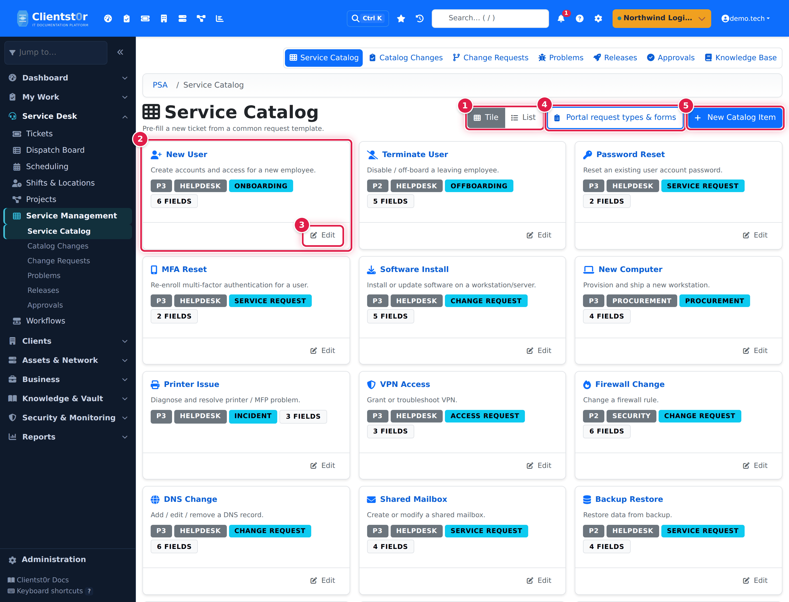
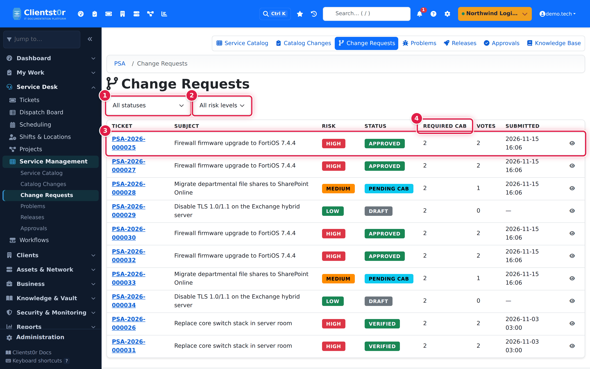

# Service management: catalog, changes, problems and releases

The Service Management pages (**Service Desk → Service Management**) hold the formal side of the service desk: the
service catalog that pre-fills tickets, approval of catalog edits, change requests with a change advisory board
(CAB), problem records for recurring incidents, release windows that bundle changes, and the approvals queue. The
section appears while the native service desk (`psa_enabled`) is on; each tab then needs its own permission, as
described below. The numbers in each screenshot match the list under it. Every screenshot is a capture of the
application against a demo database; the customers and people in it are invented.

| Tab | What it is for | Who sees it |
|---|---|---|
| Service Catalog | Common requests that open a pre-filled ticket | Everyone who can open the Service Desk; editing is MSP staff only |
| Catalog Changes | Proposed edits to governed catalog items, waiting for approval | MSP staff with *Propose edits to a service catalog item* or *Approve / reject service catalog change proposals* |
| Change Requests | Changes that need CAB approval before work starts | *View change requests* |
| Problems | The cause behind recurring incidents | *View problems* |
| Releases | Release windows that bundle several changes | *View release windows* |
| Approvals | Sign-offs waiting on someone (expenses, quotes, time, actions) | MSP staff |
| Knowledge Base | The global knowledge base (its home is Knowledge & Vault) | MSP staff |

The permissions are set on roles; see [Roles and access](ROLES_AND_ACCESS.md).

## Service Catalog

<!-- guide-figure: guide-service-catalog -->

1. Show the catalog as tiles or as a table. The page remembers your choice.
2. A catalog item. Click it to open a new ticket already filled in from this item; the badges show its default priority, queue and type.
3. Edit the item (MSP staff only).
4. Portal request types and forms: what customers can request in the portal.
5. Add a catalog item.
<!-- /guide-figure -->

The catalog lists the requests your team handles over and over: new user, password reset, VPN access, firewall
change and so on. Clicking an item opens **New Ticket** already filled in from it: subject and description
templates, default queue, priority and ticket type, and the item's extra fields (the badge counts them). Values
typed into those fields are put into the subject and description where the template has a `{{key}}` placeholder.

- **Tile or List.** The list view adds the default queue, priority and status (Active or Inactive) per item.
- **Who sees what.** Everyone sees the active items. MSP staff and superusers also see disabled items (faded,
  marked *disabled*) and get **Edit** and **New Catalog Item**. Archived items are not listed.
- **Editing an item** sets its name, description, icon, templates, defaults, sort order, fields, and whether it is
  offered to customers in the portal. **Portal request types & forms** opens the list of what customers can
  request in the portal.
- **Change governance.** Ticking *requires approval* on an item puts later edits through **Catalog Changes**: a
  member of staff without *Approve / reject service catalog change proposals* who clicks **Edit** gets the
  proposal form instead, and nothing changes until someone approves it.

## Catalog Changes

The queue of proposed edits to governed catalog items. It opens on **Pending Approval**; the Status filter also
shows approved, rejected, cancelled or all proposals, with who proposed each one, when, and who decided.

- **Review** (for approvers) shows each changed field before and after, with the proposer's reason. Approve
  applies the change to the live item at once and records you as its publisher; Reject keeps the item as it was.
  Either can carry a note.
- You cannot approve a change you proposed yourself, unless you are a superuser.
- People who can only propose see **View** instead of Review.
- A proposal that changes nothing is not stored.

## Change Requests

<!-- guide-figure: guide-change-requests -->

1. Filter by where the change is: draft, pending CAB approval, approved, implementing, verified and so on.
2. Filter by risk: low, medium, high or emergency.
3. One change. The number opens its change record; the ticket itself is a normal ticket of type Change.
4. Required CAB: how many approvers the change needs. Votes: how many have voted so far.
<!-- /guide-figure -->

A change request is a ticket of type **Change**. Creating such a ticket creates its change record (a draft)
automatically, and the ticket page shows a banner with **Open Change Record**. The list shows the latest 200
changes across all customers you can reach, newest first, filtered by status and risk.

<!-- guide-figure: guide-change-request -->
.")

1. The change's risk and where it stands.
2. Implementation plan, rollback plan and impact assessment.
3. The planned window and, once work starts, the actual start and end.
4. Each required approver and their vote. All must approve, and none reject, before work can begin.
5. The next step: submit to CAB, begin implementation, or record the outcome.
<!-- /guide-figure -->

### From draft to done

1. **Draft.** With *Submit a change request for CAB review*, use **Edit** to fill in the risk (low, medium, high,
   emergency), the implementation plan, rollback plan, impact assessment, backout window, the scheduled start and
   end, and the **required approvers**. A change can be edited while it is a draft or after it was rejected.
2. **Submit to CAB.** Needs an implementation plan; high and emergency changes also need a rollback plan.
3. **CAB vote.** Only the required approvers can vote, and they also need *Sit on the CAB and vote on changes*.
   Each votes Approve, Reject or Abstain, with an optional note. One rejection rejects the change. When every
   required approver has approved, it becomes **Approved — ready to implement**. Add at least one required
   approver, otherwise nobody can vote.
4. **Begin Implementation** (needs *Move an approved change into Implementing*) records the actual start and puts
   the ticket in progress. It is refused until the CAB has approved.
5. **Verify (Successful)** records the outcome and closes the ticket. The ticket's closeout rules apply as they do
   for the Close button; if one fails, nothing changes. The outcome becomes the ticket's resolution unless it has
   one. **Mark Failed (Rolled Back)** records the outcome and leaves the ticket open.

Every step is written to the audit log. A change can also be linked from a problem (as the change that deployed
the permanent fix) and bundled into a release.

## Problems

<!-- guide-figure: guide-problem -->
.")

1. Symptoms, root cause, workaround and permanent fix.
2. The incidents that share this cause. Link another by its ticket number.
3. What was learned and when. Mark a note as a breakthrough to make it stand out.
4. Move the problem on. Known error needs a root cause and workaround; resolved needs a root cause and permanent fix.
<!-- /guide-figure -->

A problem record (numbered `PRB-year-number`) collects the incidents that share one underlying cause, so the cause
is fixed once. The list puts open problems first (investigating, then known error), then by priority, and filters
by status, priority and assignee (me, unassigned, or a person).

- **New Problem** and **Edit** need *Create problems*: customer, title, description, priority, symptoms, root
  cause, workaround, permanent fix, the five whys, a duplicate-of link and the change that deployed the fix.
  Assigning an owner needs *Assign problems to investigators / reassign owners*.
- **Related tickets.** Link a ticket by its number; unlink with the icon on its row.
- **Investigation notes** build a timeline. Tick *Mark as breakthrough finding* to highlight a note.
- **Status pipeline** (needs *Move a problem to resolved / closed*): Investigating → Known Error → Resolved →
  Closed, or Duplicate. **Known Error** needs a root cause and a workaround; **Resolved** needs a root cause and a
  permanent fix. The buttons stay disabled until those fields are filled in.

## Releases

A release window (numbered `REL-year-number`) bundles several change requests of one customer into one
deployment. The list shows each release's status (Planned, Frozen, Completed, Rolled Back, Cancelled), schedule,
number of changes and release manager.

- **New Release** and editing need *Create / edit release windows and bundle changes*: customer, title,
  description, scheduled start and end, rollback plan and release manager.
- **Bundle changes** on the release page. Only that customer's changes can be added, and a change cannot sit in
  two planned or frozen releases at once.
- **Freeze (Begin)** needs at least one change and a rollback plan. A frozen release takes no new changes and can
  no longer be edited.
- **Mark Completed** or **Roll Back** (the latter asks for a reason) end the release. Freeze, complete and roll
  back need *Flip a release to frozen / completed / rolled back*.

## Approvals

The approvals waiting on your team for the customer in the client switcher (all customers in Global View):
expenses, quotes, time entries, distributor orders, change or scope approvals and AI actions. Switch between
Pending, Approved, Denied and Cancelled.

- **Approve** or **Deny** on a pending row. You cannot approve a request you made yourself, unless you are a
  superuser.
- **Awaiting customer** marks a customer sign-off. The customer decides it in the portal; staff cannot decide it
  for them.
- **AI actions** (OPTIONAL AI, only when AI features are on) also need the AI approval permission for that
  customer.

These pages are for MSP staff only. Customer users see their own approvals in the portal.

## Knowledge Base

This tab opens the global knowledge base, whose home is **Knowledge & Vault → Knowledge Base**. It lists the
global articles by category, with search over titles and text. MSP staff only. People who edit the knowledge base
also see drafts and articles waiting for review, and can add articles, manage categories, move articles between
categories and choose which customers may see them, as their permissions allow.

## Related guides

- [Workflows: runbooks and rule templates](WORKFLOWS.md)
- [Support workflows](SUPPORT_WORKFLOWS.md)
- [Ticket routing](TICKET_ROUTING.md)
- [Getting started: working a ticket](GETTING_STARTED.md#working-a-ticket)
