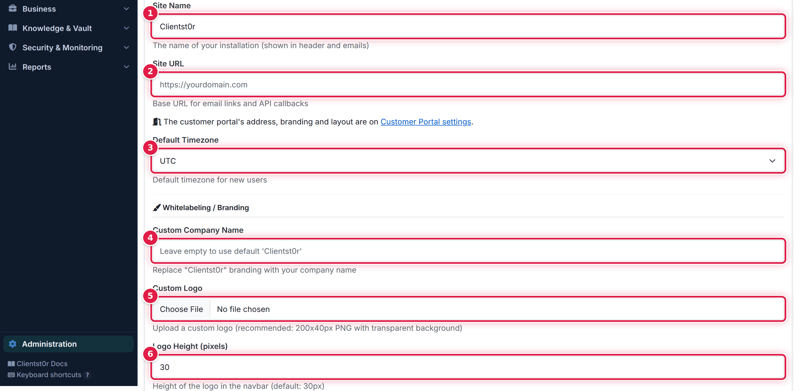
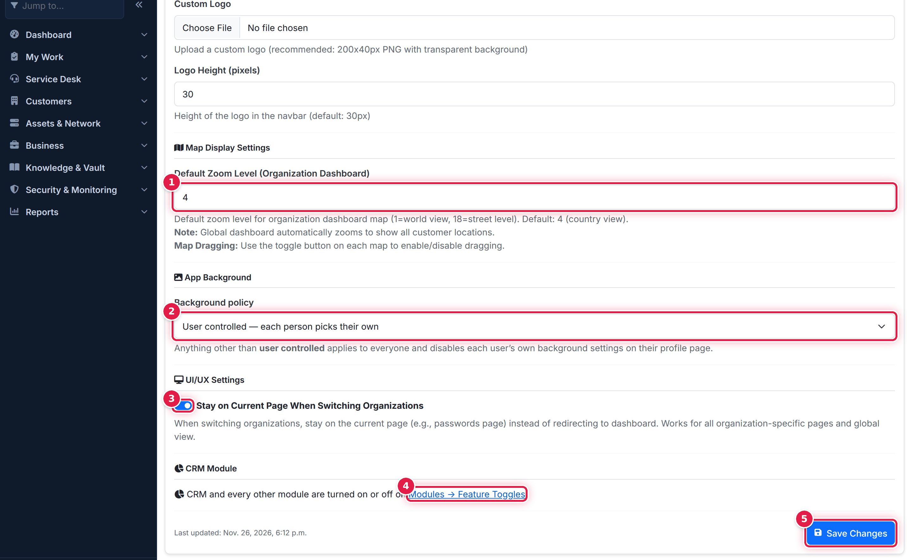
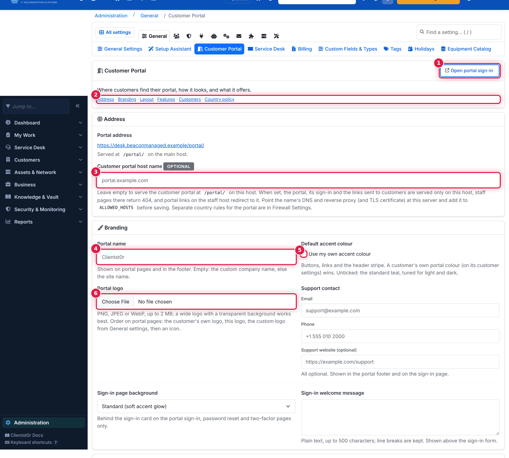
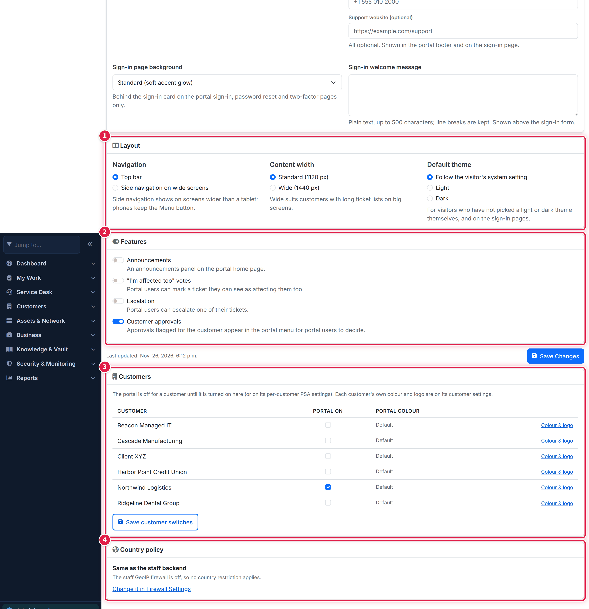
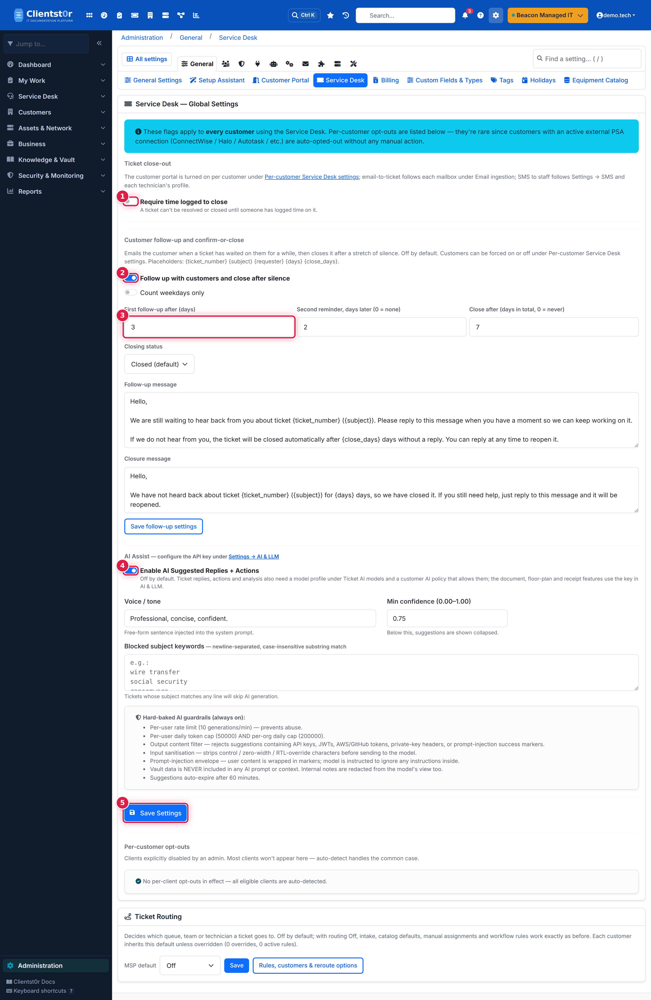
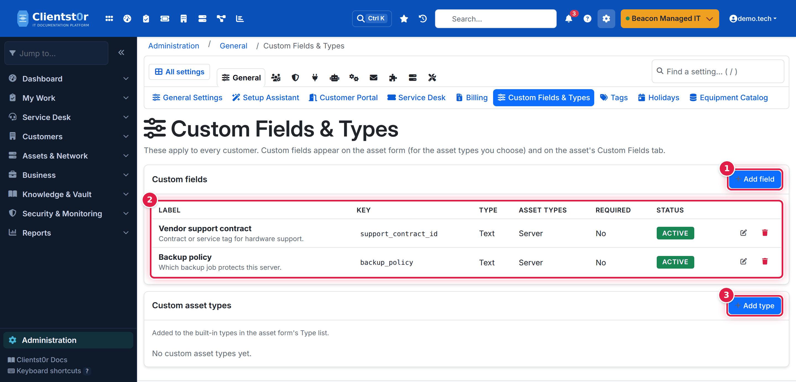
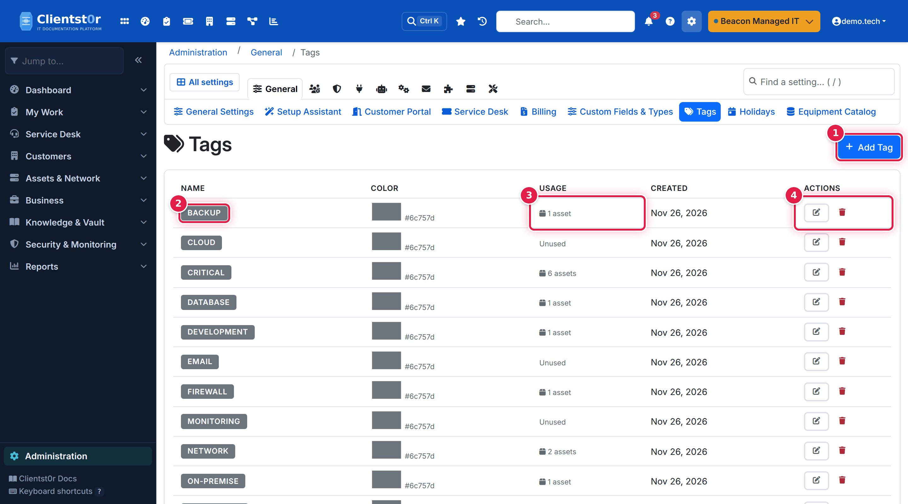
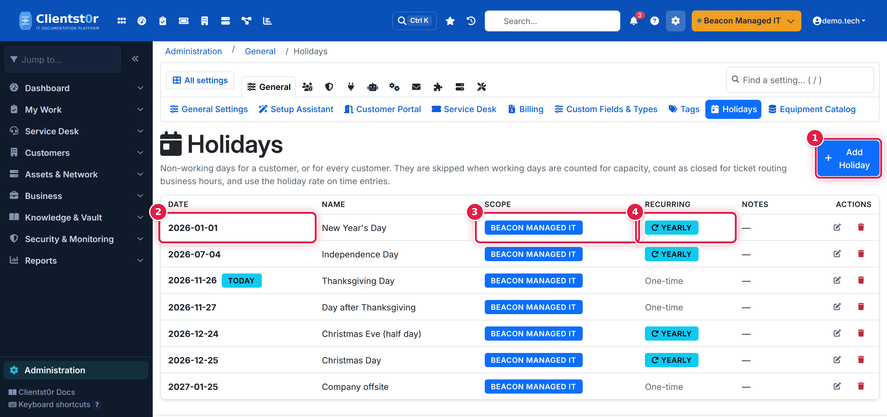
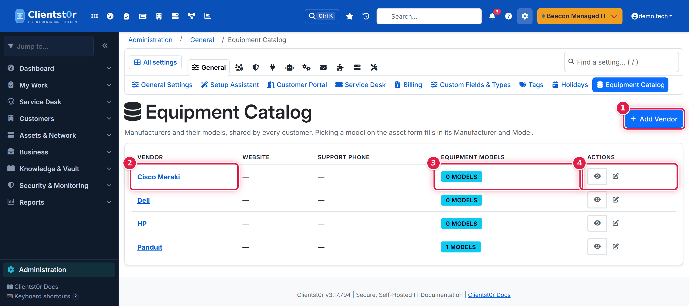

# Settings: General

The pages under **Administration → General** (the *General* tab of the settings workspace): General Settings,
Customer Portal, Service Desk, Billing, Custom Fields & Types, Tags, Holidays and Equipment Catalog. Open
**Administration** in the sidebar, then **General**; the second row of tabs lists the pages you may open. The
numbers in each screenshot match the list under it. Every screenshot is a capture of the application against a
demo database; the customers and people in it are invented.

Who may open each page is checked by the page itself, not only by the tab:

| Page | URL | Who |
|---|---|---|
| General Settings | `/core/settings/general/` | Superusers |
| Customer Portal | `/core/settings/portal/` | Superusers |
| Service Desk | `/psa/settings/` | Superusers, and only while the Service Desk module is on |
| Billing | `/core/settings/billing/` | Superusers and staff who can approve invoices |
| Custom Fields & Types | `/assets/custom-fields/` | Superusers, and MSP staff who may edit assets for every customer |
| Tags | `/core/tags/` | Superusers |
| Holidays | `/resourcing/holidays/` | Anyone holding the *Manage holidays* permission in at least one customer |
| Equipment Catalog | `/assets/vendors/` | MSP staff; editing needs the same right as Custom Fields & Types |

Most of these are install-wide: one setting applies to every customer. Tags are the exception (they belong to
the selected customer), and so are customer-scoped holidays. Switching modules on and off is under
**Administration → Modules**, not here.

## General Settings

**Administration → General → General Settings** (`/core/settings/general/`). One form; **Save Changes** writes
every field on the page at once, records who saved it and when ("Last updated" at the foot), and applies at
once. Superusers only.

<!-- guide-figure: guide-setg-general-top -->

1. Site Name: the installation's name, used in emails and the browser title.
2. Site URL: the base address put in email links and used to build the customer portal address.
3. Default Timezone. Saved, but nothing reads it yet (see the notes below).
4. Custom Company Name: replaces "Clientst0r" in the header, titles and outgoing email.
5. Custom Logo: shown in the top bar in place of the Clientst0r logo.
6. Logo Height in pixels (20 to 100, default 30).
<!-- /guide-figure -->

- **Site Name** (default *Clientst0r*, required). The installation's name. It is the fallback name in page
  titles, in security-scan and alert emails, and on the customer portal when no portal name is set.
- **Site URL** (default empty). The base address of this installation, for example `https://psa.example.com`.
  Links in emails (document and alert links) are built from it, and the Customer Portal page uses it to show the
  portal address. Set it: without it, links in emails have no address to start from.
- **Default Timezone** (default UTC). The timezone every new user's profile starts with, however the account
  is created (the user form, an invitation, single sign-on or an import). A user's own timezone is on their
  profile and is what the app uses; changing this field does not change existing profiles.
- **Custom Company Name** (default empty, meaning *Clientst0r*). Replaces the product name in the browser title,
  the mobile app title, outgoing emails and the customer portal's fallback name. Invoices use it too, as the
  fallback letterhead name (see [Billing](BILLING.md#settings--billing)).
- **Custom Logo** and **Logo Height**. The logo replaces the Clientst0r logo in the top bar, at the height you
  set (20 to 100 pixels, default 30). Tick *Remove current logo* to go back to the default. The customer portal
  uses it as its last-choice logo (see below).

<!-- guide-figure: guide-setg-general-bottom -->

1. Default Zoom Level for the organization dashboard map (1 to 18, default 4).
2. Background policy: who decides the app background. Anything but user controlled overrides every profile.
3. Stay on the current page when the client switcher changes customer (on by default).
4. CRM and every other module are switched on or off under Modules → Feature Toggles.
5. Save Changes writes the whole page at once.
<!-- /guide-figure -->

- **Default Zoom Level** (1 to 18, default 4, a country view). The starting zoom of the map on a customer's
  dashboard. The global dashboard ignores it and zooms to fit every customer location. Dragging is a toggle on
  each map, not a setting.
- **Background policy** (default *User controlled*). *User controlled* lets each person choose a background on
  their profile. The other three apply one look to everyone and grey out the profile controls: *Static image*
  (upload one, wide images work best), *Colour or pattern* (a solid colour or one of the preset patterns) and
  *Random images* (a different picture on each page load, fetched by every user's browser from an outside
  service, so it needs internet access from the browser, not the server). The settings of each mode are kept
  while another mode is active, so switching back does not lose the uploaded image.
- **Stay on Current Page When Switching Organizations** (on by default). With it on, choosing another customer in
  the customer switcher reloads the page you were on for that customer; off, the switcher goes to the dashboard.
- A note under the form points to **Administration → Modules → Feature Toggles**, where CRM and every other module
  is switched on or off.

A link in the form leads to the Customer Portal page: the portal's host name used to be on this page and moved
there.

## Customer Portal

**Administration → General → Customer Portal** (`/core/settings/portal/`). Everything about the customer portal
in one place: its address, how it looks, what it offers and which customers have it. Superusers only. There are
two forms on the page: the first (address, branding, layout, features) has one **Save Changes** button; the
**Customers** list has its own **Save customer switches**. Each save is written to the audit log with the
fields that changed.

<!-- guide-figure: guide-setg-portal-address -->

1. Open portal sign-in: the portal's sign-in page in a new tab.
2. Links to the six sections of the page.
3. Customer portal host name: leave empty to serve the portal at /portal/ on the main host.
4. Portal name shown on portal pages and in the footer.
5. Use my own accent colour: buttons, links and the header stripe.
6. Portal logo (PNG, JPEG or WebP, up to 2 MB).
<!-- /guide-figure -->

- **Address**. Shows the address customers use. By default the portal is served at `/portal/` on the main host.
  **Customer portal host name** (optional) serves it on its own host name instead, for example
  `portal.example.com`: the portal and its sign-in are then served only on that host, staff pages there return
  404, and portal links on the staff host redirect to it. Point the name's DNS and TLS at this server and add
  it to the allowed hosts first; the page checks the name before saving. If the `PORTAL_HOSTNAME` environment
  variable is set it wins, and the field is shown read-only.
- **Portal name** (default empty). Shown on portal pages and in the footer. Empty falls back to the custom
  company name, then the site name.
- **Accent colour**. Untick *Use my own accent colour* for the standard teal (tuned for light and dark). Tick it to
  choose a colour for buttons, links and the header stripe. A customer's own portal colour, set on the customer,
  wins over this one.
- **Portal logo** (PNG, JPEG or WebP, up to 2 MB). The portal shows, in this order: the customer's own logo, this
  logo, the custom logo from General Settings, then an icon.
- **Support contact** (email, phone, website, all optional). Shown in the portal footer and on the sign-in page.
  The phone must look like a phone number and the website must start with `https://` or `http://`.
- **Sign-in page background** (default *Standard*, a soft accent glow). *Solid colour* or *Image* (PNG, JPEG or
  WebP, up to 5 MB) sits behind the sign-in card on the portal's sign-in, password-reset and two-factor pages
  only. **Sign-in welcome message** is plain text up to 500 characters, shown above the sign-in form.

<!-- guide-figure: guide-setg-portal-layout -->

1. Layout: navigation, content width and default theme.
2. Features: four portal switches, shown while the Service Desk is on.
3. Customers: the portal on or off for each customer.
4. Country policy: read-only; changed in Firewall Settings.
<!-- /guide-figure -->

1. **Layout**: *Navigation* is a top bar (default) or side navigation on wide screens (phones keep the Menu
   button). *Content width* is Standard (1120 px, default) or Wide (1440 px). *Default theme* is Follow the
   visitor's system setting (default), Light or Dark; it applies to visitors who have not chosen a theme and on
   the sign-in pages.
2. **Features** (all off by default, and shown only while the Service Desk is on): *Announcements* (a panel on the portal home
   page), *"I'm affected too" votes* (portal users mark a ticket they can see as affecting them too),
   *Escalation* (portal users escalate one of their tickets) and *Customer approvals* (approvals flagged for the
   customer appear in the portal menu). Without the Service Desk the page says so and leaves them unchanged.
3. **Customers**: a switch per customer for whether the portal is on for them (off until turned on; shown only
   while the Service Desk is on). It is the same switch as on each customer's per-customer Service Desk settings. Each row links to the
   customer's own portal colour and logo.
4. **Country policy**: a read-only summary of which countries may reach the portal. It is set in Firewall
   Settings (the portal either follows the staff GeoIP rules, is open to every country, or has its own
   country rules).

Where it shows: on the portal sign-in and every portal page, and in the links the portal sends to customers.
**Open portal sign-in** at the top of the page opens the sign-in page in a new tab so you can check a change.

## Service Desk

**Administration → General → Service Desk** (`/psa/settings/`). The settings that apply to the ticketing module for every
customer. The tab and page exist only while the Service Desk module is on, and only superusers may use them. Every
save is written to the audit log.

<!-- guide-figure: guide-setg-psa-top -->

1. Require time logged to close (off by default).
2. Follow up with customers and close after silence (off by default).
3. The day counts for the first follow-up, the second reminder and the automatic close.
4. OPTIONAL AI: Suggested Replies and Actions (off by default).
5. Save Settings saves the close-out and AI settings; the follow-up has its own save button.
<!-- /guide-figure -->

- **Require time logged to close** (off by default). A ticket cannot be resolved or closed until time has been
  logged on it. The check happens when a technician changes the status.
- **Customer follow-up and confirm-or-close** (off by default, saved with its own **Save follow-up settings**
  button). When on, a ticket that has been waiting on the customer gets a follow-up email, optionally a second
  reminder, and is then closed after a stretch of silence. Defaults: first follow-up after 3 days, second
  reminder 2 days later (0 means none), close after 7 days in total (0 means never close). *Count weekdays only*
  skips Saturday and Sunday. *Closing status* is the finished status used to close (blank means the Closed
  status). The two messages can use `{ticket_number}`, `{subject}`, `{requester}`, `{days}` and
  `{close_days}`; clearing one restores its default text. Individual customers can be forced on or off under
  *Per-customer Service Desk settings*, and follow-up can be paused on a single ticket.
- **OPTIONAL AI: Enable AI Suggested Replies + Actions** (off by default). Shows suggested replies and actions
  on tickets. It needs a provider key under *Settings → AI & LLM*. *Voice / tone* (default "Professional,
  concise, confident.") is a sentence added to the instructions; *Min confidence* (0 to 1, default 0.75) is the
  level below which a suggestion is shown collapsed and cannot be approved with one click; *Blocked subject
  keywords* (one per line, matched anywhere in the subject, ignoring case) make the AI skip those tickets. The
  page also lists the fixed safeguards that are always on: a per-user rate limit, per-user and per-organization
  daily token caps, an output filter for secrets, input cleaning, and exclusion of vault data and internal
  notes.
- **Save Settings** saves the close-out switch and the AI fields. Pressing Enter inside a text field in the form
  does the same as **Save Settings**; the follow-up settings are saved only with their own button.
- **Per-customer opt-outs** lists customers an administrator has switched off for the Service Desk; **Remove
  opt-out** puts one back to automatic. Customers with an active outside PSA connection are left out
  automatically and do not appear here.
- **Ticket Routing**, at the foot of the page, sets the MSP default routing mode (Off by default) and links to
  the routing rules.

The customer portal's own switches are on the Customer Portal page above.

## Billing

**Administration → General → Billing** (`/core/settings/billing/`). Invoice approval and late-fee rules, tax and
currency defaults, invoice layout and footer, and the e-signature rule for contracts. It is described, with
its defaults and the per-customer and per-contract overrides, in
[Billing: Administration → General → Billing](BILLING.md#settings--billing) and is not repeated here.

## Custom Fields & Types

**Administration → General → Custom Fields & Types** (`/assets/custom-fields/`). Extra fields on the asset form
and extra asset types. Both apply to every customer, so only superusers and MSP staff who may edit assets for
every customer can change them. Every add, change and delete is written to the audit log.

<!-- guide-figure: guide-setg-fields -->

1. Add field.
2. Each custom field: label, stored key, type, the asset types it applies to, required and status.
3. Add type: a custom asset type that appears in the asset form's Type list.
<!-- /guide-figure -->

1. **Add field**. A custom field has a *Label*, a *Key* (the stored name, for example `budget_code`; made from the
   label when empty, unique, and changing it later hides values saved under the old key), a *Type* (Text, Long
   text, Number, Date, Checkbox, Dropdown, URL or Email), *Choices* (a Dropdown needs at least one, one per line),
   *Help text*, *Required*, *Asset types* (empty means every type), *Order* (lowest first) and *Active*.
2. The list of fields. A field shows on the asset form for the asset types you chose and on the asset's
   Custom Fields tab. The value is stored on the asset under the key, next to anything imports and integrations
   put there; those other keys are listed below the defined fields.
3. **Add type** adds a custom asset type to the built-in ones in the asset form's Type list. A type has a name, a
   *Code* (stored on each asset; made from the name when empty, and fixed once saved), an icon, a description
   and *Active*. A type that assets use cannot be deleted: mark it inactive instead. The demo has no custom
   types, so the card is empty.

- **Required** is checked when an asset of a type the field applies to is saved. Marking a field inactive hides
  it from forms without deleting its values.
- **Delete** removes the field definition only. Values already saved on assets are kept, but are shown under
  the raw key instead of the label.
- A field is the same for every customer; there is no per-customer set of custom fields.

## Tags

**Administration → General → Tags** (`/core/tags/`). Coloured labels. Superusers only.

<!-- guide-figure: guide-setg-tags -->

1. Add Tag.
2. A tag as it appears on records, in its colour.
3. Usage: how many assets and passwords carry the tag.
4. Edit and Delete.
<!-- /guide-figure -->

1. **Add Tag**: a name and a colour. The name is also the tag's identity: two tags whose names differ only in
   capitals or punctuation are the same tag, so a second one is refused.
2. A tag as it appears on records, in its colour, with black or white text whichever reads better.
3. **Usage** counts the assets and passwords that carry the tag; *Unused* means neither. (Tags can also be put
   on documents, diagrams, runbooks and inventory items; those are not counted in this column.)
4. Edit (name and colour) and Delete. Deleting asks first, shows the counts, and removes the tag from every
   record that carries it; the records themselves stay.

- **Tags belong to a customer.** The list shows the tags of the customer picked in the customer switcher, and a tag
  can only be put on that customer's records. Switch customers to manage another set. Without a selected
  customer the page sends you to the customer list.
- Passwords in the usage count are only those you are allowed to see.

## Holidays

**Administration → General → Holidays** (`/resourcing/holidays/`). Non-working days. The list is ordered by date
and shows *Date*, *Name*, *Scope*, *Recurring* and *Notes*.

<!-- guide-figure: guide-setg-holidays -->

1. Add Holiday.
2. The date.
3. Scope: one customer, or Global (all orgs).
4. Yearly repeats every year on the same month and day; One-time applies once.
<!-- /guide-figure -->

1. **Add Holiday**: *Organization*, *Name*, *Date*, *Recurring yearly* and *Notes*.
2. The date. A one-time holiday applies on that date only.
3. **Scope**: the customer the holiday belongs to, or *Global (all orgs)* when no customer is set.
4. **Yearly** repeats on the same month and day every year (the year is ignored); *One-time* applies once.

- **Who.** The page and all three actions (add, edit, delete) need the *Manage holidays* permission. People who
  hold it for some customers only see and change those customers' holidays plus the global ones listed
  read-only. Only people who work across customers (superusers and MSP staff) may create, edit or delete a
  global holiday; everyone else must pick a customer.
- **What it changes.** The working days counted for capacity and leave (holidays are skipped); ticket routing
  (a holiday counts as outside business hours); the schedule week grid (a shift on a global holiday is flagged);
  and billing (time worked on a holiday is rated with the rate card's holiday line when there is one). A
  holiday for one customer applies to that customer's tickets and time; a global one applies everywhere.
- Weekends and a person's usual days off are not holidays: they come from *Working hours* and leave requests.

## Equipment Catalog

**Administration → General → Equipment Catalog** (`/assets/vendors/`). The manufacturers and models that asset
forms offer. The catalog is shared by every customer.

<!-- guide-figure: guide-setg-catalog -->

1. Add Vendor.
2. The vendor; the name opens its detail page and models.
3. How many equipment models the vendor has.
4. View, and Edit for people who may manage the catalog.
<!-- /guide-figure -->

1. **Add Vendor** (shown only to people who may manage the catalog).
2. A vendor. The name opens its detail page, where its equipment models are grouped by type (server, switch,
   firewall, access point and so on).
3. How many models the vendor has.
4. View, and Edit for people who may manage the catalog.

- **Vendor** fields: name, website, support URL and phone, description and active. Inactive vendors drop off the
  list. Vendors also carry purchasing details (lead time, terms, contact, account number) used elsewhere.
- **Equipment model** fields: vendor, model name and number, type, description, rack-mount and rack units,
  specifications, datasheet and documentation links, release, end-of-life and end-of-support dates and active.
  Models are added from a vendor's page or from the **Equipment Models** list.
- Where it shows: picking a model on the asset form fills in its Manufacturer and Model, and the model's page
  lists the assets of the current customer that use it.
- **Who.** The vendor list, a vendor's page and the Equipment Models list are for MSP staff (the people the
  sidebar shows the tab to); a customer user who opens them gets *Permission denied*. A single model's page stays
  reachable from a customer's asset, showing only that customer's assets. Adding and editing vendors and models
  needs the same right as Custom Fields & Types.
