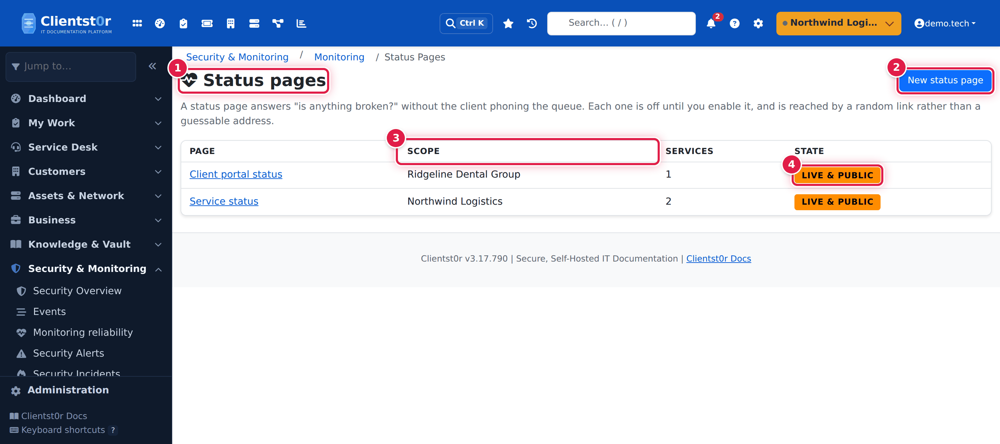
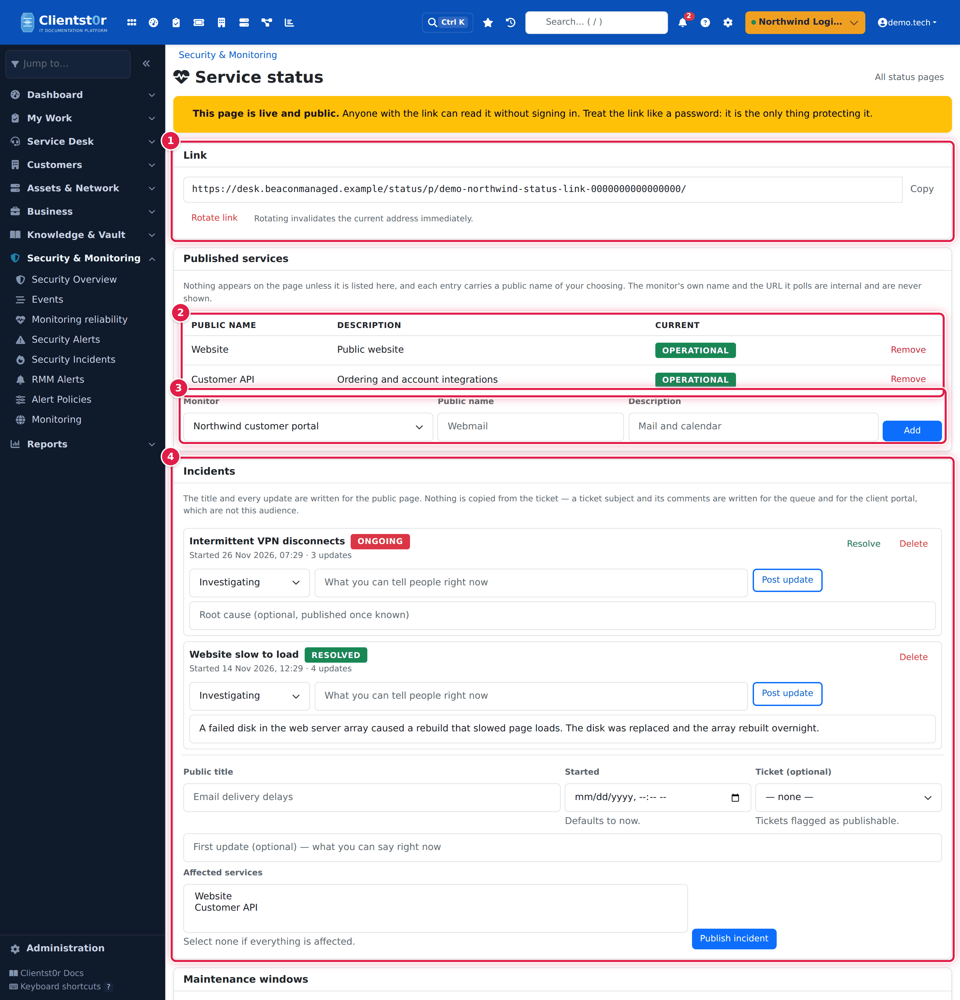
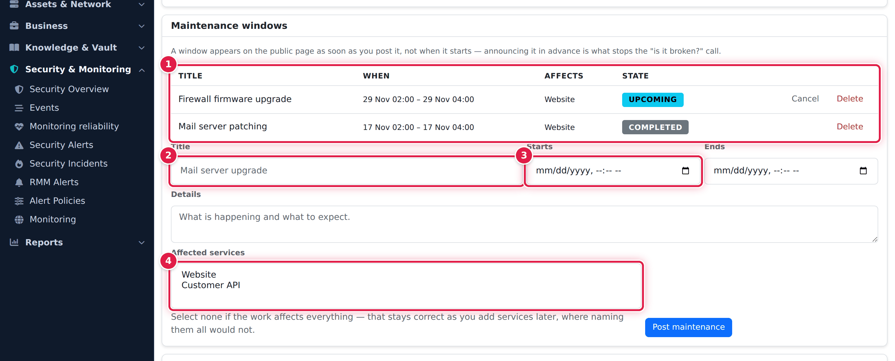
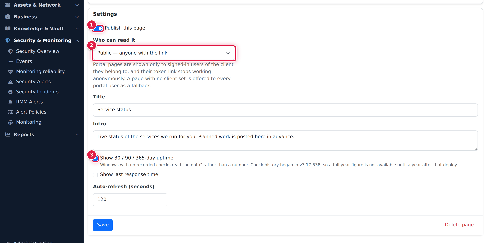
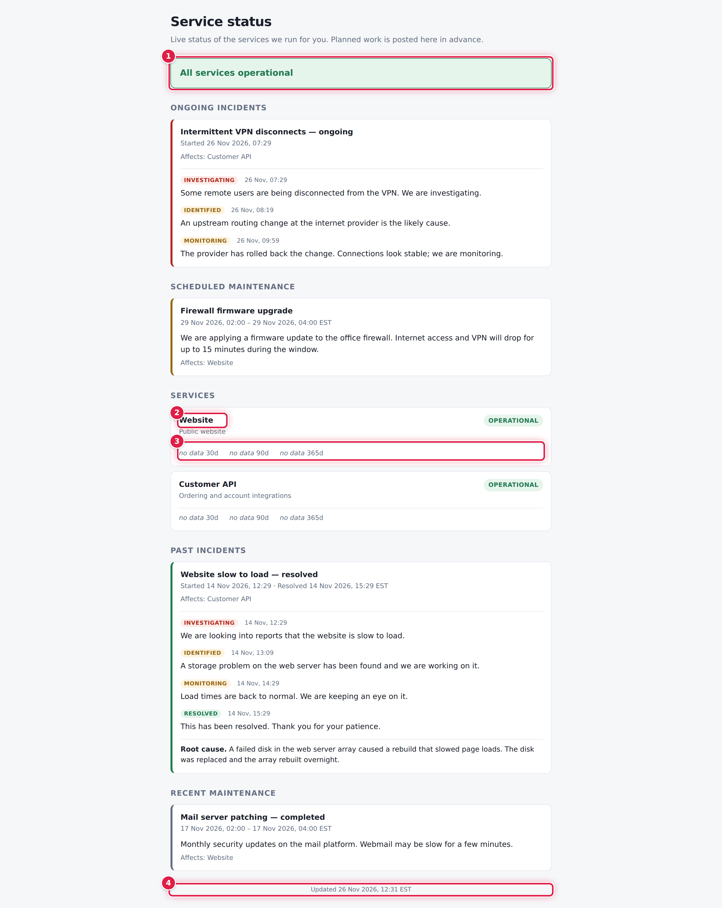
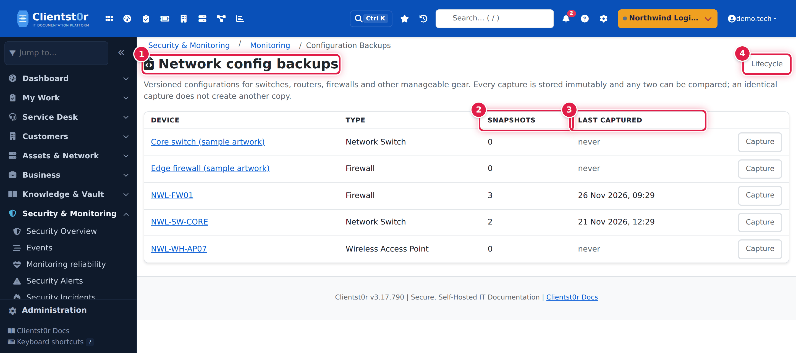
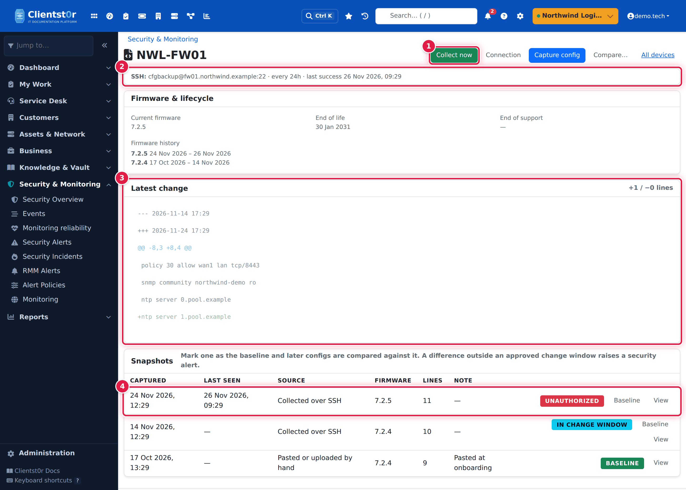
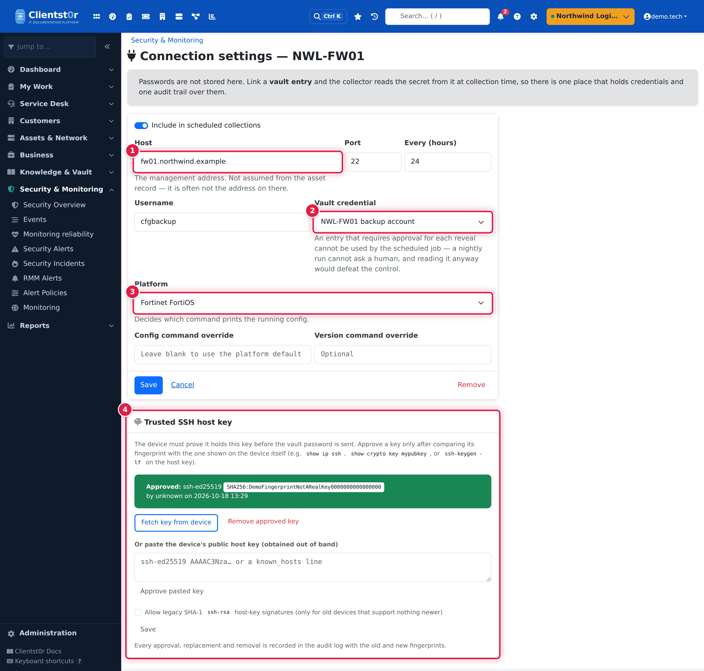

# Status pages and configuration backups

Two tabs of the **Monitoring** section (**Security & Monitoring → Monitoring** in the sidebar): **Status Pages**,
which publish the state of selected website monitors to your customers, and **Configuration Backups**, which keep
a versioned history of the configuration of switches, routers, firewalls and similar devices. The other three
tabs (Website Monitors, WAN Connections, Expirations) are described in [Website monitors, WAN connections and
expirations](MONITORING.md); status pages publish the monitors set up there. The numbers in each screenshot
match the list under it. Every screenshot is a capture of the application against a demo database; the
customers and people in it are invented.

The whole Monitoring section can be switched off by a superuser in **Administration → Modules → Feature
Toggles** (*Monitoring*).

## Status pages

**Monitoring → Status Pages** (`/status/`). A status page answers "is anything broken?" without the customer
phoning the queue. Managing status pages is for MSP staff with an Admin role or higher; customer users get
"permission denied" on every management page, even customer-side administrators. Customers read the finished
page, never this screen.

<!-- guide-figure: guide-stat-list -->

1. The list of every status page the installation has, live pages first.
2. New status page: asks for a title and, optionally, one client. The page is created switched off.
3. Scope: one client, or All clients for a page that can carry any client's services.
4. State: Live and public, or Off. A portal-only page that is switched on also reads Live here.
<!-- /guide-figure -->

- **New status page** asks for a title (optional, defaults to "Service status") and, optionally, one customer.
  The page is created **switched off**. A page with no customer chosen is not tied to one client and can carry
  monitors from any customer; a page for one customer can only carry that customer's monitors.
- There is one list for the whole installation: it is not filtered by the customer switcher.
- Status pages do not send anything. There are no subscribers, e-mail or SMS notifications, or RSS feed: people
  read the page, which reloads itself.

### Managing one page

Open a page from the list (`/status/<id>/`). The top of the screen says whether the page is live or off.

<!-- guide-figure: guide-stat-detail -->

1. The link: the address anyone holding it can open, a Copy button and Rotate link.
2. Published services: the name the public sees, the description and a Remove action. The monitor behind it is never shown.
3. Add a service: pick a website monitor and give it a public name.
4. Incidents: post one with its own public title, add timeline updates, resolve or delete it.
<!-- /guide-figure -->

- **The address.** Each page has a random 43-character link, `/status/p/<token>/`, on this installation's own host
  name. Nothing else identifies the page: it cannot be found by counting. Treat the link like a password; it is
  the only protection a public page has. **Rotate link** gives the page a new token at once and the old address
  returns 404. The token is stored encrypted, so the link can be shown again here.
- **Published services.** Nothing appears on the page unless it is listed here. Pick a website monitor and give
  it a **public name** (required) and an optional one-line description. The monitor's own name and its URL are
  never shown; if you leave the public name empty the service is not added. A monitor can appear once per page.
  **Remove** deletes the entry (the monitor is untouched). There is no button to hide an entry; services keep
  the order they were added in.
- **Incidents.** An incident has its own public title (never the ticket subject), a start time, optional
  affected services (none ticked means "all services") and an optional first update. Each update has a stage:
  Investigating, Identified, Monitoring or Resolved, and a message written for the public. Posting a Resolved
  update, or pressing **Resolve**, marks the incident resolved. A root cause can be added with an update. You can
  link an incident to a ticket that is flagged as publishable, only to keep the connection; nothing is copied
  from the ticket or its comments. **Delete** removes the incident with its updates. Updates cannot be edited
  after they are posted.
- **Maintenance windows.** Planned work, announced before it starts.

<!-- guide-figure: guide-stat-maint -->

1. Posted windows with their state (upcoming, in progress, completed or cancelled), with Cancel and Delete.
2. Title and details, written for people outside the business.
3. Start and end, in the server's time zone.
4. Affected services. Leave empty if the work affects everything on the page.
<!-- /guide-figure -->

A window needs a title, a start and an end that is later than the start. It is visible on the page from the
moment it is posted, as "scheduled", then "in progress", then "completed". **Cancel** keeps it on the page marked
cancelled so people who read the notice can see it is off. **Delete** removes it.

### Settings

<!-- guide-figure: guide-stat-settings -->

1. Enabled: off by default. While off the address returns 404.
2. Visibility: Public (anyone with the link) or Portal (signed-in client users only).
3. Show uptime and Show response time, and how often the page reloads itself (30 seconds at the least).
<!-- /guide-figure -->

- **Enabled** is off by default. While it is off, the address returns 404, the same answer as an address that
  never existed.
- **Visibility.** *Public* pages are readable by anyone who holds the link. *Portal* pages are readable only by
  signed-in users of the customer in the customer portal, at the portal's status entry; their link returns 404
  to anyone, signed in or not. A customer user sees the portal page of their own customer, or else the
  portal-visible page that is not tied to a customer. A public page is not reused as a portal page.
- **Show uptime** adds 30, 90 and 365-day uptime per service ("no data" where the monitor has no checks in that
  window). **Show response time** is a setting on the page but is off by default and the page does not show it
  at present.
- **Refresh** is how often the page reloads itself: at least 30 seconds.
- **Title and intro** are the heading and an optional paragraph under it (plain text).

### What the public sees

<!-- guide-figure: guide-stat-public -->

1. The overall banner: the worst state among the visible services.
2. Each service under the public name chosen for it.
3. Uptime over 30, 90 and 365 days, when the page shows it.
4. When the page was generated. The page reloads itself on its own.
<!-- /guide-figure -->

A standalone page with no menus and no sign-in. It shows the title and intro, one banner with the worst state of
the visible services (all operational, some degraded, outage or not yet known), ongoing incidents, maintenance
in progress and scheduled maintenance, then each service with its public name, description, state and uptime,
then up to ten resolved incidents and the five most recent finished or cancelled maintenance windows, and the
time the page was generated.

A service is **Operational** when its monitor is active, **Degraded** when the monitor shows a warning (for
example a redirect or an expiring certificate), **Outage** when the monitor is down and **Unknown** otherwise.
The page is sent with `Cache-Control: no-store` and `noindex`, so shared caches and search engines should not
keep it.

**What is exposed:** the page title and intro, the public names and descriptions you wrote, service states and
uptime percentages, and the text of incidents and maintenance you posted (including who is affected, by public
name). **What is not:** monitor names, monitored URLs, ticket subjects or comments, customer names (unless you
put one in the text), response times, and the names of the staff who posted. Anything you type in an incident
update or maintenance body is published as written, so keep internal host names and customer details out of it.

### Limits

- Only website monitors can be published. WAN connections and other checks cannot.
- Deleting a status page also deletes its services, incidents and maintenance windows.

## Configuration backups

**Monitoring → Configuration Backups** (`/netconfig/`). A versioned history of the running configuration of
network devices. The list shows the devices of the customer in the switcher (all customers you may view, in
Global View) whose asset type is switch, router, firewall, load balancer, wireless AP, wireless controller,
modem, gateway, bridge or console server, and that you may view as assets.

<!-- guide-figure: guide-stat-devices -->

1. The network devices (switches, routers, firewalls and similar) in the current client.
2. Snapshots: how many different configurations are stored.
3. Last captured: the last time a capture matched or produced a snapshot.
4. Lifecycle: devices past or near vendor end of support.
<!-- /guide-figure -->

- **Capture** on a row stores a configuration by hand. **Lifecycle** lists the devices already past, or within
  a year of, vendor end of life or end of support.
- Configurations enter the history in one of two ways: you paste or upload one (**Capture config**, which needs
  permission to edit assets), or Clientst0r logs in to the device over SSH and reads it.
- An identical capture does not create another copy: the existing snapshot's "last seen" moves instead.
  Trailing spaces and line-ending differences do not count as a change.

### One device

<!-- guide-figure: guide-stat-device -->

1. Collect now: log in to the device now and store the configuration.
2. The saved connection: user, host, port, schedule and the last success.
3. Latest change: the newest snapshot against the one before it.
4. A snapshot row: source, firmware, line count, drift verdict, Baseline and View.
<!-- /guide-figure -->

- Each snapshot shows when it was captured, when it was last seen unchanged, how it was captured (pasted or
  uploaded, SSH), the firmware version, line count and note. **View** opens the stored text; **Compare...**
  shows the differences between any two snapshots, and the newest against the one before it is shown
  automatically as **Latest change**. If the device reports its firmware, a firmware history is kept.
- **Baseline** marks one snapshot as the known-good configuration (one per device). Each later new snapshot is
  compared with it: *Baseline* (same), *In change window* (differs, but an approved change request for that
  customer was scheduled at that time) or *Unauthorized* (differs and no approved change request covered it).
  An unauthorized change raises a high-severity alert on the security alerts page. Until a baseline is set
  nothing is classified and no alert is raised.
- **There is no restore and no download.** Clientst0r only reads and stores configurations; it never pushes one
  to a device. To restore, copy the text from **View** and apply it with the device's own tools.
- **Retention.** Snapshots are kept until the device (asset) is deleted. There is no automatic pruning.

### How configurations are collected

<!-- guide-figure: guide-stat-connection -->

1. Host and port: the management address, which is not taken from the asset record.
2. Vault credential: the password comes from this vault entry at collection time.
3. Platform: decides the command that prints the configuration.
4. Trusted SSH host key: no password is sent until a key you have compared is approved.
<!-- /guide-figure -->

**Set up SSH** (or **Connection**) opens the connection settings (`/netconfig/device/<id>/connection/`).

- **Host, port, user.** The management address; it is not taken from the asset. The platform
  (Cisco IOS, Cisco ASA, Arista EOS, Juniper Junos, MikroTik, FortiOS, HP/Aruba ProCurve or Generic) decides the
  command that prints the configuration; you can override the command, and the command that reports the version.
- **Credential.** Passwords are not stored on this page. You link a **vault entry** belonging to the same
  customer, and Clientst0r reads the password from it only at collection time. Linking one needs permission to
  edit assets, access to that vault entry, and the same permission to reveal its password that the vault
  requires (including reveal approval and access rules); changing the host or port of a linked entry is checked
  the same way. A vault entry that requires approval for each reveal cannot be used for unattended collection,
  and the page says so.
- **SSH host key.** No password is sent until the device has proved it holds a host key that you approved. Use
  **Fetch key from device**, compare the fingerprint with the one on the device itself, tick the box and approve
  it, or paste the public key you obtained another way. If the device later presents a different key, collection
  stops and the new key waits for your decision. Changing the host or port removes the approved key. Older
  devices that only offer SHA-1 RSA keys need that to be allowed explicitly.
- **Schedule.** Collection runs from the scheduler task *Network Device Config Backup*, which is enabled by
  default and looks every hour; each device is collected when its own interval (default every 24 hours, at least 1
  hour) has passed. **Include in scheduled collections** switches a device out. **Collect now** collects one
  device immediately and is disabled with the reason when it cannot run (no host, user, credential or approved
  key).
- **Audit.** Every collection, successful or failed, is written to the audit log. The last error shows on the
  device page.

### Permissions

- Seeing the list and a device's history needs permission to view assets for that customer.
- Reading a stored configuration (View, Compare, Latest change) needs more, because configurations contain
  secrets such as SNMP communities and VPN keys: MSP staff may; a customer user needs the permission to view
  passwords for their customer.
- Capture, saving connection settings, host key actions, Collect now and Baseline need permission to edit
  assets for that customer.

### Limits

- Collection is over SSH only, with a password from the vault; SSH keys, SNMP and vendor APIs are not used.
- The SSH collection connects to the host you enter, so it should only be pointed at devices you manage.
