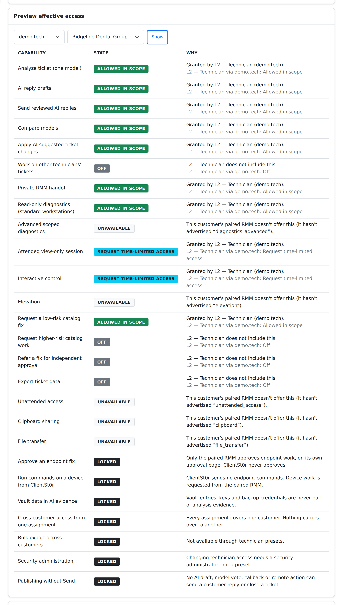
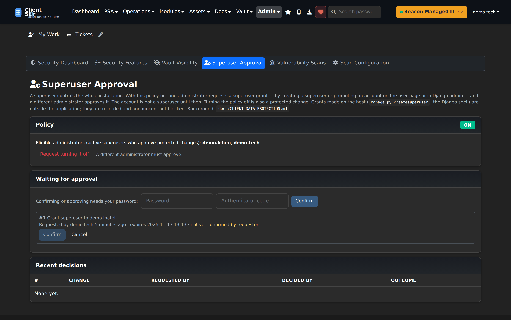
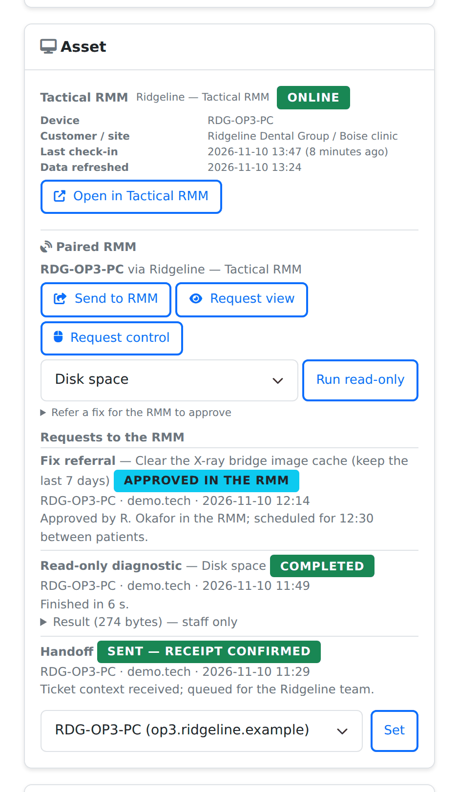

# Technician access and Ticket AI Assist — operator guide

*Since v3.17.646. Ticket AI Assist is **OPTIONAL AI**: it requires PSA to be on and the master AI switch
(`psa_ai_enabled`, Settings → AI & LLM). The RMM tools on a ticket (v3.17.658, [below](#rmm-tools-on-a-ticket))
are not AI features: they work with AI off, but need PSA, a preset and a paired RMM.*

## What it governs

Technician access decides which MSP technicians may use ticket AI and RMM tools, **per customer**. It does not change
ordinary ticket work: viewing tickets, manual replies, internal notes and escalation keep their existing permissions.
Customer portal users are outside technician access entirely and never get an AI or RMM capability.

A technician has **nothing** here until they are assigned a preset at a customer. Staff, editor, admin and superuser
flags never imply a preset — superusers who work tickets need an assignment like everyone else.

## Presets

| Capability | L1 Help Desk | L2 Technician | L3 Senior |
|---|---|---|---|
| Analyze ticket (one model) | Allowed | Allowed | Allowed |
| AI reply drafts | Allowed | Allowed | Allowed |
| Send reviewed AI replies (normal Send) | Off | Allowed | Allowed |
| Compare models | Off | Allowed | Allowed |
| Apply AI-suggested ticket changes | Off | Allowed | Allowed |
| Work on other technicians' tickets | Off | Off | Allowed |
| Private RMM handoff | Off | Allowed | Allowed |
| Read-only diagnostics (standard workstations) | Off | Allowed | Allowed |
| Advanced scoped diagnostics | Off | Off | Allowed |
| Attended view-only session | Off | Request | Request |
| Interactive control | Off | Request | Request |
| Elevation | Off | Off | Request |
| Low-risk catalog fix request | Off | Allowed | Allowed |
| Higher-risk catalog request | Off | Off | Allowed |
| Refer a fix for independent approval | Off | Off | Allowed |
| Export ticket data | Off | Off | Off |
| Unattended access / clipboard / file transfer | Off | Off | Off |

**Request** means the technician may ask for time-limited access. The grant comes from the paired RMM, per
session — never from ClientSt0r.

**Locked** for everyone, whatever the preset:

- endpoint fix approval;
- endpoint commands from ClientSt0r;
- vault data in AI evidence;
- cross-customer access from one assignment;
- bulk export;
- security administration;
- publishing without Send.

RMM, remote-access and fix capabilities show **Unavailable** at a customer until that customer's paired RMM
advertises the matching capability in its ticket-rmm-v1 capabilities document (`docs/contracts/ticket-rmm-v1/`).
Low- and higher-risk fix requests and "Refer a fix" all need `signed_actions`. Advanced diagnostics and elevation
can be granted, but no ticket action uses them yet.

Built-in presets can't be edited; clone one to customise it. Built-ins are seeded by a migration and by
`manage.py init_role_templates`. Seeding is idempotent and never overwrites a preset that already exists. When a
built-in differs from what the release ships, **Reset to default** shows a preview and goes through review.

## How a decision is made

First match wins:

1. Locked
2. Not an active technician → Off
3. Contained → Off
4. Record belongs to another customer → Off
5. Explicit deny → Off
6. Customer restriction → Off
7. Integration can't do it → Unavailable
8. The best of the technician's live assignments at that customer, **each evaluated with its own scope**. An L3
   "other technicians' tickets" grant at customer A never widens customer B.

Ticket-scoped capabilities need the ticket to be assigned to the technician, unless their assignment includes
"Work on other technicians' tickets". Read-only diagnostics cover desktops, laptops, workstations and thin clients
only.

Nothing is cached. Demotion, revocation, expiry and policy changes apply to the next request — including a job
already queued, which the gateway re-checks before calling a model.

## Admin setup

1. **Settings → Ticket AI models.** Create model profiles: Anthropic, OpenAI or Ollama.
   - API keys are write-only, sealed to the gateway key, and can't be shown again.
   - An Ollama address only works after **Propose address** is approved as a protected change.
2. On the same page, set each customer's **AI policy**: analysis, compare, allowed models, default model,
   technician-owned keys, local-only, and daily budget. Without a policy, a customer allows no AI.
   - With **technician-owned keys** on, technicians can add their own Claude or OpenAI key under
     **My Profile → My AI keys**. Only its owner can use it, and only at customers that allow
     technicians' keys and are not local-only; it doesn't have to be listed in the policy. The
     customer's daily budget counts it at the prices the technician enters.
3. **Integrations → RMM → the customer's connection → Configure → Ticket integration pairing (ticket-rmm-v1).**
   Any RMM that implements the contract can be paired; the connection must serve a single customer. Enter the
   key ID, the two secrets, where the RMM runs and, if it differs from the connection's address, the integration
   address. A second administrator approves the pairing; then **Check pairing** on the connection page fetches
   the RMM's capabilities and pins its tenant. The scheduler re-checks hourly (every 10 minutes after a failure).
4. **Settings → Security → Technician Access.**
   - Assign presets per technician or group, per customer, optionally with an expiry. **Preview** shows the diff,
     the affected technicians and the expiry before you save.
   - Set customer defaults and restrictions, add denies, and preview anyone's effective access with explanations.
5. Run `python manage.py ai_gateway_keygen` once.
6. Optionally isolate the gateway (see [Vault isolation](#vault-isolation)).
7. Run `python manage.py tech_access_report` to see:
   - technicians with no assignment;
   - roles still setting the older `psa_ai_*` flags (kept, but they grant nothing now);
   - privileged accounts that are *not* L3 by default;
   - ambiguous mappings to resolve by hand.

## Protected changes

Widening anything — a preset above L1, preset capabilities, a group member added, a deny or restriction lifted, an
RMM pairing (or marking the RMM on-premises), an Ollama destination, approvers, the recovery contact, looser detection — and moving the e-mail
address of a superuser, approver or MSP technician, works like this:

1. The requester proposes the change. Nothing changes yet.
2. The requester re-enters their password (plus their authenticator code, if they have one) and **Confirm**s it.
3. A **different** approver re-authenticates and approves it. The change is applied.

Refused outright:

- approving your own change;
- approving a change that widens your own access;
- approving a recovery contact that is your address;
- adding yourself as approver;
- approving an expired change (72 h).

The recovery contact as it was **before** the change is e-mailed at each step, along with the requester and the
affected technician.

Narrowing — revoking, lowering, restricting, denying — applies at once and is audited.

**Account e-mail addresses.** A superuser's, approver's or technician's address is where password resets, theft
alerts and these notices go, so it can't be moved by one person:

- **From My Profile**, the owner enters their password (and authenticator code) with the new address; the change
  is then waiting for approval, and the profile page says so.
- **From the user editor or the Django admin**, the editing administrator confirms it under Technician Access.
- Either way a second administrator approves it, the old address is told at every step, and an approver can't
  move an account to their own address. A change that is out of date (the address moved meanwhile) is refused.
- Directory sync (LDAP / Entra ID) still writes addresses from the directory, which is the source of truth there.
  Customer portal users change their own address as before.

**One-administrator installs can't widen access** or move a protected address. Add a second superuser first.

**Granting superuser** is a protected change when **Admin → Security → Superuser Approval** is on (since
v3.17.653; off on upgrade):

- One administrator requests the grant (from the user page, the user editor or Django admin) and confirms it with
  their password and authenticator code; a **different** administrator approves it the same way. The account is
  not a superuser until then.
- Turning the policy on needs two eligible administrators; turning it off is itself a protected change.
- The target can't approve their own grant, and nobody approves their own request. Revoking superuser is never
  held.
- Grants made outside the approval (`manage.py createsuperuser`, the Django shell) are recorded and, while the
  policy is on, e-mailed to the other superusers and the recovery contact.

See [CLIENT_DATA_PROTECTION.md](CLIENT_DATA_PROTECTION.md#granting-superuser), including how host-level commands
are handled.

## Theft detection

On by default. Per identity, across the web UI, REST API and mobile API, it counts over the last clock hour and the
last 24 h:

- distinct tickets opened;
- distinct customers whose tickets were opened;
- distinct exports;
- diagnostic bytes.

Crossing a limit raises an alert to:

- superusers;
- extra recipients you list;
- the recovery contact;
- optionally, each affected customer.

Then, per level, the technician is either contained or only alerted. While contained:

- every optional capability is off;
- exports are refused;
- only tickets assigned to them open.

Another administrator lifts containment after re-authenticating. Alerts carry identities and counts only — no
ticket text or secrets. Loosening detection is a protected change.

Defaults, editable on the page:

| Limit | 1 hour | 24 hours |
|---|---|---|
| Tickets | 150 | 600 |
| Customers | 15 | 40 |
| Exports | 10 | 30 |
| Diagnostic bytes | 50 MB | 200 MB |

## Vault isolation

AI provider keys are encrypted to an X25519 public key (`AI_GATEWAY_KEY_DIR`, default
`~/.config/clientst0r/ai-gateway/`). The web app only holds the public key.

- **`AI_GATEWAY_MODE=in_process`** (default): the web app opens provider keys itself. This is **not isolated**, and
  the AI models page says so.
- **`AI_GATEWAY_MODE=worker`**: only `manage.py ai_gateway_worker` running under `config.settings_ai_gateway` opens
  them. That process:
  - drops `APP_MASTER_KEY`, the previous master keys, `SECRET_KEY`, `API_KEY_SECRET` and every other
    KEY/SECRET/TOKEN/PASSWORD variable;
  - refuses to start if it can still see the master key;
  - therefore can't decrypt vault entries, integration credentials or backup secrets.

  Install `deploy/clientst0r-ai-gateway.service` to run it. The unit runs as the same OS user; running it as a
  separate user that can't read `.env` is a further deployment step and not done automatically.

Model calls only go to:

- `api.anthropic.com` / `api.openai.com` on public addresses;
- an Ollama origin approved by protected change (LAN addresses are allowed for that origin only).

Redirects are not followed. Cloud metadata addresses are always refused, and DNS answers are checked at connect
time.

## What the AI sees and does

**Analyze ticket** first shows a preview: the redacted evidence, what was left out, the processor, and each model
with its location and estimated cost.

Evidence is:

- the subject and description;
- up to 20 public comments;
- a summary of the ticket's asset, with RMM status from verified same-customer associations only.

Never included: attachments, vault data, internal-note bodies, raw RMM payloads, remote-session data.

Secrets, cards, e-mail addresses and phone numbers are redacted before anything is sent, logged or stored.

Results are staff-only:

- facts with evidence IDs (facts without one are dropped);
- likely causes, missing information, checks and warnings;
- editable draft replies.

**Use reply** puts a draft into the composer without overwriting your text. Only the normal Send publishes it.
Sending a reply that came from an AI draft needs *Send reviewed AI replies*; L1 technicians get the draft as an
internal note instead.

## RMM tools on a ticket

*v3.17.658.* When a ticket's asset is linked to a device of a paired RMM at the same customer, the ticket's Asset
card shows a **Paired RMM** block with what the technician's assignment allows on that device:

- **Send to RMM** — a preview of exactly what leaves (the redacted ticket context, the same evidence as Analyze
  ticket, and what was left out), then a private handoff. It shows as Sent only when the RMM confirms receipt.
- **Run read-only** — one diagnostic from the RMM's advertised list, on standard workstations only. The result is
  sanitised, limited to 32 KiB, staff-only, and counts toward theft detection's diagnostic bytes.
- **View session / Control session** (or **Request …** on presets where they are by request) — the RMM returns a
  short-lived launch address, which ClientSt0r checks against the connection's console hosts, opens and forgets.
- **Refer a fix** — a title and description (or one of the ticket's analysis suggestions) for the RMM to approve
  and run. Its status — received, approved, rejected, running, succeeded, failed — comes only from the RMM's signed
  events.

The block lists the requests already sent, with the RMM's own status notes. No RMM event can close the ticket or
send a customer reply, and customers see none of it. Only the ticket's own asset is reachable; the browser can't
name another device.

Source: `psa_ai/services/rmm_actions.py`, `psa_ai/rmm_views.py`, `integrations/ticket_rmm.py`; tests
`psa_ai/tests_rmm.py`.
