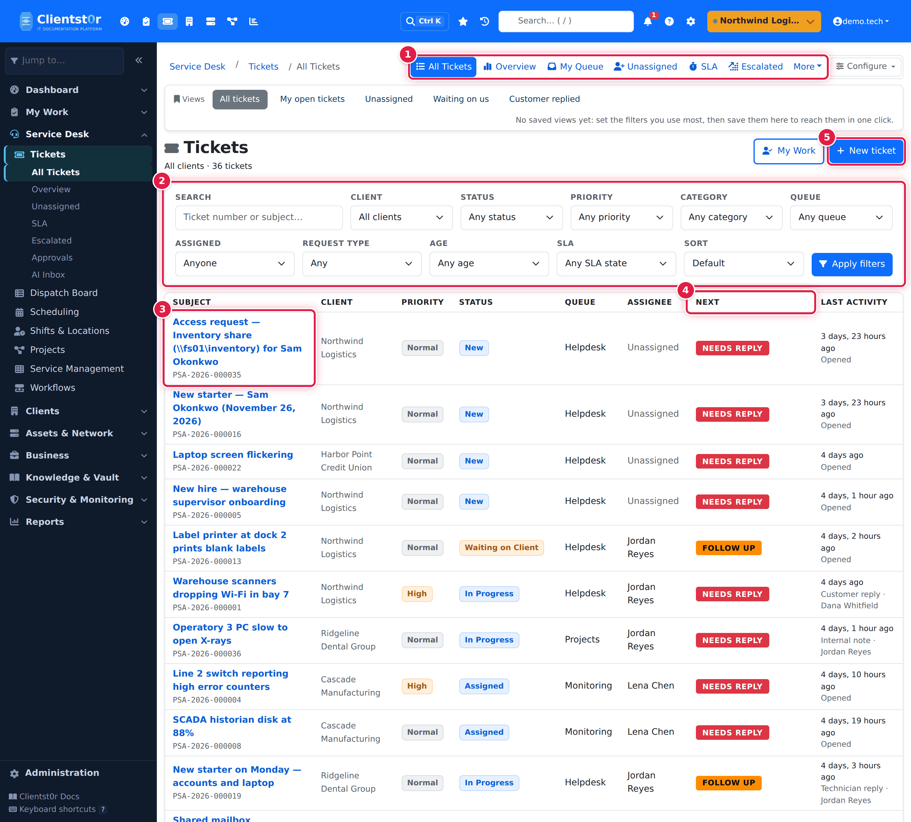
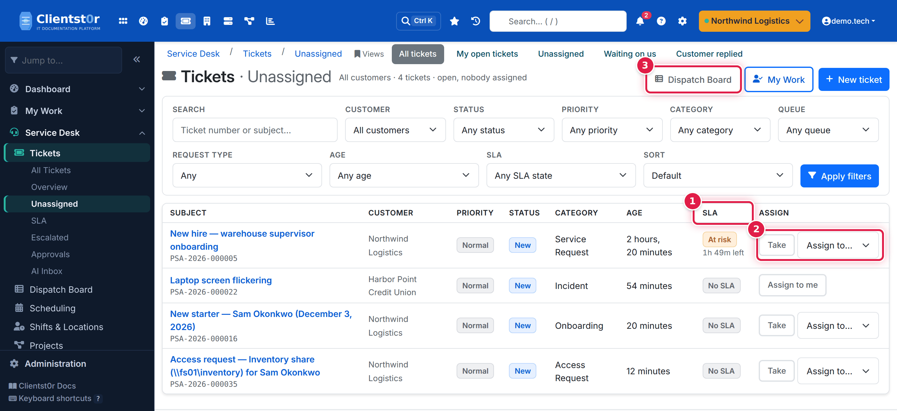
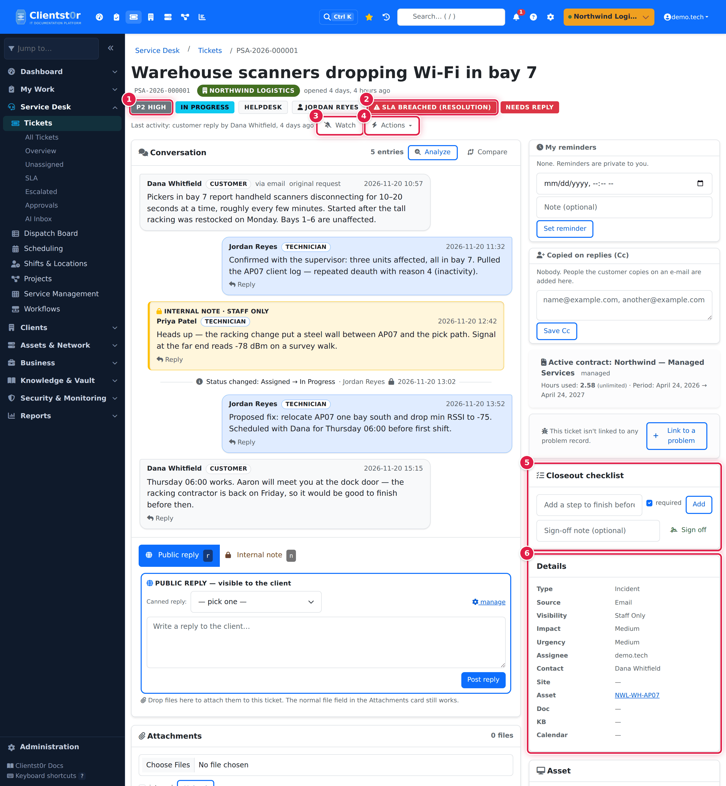
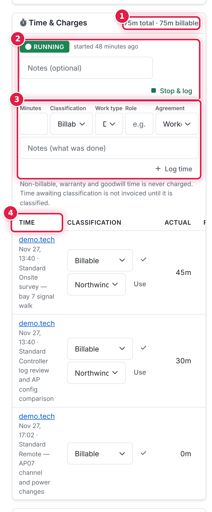
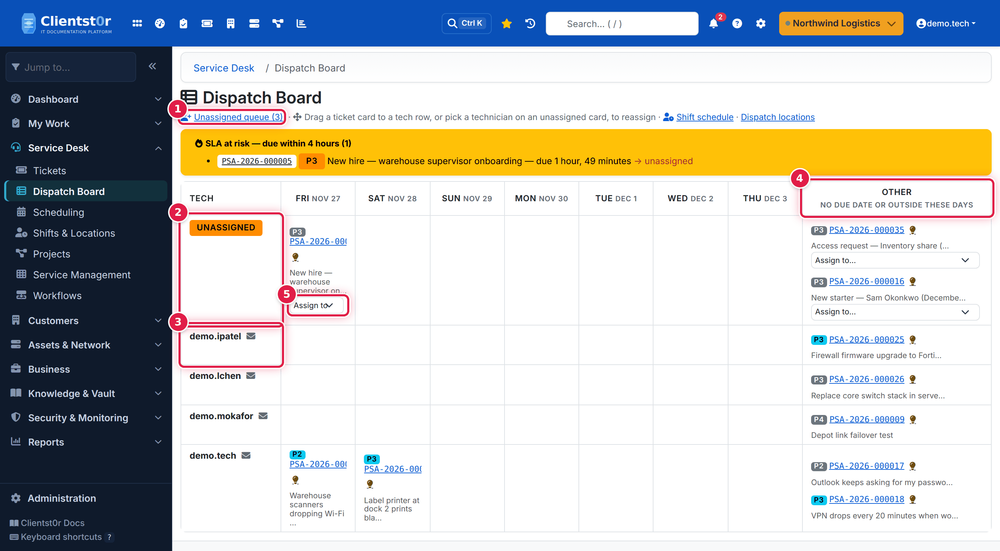
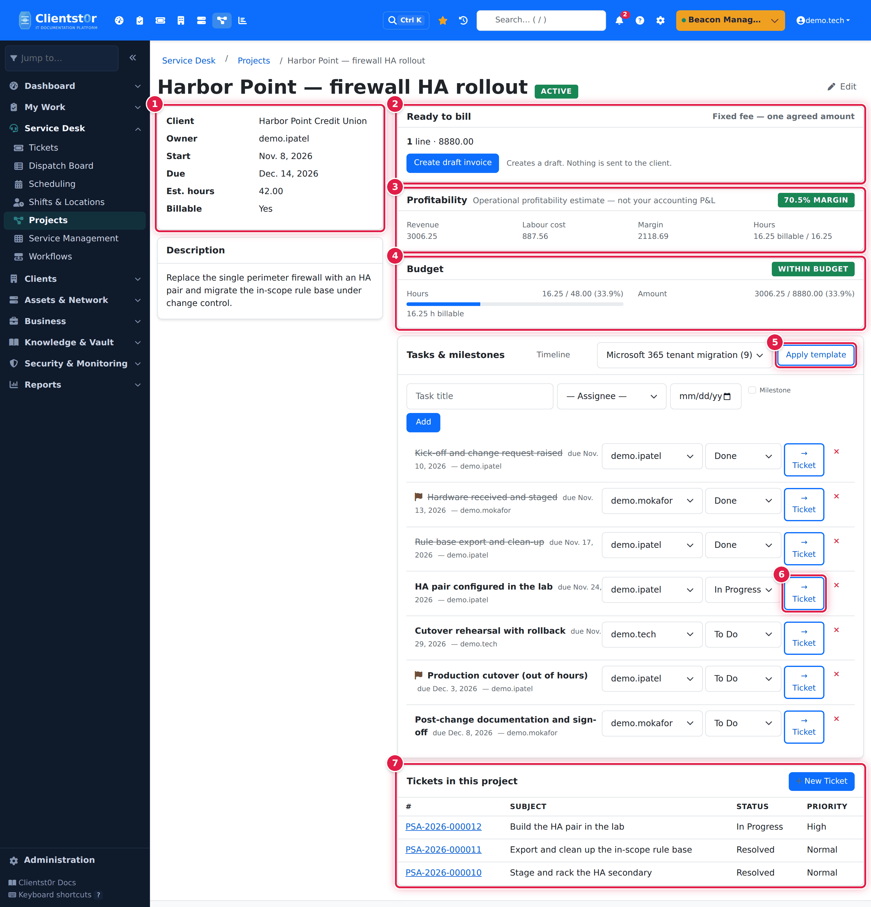

# Tickets, dispatch and projects

How technicians find, create and work tickets, plan who does what on the Dispatch Board, and run projects.
Everything here is in **Service Desk** in the sidebar and needs the native service desk (`psa_enabled`).
The numbers in each screenshot match the list under it. Every screenshot is a capture of the application
against a demo database; the customers and people in it are invented.

For a first look at a ticket, read [Working a ticket](GETTING_STARTED.md#working-a-ticket) in Getting
started. This guide goes further.

## The ticket list

**Service Desk → Tickets → All Tickets** (`/psa/`). Every ticket you may see, newest first. The list
ignores the client switcher: it always covers every customer you can reach. Pick a customer in the
*Client* filter to narrow it.

<!-- guide-figure: guide-ticket-list -->

1. Views of the same list: All Tickets, Overview, My Queue, Unassigned, SLA, Escalated, and under More, Approvals (and AI Inbox when AI is on).
2. Filters: search, client, status, priority, category, queue, assignee, request type, age, SLA and sort. They are in the address, so a filtered list can be bookmarked.
3. The subject opens the ticket; the ticket number sits under it.
4. Next: whose move it is. Reply when the customer spoke last, waiting when you did.
5. New ticket.
<!-- /guide-figure -->

- **Filters** are part of the page address, so a filtered list can be bookmarked or shared. *Queue*
  also offers four work queues: Open, Waiting on us, Waiting on customer and Customer replied (the same
  lists My Queue counts). *Age* finds tickets opened more than 1, 3, 7 or 30 days ago; *SLA* picks one SLA
  state; *Sort* orders by SLA deadline, age or newest.
- **Views** (the bar above the title) keeps filter sets you save, with one you can make open by default.
- **Next** says whose move it is: *Needs reply* when the customer spoke last (or nobody has answered yet),
  *Waiting on customer* when you did, *Follow up* once that wait passes 3 days, *Waiting on vendor*, or
  *Closed*. *Last activity* shows what happened last and who did it.
- The list shows at most 200 tickets; the count reads "(first 200)" when it is cut off. Narrow the
  filters to reach the rest.

**Who sees it.** MSP staff see the tickets of every customer their role allows (`tickets_view`). A
customer's own users who reach this page see only tickets shared with them, as in the portal, and only
the All Tickets list.

### The other views: Overview, Unassigned, SLA, Escalated, Approvals

The tabs next to All Tickets are the same list with a filter applied (`?view=` in the address). They are
for MSP technicians only; anyone else gets the plain list.

| Tab | What it shows |
|---|---|
| Overview | Counts of open tickets: open, assigned to me, unassigned, SLA at risk, SLA breached, pending approvals and escalated, plus open tickets by SLA state. Each count opens its list. |
| Unassigned | Open tickets nobody has, soonest SLA deadline first, with an assignment control on each row. |
| SLA | Open tickets with their SLA state, time left (or how long overdue) and deadline. Chips above the list filter to Breached, At risk, On track, Paused or No SLA, with counts. |
| Escalated | Open tickets a customer escalated from the portal, most recent first, with who escalated, when and why. |
| Approvals | Pending approvals tied to tickets, and change-board (CAB) votes waiting for you. **All approvals** opens the full approvals list. |
| AI Inbox | OPTIONAL AI, see below. |

*At risk* means the deadline is within the next 2 hours. A ticket whose status pauses the SLA (for
example waiting on the customer) is *Paused*; a ticket with no deadline is *No SLA*, never given one.

<!-- guide-figure: guide-ticket-unassigned -->

1. SLA state and time left (or overdue by). The list reads soonest deadline first.
2. Assign the ticket from the list. Shown only where you may assign it.
3. Open the Dispatch Board to plan the week instead.
<!-- /guide-figure -->

The assignment control appears only where the assignment would be accepted. **Assign to…** (any MSP
technician) needs the *assign tickets* permission for that customer, and the ticket must belong to the
customer in the client switcher unless you are in Global View. Without that, **Assign to me** (or *Take*)
assigns it to you if you may edit the customer's tickets.

On the Approvals tab, **Approve** and **Deny** appear only where you may decide. Otherwise the row says
why: the customer decides in the portal, it waits on an earlier stage, you requested it yourself, your
access is read-only, or an AI action needs the AI action approval permission. A CAB vote opens the change
record, where you vote.

### My Queue

**My Work → My Queue** (`/psa/my-work/`), also a tab on the ticket list. Everything waiting on you: running
timers, your open tickets, tickets where the customer replied, the Waiting on us / Waiting on customer
tabs, reminders, appointments and pending approvals, with monitoring panels for MSP staff. It is described,
with a screenshot, in [My Work](MY_WORK.md).

### AI Inbox (OPTIONAL AI)

**Service Desk → Tickets → AI Inbox** (`/psa/ai/inbox/`). Shown only when AI is switched on
(`psa_ai_enabled`) and only to MSP technicians; otherwise the page does not exist. It lists AI
suggestions that still need a person: *Pending review* (awaiting senior approval, the default), *Drafts*
(drafted by AI, awaiting a technician) or *All open*. Each row shows the ticket, customer, kind (reply,
action or triage guidance), risk and a preview. **Open** goes to the suggestion on the ticket, where it is
approved, edited or rejected. You see only suggestions you are allowed to see, at most 200. Nothing in the
inbox acts on its own.

The demo database has no AI suggestions, so there is no screenshot.

## Creating a ticket

**New ticket** on the ticket list or My Work (`/psa/new/`).

- **Client** is required. Only customers without an active connection to an external PSA are offered; a
  customer whose tickets live in another PSA cannot get native tickets. With no eligible customer the page
  says so and stops.
- **Subject** is required. Description, queue, status, priority and type are set on the form.
- **Asset** (optional) must belong to the chosen client.
- **Assign to** (optional) appears for people allowed to assign; only MSP technicians can be chosen.
- **Attach a workflow** (optional) starts a published workflow checklist on the new ticket.
- You need the *create tickets* permission for the chosen customer, and write access.

The SLA deadlines (first response and resolution) are set from the priority's targets when the ticket is
created. If the customer has an active contract with its own SLA times for that priority, those are used
instead. Deadlines count clock time from when the ticket was opened.

A request from the service catalog opens the same form with the request's own fields, and builds the
subject and description from the answers. A ticket can also be opened from an RMM alert or an asset, which
fills in the customer, asset and subject.

## Working a ticket

Open a ticket from any list (`/psa/t/<ticket number>/`). [Working a ticket](GETTING_STARTED.md#working-a-ticket)
covers the conversation and the reply composer. The header and side column hold the rest.

<!-- guide-figure: guide-ticket-work -->

1. Priority, then status, queue and assignee.
2. SLA state: on track, warning, breached (response or resolution) or paused.
3. Watch: get emails about new activity.
4. Actions: assign to me or a technician, change status, close with a resolution.
5. Closeout checklist: steps marked required must be ticked before the ticket can close; sign-off.
6. Details: type, source, impact, urgency, contact, site and asset.
<!-- /guide-figure -->

- **SLA badge.** *On track*, *warning* (less than a quarter of the resolution time left), *SLA breached*
  (response or resolution), *Paused* or *Resolved*. While a ticket sits in a status that pauses the SLA,
  the time is not counted: leaving that status moves both deadlines out by the time spent waiting.
- **Actions.** *Assign to me*; *Assign to tech* and *Unassign* for people with the assign permission;
  *Change status*; *Close with resolution…* (key `x`). A closed ticket offers *Reopen ticket* instead.
- **Watch** emails you about new activity on the ticket.
- **Others on the ticket.** A yellow banner says when another technician has the same ticket open, and
  whether they are replying. If new entries arrive while you write, your post is held and the new entries
  are highlighted, so you can read them before posting again. Unsent replies are kept as a draft.
- **Side column** (MSP staff): your private reminders, Cc addresses, the active contract and its hours,
  related problem records, similar tickets for the customer, the closeout checklist, details, the asset and
  site, kit to take on site, vault entries for the customer (titles only; open one to see it), workflows,
  and AI Assist when AI is on.

### Closing a ticket

*Close with resolution…*, or choosing a resolved or closed status in Actions, opens the close-out form:
status, **closure category** and **resolution summary** are required, and the summary is visible to the
customer. The ticket cannot close while:

- a closeout checklist step marked *required* is still open;
- no time is logged and the service desk settings require time before closing;
- the chosen status needs a sign-off and nobody has signed off (**Sign off** in the closeout checklist).

Closing a ticket with unbilled time or items keeps them and flags the ticket for billing review; nothing is
invoiced automatically.

### Time on a ticket

<!-- guide-figure: guide-ticket-time -->

1. Total and billable minutes on this ticket.
2. A running timer: add a note, then Stop & log.
3. Log time by hand, or Start timer: minutes, classification, work type, role and notes.
4. Logged entries, with classification and agreement.
<!-- /guide-figure -->

**Time & Charges** is shown to MSP staff only. **Start timer** runs a timer on the ticket (it also appears
under Running timers in My Queue); **Stop & log** saves it as a time entry. Or enter minutes by hand with a
classification (billable, covered, non-billable, warranty, goodwill, awaiting classification), work type,
role and notes. Items, the billing summary and **Send to billing** are further down the same card; what
happens to billable time is described in [Billing, prepaid hours and contracts](BILLING.md).

### What customers see

A customer user who opens a ticket sees the shared conversation and their own attachments. Internal notes,
time, items, contract hours, the side column's technician panels and similar tickets are not sent to them
at all.

### Ticket settings

The **Configure** menu on the Tickets tabs holds Recurring Tickets, Canned Replies, Email Ingestion, and
(MSP staff) Workflow Rules and the Workflow Flow Map.

## Dispatch Board

**Service Desk → Dispatch Board** (`/psa/dispatch/`). The week ahead as a grid: one row per technician,
one column per day for the next 7 days, and an *Other* column. It shows the tickets of the customer in the
client switcher, or every customer in Global View. MSP staff only.

<!-- guide-figure: guide-dispatch-board -->

1. Open unassigned tickets for the selected client, in the ticket list.
2. Overdue: open tickets whose due date has passed.
3. Unassigned tickets, by due day.
4. One row per technician; the envelope means they are emailed on assignment.
5. Other: no due date, or due outside the 7 days shown.
6. Assign from the card, or drag the card to a technician's row. The bulb lists suggested technicians.
<!-- /guide-figure -->

- A ticket sits on the day it is due (its resolution deadline, or the first-response deadline if there is
  no resolution deadline). Tickets with no deadline, or due beyond the 7 days, go in *Other*. Closed tickets
  stay on the board, with a grey priority badge, so you can see what was finished.
- **Overdue** lists open tickets whose due day has passed. **SLA at risk** (when there are any) lists open
  tickets due within the next 4 hours.
- **Reassign** by dragging a card to another technician's row, or with the picker on an unassigned card.
  This needs the *assign tickets* permission for the ticket's customer, and only MSP technicians can receive
  work. Rows of people who are not technicians (or are deactivated) are marked and cannot receive cards.
  Every move is written to the audit log.
- **Warnings, not blocks.** If the technician is on leave or has a calendar clash, the move still happens and
  the warning is shown.
- **Suggested technicians** (the bulb on a card) ranks up to five technicians by skills and availability,
  each with **Assign**.
- **Shifts.** Technicians with a shift schedule show their shift today and per day, and leave clashes, from
  **Shifts & Locations → Shift Schedule**.
- **Travel estimates.** When technicians share their location (each one opts in under Shifts & Locations →
  Location Sharing), unassigned cards show the nearest technician by straight-line distance. It is an
  estimate.
- The board reads the 1,000 most recent tickets in scope.

People who may assign see every technician as a row, even one with no tickets, so work can be dropped on
them. Others see only technicians who already have tickets on the board.

### Routing Triage

**Service Desk → Dispatch Board → Routing Triage** (`/psa/routing/triage/`). Open, unassigned tickets where
ticket routing either fell back (nobody qualified, or the customer could not be verified) or left a
suggestion for a dispatcher. Filter by routing result, priority, customer or text; each row shows the
routing reason. Open the ticket to **Accept** or **Dismiss** a suggestion there. Accepting assigns the
ticket, so it needs the *assign tickets* permission for that customer.

The list covers every customer whose tickets you may view, whatever the client switcher says, up to 500
tickets. MSP staff only. It stays empty while routing is Off. Rules, modes and fallbacks are explained in
[Ticket Routing](TICKET_ROUTING.md); the demo database has no routing decisions, so there is no screenshot.

### Load Heatmap

**Service Desk → Dispatch Board → Load Heatmap** (`/psa/dispatch/heatmap/`). One row per technician and one
column per day, from 7 days ago to 7 days ahead (today has a blue border). Each cell counts the tickets
assigned to that technician that are due that day, and the shade darkens as the count rises towards the
busiest cell in the window. Use it to spot a technician with far more due on one day than the others, then
rebalance on the Dispatch Board.

It uses the same scope as the Dispatch Board (the selected customer, or everyone in Global View), reads the
2,000 most recent tickets, and counts only open, assigned tickets with a deadline; closed and resolved tickets are left out. MSP staff
only.

## Projects

**Service Desk → Projects** (`/psa/projects/`). Projects of the customer in the client switcher; MSP staff
in Global View see every project. Filter by status (Planning, Active, On Hold, Completed, Cancelled). The list
shows the client, status, owner, due date and number of tickets, up to 200 projects.

**New project** asks for a name and a client, then status, start and due dates, estimated hours, billable,
budget (hours and amount, with a warning level), billing type (time and materials, fixed fee, or milestone)
and, for a fixed fee, the amount. The owner defaults to you; people allowed to assign can pick another
technician. Reusable task lists are kept under **Configure → Project Templates**.

<!-- guide-figure: guide-project -->

1. Client, owner, dates, estimated hours, billable. Edit changes them.
2. Ready to bill: what is waiting, and Create draft invoice (nothing is sent).
3. Profitability: revenue, labour cost and margin. Only staff allowed to see profitability.
4. Budget: hours and amount used against the budget.
5. Timeline, and Apply template: copy a template's tasks onto the project.
6. → Ticket: make a task a ticket so time can be logged on it. Set assignee and status per task.
7. Tickets in this project.
<!-- /guide-figure -->

- **Ready to bill** shows what is waiting: unbilled hours for time and materials, the fee for a fixed-fee
  project (once), or completed milestones. **Create draft invoice** needs the *send invoices* permission and
  creates a draft only; nothing is sent. For time and materials, if the customer's active contract has no hourly
  rate, the time cannot be priced and the button is not offered.
- **Profitability** (revenue, labour cost, margin and hours) appears only to MSP staff allowed to see
  profitability for the customer. It is an operational estimate, not accounting. Without technician cost
  rates it is marked *Incomplete*.
- **Budget** compares hours and amount used with the budget. With no contract rate the amount is left blank
  rather than shown as zero.
- **Tasks & milestones.** Add a task with an assignee, due date and milestone flag; change its assignee and
  status (To Do, In Progress, Blocked, Done, Cancelled) in place. **Apply template** copies a template's
  tasks onto the project and keeps the existing ones. **Timeline** shows the tasks as a schedule, where they
  can be moved.
- **→ Ticket** turns a task into a ticket so time can be logged against it (needs the *create tickets*
  permission). A task gets one ticket only; after that the button shows the ticket number.
- **Tickets in this project** lists the project's tickets.

## Related guides

- [Getting started](GETTING_STARTED.md): the dashboard, navigation and a first look at a ticket.
- [My Work](MY_WORK.md): My Queue, timesheets and your schedule.
- [Ticket Routing](TICKET_ROUTING.md): routing rules, on-call and triage.
- [Billing, prepaid hours and contracts](BILLING.md): how ticket time and project work become invoices.
- [Support workflows](SUPPORT_WORKFLOWS.md): tickets raised from monitoring alerts.
- [Roles and access](ROLES_AND_ACCESS.md): the permissions named on this page.
