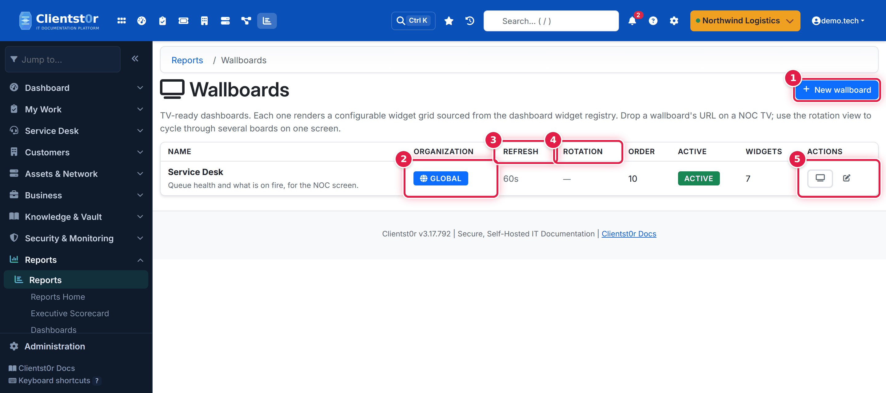
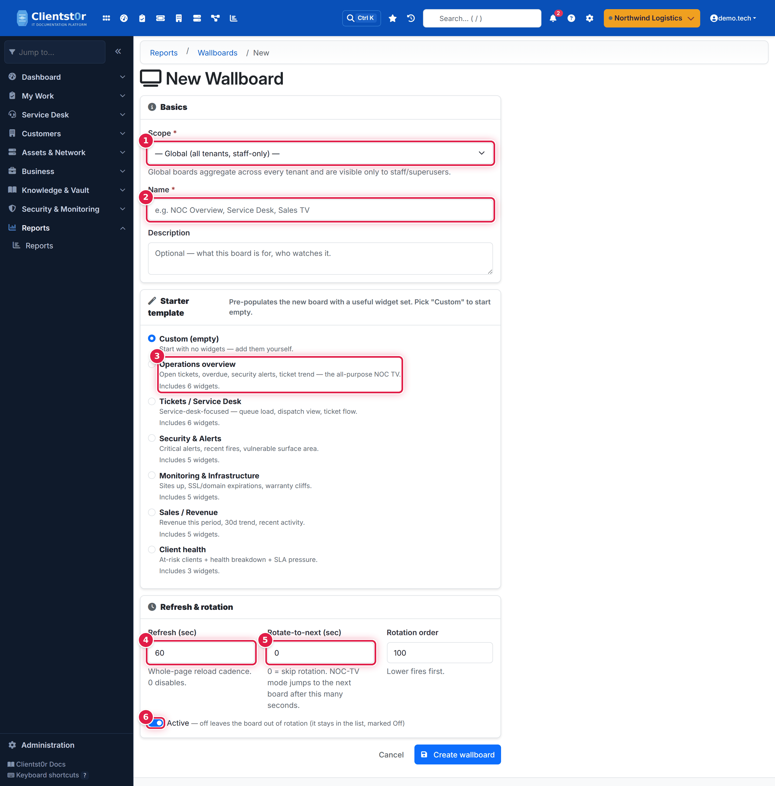
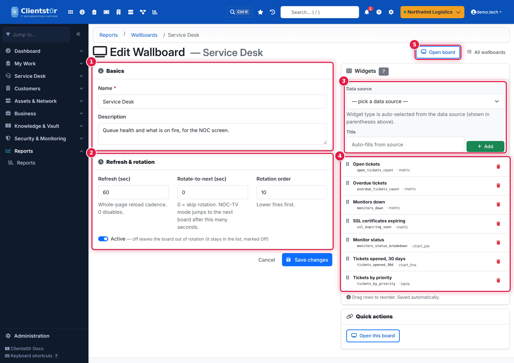
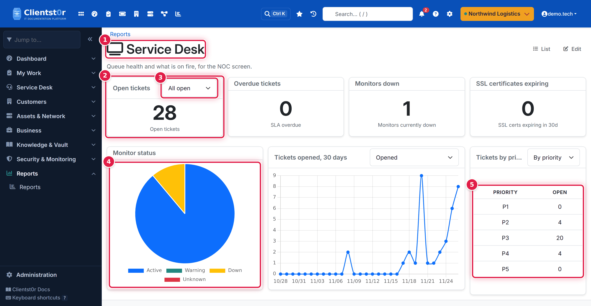
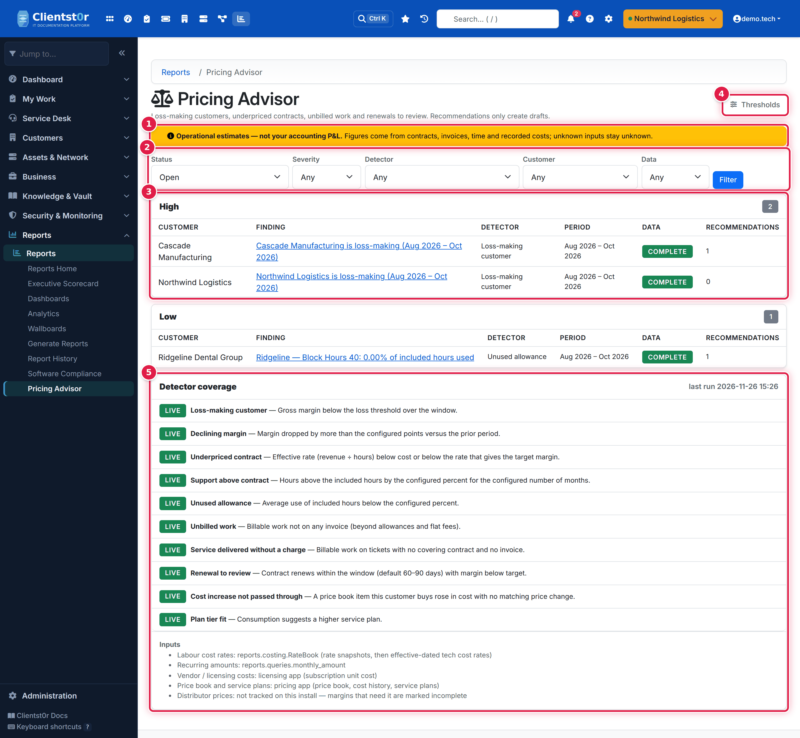
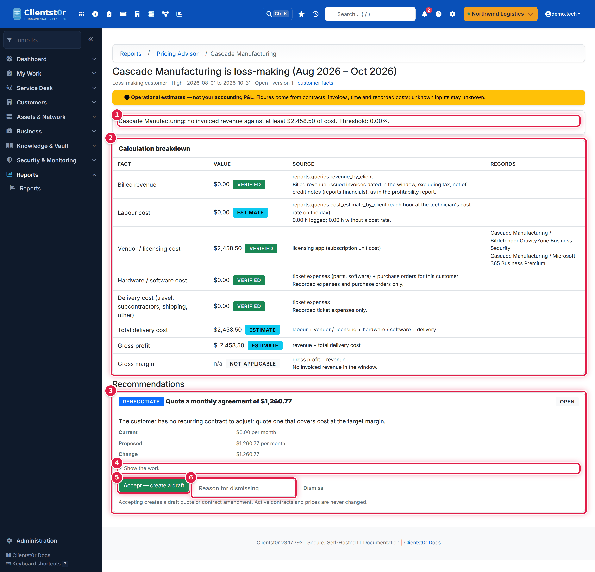
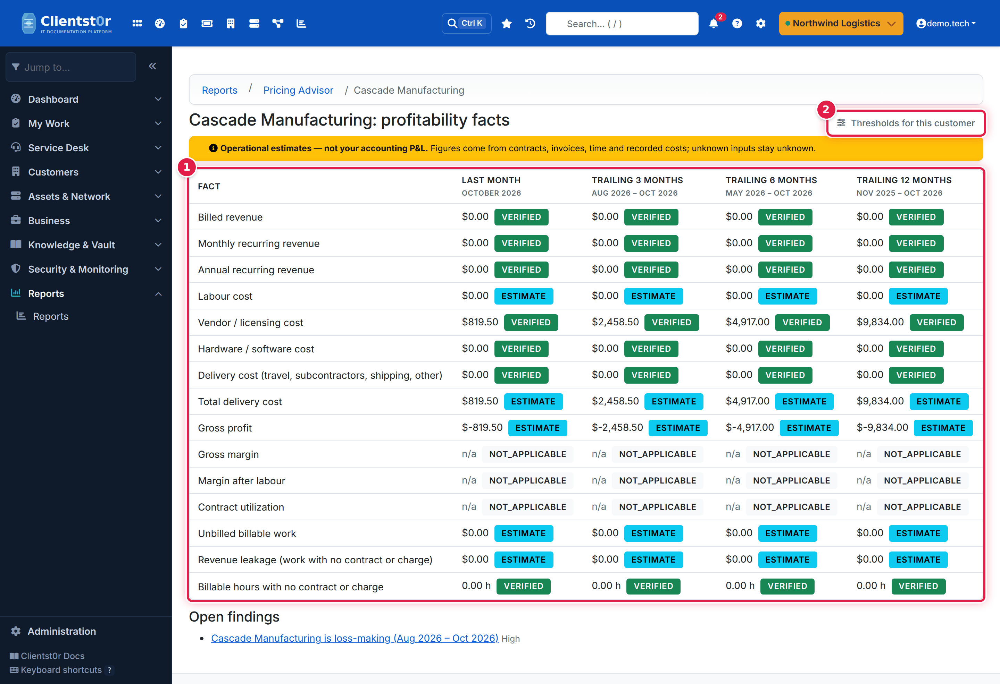
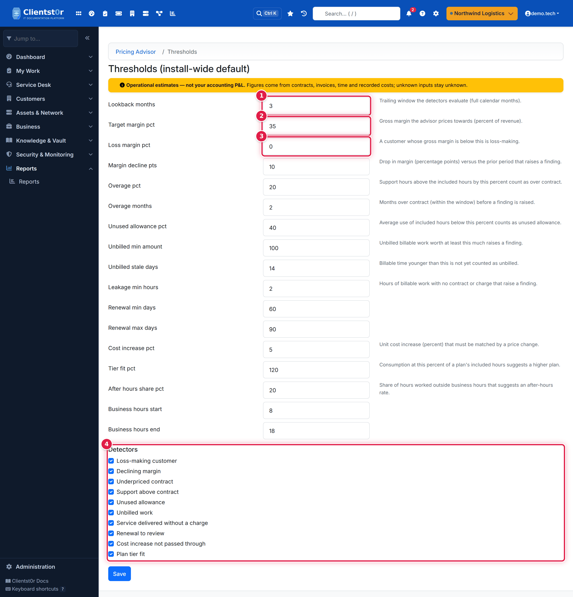

# Wallboards and the Pricing Advisor

Two pages in the **Reports** section of the sidebar: **Wallboards** (live dashboards meant for a wall-mounted
screen) and **Pricing Advisor** (a nightly check of every customer's contracts, time and costs that points out
where you are losing money or undercharging). Both are for MSP staff only: a customer user who opens an address
under `/reports/` is refused. The other Reports pages are described in [Reports](REPORTS.md) and
[Executive reporting](EXECUTIVE_REPORTING.md). The numbers in each screenshot match the list under it. Every
screenshot is a capture of the application against a demo database; the customers and people in it are
invented.

# Wallboards

## The wallboard list

**Reports → Wallboards** (`/reports/wallboards/`). Every board you may open, ordered by customer name, then
rotation order, then name.

<!-- guide-figure: guide-wall-list -->

1. New wallboard: create a board.
2. Organization: a customer's name, or Global for a board that spans every customer.
3. Refresh: seconds between page reloads.
4. Rotation: seconds on screen before moving on; blank means the board is skipped.
5. View, Start rotation (only when rotation is set) and Edit.
<!-- /guide-figure -->

- A board belongs either to **one customer** or is **Global**. A Global board is visible only to users with the
  staff flag (Django `is_staff`) or superusers; the figures on it are not limited to a customer (see
  [What the widgets show](#what-the-widgets-show)). A board for one customer is listed for people who may
  access that customer; staff and superusers see all of them.
- **Active** and **Off** show whether the board takes part in rotation. An Off board is still in the list and
  can still be opened.
- Per row: **View** (open the board), **Start rotation** (only when the board has a rotation time) and **Edit**.
- **Who can do what.** Opening a board and the list needs the *View dashboards* permission
  (`reports_view_dashboards`), which every role has. Creating, editing, adding and removing widgets and
  re-ordering them needs *Create / edit / delete dashboards and widgets* (`reports_manage_dashboards`), which
  the Owner, Organization Administrator, Service Manager and Sales Manager roles include. See [Roles and access](ROLES_AND_ACCESS.md).

## Creating a board

**New wallboard** (`/reports/wallboards/new/`).

<!-- guide-figure: guide-wall-new -->

1. Scope: one customer, or Global (all customers, staff only).
2. Name: shown in the list and as the page title.
3. Starter template: pre-fills the board with a ready set of widgets.
4. Refresh: seconds between page reloads; 0 turns reloading off.
5. Rotate-to-next: seconds before the rotation view moves on; 0 skips this board.
6. Active: an inactive board is left out of rotation.
<!-- /guide-figure -->

- **Scope** is chosen once and cannot be changed afterwards: one of the customers you may access, or Global
  (staff and superusers only). A name must be unique within its scope.
- **Starter template** fills the new board with widgets so it is useful at once; **Custom (empty)** starts
  with none. The templates are Operations overview, Tickets / Service Desk, Security and alerts, Monitoring
  and infrastructure, Sales / revenue and Client health; the page lists the widgets in each.
- **Refresh (sec)** reloads the whole page that often; `0` stops reloading. **Rotate-to-next (sec)** and
  **Rotation order** control [rotation](#rotation); `0` leaves the board out of it. **Active** off also leaves
  it out.
- Creating a board returns you to the list. Open **Edit** to add or change widgets.

## Editing a board and its widgets

**Edit** (`/reports/wallboards/<id>/edit/`).

<!-- guide-figure: guide-wall-edit -->

1. Basics: name and description. Scope cannot be changed after creation.
2. Refresh and rotation settings.
3. Add a widget: pick a data source; the widget type follows from it.
4. Widgets: drag to reorder (saved automatically) or remove one.
5. Open board: see it as the TV shows it.
<!-- /guide-figure -->

- **Add a widget.** Pick a data source and give it a title (it fills in from the source). You cannot choose
  the widget type: it follows from the source (a number, a table, a line, bar or pie chart). Each source can be
  added more than once.
- **Reorder.** Drag the rows; the order is saved as soon as you drop. Tiles appear on the board in this order,
  filling a 12-column grid: number tiles take a quarter of the width, everything else a third. Tile sizes and
  positions cannot be set on this page.
- **Remove** deletes the widget from the board only.
- Saving the basics keeps the widgets as they are.

## What the widgets show

<!-- guide-figure: guide-wall-view -->

1. Board name and description.
2. A metric tile: one large number and what it counts.
3. Category menu: switch a widget between views of the same data without reloading the page. Only some widgets have one.
4. A chart widget (needs the browser to reach cdn.jsdelivr.net).
5. A table widget.
<!-- /guide-figure -->

Each tile is one data source, shown as a number (**metric**), a table or a chart. Some tiles have a menu in the
title bar (marked 3 above) that switches the same data to another view without reloading the page. The sources
are the same ones the dashboards use:

| Source (type) | What it counts or shows | Menu |
| --- | --- | --- |
| Open tickets count (number) | Tickets whose status is not closed. | All open, Unassigned, SLA overdue, P1 / P2 only |
| SLA-overdue tickets (number) | Open tickets past their resolution due time. | |
| Avg time to resolve (number) | Average hours from creation to close for tickets closed in the last 30 days. | |
| Active techs in 30d (number) | Different people who logged time in the last 30 days. | |
| Open tickets by priority (table) | Open tickets for P1 to P5. | By priority, By queue, By tech (top eight) |
| My assigned tickets (table) | The signed-in user's open tickets: number, subject, priority. It shows the **viewer's** tickets, so on a shared TV it shows the TV account's. | |
| Tickets opened 30d (line) | Tickets per day for 30 days. | Opened, Closed, Opened vs closed (with net change) |
| SLA breach trend 30d (line) | Response-time compliance for P1, P2 and P3 per day. | |
| Revenue this period (number) | Billed revenue over 30 days: issued invoices, excluding tax, net of credit notes. | |
| Revenue trend 30d (bar) | The same figure per day. | Daily, Weekly buckets, Cumulative |
| Top clients by revenue (table) | Five clients with the most billed revenue (excl. tax) and what they still owe (incl. tax). | |
| Unbilled hours at risk (number) | Value of billable time more than 30 days old and not invoiced, over the last year. Hours with no bill rate are counted separately and flagged "incomplete". | |
| Billable vs non-billable (pie) | Hours split over 30 days. | |
| At-risk clients (table) / Client health breakdown (pie) | From the client health score. | Top 5 worst, Trouble only, At-Risk only |
| Low stock items (table) | Inventory at or below its minimum (minimum not zero), ten rows. | |
| Recent sales activity (table) | The last ten CRM activities. | |
| Security alerts last 24h by severity (table), Open critical/high alerts (number), Open alerts by severity (table) | Alerts with status *new*. | Critical + High, Critical only, All open, Last 24h |
| Monitors currently down, SSL certs expiring (30 days), Domains expiring (60 days), Monitor status (pie) | Enabled website monitors. | |
| Warranties expiring soon (number) | Assets whose warranty ends in the next 90 days. | |
| Techs logged in (number) | Active users who signed in during the last 8 hours. | |
| Failed logins last 24h (number) | Sign-in failures recorded by the lockout system. | |
| Vault events last 24h (number) | Audit entries about vault passwords (not their contents). | |

Rules that apply to every tile:

- **The board's scope does not filter the numbers; the viewer does.** A tile counts what the person looking
  at it may see, across every customer they may access. A board created for one customer is therefore not a
  "this customer only" screen. Do not rely on it to show one customer's figures.
- A tile the viewer is not entitled to shows a warning in place of numbers, for example "Restricted — needs the
  reports_view_financial permission". Money tiles need *reports_view_financial*, the SLA tile *reports_view_sla*,
  ticket tiles *tickets_view*, and so on; failed logins and techs logged in are visible only to someone
  entitled to every customer.
- If a source fails, only that tile shows an error.

## Rotation

Set **Rotate-to-next** above 0 on each board you want in the cycle, then open **Start rotation** from the list,
the editor or the board.

- Rotation shows a board for its own number of seconds, then loads the next active board with a rotation time,
  in **Rotation order** (ties by name). It stays within the same scope: Global boards rotate with other Global
  boards, a customer's boards with that customer's other boards.
- It works by the page redirecting itself, so it needs no scripts or cookies beyond the sign-in. While rotating,
  only the rotation time applies: the board reloads when it moves on, so its **Refresh** time is not used. With
  a single rotating board, the board simply reloads itself.
- A board with rotation 0 or marked Off is skipped, but can still be opened directly.

## Full screen, TVs and signing in

- There is no separate full-screen or kiosk page. A board is the normal application page, with the sidebar and
  the top bar around it. Put the TV's browser into full-screen (usually F11) and open the board's address, or
  its rotation address (`/reports/wallboards/<id>/rotate/`).
- **There is no share link and no token.** A TV signs in like a person: someone types a user name and password
  (and the two-factor code, if the account needs one) on it, and the browser keeps the session. Nothing on a
  board can be opened without signing in, and the address alone shows nothing.
- **What that exposes.** Whatever the signed-in account can see. The TV is a signed-in browser with the whole
  application behind the board: anyone at the screen with a keyboard or mouse can open other pages, and the
  tiles can show customer names (top clients, at-risk clients, recent sales) and, for *My assigned tickets*,
  ticket subjects. Use a dedicated MSP staff account that has only the permissions the board needs
  (see [Roles and access](ROLES_AND_ACCESS.md)), not a person's own account, and keep the TV where visitors
  cannot read it. The account must be MSP staff to open Reports at all, and have the staff flag to see Global
  boards.
- **Sessions end.** The normal session limits apply: after the maximum session length (8 hours unless changed
  in Settings → Security) the TV returns to the sign-in page even though the board reloads every minute.
  Plan for someone to sign the TV in again; there is no way to keep it signed in permanently.
- Charts and the drag-to-reorder list load their scripts from `cdn.jsdelivr.net`. A TV on a network that blocks
  it shows number and table tiles but empty chart tiles.
- For a screen that must show work without anyone signing in, the Scheduling section has a separate
  **Wallboard** (Scheduling → Wallboard, `/scheduling/wallboard/`): a public link, off by default, that lists
  scheduled tasks only, with the client, technician and ticket-number fields optional. It is a different feature
  and is not the board described here.

## Sharing

Boards are shared by who can open them, not by link: staff and superusers see every customer's board and the
Global ones; anyone else (a staff user without the flag) sees the boards of the customers they may access. To
let a colleague see a board, give them the permission and open it from the list.

# Pricing Advisor

**Reports → Pricing Advisor** (`/reports/advisor/`). It is for MSP staff who hold the *view profitability*
permission (`view_profitability`; on an install that predates it, *reports_view_financial*) for at least one
customer. The advisor only reads: it never changes a contract, a price or an invoice. Everything it shows is an
operational estimate built from contracts, invoices, logged time and recorded costs, **not an accounting
profit and loss**, and the page says so at the top.

## The nightly job

A scheduled task, *Pricing Advisor (profitability findings)* (`manage.py run_advisor`), runs once a day
(interval 1,440 minutes; it can be paused or run by hand under Scheduled Tasks).

- It evaluates every active customer that had a contract, an invoice or logged time in the last two years or
  so (long enough to cover a 12-month window and the one before it).
- The window is the **last full calendar months** (3, 6 or 12 months by setting; default 3), ending last
  month, and is compared with the window before it.
- A finding is kept **once** per customer, rule and period (and contract, where it is about one): a later run
  updates it and raises its version only when something in it changed. When a rule stops matching, the finding
  is closed as *Resolved* (same period) or *Superseded* (a new month started). Recommendations you already
  accepted or dismissed are not touched.
- A rule whose data does not exist on the install (for example no price book) is not evaluated and is marked
  so, instead of guessing.
- Thresholds are changed on the [thresholds page](#thresholds); a change applies from the next run.

## The findings list

<!-- guide-figure: guide-wall-adv-list -->

1. Reminder: these are operational estimates, not an accounting P&L.
2. Filters: status, severity, detector, customer and whether the data was complete.
3. Findings grouped by severity; each links to its detail page.
4. Thresholds (superusers): install-wide settings.
5. Detector coverage: which rules ran at the last run, and which inputs were available.
<!-- /guide-figure -->

- Findings are grouped by severity (Critical, High, Medium, Low, Information). The filters are status
  (Open by default), severity, rule, customer and whether the data was complete. Up to 1,000 rows show.
- **Complete / incomplete.** A finding is incomplete when a figure it needs is unknown, most often a
  technician with no cost rate or a time entry with no bill rate. The advisor does not fill in a placeholder.
  It states what is missing, draws a conclusion only when it is certain whatever the missing figure is (costs
  are never negative, so revenue minus the costs that are known is an upper limit on profit), and otherwise
  raises an *Information* finding saying it could not be evaluated. Prices proposed from incomplete costs are
  marked **minimum**.
- **Detector coverage** lists each rule, whether it ran at the last run, and the sources of its inputs.
- You see only the customers you hold the permission for, within your technician client scope.

## The ten finding types

Each uses the customer's window; "target margin" and the other thresholds are in the settings. Margin means
gross margin: (billed revenue − total delivery cost) ÷ billed revenue.

- **Billed revenue** is issued invoices dated in the window, excluding tax, net of credit notes (draft invoices
  are not counted), as in the profitability report.
- **Total delivery cost** is labour (each logged hour at the technician's cost rate on the day) + vendor and
  licence costs (from the licensing module, when installed) + hardware and software (ticket expenses of type
  parts or software, plus purchase orders for the customer) + delivery (mileage, subcontractors, shipping and
  other ticket expenses).

| Finding | Raised when | Severity |
| --- | --- | --- |
| Loss-making customer | Margin is below the loss threshold (default 0%), or there is cost and no revenue at all. | High; Critical when the loss is more than 25% of revenue |
| Declining margin | Margin fell by at least the configured points (default 10) against the prior window; compares labour-only margin when other costs are incomplete. | High when now below target margin, otherwise Medium |
| Underpriced contract | A contract's effective rate (revenue ÷ hours on it) is below cost per hour, or below the rate that would give the target margin. | High below cost, Medium below target |
| Support above contract | Hours exceeded the included hours by more than 20% in at least 2 months of the window. | High when every month, otherwise Medium |
| Unused allowance | Average use of included hours is below 40%. | Low |
| Unbilled work | Billable time older than 14 days, on no invoice, worth at least $100 (hours over an allowance not yet invoiced count; flat-fee and in-allowance work do not). | High at five times the minimum, otherwise Medium |
| Service delivered without a charge | At least 2 billable hours on tickets with no covering contract and no invoice. | Medium |
| Renewal to review | A contract ends 60 to 90 days from today and the customer's margin is below target. | High when margin is negative, otherwise Medium |
| Cost increase not passed through | A price-book item the customer buys rose in unit cost by at least 5% and its price has not changed since. Needs the price book's cost history. | Medium |
| Plan tier fit | Hours per month are at least 120% of what the customer's service plan includes. Needs service plans. | Medium |

There is no separate after-hours finding. When at least 20% of the hours on an underpriced contract fall
outside business hours (default 8:00 to 18:00, weekdays), *Underpriced contract* also gets an after-hours rate
recommendation.

## A finding and its recommendations

<!-- guide-figure: guide-wall-adv-detail -->

1. Summary: the calculated explanation, in plain words.
2. Calculation breakdown: every figure, whether it is verified or an estimate, where it came from and which records it used.
3. A recommendation with the current and proposed amounts.
4. Show the work: the formula, each step, inputs, assumptions and what is unknown.
5. Accept: creates a draft quote or contract amendment. Nothing is sent or changed.
6. Dismiss needs a reason.
<!-- /guide-figure -->

- **Summary.** A plain sentence from the calculation, written by the program, not by AI.
- **Calculation breakdown.** Each fact with its value, a basis badge (*verified*: a recorded amount such as an
  invoice or contract term; *estimate*: derived with rates; *unknown*), the source and links to the invoices,
  contracts or tickets behind it. Missing inputs are listed under the fact.
- **Recommendations.** Each has a type (price increase, renegotiate, after-hours rate, per-device price,
  bundle review, upsell, tier change), the current and proposed amount, and **Show the work**: the formula,
  every step with its numbers, the inputs, the assumptions and what is unknown. Price recommendations aim at the
  target margin: required monthly revenue = monthly cost ÷ (1 − target margin).
- **Customer facts** (`/reports/advisor/customers/<id>/`, linked from each finding and from the customer's
  page) shows the same facts for the last 1, 3, 6 and 12 months, computed now.

<!-- guide-figure: guide-wall-adv-facts -->

1. One row per fact, one column per window ending at the last full month.
2. Thresholds for this customer: per-customer overrides.
<!-- /guide-figure -->

### Accepting and dismissing

- **Accept — create a draft.** Needs *Accept or dismiss Pricing Advisor recommendations*
  (`act_on_pricing_recommendations`) for that customer; the Billing / Finance role has it. A change to a contract's
  recurring amount or hourly rate becomes a **draft contract amendment**: a new contract in Draft status copying
  the old one's terms with the proposed figure, and a note holding the calculation. Everything else becomes a
  **draft quote** with one line, valid for 30 days. The active contract, the prices and the customer are
  untouched and nothing is sent; review the draft and use the normal flow to activate or send it.
- When the draft is activated (or the quote accepted), the recommendation changes to *Implemented* on its own.
- **Dismiss** needs a reason, which is kept with who dismissed it and when. A decided recommendation is not
  re-opened by later runs.
- Both actions are written to the audit log.
- A person who can view but not act sees the recommendations without the buttons.

## Plain-English explanation (OPTIONAL AI)

**OPTIONAL AI.** The advisor is complete without it. The **Explain in plain English** button appears on a
finding only when all of these hold: the install's AI master switch (`psa_ai_enabled`, Administration → General → Service Desk) is on;
you have the technician-access AI *analyze* capability for that customer; and the customer's AI policy allows
ticket AI, has not excluded the customer, and a model profile and budget are available. It sends one request
to the customer's configured provider through the same gateway that ticket AI uses, and counts it against that
customer's AI budget. See [Client data protection](CLIENT_DATA_PROTECTION.md) and
[Technician access](TECHNICIAN_ACCESS.md).

**What is sent.** Only the finding's computed content, as structured text, plus a fixed instruction that tells
the model to use only the figures given, never to guess a missing cost, and to answer in at most 150 words:

- the rule name, severity, period, title and summary, whether it is complete and what inputs are missing;
- each fact: label, unit, value, whether it is verified, an estimate or unknown, and its note;
- each recommendation: type, title, proposed numbers, formula, steps, assumptions and unknowns;
- the thresholds applied.

The customer's name and the names of its contracts are replaced with "the customer" and "the contract".
Record links and record lists are removed. **Not sent:** tickets, ticket notes, documents, passwords, the
sign-in user's name, and other customers' data. The replacement of names is an exact text match, so a
technician's user name that appears in a "no cost rate for …" line, or a variant spelling of a customer name
in a note, is sent as written.

**What comes back.** Every amount and percentage in the answer must also appear in what was sent. If any does
not, the answer is thrown away, the page says so and shows the calculated summary instead. An accepted
explanation is saved per version of the finding with the model's name, so it is not requested again until the
finding changes, and the audit log records that it was generated or rejected. The AI cannot create drafts,
accept or dismiss anything, or change a setting.

## Thresholds

**Thresholds** on the list (superusers) open `/reports/advisor/settings/`: the install-wide defaults. A person
with the act permission can open **Thresholds for this customer** on the customer's facts page to set that
customer's own values, which win over the defaults and over a parent customer's.

<!-- guide-figure: guide-wall-adv-settings -->

1. Window: 3, 6 or 12 full months.
2. Target margin: what recommended prices aim for.
3. Loss threshold: margin below this is loss-making.
4. Detectors: untick one to stop running it.
<!-- /guide-figure -->

- The settings are: window, target margin (default 35%), loss threshold (0%), margin-decline points (10),
  over-contract percentage and months (20% and 2), unused-allowance percentage (40%), unbilled amount and days
  (100 and 14), leakage hours (2), renewal window (60 to 90 days), cost-increase percentage (5%), tier-fit
  percentage (120%), after-hours share (20%) and business hours (8 to 18). Each rule can be switched off.
- Saving is written to the audit log with the old and new values.

## Limits

- Findings are only as good as the cost rates, bill rates and recorded expenses: with a missing cost rate a
  customer shows as "cannot be evaluated" rather than as profitable.
- Distributor prices are looked up live and not stored, so they are not used. Vendor costs need the licensing
  module.
- A run covers whole months, so work logged this month shows up after the month ends.
