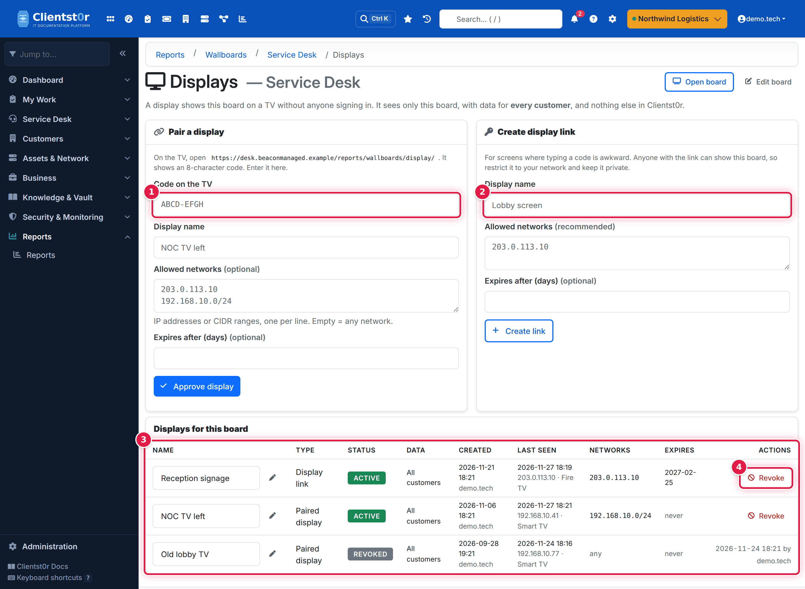

# Wallboard displays

## Showing a board on a TV

A wallboard display shows one wallboard on a TV, kiosk or spare screen without anyone signing in on
that screen. The screen can see that one board and nothing else in Clientst0r: no menus, no other
boards, no tickets, no settings, no API.

There are two ways to set a screen up. Both are on the board's **Displays** page (open the board,
then **Displays**). You need permission to edit the board.

<!-- guide-figure: guide-wall-displays -->


1. Pair a display: type the code the TV shows, give the screen a name and approve it. An IP rule and an expiry are optional.
2. Or create a display link for a player that takes an address. It is shown once; keep it like a password.
3. Every display of this board: its type, status, scope, last seen time and address, IP rule and expiry.
4. Revoke stops the screen at its next refresh. It then shows Display revoked — pair again.
<!-- /guide-figure -->

### Pair a display (recommended)

1. On the TV, open `https://<your Clientst0r address>/reports/wallboards/display/`.
   The screen shows an 8-character code, such as `K7QP-3MXD`.
2. On your computer, open the board and choose **Displays**.
3. Under **Pair a display**, type the code, give the display a name (for example "NOC TV left"),
   and optionally add an IP rule and an expiry.
4. Choose **Approve display**. Within a few seconds the TV loads the board.

The code is valid for 10 minutes and works once. If it expires, the TV shows a new one by itself.
Reloading the page on the TV also replaces the code.

### Create a display link

For screens where typing a code is awkward (digital signage players that take a URL), choose
**Create display link**. Clientst0r shows the link **once** — copy it then; only a fingerprint of it is
kept, so it cannot be shown again. Open the link on the screen. The screen remembers it and the
address bar changes to the plain display address, so the secret is not left in the address bar.

The secret is the part after `#`. Browsers never send that part to a server, so it does not end up in
web-server or proxy logs; the screen's own page reads it and hands it over in a form post. Copy the whole
link, including everything after `#`. The link keeps working until it is revoked or expires, so a player
that forgets its cookies on restart can open it again.

Anyone who has the link can show the board, so treat it like a password: add an IP rule, and set an
expiry if the screen is temporary. If the link leaks, revoke it and create a new one.

### IP rules

Each display can have an optional list of IP addresses or CIDR ranges (one per line), for example:

```
203.0.113.10
192.168.10.0/24
```

The address checked is the one Clientst0r sees after your trusted proxies (Settings → Security →
API Access Control → Client address). For a TV in your office that is usually your office's public
address. When the display is outside its rule it shows **Not allowed from this network** and no data.
When pairing, Clientst0r refuses an IP rule that does not include the address the TV is on, so you find
out straight away rather than at the TV.

### What a display can and cannot see

- **One board.** A display is tied to the board it was paired with. Rotation between boards is not
  available on a display; pair one screen per board, or use one board with the widgets you need.
- **The board's customer only.** A customer's board shows that customer's data. A global board shows
  every customer, and only someone who can see every customer can put a global board on a display.
- **The approver's permissions at the time.** Widgets the person who approved the display could not see
  (for example financial widgets without the financial reports permission) show "Restricted" on the
  display too. This is recorded when the display is approved; later changes to that person's role do not
  widen what the display sees. To change it, revoke the display and pair it again.
- **Never on a display:** vault activity, failed sign-ins and "my assigned tickets". These widgets show
  "Not available on displays". New widget types stay hidden on displays until they are reviewed.
- **No account.** The display gets no session and no user. It cannot open any other page, report, API
  endpoint or the admin site.
- **Whoever is signed in on the screen's browser does not matter.** The display pages are decided by the
  display alone, so a browser that also has someone signed in shows the same board, no more and no less.

The display refreshes on the board's refresh interval (at least every 15 seconds, at most every 5 minutes
when the board's refresh is off) and shows the time it last updated in the top-right corner. That time turns
amber when updates have stopped arriving. When widgets are added, removed or reordered the screen reloads
by itself.

### Revoking and renaming

The **Displays** page lists every display of the board with its type, status, who created it and when,
when it was last seen and from which address, its IP rule and its expiry.

- **Revoke** stops the display at its next refresh. The screen shows **Display revoked — pair again**.
- **Rename** changes the label only.
- Switching the board off (Edit → Active) or deleting it also stops its displays.

Pairing, creating a link, renaming and revoking are written to the audit log (object type
`wallboard_display`).

### Troubleshooting

| What the screen shows | What to do |
|---|---|
| A code that never gets accepted | Check the code (letters and digits, no 0/O or 1/I/L). Codes expire after 10 minutes; the TV shows a fresh one by itself. After 10 attempts in 10 minutes you have to wait. |
| "Display revoked — pair again" | The display was revoked, expired, or its board was switched off or deleted. Choose **Pair again** on the screen and pair it. |
| "Not allowed from this network" | The screen's address is outside its IP rule. Check the address under **Last seen** on the Displays page, then revoke and pair again with a wider rule. |
| "Too many pairing requests" | Many screens on one network asked for codes in the last hour. The screen retries by itself after a few minutes. |
| "Display link not valid" | The link was revoked, expired, or copied incompletely (the part after `#` is the secret). Create a new one. |
| A tile says "Restricted" | The person who approved the display could not see that widget's data. Pair again as someone who can. |
| The board page needs a sign-in | The screen was opened on the board's normal address (`/reports/wallboards/<number>/`). Use `/reports/wallboards/display/` instead. |

The display works only while its browser keeps cookies. A browser in private mode, or one that clears
cookies on exit, needs pairing again after every restart; use a display link on such players.
