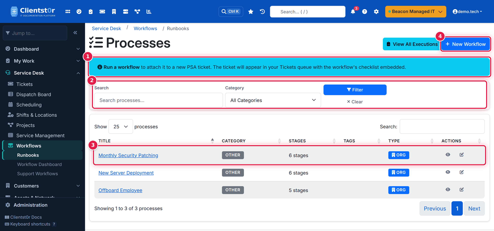

# Workflows: runbooks, rule templates and suggestions

The Workflows pages (**Service Desk → Workflows**) hold step-by-step runbooks your team runs for a customer, a
dashboard of the runbooks in progress, and two shortcuts into ticket automation: workflow rule templates and
suggested rules. The fifth tab, **Support Workflows**, guides a technician from a monitoring alert to a verified
fix and has its own guide: [Support workflows](SUPPORT_WORKFLOWS.md). The numbers in each screenshot match the list
under it. Every screenshot is a capture of the application against a demo database; the customers and people in it
are invented.

| Tab | What it is for | Who sees it |
|---|---|---|
| Runbooks | Write and run step-by-step procedures | The Workflows module is on and your role includes *View documents* for the selected customer |
| Workflow Dashboard | Progress of a customer's runbook runs | The Workflows module is on and a customer is selected |
| Support Workflows | Guided fixes for monitoring alerts on tickets | Service desk on, routing *manage* permission ([guide](SUPPORT_WORKFLOWS.md)) |
| Templates | Saved workflow rules you can copy onto a customer | Service desk on, MSP staff |
| Suggestions | Rules suggested from ticket patterns (OPTIONAL AI) | Service desk on, MSP staff, AI features on |

Templates and Suggestions also sit under **Administration → Automation**; the tabs here are shortcuts to the same
pages. The Workflows module is switched on and off in the system settings (it is on by default).

## Runbooks

<!-- guide-figure: guide-runbooks -->

1. Running a runbook opens a ticket that carries its checklist.
2. Search by title or description, or filter by category.
3. A runbook: its category, number of stages, tags, and whether it belongs to this customer (Org) or to every customer (Global).
4. Write a new runbook for the selected customer.
<!-- /guide-figure -->

A runbook (the page title says Processes) is an ordered list of stages for a job you do repeatedly: onboarding or
offboarding a user, deploying a server, monthly patching. The list shows the selected customer's published
runbooks plus the global ones that apply to every customer. In Global View, superusers and MSP staff see the
runbooks of all customers. Without a customer selected, everyone else is sent to pick one first.

- **Search and Category** narrow the list. Categories include user onboarding and offboarding, client onboarding,
  offboarding and termination, system deployment, maintenance, incident response, backup and recovery, security
  audit, change management and other.
- **New Workflow** needs *Create documents* for the customer. Give it a title, description, category, tags and its
  stages, and tick *published* so it appears in the list.
- **Edit** needs *Edit documents* and **Delete** needs *Delete documents*. Global runbooks have no Edit or Delete
  here; superusers manage them separately.
- **View All Executions** (superusers) lists every run.

<!-- guide-figure: guide-runbook -->
.")

1. Launch Workflow: pick the customer and assignee; a ticket opens with this checklist.
2. Edit or delete the runbook (not offered on global runbooks).
3. Draw a flowchart of the stages as a diagram.
4. The stages, in order. A stage can link a document, password, secure note or asset and can require confirmation.
<!-- /guide-figure -->

### Stages

Each stage has a title, instructions, an estimated duration, and optional links to a document, a password, a
secure note or an asset of that customer. A stage marked *requires confirmation* shows the badge. **Generate
Flowchart** draws the stages as a diagram, saved with the customer's diagrams and linked from the runbook; it is
built from the stages themselves, not by AI, and needs *Edit documents*.

### Running a runbook

**Launch Workflow** starts a run. With the service desk on:

1. Pick the **client** the work is for (customers where your role may file tickets), an optional **assignee** (when
   you may assign tickets for that customer), a due date and notes.
2. Clientst0r opens a ticket named *Workflow: <runbook title>* for that customer, with the SLA due times applied,
   and links the run to it. The runbook's checklist appears on the ticket.
3. Tick off the stages as you go. The person the run is assigned to, or anyone whose role edits that customer's
   tickets, can tick them.

Launching fails with a message when the service desk is missing its defaults (an active queue, a *New* status, a
priority and a ticket type). With the service desk off, a run is kept on its own, without a ticket.

## Workflow Dashboard

How far the selected customer's runbook runs have got. It needs a customer in the customer switcher; in Global
View it sends you to the list of all runs.

- **Active runbooks**, **Stages completed** (done out of total) and **Overall progress** across all of them.
- Below, the runs grouped by runbook category, each with its assignee, status, progress, start and due date.
  Cancelled and failed runs are left out; completed runs stay listed.
- **All Executions** opens the full list of runs.

There is no figure here because the demo database has no runbook runs.

## Templates

Workflow rule templates are saved ticket automation rules (a trigger, conditions and actions, sorted by category:
routing, SLA and escalation, notification, cleanup, other). **Use Template** copies one into a new, active
workflow rule, for one customer or MSP-wide, and opens the rule editor so you can adjust it.

- Viewing the list needs MSP staff. **Use Template** needs *Manage ticket workflow rules and workflow templates*,
  and offers only the customers you may write rules for; **MSP-wide** is offered only to people whose client scope
  is not restricted.
- Clientst0r ships no templates and has no page for saving a rule as a template, so on most installations this
  list is empty and says so, with a link to Workflow Rules. The demo database has none either, so there is no
  figure.

Workflow rules themselves are under **Service Desk → Tickets → Configure → Workflow Rules**.

## Suggestions (OPTIONAL AI)

Suggested workflow rules, drawn from recent ticket patterns. The page shows them only while AI features
(`psa_ai_enabled`, **Administration → AI Configuration → AI & LLM**) are on; otherwise it says AI features are disabled.

- **Where they come from.** The scheduled task *PSA Workflow Suggestions (optional AI)* runs once a day and does
  nothing while AI features are off. Today it is a rule of thumb over the last 30 days, not a language model: when
  five or more tickets of one priority were all assigned to the same person, it suggests a rule that assigns new
  tickets of that priority to them; when a tag appears on five or more tickets, it suggests looking at automating
  that tag (a rule with no actions yet).
- **Accept** turns the suggestion into a workflow rule that is **active straight away**, and opens it in the rule
  editor. Review it there. **Dismiss** hides the suggestion. Both need administrator rights and the AI permission
  to create workflows for that customer.
- **View suggested payload** shows the draft rule before you accept it.

The demo database has no pending suggestions, so there is no figure.

## Related guides

- [Support workflows](SUPPORT_WORKFLOWS.md)
- [Service management: catalog, changes, problems and releases](SERVICE_MANAGEMENT.md)
- [Ticket routing](TICKET_ROUTING.md)
- [Roles and access](ROLES_AND_ACCESS.md)
