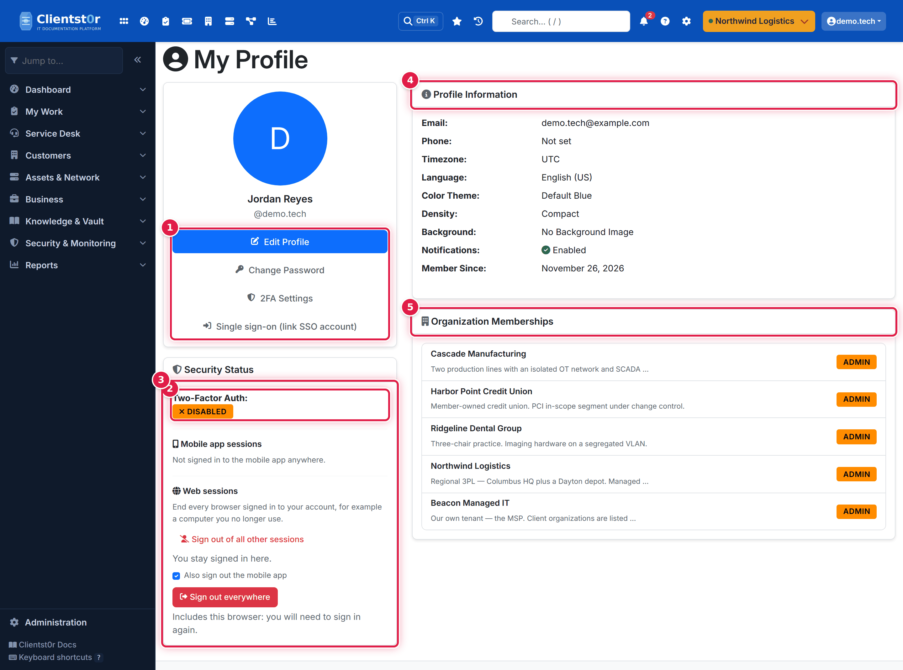
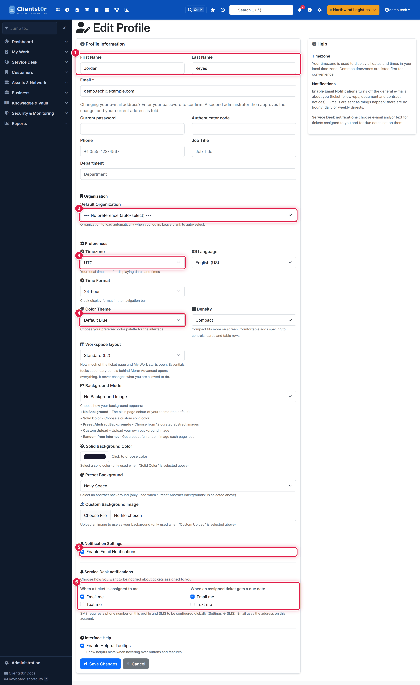
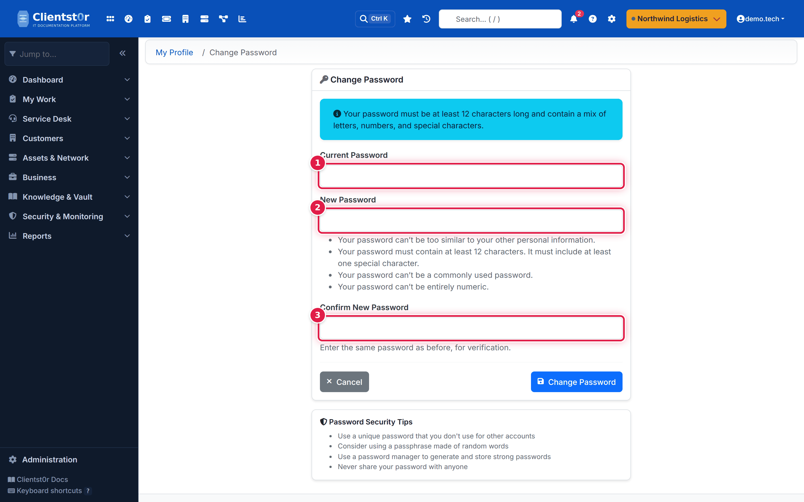
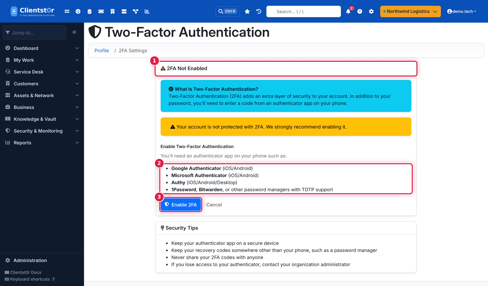
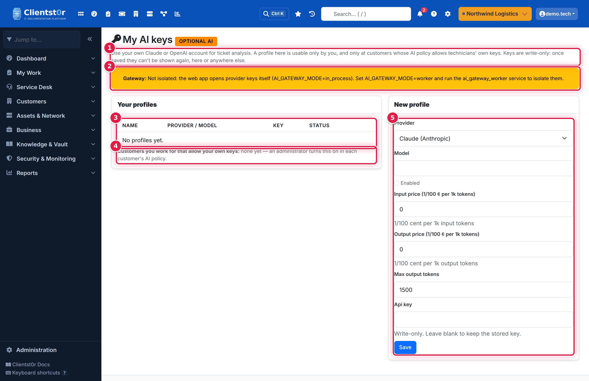

# Your account: profile, security and AI keys

The pages that belong to you rather than to a customer: your profile and preferences, your password and
two-factor sign-in, your sessions, and, for technicians, your personal AI keys. Open them from the account
menu (your user name at the top right) or from **My Profile** in the sidebar's account section. Every
signed-in user has **My Profile**; **My AI keys** is for MSP technicians and superusers and appears only when
AI features are switched on. The numbers in each screenshot match the list under it. Every screenshot is a
capture of the application against a demo database; the customers and people in it are invented.

## My Profile

**Account menu → My Profile** (`/accounts/profile/`). A read-only summary of your account with buttons to
change it.

<!-- guide-figure: guide-acct-profile -->

1. Edit Profile, Change Password, 2FA Settings and Single sign-on (link SSO account).
2. Security Status: whether two-factor is on, plus your last sign-in time and address once you have signed in.
3. Sign out of all other browsers (you stay signed in here), or everywhere including this browser.
4. What the profile currently holds: contact details, time zone, language, theme, density, background and notifications.
5. The customers you belong to and your role in each. Read only here.
<!-- /guide-figure -->

- **Profile Information** shows the values saved under Edit Profile. It cannot be edited in place.
- **Security Status** shows whether two-factor is on, your last sign-in time and the address it came from
  (once you have signed in), and the mobile app sessions that are signed in as you.
- **Organization Memberships** lists the customers you belong to and your role in each. You cannot change
  them here; an administrator does ([Roles and access](ROLES_AND_ACCESS.md)).
- **Single sign-on (link SSO account)** opens the page for linking a single sign-on identity
  ([Single sign-on](OIDC_SSO.md)). When Microsoft sign-in is set up for the install, a Microsoft sign-in box
  also appears under Security Status, where you confirm your password to link or unlink your Microsoft account.

## Edit Profile

**My Profile → Edit Profile** (`/accounts/profile/edit/`). One form saves everything below.

<!-- guide-figure: guide-acct-edit -->

1. Name, e-mail, phone, job title and department.
2. Default Organization: the customer loaded when you sign in.
3. Time zone, language and time format.
4. Color theme, and Density next to it.
5. Email notifications on or off.
6. Ticket notifications: email or text when a ticket is assigned to you, and when an assigned ticket gets a due date.
<!-- /guide-figure -->

- **Name, e-mail, phone, job title, department.** The e-mail address is required. For a superuser,
  an approver or an MSP technician, changing the address asks for your current password (and authenticator
  code if you have two-factor on); the change then waits for a second administrator to approve it, and your
  old address is told. Other users change it at once. The phone number is used for text alerts.
- **Default Organization** is the customer loaded when you sign in. Left blank, the application picks one.
- **Timezone** controls how dates and times are shown to you. **Time Format** (12-hour or 24-hour) sets the
  clock in the top bar.
- **Language.** English (US), Spanish, French, German or Portuguese (Brazil). Pages without a translation
  stay in English.
- **Color Theme.** Professional Dark (the default for new accounts), Dark Mode, Default Blue, Dracula,
  Forest Green, Gruvbox, Monokai, Nord, Ocean Blue, Purple Haze, Solarized Light and Sunset Orange. The
  light/dark switch in the account menu changes this same setting: from a dark theme it moves you to
  Default Blue, from anything else to Professional Dark.
- **Density.** Compact fits more on screen; Comfortable adds spacing to controls, cards and table rows.
- **Background.** None (the default), a solid colour, one of the preset abstract images, an image you
  upload, or a random image. If an administrator has set a background policy, these controls are greyed
  out, your own choice is kept, and it applies again if the policy is lifted.
- **Enable Helpful Tooltips** turns the hover hints on buttons and features on or off.

### Notifications

- **Enable Email Notifications** is your switch for e-mail the application sends about you in general. It is
  honoured by ticket follow-ups, document and contract notices; turn it off and those stop.
- E-mail is sent as things happen. There are no hourly, daily or weekly digests yet (planned); the old
  *Notification Frequency* choice is no longer shown because nothing read it.
- **Ticket notifications** are separate and are acted on. Choose email and/or text for two events: *a ticket
  is assigned to me*, and *an assigned ticket gets a due date*. Email is on by default, text is off. Text
  needs a phone number on your profile and text messaging switched on by an administrator (Settings → SMS);
  without them the box can be ticked but nothing is sent.

## Change Password

**My Profile → Change Password** (`/accounts/profile/password/`).

<!-- guide-figure: guide-acct-password -->

1. Your current password.
2. The new password, which must meet the password rules shown under it.
3. The new password again.
<!-- /guide-figure -->

- Enter your current password, then the new one twice. The rules are listed under the new-password box: at
  least 12 characters (the install's own minimum can be set by an administrator) with a special character, not
  too like your name or e-mail, not a common password, not only digits.
- When the change is saved you stay signed in here and **every other web session of your account is signed
  out**. Mobile app sessions are not affected.
- If you signed in through single sign-on and have no local password, ask your administrator how that
  account is meant to sign in.

## Two-factor sign-in

**My Profile → 2FA Settings** (`/accounts/profile/2fa/`). Two-factor adds a six-digit code from an
authenticator app to your password.

<!-- guide-figure: guide-acct-2fa -->

1. Whether two-factor is enabled on your account.
2. Any authenticator app that makes time-based codes works.
3. Enable starts setup: a QR code, then a six-digit code to confirm. Disable turns it off at once.
<!-- /guide-figure -->

1. **Enable 2FA** shows a QR code and the same secret as text, for apps that cannot scan. The QR code is
   drawn on the Clientst0r server; the secret is not sent to any outside service.
2. Scan it with an authenticator app (any app that makes time-based codes), type the current six-digit code
   and press **Verify and Enable**. Nothing is turned on until a correct code is entered; Cancel leaves it off.
3. The next page shows your ten **recovery codes**, once. Save them before you leave the page. From then on,
   signing in asks for a code after the password.

- **Recovery codes.** The 2FA Settings page says how many unused codes you have and has a **Recovery codes**
  button (`/account/two_factor/backup/tokens/`), where **Generate Tokens** makes a fresh set of ten. Codes are
  shown **once** and stored hashed, so they cannot be shown again; generating a new set replaces the old one.
  Keep them somewhere other than your phone. Each works once at the sign-in code prompt. If you set up
  two-factor through the sign-in setup wizard instead, its last page has a **Get recovery codes** button.
- **Disable 2FA** asks for your current password, or a current code from your authenticator app (a recovery
  code also works), then removes your authenticator and your recovery codes. Every attempt, including a
  refused one, is recorded in the audit log. When the install requires two-factor for all users, the page says
  so and has no Disable button.
- **Lost your authenticator and your codes?** Contact your administrator. This page's own advice is to ask your
  organization administrator; there is no self-service recovery page.
- An install can require two-factor for all users (Settings → Security); see the
  [Administrator guide](ADMIN_GUIDE.md).

## Sessions and signing out

On **My Profile**, under Security Status:

- **Sign out of all other sessions** ends every other browser signed in to your account. You stay signed in
  here. Use it after using a shared or lost computer.
- **Sign out everywhere** ends every browser including this one, and, with *Also sign out the mobile app*
  ticked (the default), the mobile app too. You are sent to the sign-in page.
- **Sign out all mobile sessions** ends only the mobile app sign-ins listed above it (device, when it signed
  in, when it was last used).
- These act only on your own account. An administrator can end another user's sessions from that user's page.

## Dashboard and navigation shortcuts

Two more pages reachable from your profile settings, both per user: **Quick Actions**
(`/accounts/profile/quick-actions/`) chooses and orders the tiles on the dashboard, with a reset to the
defaults; **Shortcuts** (`/accounts/profile/shortcuts/`) pins up to three pages in the top bar (MSP staff).

## My AI keys (OPTIONAL AI)

**My AI keys** (`/psa/ai/my-keys/`) is for MSP technicians and superusers, and only while AI features are
switched on (`psa_ai_enabled`). With AI off, the tab is hidden; the page still opens by its address but warns
that your profiles are not used.

<!-- guide-figure: guide-acct-ai-keys -->

1. A profile is usable only by you, and only at customers whose AI policy allows technicians' own keys.
2. Gateway: whether provider keys are stored and opened in isolation.
3. Your profiles. A key shows only as stored (write-only).
4. Customers where your own key can be used.
5. Add a profile: provider, model ID and API key.
<!-- /guide-figure -->

- **What a personal key is for.** Ticket analysis (AI Assist and AI Troubleshoot) can run on a model account
  of your own, Claude or OpenAI, instead of a company or MSP key. A profile is a provider, a model ID, an
  API key and optional per-1,000-token prices and an output limit. Ollama (local) profiles are an administrator
  matter and are not offered here. A new profile needs its key, and starts switched off: tick Enabled.
- **Where a key is used.** Only by you, and only at a customer whose AI policy allows technicians' own keys
  *and* is not set to on-premises only. The page lists the customers you work for that allow it; with none, an
  administrator turns it on in each customer's AI policy. Keys are never tried on someone else's tickets.
- **Where it is stored.** The key is encrypted for the AI gateway at the moment you save it. The web pages
  never show it again, to you or anyone: the list only says "stored (write-only)". To change a key, type a
  new one; leave the box blank to keep the old. Delete removes the profile and its key.
- **Who can see it.** Nobody can read the key itself. Superusers who manage AI profiles (Administration) can
  see that your profile exists, its model and who owns it, and can edit its settings, but not the key. Saves and
  deletes are recorded in the audit log. The gateway line at the top says whether keys are opened only by a
  separate worker process or by the web application itself; an administrator chooses that.
- AI Troubleshoot and the policy side are covered in [AI Troubleshoot](AI_TROUBLESHOOT.md).

## My Work Details

**Account menu → My Work Details** opens three pages that are also tabs of **My Work**: **My Resources**
(skills, certifications, working hours), **My Leave** and **My Billable Target**. They are described, with
screenshots, in [My Work, shifts and scheduling](MY_WORK.md#my-resources); the account menu is only another
way in. What the account menu adds: the same data, scoped to you; nothing here changes your profile or
sign-in.

## Apps and API keys

**Apps & Downloads** (Install App / Add to Home Screen, the Android app, the browser extension) is covered in
[Install the app](INSTALL_APP.md).

Users do not create API tokens on their profile page. API keys are created per customer at `/api/keys/`:
anyone can list and make keys for their own use there, within their own role, and users with the API keys
permission manage all the customer's keys. See [API access control](API_ACCESS_CONTROL.md).

## Related guides

- [Getting started](GETTING_STARTED.md)
- [My Work, shifts and scheduling](MY_WORK.md)
- [Install the app](INSTALL_APP.md)
- [Roles and access](ROLES_AND_ACCESS.md)
