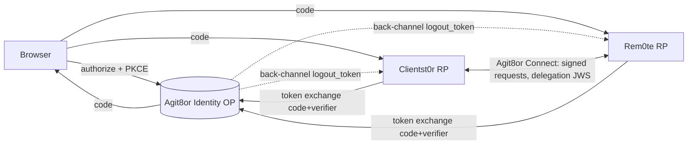

# Agit8or Identity — Architecture

> **Status: design / planned. Nothing in this document is implemented.**
> No IdP is deployed, no app has an Agit8or Identity client, and no
> production change is made by this document. Deployment (MIGRATION.md
> Phase A) requires explicit approval from the owner.
>
> Inputs: the Clientst0r + Rem0te authentication audit and IdP evaluation
> (2026-11-16), the Agit8or Connect audits for both apps (2026-11-16), and the
> product brief. File/line pointers for Rem0te come from a read-only audit and
> must be re-checked by the Rem0te session before work starts.

Companion documents in this directory:

| File | Purpose |
|---|---|
| `ARCHITECTURE.md` | This file — components, trust boundaries, IdP decision, claims contract, flows, separation from Connect, break-glass, threat model |
| `MIGRATION.md` | Phased rollout (A–G) with backward compatibility and rollback per phase |
| `CLIENTST0R_TASKS.md` | Concrete Clientst0r task list with file pointers |
| `REM0TE_HANDOFF.md` | Proposed task list for the Rem0te session (not sent) + interop test plan |
| `IMPLEMENTING.md` | Adoption checklist and conformance tests for any future Agit8or app |

---

## 1. What Agit8or Identity is (and is not)

Agit8or Identity is the **human** single sign-on layer for every Agit8or
application: Clientst0r, Rem0te, Office Unbound, ExploitHound,
MailThreatZero, Roots-HQ, m0nitor and MyAppDone. It is built on an existing,
self-hosted, open-source OpenID Connect Provider (OP); we do not write an
authentication engine.

**Centralised in Identity:** users, authentication, MFA (TOTP, WebAuthn /
passkeys), password policy, account recovery, IdP sessions, tenant (MSP)
memberships, groups, application assignments, coarse role/group grants,
suspension, deactivation, login history, authentication security events.

**Distributed (stays in each app):** authorisation. Every app keeps its own
permission model and enforces it on every request. Identity tells an app *who
the user is, how strongly they authenticated, which MSP organisations they
belong to and whether they are assigned to this app*; the app decides *what
they may do*.

**Explicitly not Identity:**

- Not app-to-app authentication. That is **Agit8or Connect** (separate
  issuer, keys, audiences, stores, admin — see §9).
- Not a replacement for mobile app tokens (`api_mobile.MobileAuthToken`),
  Rem0te `rk_` public API keys, agent enrolment, or integration HMAC/JWS
  credentials. Those are untouched.
- Not an "implicit access" system. Signing into one app never grants access
  to another; every app requires an explicit assignment per user per org.

### Standards

OIDC Core 1.0 + Discovery; OAuth 2.1 profile (Authorization Code + PKCE S256
only, no implicit, no ROPC, exact redirect URI match); OIDC RP-Initiated
Logout 1.0; OIDC Back-Channel Logout 1.0; `acr_values` / `max_age` / `amr`
(RFC 8176) for step-up; WebAuthn L2 / passkeys and TOTP (RFC 6238) at the
IdP; SCIM 2.0 (RFC 7643/7644) only in Phase G and only where it earns its
keep.

---

## 2. Components and trust boundaries

```
                         ┌───────────────────────────────────────────────┐
                         │  TRUST BOUNDARY 1 — Agit8or Identity (OP)      │
                         │                                               │
   Browser ──TLS────────►│  OIDC endpoints (authorize, token, jwks,      │
   (user agent;          │  userinfo, end_session)                       │
    holds only IdP       │  Login UI: password + TOTP + passkeys         │
    session cookie,      │  Admin console (platform admins / MSP admins) │
    app session cookies) │  Claims adapter (Actions / protocol mappers)  │
                         │  Session store, signing keys (ID tokens only) │
                         │  Postgres (users, orgs, grants, sessions,     │
                         │  events)  ── encrypted backups ──► offsite    │
                         └────────┬───────────────────────┬──────────────┘
                 ID token (aud=   │  back-channel logout  │  ID token (aud=
                 clientst0r)      │  POST logout_token    │  rem0te)
                                  ▼                       ▼
 ┌──────────────────────────────────────┐   ┌──────────────────────────────────────┐
 │ TRUST BOUNDARY 2 — Clientst0r (RP)    │   │ TRUST BOUNDARY 3 — Rem0te (RP)        │
 │ OIDC client (Authlib) + adapter        │   │ openid-client 6.x SSO module          │
 │ ExternalIdentity(iss, sub) → User      │   │ ExternalIdentity(issuer, subject)     │
 │ Mapping → Membership / RoleTemplate    │   │ OidcGroupMapping → Membership/Role    │
 │ Local authz: permission_registry,      │   │ Local authz: capabilities, Role,      │
 │   rmm_permissions, tech_access         │   │   ConfirmPolicy, approval-signer      │
 │ Django DB sessions + IdP sid index     │   │ JWT cookie + sessionsValidAfter       │
 │ Break-glass local admin (sealed)       │   │ Break-glass local admin (sealed)      │
 │ Local login fallback (password+TOTP,   │   │ Local login fallback (password+MFA)   │
 │   Azure, LDAP) during migration        │   │                                       │
 └──────────────────┬───────────────────┘   └───────────────────┬──────────────────┘
                    │                                           │
                    │   TRUST BOUNDARY 4 — Agit8or Connect       │
                    └──────► signed requests + delegation ◄─────┘
                             assertions (Ed25519, own keys,
                             own audiences, own revocation)
                             — NEVER accepts Identity tokens —
```



Trust rules between boundaries:

1. The OP is trusted **only** for authentication facts and coarse grants, and
   only via signed ID tokens validated against the OP's JWKS (pinned issuer).
2. An app never trusts another app's session, cookie or token. SSO between
   apps happens only through the OP session (silent `prompt=none`).
3. An app never forwards a user's ID token or access token to another app.
   App-to-app traffic uses Connect credentials (§9).
4. The browser is never trusted with tokens: no tokens in URLs (other than
   the one-time `code` and `state`), no tokens in `localStorage` /
   `sessionStorage`. Tokens live server-side; the browser holds only
   HttpOnly, Secure, SameSite cookies.

---

## 3. IdP choice — ADR-ID-001: Keycloak

**Status:** decided by the owner (2026-11-16): **Keycloak**, one instance
shared by Clientst0r and Rem0te. Rem0te plans to use Keycloak, so Clientst0r
uses the same one; both apps must target the same Keycloak URL, version and
realm.

> Rem0te's Keycloak is **planned / external**. A read-only check of the Rem0te
> repo and host (2026-11-16) found no Keycloak configuration or container
> yet. Where it runs, its URL, version and realm are an open question (§13).
> Until that is answered, this document assumes a dedicated Keycloak VM as
> described in MIGRATION.md Phase A.

### Context

We need a free, self-hosted, certified OIDC OP with TOTP and passkeys, a
multi-MSP tenancy model with delegated per-MSP admin, back-channel logout,
session revocation APIs, step-up (`acr`), brute-force protection, audit
events, Postgres storage and an HA path. No paid licensing.

### Decision and reasons

**Keycloak ≥ 26.2** (exact minimum to be confirmed in Phase A; 26.x is
needed for GA Organizations and fine-grained admin permissions v2),
**Apache-2.0**, self-hosted on Postgres.

- **Ecosystem consistency.** Rem0te will use Keycloak; one OP for all
  Agit8or apps means one login, one MFA enrolment, one place to suspend a
  user, one back-channel logout fan-out.
- **Standards coverage.** OpenID-certified; Authorization Code + PKCE;
  RP-initiated logout; OIDC Back-Channel Logout per client (with `sid`);
  `acr_values` / `max_age` with Level-of-Authentication (LoA) flows; `amr`
  mapper; WebAuthn (second factor and passwordless/passkeys) and TOTP; Admin
  REST API for session revocation; admin events and login events.
- **Tenancy.** Organizations (one per MSP, users may belong to several) in a
  single realm; realm-per-MSP or instance-per-MSP remains available for MSPs
  that need hard isolation.
- **Licence.** Apache-2.0 — no copyleft or paid-tier questions.
- **Cost.** JVM footprint (~1–2 GB RAM) → separate VM recommended
  (MIGRATION.md §A.3).

### Alternatives considered

| Option | Why not chosen |
|---|---|
| Zitadel | Strong native organisations and delegated admin, lighter runtime. **Rejected for ecosystem consistency** (Rem0te targets Keycloak) and because its licence moved to AGPL-3.0 for v3+, which would need a separate review |
| Authentik | Multi-tenancy is a paid/enterprise feature |
| Ory (Hydra/Kratos/Keto) | Toolkit; we would build login UI, admin and the org model ourselves |
| Authelia | No multi-tenancy; limited admin |

### App-side design stays IdP-neutral

Apps integrate with **any certified OIDC OP**. Keycloak-specific behaviour is
confined to (a) Keycloak configuration (realm, clients, client scopes,
mappers, flows, admin permissions) kept as code (realm export + scripted
`kcadm.sh`/Admin REST provisioning), and (b) a small app-side **adapter**:

| Concern | Keycloak mechanism | App-side adapter responsibility |
|---|---|---|
| Org membership | Organizations feature; `organization` client scope / Organization Membership mapper | Read `organization` claim (alias + id), check pinned org |
| App assignment + roles | Client roles on each app's client, named `<org-alias>:<role>` (e.g. `acme-msp:technician`), granted via groups; emitted only for that client in `resource_access.<client_id>.roles` | Parse prefixed roles into `agit8or` v1 (§4.4) |
| Login gate on assignment | Per-client browser-flow override: "Condition – user role" (any role of this client) else "Deny access" | Re-check assignment anyway |
| `acr` / step-up | ACR-to-LoA mapping on realm/client; "Conditional – Level of Authentication" steps in the browser flow; client "Minimum ACR value" | Map `acr` to `urn:agit8or:acr:*` (already the configured names) |
| `amr` | AMR protocol mapper (authenticator → `pwd`/`otp`/`hwk`…; verify name/availability in the Phase A version) | Consistency check against `acr` |
| Back-channel logout | Client "Backchannel logout URL" + "Backchannel logout session required" (`sid`) | Standard endpoint (§6.3) |
| Session revocation | Admin REST: `POST /admin/realms/{realm}/users/{id}/logout` (all sessions of a user), `DELETE /admin/realms/{realm}/sessions/{id}` (one session); disable user via `PUT /users/{id}` `enabled=false` | Runbook + optional admin helper; apps still rely on back-channel logout |
| Delegated admin | Fine-grained admin permissions v2 (FGAP v2) scoped to the MSP's group/users and to roles prefixed with the MSP alias; Organizations membership management | None — documented in runbook |

If the OP were ever replaced, only the adapter (claim normalisation, `acr`
names) and runbooks change; app models, mapping tables and flows do not.

### Tenancy model in Keycloak: single realm + Organizations (recommended)

The unit is **one MSP = one Keycloak Organization = one Clientst0r install
(one VM) + that MSP's Rem0te tenant and businesses**. Clientst0r serves
exactly one MSP; its `core.Organization` rows are that MSP's customers.

| | **A. Single realm `agit8or` + one Organization per MSP** (recommended) | **B. Realm per MSP** |
|---|---|---|
| Rem0te serving several MSPs | One `rem0te` client, one issuer; tenant chosen by org claim | One client + one `OidcProvider` row per MSP realm (Rem0te supports several providers, but config multiplies) |
| Clientst0r (one MSP per install) | One client per install (`clientst0r-<alias>`), pinned to issuer + org | One client in that MSP's realm, pinned to that realm's issuer |
| Person working for two MSPs | One account, member of two Organizations, roles per org prefix | Two accounts (one per realm) |
| Isolation | Logical: org membership + prefixed roles + FGAP v2 admin scoping; one set of realm signing keys | Strong: separate keys, users, sessions, flows, admins per realm |
| Policy (MFA, passwords, flows, mappers) | Configured once | Repeated per realm (scriptable, but drifts) |
| Scale | Organizations designed for many tenants per realm | Many realms degrade admin and startup performance |
| Delegated MSP admin | FGAP v2 + Organizations — must be proven in Phase A gate 4 | Realm-scoped admin roles — mature |

**Recommendation: A** — single realm `agit8or` with one Organization per MSP.
It fits the "Rem0te serves several MSPs, each Clientst0r install is one MSP"
shape, supports one human in several MSPs, and keeps one policy set.

**Isolation option B** (realm per MSP, or a separate Keycloak per MSP) stays
supported for MSPs that require separate keys, admins and failure domains.
The apps need no change: they pin issuer + org, and in B the issuer pin alone
already separates MSPs. If Phase A gate 4 (admin isolation) fails for A,
the fallback is B for every MSP.

Pinning:

- **Clientst0r** pins the issuer (realm URL, e.g.
  `https://id.<domain>/realms/agit8or`) **and** the MSP Organization id
  (UUID) with its alias, set at setup and changed only via a protected
  change. Tokens without that org membership and at least one
  `<alias>:` client role are refused.
- **Rem0te** binds each `Tenant` to (issuer, org id); a token is mapped only
  into the tenants whose org it carries.

### Keycloak configuration baseline (planned)

- **Passkeys / WebAuthn:** WebAuthn Passwordless Policy (user verification
  required, resident key/discoverable credential) for passkey sign-in;
  WebAuthn Policy for security keys as a second factor; registration via
  required actions.
- **TOTP:** OTP policy TOTP, 6 digits, 30 s, SHA-1 (authenticator-app
  compatibility), look-around 1; `CONFIGURE_TOTP` required action when no
  other second factor exists.
- **MFA required** for every member of an MSP Organization (browser flow:
  password then OTP-or-WebAuthn; or passkey alone counts as `phr`).
  No SMS or email OTP for staff.
- **Password policy:** length ≥ 12, not username/email, password history 5,
  breached-password check if available, Keycloak default hashing (Argon2 on
  26.x; verify).
- **Brute-force detection:** on; temporary lockout (not permanent, to limit
  lockout-as-DoS), max login failures 5, wait increment 1 min, max wait
  15 min, failure reset 12 h; quick-login-check on. Admin events and login
  events enabled with retention ≥ 90 days.
- **Sessions:** SSO session idle 2 h, max 10 h; persistent user sessions
  (26.x default) so restarts don't log everyone out; offline sessions
  disabled for staff clients.
- **Clients:** confidential, Standard Flow only, PKCE S256 required, exact
  redirect URIs, no implicit/direct-grant/service-account on human clients,
  front-channel logout off, back-channel logout URL + session required on.
- **Client scopes:** `openid email profile organization` + an `agit8or`
  scope that carries the AMR mapper and the client-roles mapper for that
  client only; "Full scope allowed" **off** on every client so tokens don't
  carry other clients' roles.

---

## 4. Claims contract (v1)

Apps validate the ID token (signature via JWKS, `iss` exact match, `aud`
contains this app's client_id, `azp` = client_id when multiple audiences,
`exp`, `iat` skew ≤ 120 s, `nonce` matches, `alg` in an allowlist —
`RS256`/`ES256`/`EdDSA`, never `none`, never `HS*`).

### Standard claims used

| Claim | Use | Required |
|---|---|---|
| `iss` | Pinned per configured provider; part of the identity key | yes |
| `sub` | Stable, never-reassigned user id; part of the identity key `(iss, sub)` | yes |
| `aud`, `azp` | Must be this app's client id | yes |
| `email` | Display + JIT username suggestion only. **Never** used to link or match accounts | yes |
| `email_verified` | Must be `true` for JIT provisioning | yes for JIT |
| `name`, `given_name`, `family_name` | Profile display | no |
| `amr` | How the user authenticated (`pwd`, `otp`, `hwk`, `swk`, `user`, `mfa`, …) | yes |
| `acr` | Assurance level achieved (normalised, below) | yes |
| `auth_time` | Time of last interactive authentication; freshness checks for step-up | yes |
| `sid` | IdP session id; stored with the app session; key for back-channel logout | yes |

### Normalised assurance levels (`acr`)

Apps compare against these names; the adapter maps the OP's native values.

| `acr` | Meaning |
|---|---|
| `urn:agit8or:acr:pwd` | Single factor (password or social) — **not accepted by any app for staff in production** |
| `urn:agit8or:acr:mfa` | Two factors (password + TOTP, or password + passkey as second factor) |
| `urn:agit8or:acr:phr` | Phishing-resistant: passkey / hardware key as the authenticator (`amr` contains `hwk` or `swk` with user verification) |

Apps derive MFA from `acr` **and** cross-check `amr` (an `acr` of `mfa`/`phr`
with an `amr` containing only `pwd` is rejected as inconsistent).

### Custom claim `agit8or` (versioned)

Emitted into the ID token (and userinfo) **for the requesting client only** —
a token for Clientst0r never lists the user's Rem0te or ExploitHound
assignments.

```json
{
  "agit8or": {
    "v": 1,
    "app": "clientst0r",
    "status": "active",
    "platform_admin": false,
    "orgs": [
      {
        "id": "6f1c2a9e-3b7d-4c11-9a0e-2f5d8b7c1a01",
        "slug": "acme-msp",
        "kind": "msp",
        "assigned": true,
        "roles": ["msp_admin", "technician"],
        "customers": null
      },
      {
        "id": "a83e4b10-77c2-4f6e-b5d9-0c1e2d3f4a5b",
        "slug": "contoso-msp",
        "kind": "msp",
        "assigned": true,
        "roles": ["technician"],
        "customers": [
          {"id": "cust-ext-0193", "roles": ["technician"]},
          {"id": "cust-ext-0207", "roles": ["readonly"]}
        ]
      }
    ]
  }
}
```

Rules:

- `v` — contract version. Apps reject unknown major versions (fail closed to
  "no SSO login", local login still works). Additive fields are allowed
  within a version; apps ignore unknown fields.
- `app` — must equal the app's configured app key (defence in depth on top of
  `aud`).
- `status` — `active` only; anything else is refused (the OP should not issue
  tokens for suspended users anyway).
- `platform_admin` — Identity platform administrator. **Apps must not map
  this to app superuser automatically**; it is informational / for audit
  unless an app's local mapping table explicitly says otherwise.
- `orgs[].id` — OP organisation id (immutable). `slug` is display only.
- `orgs[].assigned` — the user has an explicit application assignment for
  this app in this org. Entries with `assigned: false` are not emitted in v1
  (reserved).
- `orgs[].roles` — coarse, app-scoped role keys granted in that org. Apps map
  them to local roles through a mapping table; unmapped keys grant nothing.
- `orgs[].customers` — per-customer membership inside that MSP for this app:
  `null` = no customer-level statement from the IdP (all customers the
  local role allows); otherwise a list of entries
  `{"id": "<customer ext id>", "roles": ["<role key>", …]}` (v1 also accepts
  a bare id string meaning "no extra roles"). In Keycloak these come from
  client roles named `<alias>:customer:<customer-key>:<role>` granted inside
  the MSP (§4.4). The app maps each entry through its mapping table to a local
  customer membership. For staff it is a **ceiling**: the app intersects it
  with local scope and it never widens a staff role's reach beyond what the
  mapping allows.
- Size budget: if the role list would make the ID token exceed ~4 KB, the
  client-roles mapper is set to userinfo only and apps fetch userinfo during
  the code exchange (server-side; never via the browser).

Clientst0r is pinned to exactly one MSP org id at setup and **rejects any
token whose `agit8or.orgs[]` does not contain that org id with
`assigned=true`**; other org entries are discarded before mapping.

Login is scoped to one org at a time where the app needs it: the app
requests the `organization:<alias>` scope (Keycloak Organizations; exact
scope syntax and the resulting claim to be confirmed in Phase A gate 1) and
still re-checks the claim.

### 4.4 How Keycloak produces `agit8or` v1 (no Keycloak extensions)

Keycloak has no built-in way to emit our exact JSON object without a custom
mapper SPI (a Java JAR). Phase B/C therefore uses **built-in mappers only**
and normalises on the app side; a custom mapper that emits `agit8or`
directly is an optional later step (it must then produce exactly this
contract).

Raw claims (illustrative; confirm shapes in Phase A):

```json
{
  "iss": "https://id.example/realms/agit8or",
  "aud": "clientst0r-acme-msp",
  "azp": "clientst0r-acme-msp",
  "organization": { "acme-msp": { "id": "6f1c…-uuid" } },
  "resource_access": {
    "clientst0r-acme-msp": {
      "roles": [
        "acme-msp:technician",
        "acme-msp:customer:cust-ext-0193:technician"
      ]
    }
  },
  "acr": "urn:agit8or:acr:mfa",
  "amr": ["pwd", "otp"]
}
```

Normalisation rules (adapter, same in every app):

1. `app` = the app key configured for this client id; `aud`/`azp` must equal
   the client id.
2. For each `<alias>:` prefix in `resource_access.<client_id>.roles`, the
   alias **must** also appear in the `organization` claim; otherwise the role
   is dropped (roles never count without org membership).
3. `<alias>:<role>` → `orgs[alias].roles`; `<alias>:customer:<key>:<role>` →
   `orgs[alias].customers[{id:key, roles}]`; at least one role for the alias
   → `assigned: true`.
4. `orgs[].id` = the Organization id from the `organization` claim (requires
   "add organization id" on the mapper); `slug` = alias.
5. `platform_admin` is always `false` from this path (platform admins are not
   expressed in app tokens).
6. `status` = `active` (Keycloak does not issue tokens to disabled users).

Role naming keeps role explosion bounded: per MSP, `apps × roles` plus
`customers × customer-roles` for customer-scoped staff. If Keycloak
organization-scoped groups prove usable in the Phase A version, they can feed
the same client roles without changing the contract.

---

## 5. Claim → local mapping (apps keep authorisation)

### 5.1 Common rules (both apps, every future app)

1. **Account linking is strictly by `(iss, sub)`.** Never by email, username
   or display name. A new `(iss, sub)` with an email equal to an existing
   local user's email is **not** linked automatically; it goes to the linking
   flow (MIGRATION.md §B.3) or is refused.
2. **JIT provisioning** only when all hold: provider has JIT enabled,
   `email_verified=true`, `agit8or.orgs[]` contains at least one org with
   `assigned=true` that is bound to this install/tenant, and the mapping
   table yields at least one local role. Otherwise: no account, audited
   refusal.
3. **Mapped memberships are tagged with their source** (`source=oidc`,
   mapping id). On each login the app reconciles only the memberships it
   created from mappings; manually granted memberships are never removed by
   SSO. (Same pattern as Clientst0r's `Membership.ldap_group_mapping`.)
4. **Removal is immediate on next login and on back-channel logout**: if an
   org/role disappears from the claim, the mapped membership is deactivated.
   Suspension at the IdP + back-channel logout kills current sessions (§7).
5. **Local re-check on every request.** The app's session carries the local
   user id only; membership and permissions are evaluated from the local DB
   per request as today. A cached claim is never an authorisation input after
   login.
6. **Install/tenant binding.** Each app install or app tenant is bound to an
   explicit OP issuer + org id (Clientst0r: exactly one, pinned at setup;
   Rem0te: one per `Tenant`). Tokens without the bound org are refused;
   claims for any other org are ignored even if the token is otherwise
   valid.

### 5.2 Clientst0r

Current model (verified in `.wt-connect`, dev-work v3.17.687):
`accounts/models.py` — `Membership` (:47, unique user+organization, `role`,
`role_template`, `additional_roles`, `record_scope`, `ldap_group_mapping`),
`UserProfile` (:462, `user_type` staff / org_user :469, `global_role_template`
:477, `client_scope` :497, `azure_ad_oid`), `RoleTemplate` (:834),
`LDAPGroupMapping` (:2379). **A Clientst0r install serves exactly one MSP**
(one install per VM); its `core.Organization` rows are that MSP's
**customers**. The install's OIDC provider config pins one issuer and one
Keycloak Organization id/alias (the MSP) under a pinned issuer at setup; changing it is a protected change
(second-admin approval).

| Identity input | Clientst0r target |
|---|---|
| `(iss, sub)` | New `accounts.ExternalIdentity(provider, issuer, subject, user, last_login_at, last_sid)`, unique `(issuer, subject)` |
| Token without the pinned MSP org id (assigned) | Refused — no login, audited `auth.sso.login_refused reason=org_mismatch` |
| Pinned MSP org id + role key (e.g. `technician`) | New `OIDCRoleMapping(provider, idp_org_id, role_key, → user_type=staff, global_role_template, client_scope)` — staff users |
| Pinned MSP org id + `customers[]` entries (per-customer membership client roles `<alias>:customer:<key>:<role>` within the MSP) | `core.Organization` resolved by a stored customer external id (new `Organization.identity_customer_key`, set when the admin maps the customer) → `Membership(role_template from mapping, source=oidc, oidc_mapping=…)` |
| `email`, names | `User.first_name/last_name`, `User.email` (display only; updating email never re-links) |
| `amr`/`acr`/`auth_time`/`sid` | Session keys used by `Enforce2FAMiddleware` and step-up (§8) |
| Org users (`user_type=org_user`) | Via `customers[]` mappings; **customer portal users stay local in Phase B–E**; in Phase F they are members of the same MSP Keycloak Organization with roles on a dedicated portal client — §10 |

Superuser (`is_superuser`) is **never** granted via SSO mapping. Superuser
remains a local designation and goes through the existing Superuser Approval
flow.

### 5.3 Rem0te

Current model (from audit; verify): `ExternalIdentity(issuer, subject)` unique,
`OidcProvider` with `groupsClaim`, `OidcGroupMapping`; `Tenant` (MSP operator,
schema.prisma:352), `Customer` (business, :592), `User` (:425, `status`,
`isPlatformAdmin`, `platformPermissions`, `sessionsValidAfter`), `Membership`
(:560, unique user+tenant, one `customerId`, capabilities), `Role`
PLATFORM_ADMIN / BUSINESS_OWNER / BUSINESS_USER, `TechnicianAssignment`.

| Identity input | Rem0te target |
|---|---|
| `(iss, sub)` | Existing `ExternalIdentity(issuer, subject)` — already never links by email |
| OP org id | `Tenant` binding (new `Tenant.identityOrgId` or provider-level allowlist) |
| `orgs[].roles` | Extend `OidcGroupMapping` to read `agit8or.orgs[].roles` (claim path) instead of a flat `groupsClaim`; maps to `Role` + capability set |
| `orgs[].customers` | Ceiling on `Membership.customerId` / technician assignments; never widens |
| `platform_admin` | **Not** mapped to `isPlatformAdmin`. Rem0te platform admin stays local + break-glass |
| Capabilities, TechnicianAssignment, ConfirmPolicy, approval-signer quorum | Stay local, unchanged |

---

## 6. SSO, logout and session flows

### 6.1 Login to Clientst0r (first app)

```
User        Browser            Clientst0r              Identity (OP)
 │  open /     │                    │                        │
 │────────────►│  GET /             │                        │
 │             │───────────────────►│ no session             │
 │             │◄── 302 /account/oidc/login/?next=/          │
 │             │───────────────────►│ make state, nonce,     │
 │             │                    │ code_verifier (server- │
 │             │                    │ side session only)     │
 │             │◄── 302 /authorize?response_type=code&client_id=clientst0r
 │             │      &redirect_uri=…&scope=openid email profile agit8or
 │             │      &state=…&nonce=…&code_challenge=S256(…)&acr_values=urn:agit8or:acr:mfa
 │             │────────────────────────────────────────────►│ login UI:
 │             │                                             │ password +
 │◄───────── credentials / passkey / TOTP ─────────────────►│ TOTP/passkey
 │             │◄── 302 redirect_uri?code=…&state=…  (IdP session cookie set)
 │             │───────────────────►│ check state; POST /token
 │             │                    │ (code + code_verifier + client auth)
 │             │                    │───────────────────────►│
 │             │                    │◄── id_token (+access)  │
 │             │                    │ validate (§4); map (§5);│
 │             │                    │ create Django session;  │
 │             │                    │ store sid, auth_time,   │
 │             │                    │ acr, amr; rotate key    │
 │             │◄── 302 /  (Set-Cookie: sessionid; HttpOnly; Secure; SameSite=Lax)
```

Client authentication at the token endpoint: `private_key_jwt` preferred,
`client_secret_basic` acceptable in Phase B. Tokens returned by the token
endpoint are kept server-side (Clientst0r stores none after login except what
is needed for RP-initiated logout — the `id_token` hint can be replaced by
`client_id` + `logout_hint` where the OP supports it).

### 6.2 Silent SSO into Rem0te (second app)

```
Browser (already has IdP session)        Rem0te                 Identity
 │ open rem0te.example/                    │                         │
 │────────────────────────────────────────►│ no Rem0te session        │
 │◄── 302 /authorize?…&prompt=none&state&nonce&PKCE                  │
 │──────────────────────────────────────────────────────────────────►│ valid IdP
 │                                                                   │ session AND
 │                                                                   │ user assigned
 │                                                                   │ to rem0te?
 │◄── 302 /sso/callback?code=…  ─── or ─── ?error=login_required /  │
 │                                          interaction_required /   │
 │                                          access_denied            │
 │────────────────────────────────────────►│ exchange, validate aud=rem0te,
 │                                         │ map, set Rem0te cookie   │
```

- `prompt=none` success requires an existing IdP session **and** an
  assignment for Rem0te. Without the assignment the OP returns an error and
  Rem0te shows "you are not assigned to this application" — logging into
  Clientst0r granted nothing.
- On `login_required` / `interaction_required` Rem0te falls back to an
  interactive authorize (or its local login page during migration).
- If Rem0te requires a stronger `acr` than the existing IdP session holds,
  it sends `acr_values` and the OP prompts for the missing factor.
- Silent auth is a top-level redirect, not an iframe (third-party cookie
  restrictions make iframe-based checks unreliable and we do not depend on
  them).

### 6.3 Logout

**RP-initiated** (user clicks Sign out in any app): the app kills its own
session first, then redirects to the OP `end_session_endpoint` with
`client_id`, `post_logout_redirect_uri` (pre-registered) and `state`. The OP
ends the IdP session and fires back-channel logout to every other RP that has
a session under that `sid`.

**Back-channel** (required for every app): `POST /…/oidc/backchannel-logout/`
with form field `logout_token` (a JWT). The app:

1. Validates signature (OP JWKS), `iss`, `aud` = own client id, `iat` within
   skew, `events` contains `http://schemas.openid.net/event/backchannel-logout`,
   **no** `nonce` claim, at least one of `sid` / `sub`.
2. Rejects replays by `jti` (unique store, TTL ≥ token lifetime).
3. Kills every local session matching `(iss, sid)`; if only `sub` is present,
   kills every session of the user linked to `(iss, sub)`.
4. Returns `200` (or `204`), `Cache-Control: no-store`; `400` on invalid
   tokens. Never redirects; CSRF-exempt but accepts only this POST shape.
5. Audits `auth.sso.backchannel_logout` with sid/sub and sessions killed.

Front-channel logout (iframes) is **not** used.

### 6.4 Session lifetime alignment

| Session | Today | Proposed |
|---|---|---|
| IdP SSO session | n/a | absolute 10 h, idle 2 h (OP config) |
| Clientst0r web | idle 60 min, absolute 480 min (`SessionIdleTimeoutMiddleware`, `config/settings.py:398-404`) | unchanged, **and** never longer than the IdP session: at absolute expiry the user is re-authenticated (silent `prompt=none` keeps it seamless while the IdP session lives) |
| Rem0te web | 8 h JWT cookie (`cookies.ts:7`) | unchanged, capped the same way |
| Step-up freshness | Clientst0r `FRESH_AUTH_SECONDS = 300` (`tech_access/protected.py:43`); Rem0te step-up cookie 10 min | per-action `max_age` (default 300 s), checked against `auth_time` |

App sessions are always killable independently of the IdP (local sign-out,
admin revoke, back-channel logout).

---

## 7. Revocation paths

| Trigger | Path | Result |
|---|---|---|
| User signs out in one app | RP-initiated logout → OP ends IdP session → back-channel logout to other RPs | All app sessions under that `sid` end |
| MSP admin suspends / deactivates a user at the IdP | OP terminates the user's sessions → back-channel logout (`sub`) to every RP | All app sessions end; new logins refused by OP; next app login (if any slipped through) sees no token |
| Platform/MSP admin "terminate sessions" for a user | Same as above without suspension | All sessions end; user can log in again |
| Back-channel delivery fails (app down) | App sessions keep living until local expiry — **mitigation**: apps re-validate at absolute timeout via silent auth; Phase E adds a short app-side `sid` liveness check (OP introspection / session API through the adapter) for high-privilege sessions; OP retries per its policy | Bounded exposure ≤ app absolute timeout (8 h) without mitigation, ≤ check interval with it |
| App-local admin revokes a user | Clientst0r: new **web "sign out everywhere"** (missing today — `CLIENTST0R_TASKS.md` CS-ID-03) using a per-user `sessions_valid_after` + session index; Rem0te: existing `sessionsValidAfter` | That app only; IdP session untouched (admin should also revoke at IdP) |
| User removed from app assignment | OP refuses next login to that app; mapped memberships deactivated on next login; Phase E: OP triggers back-channel logout for that client on unassignment (adapter, if supported) | Access ends on next request after logout or at next login |
| Credential compromise | Revoke at IdP (sessions + passkeys + reset), then per-app "sign out everywhere" as belt-and-braces; Connect credentials are a separate revocation (§9) | |

Mobile tokens (`MobileAuthToken`) and Rem0te `rk_` keys are **not** affected
by IdP revocation in v1 — documented gap; admins revoke them via existing
UIs (`/account/users/<id>/mobile-sessions/revoke/`). Phase E evaluates
linking mobile token revocation to back-channel logout by `sub`.

---

## 8. MFA policy and step-up

- **The IdP enforces MFA.** Org policy at the OP: MFA required for all MSP
  staff; passkeys allowed and encouraged; TOTP allowed; SMS/email OTP not
  allowed for staff.
- **Apps verify, not trust blindly.** An SSO session counts as "2FA verified"
  in an app only when `acr ∈ {mfa, phr}` and `amr` is consistent (§4). This
  replaces Clientst0r's Azure-specific `azure_sso_counts_as_2fa()`
  (`accounts/azure_auth.py`) for the generic provider and is evaluated in
  `Enforce2FAMiddleware` (`accounts/middleware.py:79`). Rem0te applies the
  same to skip its local MFA partial-token step for SSO logins.
- **Step-up for sensitive actions** (vault reveal, technician access grants,
  role changes, Rem0te `technicians.manage`, script approval, remote
  actions): the app redirects to authorize with `max_age=300` (or
  `prompt=login`) and `acr_values` (`mfa` or `phr` per action), then on
  return requires `auth_time` within the window and the requested `acr`.
  - Clientst0r: `tech_access/protected.py` `reauthenticate()` /
    `has_fresh_auth()` gain an OIDC branch; local password+OTP remains for
    local users.
  - Rem0te: `step-up.service.ts` issues its HMAC step-up cookie after a
    successful OIDC step-up instead of (or in addition to) local re-entry.
  - Rem0te approval-signer passkey quorum is **not** replaced — it is an
    approval control (who approves), not authentication strength.
- **Phishing-resistant policy option** per org: require `phr` for
  platform/MSP admins and for selected actions.

---

## 9. Separation from Agit8or Connect

Identity authenticates **humans to apps**. Connect authenticates **apps to
apps** (and carries explicit delegation when an app acts for a user). They
share nothing.

| Aspect | Agit8or Identity | Agit8or Connect |
|---|---|---|
| Purpose | Human SSO into an app | App-to-app requests, events, delegated actions |
| Issuer | OP issuer URL (e.g. `https://id.<domain>`) | Each app's own Connect identity (`iss` = peer id, e.g. ticket-rmm-v1 `iss` peer) |
| Signing keys | OP-managed JWKS (RS256/ES256), rotated by the OP | Per-app Ed25519 keys (today `Rem0teIdentity` / Rem0te `peers.json`; planned per-connection keys), rotated by Connect's stage/promote |
| Audiences | OIDC client ids (`clientst0r`, `rem0te`, …) | Connect audiences (`aud` = peer id / connection id), request-signing domain strings (`rem0te-http-req-v1`, …) |
| Token types | ID tokens (`typ` JWT), logout tokens | Signed HTTP requests, delegation JWS (`typ` `rem0te-delegation+jwt` today; Connect generalisation planned), planned client_credentials access tokens |
| Credential stores | OP Postgres; app stores only `(iss, sub)` links and session index | Clientst0r encrypted fields under `APP_MASTER_KEY`; Rem0te root-owned PEM + peers file / planned DB-backed connections |
| Revocation | OP session kill + back-channel logout | Connect key/connection revocation, replay guards (`Rem0teReplayGuard`, `IntegrationReplayGuard`) |
| Audit | OP auth events + app `auth.*` audit events | `integration.*` / Connect audit events |
| Admin permission | Keycloak platform admins (master realm) / MSP admins (FGAP v2, own Organization only); app "Identity provider settings" permission | App integration-admin permission (Clientst0r Settings → Integrations + second-admin protected change; Rem0te `technicians.manage` step-up) |

**Hard rules**

1. A user ID token, access token or logout token from Identity is **never**
   accepted as a credential on any Connect endpoint. Connect verifiers reject
   any token whose `iss` is an Identity issuer or whose `typ` is not a Connect
   type.
2. Identity signing keys never sign Connect material and vice versa.
3. Revoking a Connect connection does not log users out; revoking a user at
   the IdP does not revoke a Connect connection — but it **does** make any
   further delegation on that user's behalf fail (rule 4b below).
4. **Acting on behalf of a user** is an explicit delegated authorisation
   issued by the calling app's Connect boundary:
   a. Keep and generalise the existing **ticket-rmm-v1 delegation JWS**
      (EdDSA, `iss` peer, `aud`, `sub` = mapped local principal e.g.
      `tech-<pk>`, `org`, single `scope`, `iat`/`exp` ≤ 300 s, `jti`,
      `req_sha256` binding to the exact request). It is already implemented
      on both sides, strictly validated, replay-protected and request-bound.
   b. Add optional, informational user-context claims for audit and policy:
      `usr_iss`, `usr_sub` (the Identity `(iss, sub)` of the human), `usr_acr`,
      `usr_auth_time`, `approval` (reference to an approval record). The
      receiver uses them for audit correlation and may **require** a recent
      `usr_auth_time` / `usr_acr` for sensitive scopes, but never treats them
      as authorisation — it still maps `sub`/`org` through its own mapping
      tables (e.g. Rem0te `IntegrationTechnicianMapping`, `checkActor`) and
      enforces its own permissions and approval rules. The calling app only
      issues a delegation while the user has a live, non-revoked local
      session.
   c. **RFC 8693 Token Exchange** is evaluated as a later Connect profile, if
      and when Connect gains an authorisation server (the planned
      client_credentials + `private_key_jwt` token endpoint). If adopted, the
      exchange happens at the **receiving app's Connect AS**, the
      `subject_token` is the caller's Connect delegation assertion (never a
      user ID token), the `actor_token` is the caller's client assertion, and
      the issued token carries `act` (actor) plus the preserved user/tenant/
      approval context. Until then, 4a is the only delegation mechanism.

Connect's own protocol is specified separately in `docs/agit8or-connect/`
(in progress at time of writing; not yet present in this worktree).

---

## 10. Tenant isolation and multi-MSP rules

- **IdP org = MSP** = one Clientst0r install + that MSP's Rem0te tenant and
  businesses. Customers are **not** separate IdP orgs; they are app-local
  records (Clientst0r `core.Organization`, Rem0te `Customer`) referenced
  from the MSP org by per-customer membership claims/groups
  (`orgs[].customers`).
- Clientst0r rejects any token whose org claim is not its pinned MSP org
  (§4, §5.2). In the single-realm model this is the control that keeps MSP
  A's users out of MSP B's install; in realm-per-MSP (isolation option B) the
  issuer pin does it as well.
- A token's org claim **never** grants access to another org. Apps ignore
  `orgs[]` entries not bound to the install/tenant (§5.1 rule 6).
- One human, several MSPs: one `sub` with several `orgs[]` entries, each with
  its own roles and assignment. Apps that host several MSPs (Rem0te tenants)
  keep a per-tenant membership; the user picks the active tenant, the app
  re-checks membership on every request (no "current org" from the token).
- MSP admins (Keycloak FGAP v2, scoped to their Organization's users and
  `<alias>:*` roles) administer only their own org at the OP (users,
  assignments, roles, MFA policy within platform minimums, sessions, login
  history). Platform admins are a separate, small group with phishing-
  resistant MFA required, managed only at the OP's instance level.
- Customer-specific app access is expressed by `orgs[].customers` (ceiling)
  plus app-local scoping (Clientst0r `client_scope`, `Membership`; Rem0te
  `Membership.customerId`, `TechnicianAssignment`).
- Login history and security events at the OP are filterable per org and
  visible only to that org's managers and platform admins.

### Portal / customer users

Phase F. Target model: portal/customer users are **users of the MSP's own
Keycloak Organization** (managed by that MSP's admins via FGAP v2),
authorised for the portal through client roles on a dedicated portal client
(e.g. `portal-<alias>`), with
their customer given by `orgs[].customers`. They never receive staff role
keys, and the portal OIDC client is separate from the staff client. Until
then Clientst0r customer portal users
(`portal/auth_views.py`, `PortalHostMiddleware`, `PortalUserGuardMiddleware`)
and Rem0te business users keep local login. The portal never accepts the
staff OIDC client's sessions (separate client id, separate redirect URIs on
the portal host, `user_type` guard unchanged).

### Mobile and API tokens

Untouched in v1: Clientst0r `api_mobile.MobileAuthToken`, Rem0te `rk_` keys,
agent enrolment tokens. A future phase may let the mobile app sign in through
the OP with PKCE (native app, RFC 8252) — not in scope here.

---

## 11. Break-glass, DR and HA

### 11.1 Break-glass local emergency admin (per app)

Purpose: recover an app when the OP is down, misconfigured, or an attacker
has locked admins out. It is documented, audited and narrow — never an
undocumented backdoor.

- One (max two) local accounts per app install, flagged `break_glass=true`,
  created by an admin with a second-admin approval (Clientst0r: existing
  Superuser Approval flow; Rem0te: platform admin + step-up).
- **Sealed**: the account is disabled by default. Enabling it requires shell
  access to the app host (Clientst0r: `manage.py breakglass enable --ttl 4h`;
  Rem0te: CLI equivalent) — i.e. it cannot be enabled from the web UI by a
  compromised web admin.
- Strong local password (generated, stored offline by the owner) **plus
  mandatory local MFA** (TOTP or passkey); never SSO-linked.
- **Auto-expiring**: enabled for a TTL (default 4 h), then disabled and its
  sessions killed automatically.
- **Alerting**: enabling and every sign-in raise a high-severity audit event
  and an alert (email/notification to all app superusers and platform
  admins).
- Login path stays available even when "SSO enforced" is on, but only at a
  separate URL and only for `break_glass` accounts while enabled.
- Quarterly drill documented in the runbook.

### 11.2 IdP backup and restore

- Postgres: nightly `pg_dump` (logical) + WAL archiving if HA; encrypted with
  a key held outside the IdP host; retained 30 days; offsite copy.
- Keycloak realm signing keys, client secrets and user credentials live in
  Postgres, so the dump is highly sensitive: encrypt it with a key held
  outside the Keycloak host.
- Also nightly `kc.sh export --realm agit8or` (realm configuration, without
  users) as configuration-as-code, plus the provisioning scripts in git;
  `kc.sh import` rebuilds a realm from it.
- Restore tested quarterly into a scratch instance; RPO ≤ 24 h (≤ 5 min with
  WAL), RTO ≤ 4 h.
- Configuration as code where possible (Keycloak provisioning scripts with
  `kcadm.sh` / Admin REST, kept in git) so clients, scopes, flows and policies can be rebuilt.

### 11.3 HA options

| Option | Notes |
|---|---|
| Single VM + backups (Phase A default) | Simplest; OP outage = SSO outage, local logins + break-glass still work during migration phases |
| 2+ Keycloak nodes behind a load balancer + Postgres primary/replica | Keycloak 26 clusters through embedded Infinispan (JGroups discovery via JDBC_PING over the shared DB — no multicast needed); persistent user sessions live in Postgres so a node loss doesn't log users out; Postgres HA via streaming replica (+ Patroni if automatic failover is wanted); adds operational load |
| Managed-elsewhere Postgres | Not chosen by default (self-hosted brief) |

Apps must degrade safely when the OP is unreachable: existing app sessions
continue until expiry; new SSO logins fail with a clear message; break-glass
and (until Phase E enforcement) local logins work.

### 11.4 Lockout recovery runbook (summary)

1. Confirm scope: OP down, OP misconfigured, admin accounts compromised, or
   signing key problem.
2. OP down → restore service/DB from backup; apps keep existing sessions.
3. All Keycloak admins locked out → on the Keycloak host, create a temporary
   admin with `kc.sh bootstrap-admin user` (Keycloak 26) — shell access only,
   audited, removed afterwards — then rotate those admins' credentials.
4. App unreachable via SSO → shell on the app host → enable break-glass with
   TTL → sign in with local MFA → fix provider config or switch the app's
   SSO mode to "optional" → disable break-glass.
5. Suspected OP key compromise → rotate OP signing keys, terminate all OP
   sessions, apps' JWKS cache refresh (forced), per-app "sign out
   everywhere", review login history.
6. Post-incident review; every step is in the audit log.

---

## 12. Threat model (STRIDE summary)

| # | Threat | Mitigation |
|---|---|---|
| T1 | Account takeover via email collision (attacker controls an IdP account with a victim's email) | Link only by `(iss, sub)`; JIT needs verified email **and** explicit assignment; fix existing Clientst0r Azure email matching (`accounts/azure_auth.py:138` `email__iexact`) → link by `tid`+`oid` |
| T2 | Token substitution / mix-up between apps | `aud`/`azp` exact; `iss` pinned per provider; `agit8or.app` check; per-provider redirect URIs; `state` bound to provider |
| T3 | Authorization code interception / injection | PKCE S256 mandatory; `state` + `nonce`; exact redirect URI match; codes single-use |
| T4 | Tokens leaked via URL / browser storage / logs | No tokens in URLs (code only), no web storage, server-side only; scrub `code`, `id_token` from logs and Sentry-like reporters; `Referrer-Policy: no-referrer` on callback |
| T5 | Cross-tenant access (MSP A token used for MSP B) | Install/tenant ↔ org binding; per-request local membership check; org-scoped login hint |
| T6 | Stale sessions after suspension | Back-channel logout; `sessions_valid_after`; silent re-auth at absolute timeout; Phase E sid liveness check |
| T7 | Forged back-channel logout (DoS by logging users out) | Signed `logout_token` validated against OP JWKS, `aud`, `events`, `jti` replay store |
| T8 | MFA bypass via weak SSO login | Apps require `acr` mfa/phr + consistent `amr`; per-action `acr_values`/`max_age`; local MFA kept for local accounts |
| T9 | Compromised MSP org manager escalates to platform or another MSP | OP delegated admin limited to own org; platform admins separate with `phr`; `platform_admin` never auto-maps to app superuser; Phase A gate 4 tests FGAP v2 isolation; fallback is realm-per-MSP |
| T10 | Using an Identity token against Connect endpoints / confused deputy | §9 hard rules: Connect rejects Identity issuers and types; delegation is explicit, short-lived, request-bound, re-authorised by the receiver |
| T11 | OP outage locks everyone out | Local login fallback until enforcement; break-glass; backups; HA option |
| T12 | Break-glass abuse | Sealed (shell-only enable), TTL, MFA, alerts, second-admin creation |
| T13 | OP signing key compromise | OP key rotation; apps refresh JWKS on unknown `kid` (rate-limited) and on demand; global session kill runbook |
| T14 | Open redirect via `next` / `post_logout_redirect_uri` | Only relative same-site `next` (existing `url_has_allowed_host_and_scheme`); pre-registered post-logout URIs |
| T15 | Brute force / credential stuffing | At the OP (rate limits, lockout policy, passkeys); local fallback keeps Clientst0r Axes; Rem0te moves lockout counters from in-memory Map to durable storage (`auth.service.ts:49`) |
| T16 | Audit gaps / repudiation | OP auth events + app `auth.sso.*` events with `iss`, `sub`, `sid`, `acr`, IP; Clientst0r `AuditLog` is mutable today (Connect audit item) — tamper-evidence tracked separately |
| T17 | SQLite write contention on Clientst0r prod during login bursts (known prod issue) | Keep session index writes minimal; no per-request writes for SSO; flagged for Postgres migration discussion |

---

## 13. Open questions (for the owner)

1. **Where does the shared Keycloak run?** URL, version and realm name — so
   Clientst0r and Rem0te target the same instance. (No Keycloak config or
   container exists on the Rem0te repo/host yet; it is treated as planned.)
   If it isn't decided: a dedicated VM per MIGRATION.md §A.3, Keycloak ≥ 26.2.
2. Single realm + Organizations (recommended) for all MSPs, with
   realm-per-MSP only on request — agreed?
3. Same person in several MSPs: one account with several Organization
   memberships (recommended) or separate accounts?
4. Should Identity platform admins ever map to app superuser, or always stay
   separate (recommended: separate)?
5. Should existing Azure AD SSO be kept long-term (brokered *through*
   Keycloak as an identity provider) or retired after migration?
6. Portal/customer users in Keycloak (Phase F): members of the MSP
   Organization with a portal client role — wanted?
