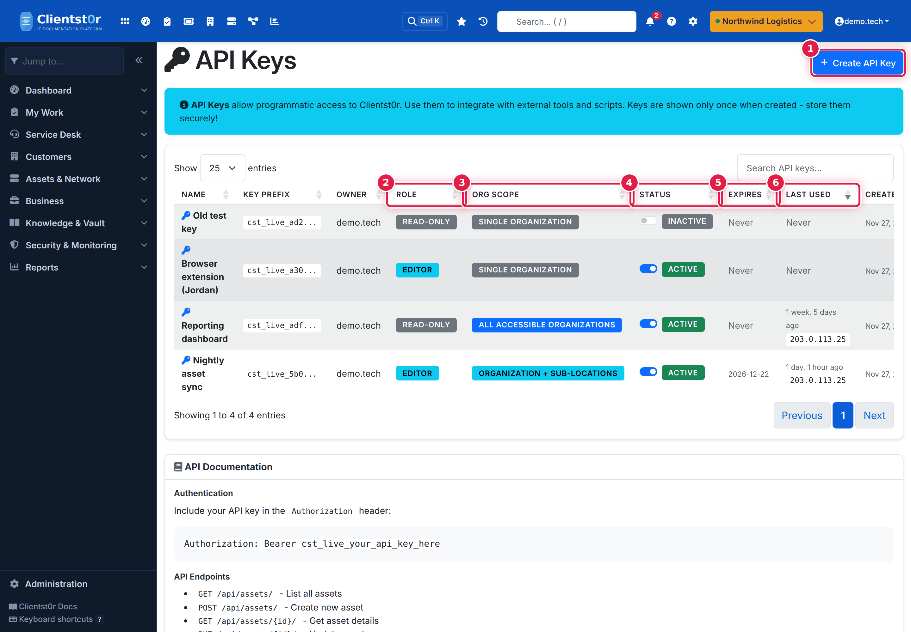
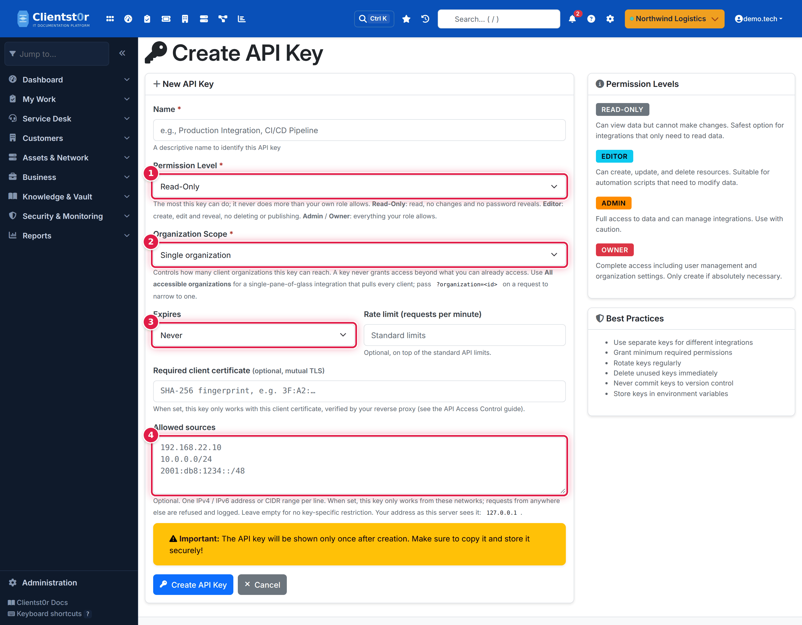

# Multi-Organization REST API Access

*Issue #134 — shipped v3.17.496*

The public REST API (`/api/`) can address **multiple client organizations
through a single API key**. This is built for MSPs running a single-pane-of-glass
integration (a PSA, a custom dashboard) that needs to pull or push data across
every client without minting one key per client.

Everything here is **opt-in and backward-compatible**: keys created before this
feature — and any new key left on the default scope — behave exactly as they
did before (one key, one organization).

## Key scopes

Keys belong to one customer (the one selected in the client switcher) and are made on the API Keys
page, `/api/keys/` (**Administration → Users & Access → Access Management → API Keys**, or the
page's address directly). Creating one needs the **API access** permission in that customer. The list
shows your own keys, or all of the customer's keys if you may manage them.

New keys start with `cst_live_`. Keys created before the prefix change start with `itdocs_live_` and
keep working unchanged: a key is matched by a hash of the whole key, not by its prefix.

<!-- guide-figure: guide-x3-api-keys -->


1. Create API Key: choose the permission level and organization scope.
2. Role: Read-Only, Editor, Admin or Owner. A key never does more than its owner may.
3. Org Scope: single organization, organization plus sub-locations, or all accessible organizations.
4. Active or inactive; the switch turns a key off without deleting it.
5. Expiry, if one was set.
6. When and from which address the key last called the API.
<!-- /guide-figure -->

Every API key has an **Organization Scope**, chosen on **Create API Key**
(`/api/keys/create/`) together with the permission level, an optional expiry, rate limit and allowed sources:

<!-- guide-figure: guide-x3-api-key-new -->


1. Permission level: no higher than your own role in this customer.
2. Organization Scope: Single, Organization + sub-locations, or All accessible organizations.
3. Expires: never, or a date after which the key is refused.
4. Allowed sources: one address or range per line; other addresses are refused.
<!-- /guide-figure -->


| Scope | Reach |
|---|---|
| `single` *(default)* | The key's home organization only. Legacy behavior. |
| `descendants` | The home organization **plus every sub-location** beneath it in the client hierarchy (Phase 18 `Organization.parent`). |
| `all` | **Every organization the key's owner can access** — all active organizations for an MSP staff user / superuser, or the owner's active memberships for a regular org user. |

A key never grants more access than its owner already has. A broad scope only
*exposes* what the owner could already reach in the web app; it cannot escalate.

## Selecting an organization per request

All list/detail/create/update endpoints accept an optional `organization`
query parameter:

| Request | Result |
|---|---|
| *(no param)* | **`single` keys & web sessions:** the home / current org only.<br>**`descendants` / `all` keys:** every accessible org (single-pane default). |
| `?organization=<id>` or `?organization=<slug>` | Narrows to that one organization. **403** if the key may not access it. |
| `?organization=all` | Every organization the key can access. |

Example — list assets across all clients, then narrow to one:

```bash
# Every client's assets in one call (key must be scope=all)
curl -H "Authorization: Bearer cst_live_..." \
     https://your-domain.com/api/assets/

# Just one client
curl -H "Authorization: Bearer cst_live_..." \
     "https://your-domain.com/api/assets/?organization=acme-corp"
```

## Knowing which client a row belongs to

Every resource now serializes its owning organization, so a single-pane
consumer can group rows by client:

```json
{
  "id": 42,
  "organization": 7,
  "organization_name": "Acme Corp",
  "name": "ACME-DC01",
  "asset_type": "server"
}
```

`organization` is writable on create/update; `organization_name` is read-only.

## Discovering the client list

`GET /api/organizations/` returns every organization the key can address — use
it to enumerate clients before iterating:

```bash
curl -H "Authorization: Bearer cst_live_..." \
     https://your-domain.com/api/organizations/
```

## Creating records under a specific client

On `POST`, the target organization is resolved in this order:

1. `?organization=<id|slug>` query parameter
2. `organization` field in the request body
3. The request's primary organization (home org for a key)

The resolved organization must be in the key's accessible set, otherwise the
request is rejected with **403** and nothing is written.

```bash
curl -X POST \
     -H "Authorization: Bearer cst_live_..." \
     -H "Content-Type: application/json" \
     -d '{"name": "NEW-SW01", "asset_type": "switch"}' \
     "https://your-domain.com/api/assets/?organization=42"
```

## Security notes

- Cross-organization isolation is enforced on **every** request: a key can only
  ever see rows in organizations its owner is entitled to. Guessing a primary
  key from another client still returns 404.
- Password reveals and OTP generation are audited against the **row's own
  organization**, so multi-client access stays fully traceable.
- Scope is bounded by the owner's live permissions at request time — revoking a
  user's membership immediately shrinks what their `all`-scoped keys can reach.
