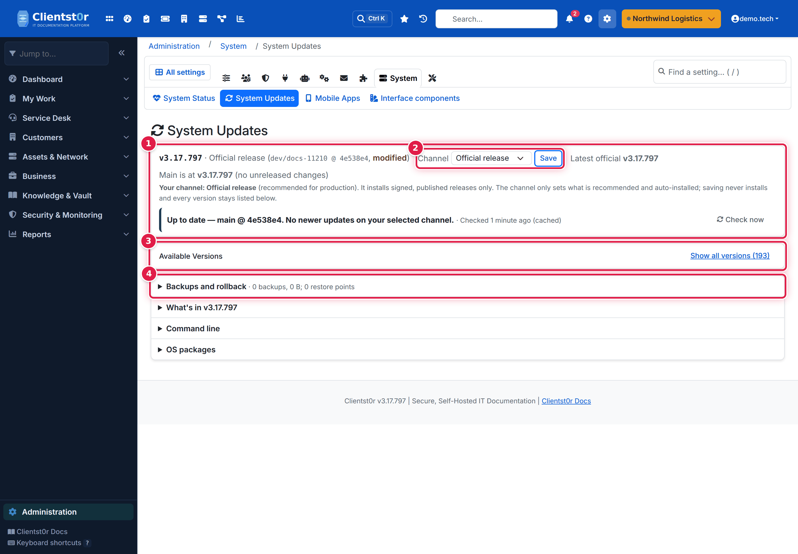

# Running Clientst0r with Docker

This guide covers the **Docker / Docker Compose** install path. It's
the fastest way to stand up Clientst0r on a fresh host — one command
brings up the app, the scheduler, MariaDB, and (optionally) an Nginx TLS proxy. The
classic `bash install.sh` path still works and is documented in
`INSTALL.md`; Docker is a peer option, not a replacement.

---

## TL;DR

```bash
git clone https://github.com/agit8or1/clientst0r.git
cd clientst0r
cp .env.example .env
# edit .env — at minimum: SECRET_KEY, APP_MASTER_KEY, API_KEY_SECRET, DB_PASSWORD, DB_ROOT_PASSWORD
docker compose up -d
```

Then open `http://localhost:8000` (or your TLS proxy's address). The
`.env.example` defaults assume HTTPS (`SECURE_SSL_REDIRECT=True` and
secure cookies), so plain HTTP redirects to HTTPS; for a local trial over
HTTP set `SECURE_SSL_REDIRECT=False`, `SESSION_COOKIE_SECURE=False` and
`CSRF_COOKIE_SECURE=False`. The first boot runs migrations and
collects static files automatically. If you set `DJANGO_SUPERUSER_*`
in `.env`, the entrypoint creates the admin account on first boot too.

Tail the logs while it warms up:

```bash
docker compose logs -f app
```

Once it is up, sign in and open **Administration → System → System Updates**. On a native install that page applies upgrades; in Docker it is informational and you upgrade with the commands under [Upgrading](#upgrading).

<!-- guide-figure: guide-x4-docker -->


1. The installed version, branch and commit, the channel, and the update status. This page is for native installs: the image has no git checkout, so upgrade a container with docker compose pull.
2. The release channel. Official release is the default.
3. Available Versions: published releases and the newest commit on main.
4. Backups and rollback: verified pre-upgrade backups (on Docker they sit in the clientst0r-backups volume).
<!-- /guide-figure -->

---

## Requirements

- Docker Engine **24.0+** (released 2023-05) — older versions don't
  ship the Compose v2 plugin.
- Docker Compose **v2.24+** (`docker compose ...`, not the legacy
  `docker-compose ...` binary). The compose file uses optional
  `env_file` entries, which older versions reject.
- ~2 GB free disk for the image + ~1 GB for the database volume
  before any data.
- Open ports: by default `8000/tcp` on the host. If you turn on the
  Nginx profile, also `80/tcp` and `443/tcp`.

Check your versions:

```bash
docker --version
docker compose version
```

---

## Layout

| File                       | Purpose                                               |
|----------------------------|-------------------------------------------------------|
| `Dockerfile`               | Multi-stage production image. Runs as non-root.       |
| `docker-compose.yml`       | Production stack: `app`, `scheduler`, `db`. Optional proxy, cache, AI gateway. |
| `docker-compose.dev.yml`   | Dev override — source-mount + `--reload`.             |
| `docker-entrypoint.sh`     | DB wait, migrations, collectstatic, optional superuser. |
| `.env.example`             | Every supported env var, commented.                   |
| `docker/`                  | MariaDB settings, and the Nginx config used by the `proxy` profile. |
| `.dockerignore`            | Keeps secrets / mobile / build artifacts out of context. |
| `Makefile`                 | Shortcuts: `make docker-up`, `docker-logs`, `backup`. |
| `.github/workflows/docker-image.yml` | Builds & pushes `ghcr.io/agit8or1/clientst0r`. |

---

## Configuration

All configuration is via environment variables — Django's twelve-factor
style. `docker-compose.yml` reads them from `.env`.

**Minimum you must set** before the first boot:

```env
SECRET_KEY=...               # python -c "import secrets; print(secrets.token_urlsafe(64))"
APP_MASTER_KEY=...           # python -c "import secrets, base64; print(base64.urlsafe_b64encode(secrets.token_bytes(32)).decode())"
DB_ROOT_PASSWORD=...         # strong; only used on first DB init
DB_PASSWORD=...              # strong; the app uses this
API_KEY_SECRET=...           # python -c "import secrets; print(secrets.token_urlsafe(50))"; compose refuses to start without it
ALLOWED_HOSTS=clientst0r.example.com,localhost
```

**Strongly recommended** for production:

```env
DEBUG=False
BASE_URL=https://clientst0r.example.com
CSRF_TRUSTED_ORIGINS=https://clientst0r.example.com
EMAIL_HOST=smtp.example.com
EMAIL_HOST_USER=...
EMAIL_HOST_PASSWORD=...
GITHUB_TOKEN=ghp_...         # raises the GitHub rate limit for update checks
```

See `.env.example` for the full list, including SMTP, the Anthropic key
(OPTIONAL AI), and feature flags.

> **APP_MASTER_KEY is irreversible.** Once vault entries have been
> written under a given master key, rotating the key makes them
> unreadable. Generate it ONCE, back it up, and never change it.

---

## Portainer and other stack managers

You don't need to build anything: the stack pulls the published image
`ghcr.io/agit8or1/clientst0r:latest`. Pin a release with
`CLIENTST0R_IMAGE=ghcr.io/agit8or1/clientst0r:3.17.622`, for example.

There's no need to edit the compose file. Add the settings from
[Configuration](#configuration) as the stack's **Environment variables**,
including `DB_ROOT_PASSWORD` and `DB_PASSWORD`. Then deploy.

- The required secrets (`SECRET_KEY`, `APP_MASTER_KEY`, `API_KEY_SECRET`)
  and the database settings are passed to the containers directly from
  those variables.
- Every other setting reaches the app through `stack.env`, the file
  Portainer writes from the stack's variables. `docker-compose.yml` reads
  it when it exists, as well as `.env`; both are optional.
- If a required secret is missing, deployment stops with a message naming
  it, instead of the app failing at startup.

Other stack managers that only fill in `${...}` values get the required
settings the same way. For the optional ones, either write them to `.env`
or `stack.env`, or list them under the services' `environment:`.

---

## Day-to-day commands

```bash
# Start in the background
docker compose up -d                       # or: make docker-up

# Stop (volumes preserved)
docker compose down                        # or: make docker-down

# Tail logs
docker compose logs -f app                 # or: make docker-logs

# Shell into the running app
docker compose exec app bash               # or: make docker-shell

# Run management commands
docker compose exec app python manage.py createsuperuser
docker compose exec app python manage.py migrate
docker compose exec app python manage.py shell

# Pull a new image without rebuilding
docker compose pull && docker compose up -d
```

`make help` lists every shortcut.

---

## Profiles — Nginx and Redis

The default stack is **app + scheduler + db** (the scheduler container runs
`manage.py run_scheduler` once a minute for the background jobs). Optional
services are gated behind compose profiles so they only start when you
ask for them:

### Proxy (Nginx + TLS)

```bash
docker compose --profile proxy up -d
```

This adds an `nginx` container that listens on `80` / `443` and
reverse-proxies the app. Put your TLS certificate files in `./docker/nginx/ssl/`
and adjust `./docker/nginx/conf.d/clientst0r.conf` to point at your hostname.
For Let's Encrypt, point your `certbot` deploy hook at the same
`ssl/` directory.

If you already run a reverse proxy on the host (Caddy, Traefik,
existing Nginx), **don't enable this profile** — just point your
existing proxy at `http://localhost:${WEB_PORT}`.

### Cache (Redis)

```bash
docker compose --profile cache up -d
```

Clientst0r runs fine without Redis (the default cache backend is
in-process `locmem`). The Redis service is provided for installs that
already plumb `CACHES['default']` to Redis in `config/settings.py`.

A third profile, `ai-gateway`, runs the OPTIONAL AI gateway worker (a
separate container that holds the AI provider keys; the one-time setup steps
are in the comments of `docker-compose.yml`). You can combine profiles:
`--profile proxy --profile cache`.

---

## Persistent data

These named volumes outlive container rebuilds:

| Volume                     | Mounted at                | What it holds                              |
|----------------------------|---------------------------|--------------------------------------------|
| `clientst0r-db-data`       | `/var/lib/mysql` (db)     | MariaDB tables                             |
| `clientst0r-media`         | `/app/media` (app)        | User uploads, branding, generated PDFs     |
| `clientst0r-uploads`       | `/var/lib/itdocs/uploads` (app) | Document & vault attachments         |
| `clientst0r-static`        | `/app/static_collected` (app, nginx) | collectstatic output            |
| `clientst0r-backups`       | `/app/backups` (app)      | Verified backups taken before an upgrade   |
| `clientst0r-ai-gateway-keys` | `/var/lib/clientst0r/ai-gateway` | AI gateway key pair (only used with the `ai-gateway` profile) |
| `clientst0r-redis-data`    | `/data` (redis)           | Redis data (only with the `cache` profile) |

To wipe everything (DESTRUCTIVE):

```bash
docker compose down -v       # or: make docker-down-clean
```

---

## Backups

The Makefile ships `backup` / `restore` targets that pipe through the
`db` container — no host-side `mysqldump` needed.

```bash
make backup                       # writes backups/clientst0r-YYYYMMDD-HHMMSS.sql.gz
make restore FILE=backups/clientst0r-20260513-120000.sql.gz
```

You should also back up the `clientst0r-media` and `clientst0r-uploads`
volumes — they hold user-supplied files. The simplest way:

```bash
docker run --rm -v clientst0r-media:/data -v "$(pwd)/backups:/backup" \
  alpine tar czf /backup/media.tgz -C /data .
docker run --rm -v clientst0r-uploads:/data -v "$(pwd)/backups:/backup" \
  alpine tar czf /backup/uploads.tgz -C /data .
```

And — critically — keep `.env` somewhere safe. Without
`APP_MASTER_KEY`, the database backup is useless.

---

## Upgrading

The image is published to `ghcr.io/agit8or1/clientst0r`. To upgrade:

```bash
cd clientst0r
git pull                          # picks up new docker-compose.yml / .env.example
docker compose pull               # pulls the new image
docker compose up -d              # restarts on the new image
```

The entrypoint re-runs `migrate --noinput` on every boot, so schema
changes are applied automatically. When the new image brings migrations
and the database already holds data, it first takes and verifies a
backup (database, uploads, keys) in the `clientst0r-backups` volume, and
does not migrate without one. Restoring, the restore-test database grant
for stacks created before this, and the rest of the recovery steps are in
[UPGRADE_AND_RECOVERY.md](UPGRADE_AND_RECOVERY.md#docker). The web update
path (**Administration → System → System Updates**) is for native installs: the image has no git checkout, so
upgrade a container with the commands above.

---

## Local development with Docker

`docker-compose.dev.yml` overrides the prod compose so source changes
take effect without rebuilding:

```bash
docker compose -f docker-compose.yml -f docker-compose.dev.yml up
# or:
make dev-up
```

What changes vs production:

- Source tree is bind-mounted into the container at `/app`.
- `gunicorn --reload` watches for changes.
- `DEBUG=True`, `ALLOWED_HOSTS=*`, all `SECURE_*` flags off.
- Defaults to **SQLite** (`DB_ENGINE=sqlite3`) so you can develop
  without spinning up MariaDB. Comment that line in the override to
  use the `db` service.

---

## Troubleshooting

**"Database is up." appears, then connection errors.** The MariaDB
init runs `CREATE DATABASE`, then immediately accepts connections. On
slow hosts the app might race ahead. `docker compose restart app` once
usually fixes it; the entrypoint will wait again.

**Old `APP_MASTER_KEY` lost.** Vault entries can't be decrypted. If
you have a `.env` backup, restore it. If not, the encrypted columns
must be cleared — there's no recovery path for the keys themselves.

**`docker compose up` fails with "required variable SECRET_KEY is
missing".** That's the `:?` enforcement in `docker-compose.yml`. Copy
`.env.example` to `.env` and fill in the required values.

**Healthcheck stuck at `starting`.** The app runs
migrations + collectstatic on the first boot, and the healthcheck allows a
15-minute start period before failures count. Watch the logs:
`docker compose logs -f app`. If it stays unhealthy after that,
something's wrong — usually a missing env var.

**Image is huge.** It's ~600 MB on `linux/amd64`. Most of that is the
Python runtime + native build deps. We don't compress further to
keep the build simple. If you really need a slimmer image, switch the
base from `python:3.12-slim` to `python:3.12-alpine` in `Dockerfile`,
but expect to pin `mysqlclient` and rebuild every wheel from source.

**ARM (Raspberry Pi, Apple Silicon hosts).** The GitHub Actions
workflow only publishes `linux/amd64`. Build locally on the ARM host
with `docker compose build` to get a native image, or uncomment the
`platforms:` line in `.github/workflows/docker-image.yml` and re-run.

---

## What's NOT in Docker

- The mobile-app code generator. It lives outside the repo entirely
  and is not shipped to GitHub.
- The Play Console publisher (`local_apps/play_publish/`). Not in the
  image — it's a developer-only tool.
- `systemd` integration. The image runs as PID 1 — `gunicorn` directly.
  If your host needs systemd-style service management, install via
  `bash install.sh` instead.
