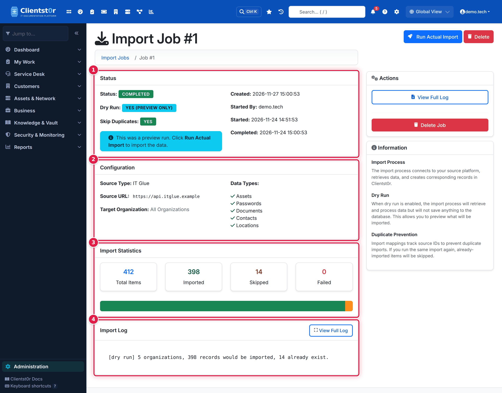

# Importing from IT Glue

Clientst0r is a self-hosted, MIT-licensed IT documentation and service desk platform for
MSPs, with documentation, credentials, assets and ticketing in one system you run yourself.
This page covers its built-in IT Glue importer: what it brings over today and what to plan
for before switching.

## Clientst0r at a glance

| Category | Clientst0r |
| --- | --- |
| Licence | MIT, open source; no licence fee, seat or client limits |
| Hosting | Self-hosted (Docker or native install). Optional managed hosting and support are offered separately by [MSP Reboot](https://mspreboot.com) |
| Data control | Your server, your database, your backups |
| Customisation | Source is public and modifiable |
| Support | Community (GitHub Issues and Discussions), or commercial support through MSP Reboot |

## Capabilities

| Capability | Status in Clientst0r |
| --- | --- |
| Asset management (fixed asset types, tags, photos, relationships) | Available; per-type custom fields are not in the UI yet |
| Encrypted password vault (AES-256-GCM, audited reveals) | Available |
| Knowledge base, runbooks and per-client documents | Available |
| IPAM, VLANs and rack elevations | Available |
| Built-in service desk with SLAs, contracts and invoicing | Available (opt-in) |
| PSA integrations | Available — ConnectWise Manage, Autotask, HaloPSA, Kaseya BMS, Syncro, Freshservice, Zendesk, ITFlow (companies, contacts, tickets); RangerMSP and Alga PSA Limited (newly added) |
| RMM integrations | Available — Tactical RMM, NinjaOne, Datto RMM, Atera, ConnectWise Automate and Rem0te (devices, alerts, software; Rem0te syncs computers and adds a Connect button) |
| Multi-organization with customer logins | Available |
| Sign-in | Azure AD / Entra ID SSO and LDAP / Active Directory sign-in available (LDAP needs optional packages); 2FA enforced by default |
| Documentation readiness and lifecycle | Available — per-client readiness scores and a repair queue, document owners and review dates, drafts, version compare and restore |
| Bitwarden / Vaultwarden import | Available |
| Fleet (service vehicle) management | Available |

Full list with limitations: [FEATURES.md](../FEATURES.md).

## What the IT Glue importer brings over

The importer is under **Administration → Maintenance → Data Import** (`/imports/`). It is open to
superusers only. **New Import** takes the source type (IT Glue), the API address, an API key and an
optional target organization. The API key is stored encrypted and is never shown again.

<!-- guide-figure: guide-x3-itglue-job -->


1. Status, and whether this was a dry run.
2. Source, target organization (All Organizations here) and the data types chosen.
3. Total, imported, skipped and failed items.
4. The log of the run; View Full Log shows all of it.
<!-- /guide-figure -->

The page of an import job: a finished dry run of an IT Glue import. The buttons at the top of the page are Run Actual Import (dry runs only) or Rollback (real imports), and Delete.

| IT Glue data | Imported today |
| --- | --- |
| Organizations | Yes — matched to existing organizations, or created |
| Configurations (as assets) | Yes |
| Passwords | Yes — encrypted on arrival |
| Documents | Yes |
| Contacts | Yes — tick **Contacts** (off by default) |
| Locations | Yes — tick **Locations** (off by default) |
| Networks | Yes — tick **Networks** (off by default); IT Glue has no networks list, so these come from flexible assets whose type is a network type |
| Other flexible assets, attachments, relationships, permissions | Not by this screen (see the one-customer rehearsal below) |

- A **dry run** is on by default and reports counts without writing anything. On a finished dry run, **Run Actual Import** turns the same job into a real one and asks you to confirm.
- **Skip Duplicates** (on by default) skips records already imported by an earlier completed job for the same organization.
- Each job keeps a log and history, and imported records are tagged with their source.
- **One or all organizations.** Import into a single target organization, or import every
  IT Glue organization at once; with the target left blank, **Enable Fuzzy Matching** matches IT Glue
  organizations to existing ones by name similarity (threshold 85 by default).
- Each record goes to the client its source record belongs to.
- A job shows "Completed" only when nothing failed; otherwise "Completed with errors" or
  "Failed", with imported / skipped / failed counts that add up to the source total, and the
  log on the import page.
- **Rollback** runs in one transaction. Records edited after the import are kept and listed,
  and organizations the import created are removed only when nothing else uses them; if
  anything was kept the job shows "Partially rolled back".

## One-customer rehearsal

**One-customer rehearsal** on the Data Import page (`/imports/rehearsals/`, superusers only, like the rest of Data Import) moves one source organization
into one Clientst0r customer in steps: create the rehearsal, **Fetch source data** (nothing is written to
the customer), review **What will transfer** (create, update, unchanged, duplicate, conflict and
unavailable counts per type, with broken links and the reasons for skips), **Mark reviewed (freeze)**,
then **Apply reviewed plan**. It also covers IP addresses, processes, websites, relationships and
attachments, can be rolled back, and exports reports as JSON or CSV. Applying needs the matching
permission in the customer (for example Create passwords for passwords).

## Before you switch

* Run a dry run, then a real import into a test organization, and compare record counts
  with IT Glue.
* Tick Contacts, Locations and Networks if you want them (they are off by default), and plan
  how you will bring over anything the importer does not read (CSV import or by hand). CSV
  contact and password imports work, and re-running a CSV import updates matching rows
  instead of duplicating them.
* Check the integrations, sign-in method and exports you depend on against
  [FEATURES.md](../FEATURES.md).

## Install

```bash
# Docker
git clone https://github.com/agit8or1/clientst0r.git && cd clientst0r
cp .env.example .env   # set SECRET_KEY, DB_PASSWORD, DB_ROOT_PASSWORD, APP_MASTER_KEY
docker compose up -d

# or native, on Ubuntu 20.04+ / Debian 11+
git clone https://github.com/agit8or1/clientst0r.git && cd clientst0r && bash install.sh
```

---

[Back to docs index](README.md)
