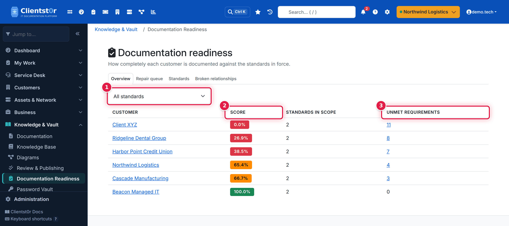

# MSP Documentation with Clientst0r

Effective MSP operations rely on accurate, accessible documentation. Clientst0r provides a structured platform for organizing client and infrastructure knowledge. See [FEATURES.md](../FEATURES.md) for each capability's status and limitations.

## What Clientst0r Helps Document

### Clients & Organizations
- Multi-organization support: every record belongs to a client organization, and customer users see only their own
- Per-client documentation spaces
- Contact management

### Assets & Infrastructure
- Device and asset tracking with warranty and end-of-life dates
- Interactive rack diagrams with drag-and-drop placement
- Wall-mounted board layouts for network closets
- IPAM (IP address management) with subnet tracking
- VLAN documentation
- Patch panel management

### Security
- AES-256-GCM encrypted password vault with audited reveals
- Personal vaults per user
- Every stored secret encrypted or hashed at rest, with master-key rotation (`rotate_encryption_key`)
- Sign-in with local accounts and enforced 2FA, Azure AD / Entra ID SSO, or LDAP / Active Directory
- Password breach detection (Have I Been Pwned, k-anonymity)
- Encrypted backups via the `manage.py backup` command

### Knowledge Base
- Per-organization documentation (see [Documents and diagrams](DOCUMENTS_AND_DIAGRAMS.md)); a version is saved when an edit changes the title, body or editor type; compare and restore versions
- Document owners, review intervals, drafts, publish approval and an Archived list
- Template drift: see which documents are behind their template, with a diff
- KB analytics: most and never viewed, overdue reviews, searches that found nothing
- Global MSP knowledge base (MSP staff only)
- Diagrams drawn in the draw.io editor (loaded from `embed.diagrams.net`, so the browser needs internet access to it), saved per customer with a PNG preview and a .drawio download
- Floor plan import from MagicPlan JSON exports: creates floor plan records on a location (not diagrams); the import job pages are superuser-only
- SOPs and runbooks

### Documentation Readiness
- Standards for what every client (or every client of a type) must have documented
- A per-client score with a plain explanation and a fix link for every gap
- A repair queue across clients, audited exceptions, and a broken-relationships report

It is under **Knowledge & Vault → Documentation Readiness** (`/readiness/`). The numbers in the screenshot
match the list under it. Every screenshot is a capture of the application against a demo database; the
customers and people in it are invented.

<!-- guide-figure: guide-x1-msp-readiness -->

1. Show the score against one standard, or all standards in force.
2. The customer's documentation score. Open a customer for the reason behind each gap and a link to fix it.
3. How many requirements are not met. The number opens the repair queue for that customer.
<!-- /guide-figure -->

### Monitoring & Expiration Tracking
- Website uptime and SSL certificate checks, with email alerts when a site goes down and recovers
- Email alerts for expiring SSL certificates, domains (dates you enter) and credentials

### Fleet Management
- Service vehicle tracking
- Mileage, maintenance, and fuel logs
- Interactive damage reports with vehicle diagrams
- Vehicle inventory management

### Integrations
- PSA providers (ConnectWise Manage, Autotask, HaloPSA, Kaseya BMS, Syncro, Freshservice, Zendesk, ITFlow) — companies, contacts and tickets; RangerMSP and Alga PSA newly added (Limited)
- 6 RMM providers (Tactical RMM, NinjaOne, Datto RMM, Atera, ConnectWise Automate, Rem0te) — devices, alerts and software
- REST API v1 and GraphQL API v2

For how to use documents, categories, templates and diagrams, read [Documents and diagrams](DOCUMENTS_AND_DIAGRAMS.md).

## Goal

Reduce tribal knowledge risk, improve onboarding speed, and enable consistent service delivery across the team.
