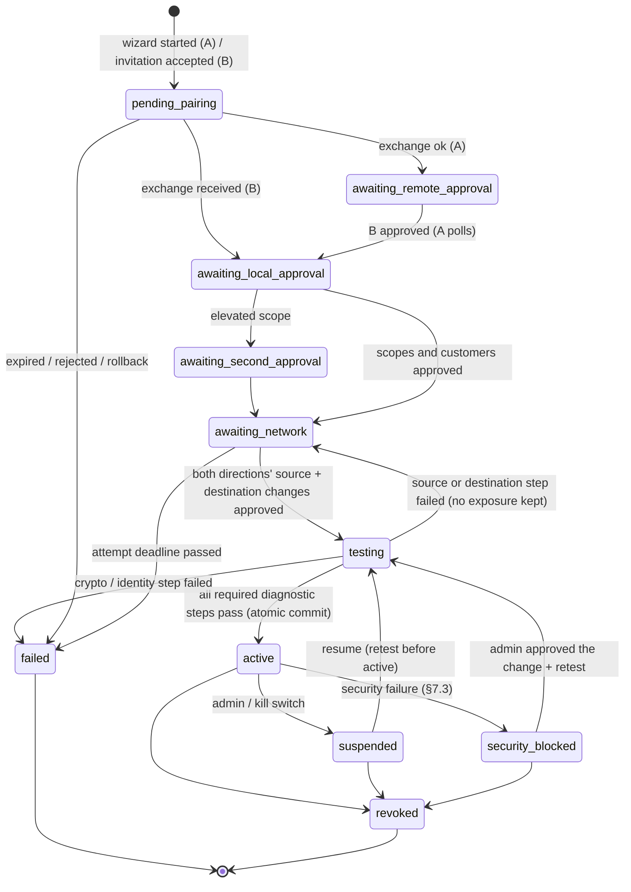
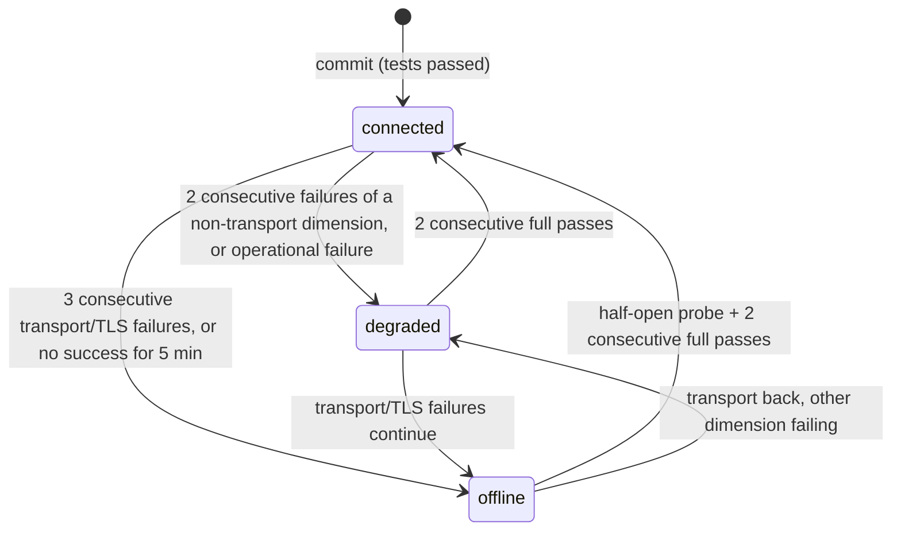

# Secure HTTPS Quick Connect: Clientst0r design

Status: **design, not implemented**. Builds on the audit in [AUDIT.md](AUDIT.md) (finding ids QC-nn, conflict ids
C-nn). The increments that implement it are in [INCREMENTS.md](INCREMENTS.md). Roadmap entries are in
[ROADMAP_ITEMS.md](ROADMAP_ITEMS.md).

Principles:

1. **Extend, don't duplicate.** Use the existing `connect` models, the `api_access` policy engine, `core.client_ip`,
   `core.safe_http`, `tech_access` protected changes, the scheduler, `events/` (Phase 82), `ConnectAuditEvent` and
   `AuditLog`. There is no new API-key system, signature format, firewall settings store, audit table,
   notification engine, status model or daemon.
2. **v1 stays v1.** Every `agit8or-connect/1` message, header, signing string and test vector keeps its bytes and
   meaning. Quick Connect is an optional, negotiated revision (§3). A peer that only speaks v1, which is any Rem0te
   build implementing the handoff contract, pairs exactly as today. ticket-rmm-v1 (`integrations/rem0te/`) is not
   touched.
3. **Off and closed by default.** Nothing in this design is reachable until `AGIT8OR_CONNECT_ENABLED` is on. Once it
   is on, Connect endpoints refuse every source address until an administrator authorises it.
4. **Commit only on proof.** A connection is shown as "Connected" only after authentication, authorisation and
   connectivity were each tested and passed.

---

## 1. Roles and terms

| Term | Meaning |
|---|---|
| **A** | The installation whose administrator starts Quick Connect, the *initiator*. A runs the wizard. |
| **B** | The installation being connected to, the *responder*. Its administrator authorises in B's own admin UI. |
| Attempt | One Quick Connect run. It is a `Connection` row in `pending_pairing` on A, and in `awaiting_*` on B once B accepts. |
| Invitation | A short-lived, single-use, signed request to authorise one attempt. A creates it and the browser carries it to B. It is **not** a credential: it lets an already signed-in B administrator see the request, nothing more. |
| Egress address | The source address an installation's outbound requests come from, as the peer sees it (after NAT). It comes only from trusted configuration or administrator confirmation. |
| Installation layer | The Connect-wide source allowlist (one per installation). |
| Connection layer | The per-connection source allowlist. Every Connect request has to pass both layers. |
| Approved destination | Per connection: the host name, port, address set, trust anchor and expected identity of the peer, approved by an administrator. |

---

## 2. Data model (all in `connect`, extending existing tables)

### 2.1 `Connection` (existing table `connect_connections`): new fields

| Field | Type | Purpose |
|---|---|---|
| `state` | *new choices* `awaiting_network`, `testing`, `security_blocked` | Lifecycle (§4). Existing values unchanged. |
| `health` | CharField: `connected`/`degraded`/`offline`/`''` | Health while `state=active` (§7). Not a second status model: the displayed status is one function, `status(conn)` (§4.3). |
| `health_dims` | JSON `{transport, tls, authenticated, authorised, operational}` → `{ok, since, last_ok, last_fail, code}` | Separate dimensions (§7). |
| `consecutive_ok`, `consecutive_fail` | PositiveSmallInteger | Hysteresis. |
| `next_check_at` | DateTime, indexed | Durable monitor and retry schedule (§8). |
| `retry_step` | PositiveSmallInteger | Index into the backoff ladder. |
| `circuit` | CharField `closed`/`open`/`half_open` | Circuit breaker. |
| `security_block_code`, `security_block_at`, `security_block_detail` (JSON, sanitised) | | Evidence. **Never cleared**, only superseded by a new block, and copied to the audit chain (§12). |
| `qc_revision` | CharField, blank | `''` = v1 code pairing; `'1.1'` = Quick Connect (§3). |
| `qc_attempt_expires_at` | DateTime, null | Hard deadline for the attempt; the reaper rolls back after it (§11.4). |
| `monitor_interval_s` | PositiveSmallInteger, default 60 | Configurable health interval (30–900 s). |
| `alert_mute_until` | DateTime, null | Per-connection suppression (§10). |

The existing `last_success_at`, `last_failure_at`, `last_error`, `failure_count`, `auth_failure_count` and `last_test`
are kept. `last_test` holds the latest diagnostic run summary for back-compatibility (§9).

### 2.2 New small tables (justified by the requirements, none duplicates an existing one)

| Model | Fields | Why it is not an existing table |
|---|---|---|
| `ApprovedDestination` (1:1 with `Connection`) | `host`, `port` (default 443), `addresses` (JSON list of exact IPs/CIDRs, each `{net, private: bool, approved_by, approved_at}`), `trust` (`system`/`private_ca`), `ca_bundle` (moved from `Connection.tls_ca_bundle`), `spki_pins` (optional SHA-256 list), `expected_installation_id`, `expected_cert_names` (SAN list seen at approval), `status` (`staged`/`active`), `version` | No outbound per-destination store exists anywhere. `core.safe_http` policies are code-level, not data. |
| `SourceRule` | `layer` (`installation`/`connection`), `connection` (null for installation), `network` (CIDR), `action` (`allow`/`deny`), `status` (`staged`/`temporary`/`active`/`removed`), `purpose` (`pairing`/`api`/`events`/`all`), `expires_at`, `created_by`, `approved_by`, `change` (FK `ConnectChange`), `observed_first_at`, `match_count`, `last_matched_at` | Rows are compiled into `api_access.policy.CompiledRule` objects and evaluated by **the same `evaluate()`** (§5). They are kept out of `ApiAccessRule` deliberately. That table's rollback snapshot restores wholesale and deletes rules created inside the window (C-03), and its global mode is shared with the REST API (C-01). One engine, two rule stores with different change semantics. |
| `ConnectChange` | `connection` (null for installation), `kind` (`source_rules`/`destination`/`scopes`/`grants`/`tls`/`settings`), `payload`, `preview` (computed effect), `fingerprint`, `base_version`, `status` (`staged`/`approved`/`applied`/`rejected`/`expired`/`rolled_back`), `proposed_by`, `approved_by`, `protected_change_id`, `applied_at`, `rollback_of` | The staging record for every network and authorisation change (§11). Sensitive changes are additionally a `tech_access.ProtectedChange` (kind `app_connection`, payload references this row). The table does the staging; the two-admin approval stays in tech_access. |
| `QuickConnectInvitation` | `id` (UUID, public), `connection` (FK, the attempt on A), `nonce_hash` (SHA-256 of the 256-bit nonce), `code_challenge` (S256, from A), `redirect_uri`, `expected_peer_host`, `egress` (A's declared egress list), `expires_at` (10 min), `used_at`, `burned_at` | Only on A. It is not a `PairingInvitation`: the code invitation is a typed human secret with the burn-all brute-force rule, while this is a signed, attempt-bound object (§6.2). |
| `QuickConnectGrant` | `id`, `connection` (the attempt on B), `code_hash`, `code_challenge`, `redirect_uri`, `approved_source` (FK `SourceRule`), `expires_at` (120 s), `used_at` | Only on B. The authorisation code of the browser flow (§6.3). |
| `DiagnosticRun` | `connection`, `trigger` (`manual`/`wizard`/`monitor`/`retest`), `started_at`, `finished_at`, `steps` (JSON, §9), `result`, `exported_at` | History for diagnostics. `last_test` keeps only the latest. Retention-pruned (default 30 days, last 50 per connection kept). |

`InstallationIdentity` gets `connect_policy_version` (PositiveBigInteger, the cross-worker invalidation counter,
§5.5), `egress_addresses` (JSON, this installation's own egress addresses, §6.1) and `qc_enabled` (Boolean, default
False).

Migrations only add columns and tables. Existing rows keep `qc_revision=''`. Existing active connections get
`health=''` until the first monitor run, an `ApprovedDestination` derived from `base_url` in `staged` status, and no
`SourceRule` (§13.2 explains how existing connections are migrated without being cut off).

---

## 3. Protocol version plan

### 3.1 Decision

- **The major version stays `1`.** No v1 message, claim, header, signing string, endpoint or error changes meaning.
  `docs/agit8or-connect/test-vectors/*.json` stay byte-identical; `generate_vectors --check` must keep passing.
- **Quick Connect is protocol revision `1.1`**, a strictly additive set of *named extensions*. Each is advertised in
  discovery and used only when **both** sides advertise it. PROTOCOL.md §3 already requires v1 receivers to ignore
  unknown discovery members, so a v1 peer is unaffected by the advertisement.
- New messages get **new JWS `typ` values** and new signing-string prefixes, so a 1.1 message can never be read as a
  v1 message and vice versa (no cross-protocol confusion).
- New vectors go in **new files** (`test-vectors/qc-*.json`). Existing files are never edited.
- Normative text lives in a new `PROTOCOL-1.1.md` (extensions), which references `PROTOCOL.md` (unchanged apart from
  a pointer). It moves to the public repository in increment F.

### 3.2 Discovery additions (ignored by v1 peers)

```json
{
  "versions": ["1"],
  "revision": "1.1",
  "extensions": {
    "qc-bootstrap": 1,
    "qc-source-binding": 1,
    "qc-diagnostics": 1
  },
  "endpoints": {
    "…all v1 endpoints unchanged…": "…",
    "qc_authorize": "https://b.example/settings/integrations/connected-apps/quick-connect/authorize",
    "qc_exchange":  "https://b.example/connect/v1/qc/exchange",
    "qc_probe":     "https://b.example/connect/v1/qc/probe"
  }
}
```

`qc_authorize` is a **web page** (B's admin UI), and all three are on the discovery origin (the existing same-origin
rule, `agit8or_connect/discovery.py:83-93`).

### 3.3 Exactly what is new on the wire

| Extension | New element | Replaces / changes in v1 |
|---|---|---|
| `qc-bootstrap/1` | Invitation JWS `typ agit8or-qc-invitation+jwt`. Authorisation response (browser redirect parameters) with acceptance JWS `typ agit8or-qc-accept+jwt`. `POST qc_exchange` with exchange JWS `typ agit8or-qc-exchange+jwt`, answered with **the v1 ack** (`agit8or-pairing-ack+jwt`, unchanged). Transcript `agit8or-connect/1.1 qc-transcript`, SAS derived as in v1 from that transcript. | Nothing. It is an alternative to `POST pairing` with a typed code. After the exchange, `pairing_status` polling, the result JWS, tokens, JWKS and events are **v1 unchanged**. |
| `qc-source-binding/1` | Signed declaration of egress addresses inside the invitation and the acceptance (`egress: [{net, note}]`). Error code `source_not_authorised` (HTTP 403) on every Connect endpoint. | v1 has no source semantics. A v1 peer that is refused by a source rule gets `403` with the new code; v1 already says unknown error codes are opaque failures. |
| `qc-diagnostics/1` | `POST qc_probe` (DPoP-authenticated, any granted connection) → `{observed_source, server_time, connection_state, checks: {source: ok, token: ok}}`. | Nothing. v1 `POST test` stays as is. |

### 3.4 Behaviour toward v1 peers and Rem0te

| Peer | What happens |
|---|---|
| v1-only peer (any Rem0te build implementing the current handoff contract) | The Quick Connect wizard sees no `qc-bootstrap` in discovery and offers the **v1 code flow** (today's flow). The connection still gets an approved destination and source rules, which are local policy: B's admin enters the peer's egress address by hand (§6.6). |
| Rem0te ticket-rmm-v1 rev2 | Untouched. Different routes (`/api/integration/v1/`), different models, and its own `integration_api` group in API Access Control. |
| Existing Connect connections | Keep working. Source rules are introduced in *observe* mode first (§13.2). |

Sender-side queue behaviour (dead letters, §9 of PROTOCOL.md "Sender rules") changes in §8.4. These are local rules
that never appear on the wire, so the change is an editorial revision of PROTOCOL.md §9, not a version change.

---

## 4. State machine

### 4.1 Lifecycle (`Connection.state`)



Rules:

- `active` is entered **only** from `testing`, by `commit_connection()` (§11.3). This fixes QC-07.
- Every transition out of `pending_pairing`, `awaiting_*` or `testing` into `active`, and every resume, refuses
  while the kill switch is engaged (fixes QC-08).
- `resume` goes through `testing` instead of straight to `active`.
- v1 code-flow connections follow the same machine: `awaiting_network` is reached after approval, and if the
  administrator already supplied the peer's addresses during approval it passes straight through.

### 4.2 Health while `active` (`Connection.health`)



Security failures skip hysteresis and leave `active` for `security_blocked` at once (§7.3).

### 4.3 Displayed status: one function

`connect.status.display(conn) -> (key, label, severity)` maps lifecycle + health to the ten owner-facing states.
Every page, API response, alert and the bell use it:

| Displayed | Condition |
|---|---|
| Pending Setup | `pending_pairing` |
| Awaiting Approval | `awaiting_remote_approval`, `awaiting_local_approval`, `awaiting_second_approval` |
| Awaiting Network Authorization | `awaiting_network` |
| Testing | `testing` |
| Connected | `active` and `health=connected` (or `''` right after commit) |
| Degraded | `active` and `health=degraded` |
| Offline | `active` and `health=offline` |
| Security Blocked | `security_blocked` |
| Suspended | `suspended` |
| Revoked | `revoked` (and `failed`, labelled "Setup failed") |

---

## 5. Inbound: default-deny source policy for Connect endpoints

### 5.1 Scope

Only these routes: `/.well-known/agit8or-connect` and everything under `/connect/v1/`. Web pages, including B's
`qc_authorize` admin page, are not covered. They keep the site firewall, login and 2FA.

### 5.2 Engine reuse

- `api_access.groups` classifies the two prefixes into a **new surface `connect`** (`SURFACE_CONNECT`) instead of
  `SURFACE_API`. The REST API mode, limits and global rules therefore no longer apply to Connect (C-01).
- A new module `connect/source_policy.py` builds a `api_access.policy.Policy` from `SourceRule` rows with
  `api_mode` forced to **allowlist** for the `connect` surface. It always has `mode=allowlist`; there is no setting
  for it. `evaluate()` is reused unchanged. Two calls are made, one per layer:
  1. installation layer: rules with `layer=installation`;
  2. connection layer: rules of the connection the request names (§5.4).
  A request passes only if **both** decisions allow.
- Validation on save (shared helper `api_access.models` network validation):
  - Refused outright: `0.0.0.0/0` and `::/0`, any IPv4 prefix shorter than `/16` and any IPv6 prefix shorter than
    `/32`.
  - Private, loopback and link-local networks are allowed only as exact entries the administrator ticks "this is
    a private address" for; there is no implicit trust (§5.6).
- Refusals are written to the existing folded `ApiAccessDecision` log (`api_access/enforce.py:39-66`) with the
  surface `connect`, the layer, the connection id and the reason. **Not** to `ConnectAuditEvent`, so unauthenticated
  traffic cannot grow the audit chain (fixes QC-03 for refused sources). Security-relevant refusals are
  summarised into the chain at most once a minute per (connection, reason), as one aggregated record.

### 5.3 Evaluation order (per request)

```
0. AGIT8OR_CONNECT_ENABLED off                         → 404 (unchanged)
1. Client address = core.client_ip.get_client_ip()     → unreadable → 403 source_not_authorised
   (trusted proxies only; X-Forwarded-For from anyone else ignored)
2. Load source policy (DB version check, §5.5)         → load error → 403 (fail closed; there is no open mode)
3. Installation layer: explicit deny                   → 403
4. Installation layer: allowlist (empty = deny all)    → not matched → 403
5. Identify the connection the request names (§5.4)    → unknown → treat as "no connection rules" → 403
6. Connection layer: explicit deny                     → 403
7. Connection layer: allowlist (empty = deny all)      → not matched → 403
8. Rate limits (existing connect/ratelimit.py buckets, keyed by address AND connection)
9. Body cap, kill switch                               (unchanged)
10. Protocol authentication (signature / assertion / DPoP)
11. Binding check: the connection proven by step 10 MUST equal the connection used in step 5–7
    → mismatch → 403 source_not_authorised + security event
```

Steps 1–7 run in `ApiAccessMiddleware` (it already runs before authentication middleware and views,
`config/settings.py:187`), branching on the `connect` surface. Step 11 runs in `connect/auth.py` and
`connect/events.py` after verification. A valid token never skips steps 1–7, and there is no exception for
discovery, health or pairing.

### 5.4 Which connection a request names (before authentication)

| Route | Connection named by | Rules consulted at layer 2 |
|---|---|---|
| `discovery`, `health` | none | Union of the `active` rules of all connections, plus `temporary` attempt rules with purpose `pairing`. A peer that is allowed for any connection may read discovery. |
| `pairing/requests` (v1 code flow) | none | Union of `temporary` rules with purpose `pairing`. The administrator creates them with the invitation code (§6.6). |
| `pairing/requests/{id}/status` | `PairingRequest.connection` | that connection's `temporary` + `active` rules |
| `qc/exchange` | `attempt` claim → `QuickConnectGrant.connection` | that attempt's `temporary` rule (exactly one address) |
| `token` | `client_id` form field | that connection's rules |
| `connections/{id}/jwks` | path id | that connection's rules |
| `events` | `Agit8or-Connection` header | that connection's rules |
| `capabilities`, `test`, `customers*`, `qc/probe` | `client_id` claim of the (still unverified) access token | that connection's rules; re-checked at step 11 |

Naming a connection that does not exist, or one in `revoked`/`failed`, gives the same 403 as a non-matching
address, so the policy reveals nothing about connection ids.

### 5.5 Cross-worker invalidation and failure behaviour

- Every `SourceRule` change is applied inside a `ConnectChange` commit that increments
  `InstallationIdentity.connect_policy_version` (an `F()` update). This is the same pattern as
  `ApiAccessSettings.bump` and `current_policy()` (`api_access/policy.py:202-226`).
- Each worker caches the compiled policy keyed by version. Each covered request does one indexed single-row read.
- Database unavailable:
  - the last loaded policy is used if it is less than 60 s old;
  - otherwise the request is refused (fail closed).
  - Unlike the API policy, there is no "allow because unrestricted" fallback, because Connect has no
    unrestricted mode.
- The cache is never the source of truth. With `LocMemCache` it could not be shared across the four workers anyway.

### 5.6 What is never trusted implicitly

- A private or loopback source address. The site firewall's LAN exemption (C-04) happens after this layer and does
  not apply to it.
- A source that shares an address with another connection (NAT). The address passes the layer for the connection
  whose rules list it, and step 11 binds the request to the key-holder of *that* connection. Two installations
  behind one NAT address are told apart only by their keys. This is the "shared address, separate crypto identity"
  requirement.
- The same vendor or app type.
- An address seen in a browser request. Browser addresses are never used to build source rules (§6.1).

---

## 6. Browser-mediated bootstrap (`qc-bootstrap/1`)

### 6.1 Where egress addresses come from

- **Own egress (A declares it):**
  - `InstallationIdentity.egress_addresses`, set by an administrator in Connected Applications → Network. The
    setting page can *suggest* a value: after any authorised `qc_probe` to an existing connection, the address
    that peer observed is shown as "seen by <peer>". The administrator must still confirm it.
  - A value is never derived from the administrator's browser address.
- **Peer egress (B learns A's):** only from the signed invitation, verified later through the exchange (proof of
  possession from that address) and confirmed by B's administrator.
- **Observed vs declared:** after the first authorised exchange or probe, both values are shown side by side. If
  they differ, the request has already been refused (§6.4 step 12); nothing is added automatically.

### 6.2 Sequence

```mermaid
sequenceDiagram
    autonumber
    actor AdmA as Admin (A's UI)
    participant A as Clientst0r A (server)
    participant Br as Admin's browser
    participant B as App B (server + admin UI)
    actor AdmB as Admin (B's UI, B's own sign-in)

    AdmA->>A: Quick Connect: host b.example (port 443)
    A->>A: validate host against outbound policy (no fetch yet)
    A->>B: DNS + TCP + TLS handshake only (cert chain + name; no HTTP request)
    A-->>AdmA: approved-destination preview (host, port, addresses, cert names)<br/>+ own egress address (configured, must be confirmed)
    AdmA->>A: confirm destination + egress
    A->>A: stage ApprovedDestination(B); new attempt Connection (pending_pairing)<br/>generate attempt key K_A; PKCE verifier v
    A->>A: QuickConnectInvitation (10 min, single use)<br/>invitation JWS signed by K_A: {attempt, A installation id, A base,<br/>redirect_uri, egress_A, requested scopes, code_challenge=S256(v), nonce, exp}
    A-->>Br: 303 to B's qc_authorize URL (?invitation=JWS&state=s)<br/>(qc_authorize URL is the conventional path; A has not seen B's discovery yet)
    Br->>B: GET qc_authorize (B's admin UI)
    B-->>AdmB: B's normal sign-in + 2FA (B never sees any A password; A never sees B's)
    B->>B: verify invitation signature (self-contained K_A), exp, single use (jti),<br/>redirect_uri origin == A base origin, A base passes B's outbound policy (static check)
    B-->>AdmB: review: A host, claimed installation id, egress_A, requested scopes by risk,<br/>"this lets egress_A reach B's pairing endpoints for 15 minutes"
    AdmB->>B: approve temporary inbound authorisation (+ second admin if B's policy says so)
    B->>B: ConnectChange commit: SourceRule(connection=attempt_B, net=egress_A,<br/>status=temporary, purpose=pairing, expires=15 min)<br/>QuickConnectGrant(code, code_challenge, 120 s)
    B-->>Br: 303 redirect_uri?code=c&state=s&accept=JWS_B<br/>(accept signed by B attempt key K_B: {attempt, B installation id, B base, egress_B, exp})
    Br->>A: GET callback (A's admin session, state bound to session + attempt)
    A->>A: verify state, accept JWS, B base origin == approved destination
    A->>B: GET discovery (now allowed: source = egress_A)
    A->>A: discovery installation id == accept.iss; qc-bootstrap advertised
    A->>B: POST qc_exchange {exchange JWS signed by K_A: code, code_verifier v,<br/>v1 request claims (connection_id, connection_key=K_A, scopes, tenants)}
    B->>B: source == temporary rule? code unused, unexpired? S256(v)==challenge?<br/>K_A == invitation key? → mark used
    B-->>A: 202 v1 ack (signed by K_B, B connection id)
    Note over A,B: Both compute qc-transcript(invitation, accept, exchange, K_A, K_B, egress_A, egress_B,<br/>destination host) → SAS NNNN-NNNN, shown on both UIs
    AdmB->>B: compare SAS; approve scopes + customers (protected change for elevated)
    A->>B: POST pairing_status (v1 poll, signed K_A) → v1 result
    AdmA->>A: compare SAS; approve what B asks; map customers
    AdmA->>A: approve reverse direction: SourceRule(connection, net=egress_B) staged
    B->>B: stage: temporary pairing rule → staged active rule (purpose=all) for egress_A
    Note over A,B: both: state = awaiting_network → testing
    A->>B: diagnostics (A→B): DNS…signed event (§9)
    B->>A: diagnostics (B→A): discovery of A (identity bound to A's TLS name), token, event
    A->>A: all required steps pass → commit (atomic): rules active, destination active, state active
    B->>B: all required steps pass → commit; temporary rule removed
```

### 6.3 Message details

- **Invitation JWS** (`agit8or-qc-invitation+jwt`), header `jwk` = K_A (self-contained, like the v1 pairing request).
  - Claims: `protocol: "agit8or-connect/1.1"`, `ext: "qc-bootstrap/1"`, `iss` = A installation id, `aud` = B host
    (as typed), `iat`, `exp` (≤600 s), `jti` = invitation id, `attempt` = A's connection id, `base` = A's public
    base (must equal `AGIT8OR_CONNECT_PUBLIC_URL`), `redirect_uri`, `egress`, `requested_scopes`,
    `code_challenge`, `code_challenge_method: "S256"`, `nonce`.
  - Size ≤ 4 KiB, so it fits in a URL.
- **Authorisation response.** A redirect to the exact `redirect_uri` with `code` (256-bit, single use, 120 s),
  `state` (echoed), and `accept` (`agit8or-qc-accept+jwt`, header `jwk` = K_B).
  - `accept` claims: `iss` = B installation id, `aud` = A installation id, `attempt`, `invitation` (jti), `base` (B's
    public base), `egress` (B's declared egress), `iat`, `exp` (≤600 s).
  - The code is useless without the verifier and without arriving from `egress_A`.
- **Exchange JWS** (`agit8or-qc-exchange+jwt`), signed by K_A, kid = thumbprint(K_A).
  - Claims: everything a v1 pairing request has except `pairing_code`, plus `code`, `code_verifier`, `invitation`,
    `accept_sha256`.
  - Answered with an **unchanged v1 ack**. From here on everything is v1.
- **QC transcript.**
  `sha256_hex(canonical({"v": "agit8or-connect/1.1 qc-transcript", "invitation_sha256", "accept_sha256",
  "exchange_sha256", "initiator": {installation_id, jkt, egress}, "responder": {installation_id, jkt, egress},
  "destination": {host, port}}))`.
  The SAS is computed as in v1 (8 digits). A substituted key, a changed egress declaration or a different
  destination host all change the SAS.
- **Why OAuth-style code + PKCE rather than a typed code.**
  - The administrator authorises in B's own UI with B's own sign-in, so no password crosses applications. There
    is no resource-owner password grant anywhere.
  - The code travels through the browser but is bound to:
    1. PKCE (only A's server holds the verifier);
    2. K_A (the invitation key must sign the exchange);
    3. the approved source address.
  - A stolen redirect is therefore useless.

### 6.4 Validation checklist at B (each failure is a distinct error code and audit record)

1. Invitation signature verifies with its own header key; `typ`, `protocol`, `ext`, `exp` ≤600 s, `jti` unused
   (replay store namespace `qc-inv`).
2. `redirect_uri` is `https`, its origin equals `base`'s origin, and its path is the fixed callback path.
3. `base` passes B's **outbound** policy statically (host syntax, not loopback/link-local/metadata, port 443 unless
   the admin explicitly allows another). It is not fetched yet.
4. `egress` entries are exact addresses or CIDRs within the size limits of §5.2. Private entries are flagged for the
   administrator.
5. The claimed installation id is not already used by an active connection here. If it is, a warning is shown and
   approval needs a second administrator (fixes QC-12).
6. Requested scopes exist in B's catalog. Unknown or unavailable ones are listed and never granted.
7. The administrator has the `manage_app_connections` permission and a fresh re-auth (`tech_access` 300 s).
8. Rate limit: 10 invitation reviews per administrator per hour and 30 per installation per hour (DB-counted).
9. At exchange time:
   - code unused, not expired, and `S256(verifier) == challenge`;
   - the exchange key equals the invitation key;
   - the request came from a temporary rule of **this** attempt.
10. Single use: the code, the invitation jti and the grant are all consumed in one transaction.
11. On exchange success, the observed source address is recorded on the attempt (`SourceRule.observed_first_at`).
12. **An unexpected source (the exchange arriving from an address outside `egress_A`) is refused by the policy before
    the view runs.** The attempt shows "A request for this attempt came from 198.51.100.7, which is not the address
    you approved (203.0.113.10). Nothing was added." The administrator can approve a corrected address, which is a
    new `ConnectChange`, and A retries. It is never added silently.

### 6.5 Failure and rollback

- Any failure before commit (rejection, SAS mismatch reported by an admin, expiry, failed test) runs
  `rollback_attempt()`:
  - temporary/staged `SourceRule` rows for the attempt become `removed`;
  - the staged `ApprovedDestination` is deleted;
  - keys are retired (v1 behaviour);
  - the state becomes `failed`;
  - the policy version is bumped.
  All of this happens in one transaction. Rollback **only removes** access (§11.4).
- A reaper in the monitor job (§8) rolls back attempts past `qc_attempt_expires_at` (default 30 min) and expires
  temporary rules (`expires_at` is also enforced by `evaluate()` itself, `api_access/policy.py:247-248`, so an
  expired rule is inert even if the reaper is late).

### 6.6 v1 code flow with the same protections

When the peer does not advertise `qc-bootstrap`:

- The invitation page (responder side) also asks for the peer's egress address(es) and creates a `temporary`
  `pairing` `SourceRule` with the code. A code without an address is not offered once source policy is enforced.
- This also contains QC-02: wrong-code floods can only come from the authorised address.
- On the initiator side, the destination is approved in the wizard (step 1) exactly as in Quick Connect.
- The approval step then asks for the reverse-direction address.

### 6.7 Reverse direction

Each side approves the other side's source address for its own endpoints, as its own `ConnectChange`:

- B approves `egress_A`: a staged rule, active at commit.
- A approves `egress_B` (from the signed `accept`) during A's approval step.

A connection that is used in only one direction still needs B's discovery of A to pass before B commits (identity
binding to A's TLS name). For that case A authorises `egress_B` with purpose `discovery` only.

---

## 7. Outbound: approved destinations and the validator

### 7.1 Policy (fixes QC-04 and QC-05)

`connect/transport.py` stops calling `configured_service_policy()`. For each connection it builds:

```python
OutboundPolicy(allow_lan=dest.has_private_entries, allow_local=False,
               allowed_ports=frozenset({dest.port}))
```

plus a new **address pin**. `core.safe_http` gains an optional `pinned: frozenset[ip_network]` on
`OutboundPolicy`. `_GuardedConnectionMixin._new_conn` (`core/safe_http.py:312-348`) then refuses unless **every**
resolved address and the connected peer address are inside `pinned`, in addition to the existing checks. This is a
backwards-compatible addition: `pinned=None` behaves as today for every other caller.

Fixed rules:

- Loopback, link-local and metadata addresses are always refused for Connect, whatever
  `ALLOW_PRIVATE_IP_INTEGRATIONS` says.
- Private addresses are allowed only as explicit entries in `ApprovedDestination.addresses` that an administrator
  marked private.
- No redirects (unchanged).
- No proxies (unchanged).
- No `trust_env` (unchanged).
- TLS 1.2 minimum (unchanged).
- Certificates are always verified: either against system CAs, or against **only** the private CA bundle when one is
  configured (unchanged).
- Optional SPKI pins: after the handshake, the validator compares the SHA-256 of the leaf SPKI. It is implemented
  via a `urllib3` connection subclass that reads `getpeercert(binary_form=True)`.
- Hostname verification stays on.
- An IP-literal destination is accepted only if the certificate has that IP as a SAN. This is stdlib behaviour, now
  covered by an explicit test.

### 7.2 Changes of address (dynamic IP)

- If a resolved address falls outside the pin, the request fails with `destination_changed`. The connection
  becomes `security_blocked` (code `destination_changed`), and the new address and certificate names are recorded
  as evidence.
- The administrator sees "b.example now resolves to 198.51.100.20 (approved: 203.0.113.10)" with an **Approve new
  address** action. That action is a `ConnectChange` with a preview and, if the new address is private, a protected
  change. After it is applied, the connection goes to `testing`, is retested, and only then returns to `active`.
- For peers behind rotating addresses, the administrator may approve a CIDR (IPv4 /24 at most, IPv6 /48 at most)
  instead of a single address. A bigger range is refused.

### 7.3 Security failures (no auto-reconnect)

These move `active` → `security_blocked` immediately. They never reconnect by themselves, and their evidence is
kept:

- `destination_changed`
- `certificate_invalid`, `certificate_name_mismatch`, `spki_mismatch`
- `identity_changed` (discovery installation id differs)
- `invalid_signature` on a response from the peer
- `peer_revoked`: the peer answered `connection_revoked` / `invalid_client` for a connection it should know.
  This becomes `revoked` if it arrived as a signed `connect.connection.revoked` event.
- `key_revoked` (our key refused after rotation completed)
- `source_not_authorised` answered by the peer: our egress changed. This blocks and asks the admin to update and
  coordinate.
- `scope_withdrawn`: the token was granted with fewer scopes than committed.
- Any inbound binding mismatch (§5.3 step 11).

Transport failures (DNS timeout, TCP refused or reset, TLS timeout, HTTP 5xx, 429) are **availability** failures.
They drive `degraded`/`offline` and the retry ladder.

---

## 8. Monitor, retry scheduler, auto-reconnect and event-queue recovery

### 8.1 One scheduler job

`connect_monitor` is a `ScheduledTask` that runs every minute. It needs the existing registration steps: a
`TASK_TYPES` choice + migration, `PERIODIC_COMMAND_DEFAULTS`, and `COMMAND_TASKS`
(`core/management/commands/run_scheduler.py:20-82`).

Each run:

1. Reaps expired attempts and temporary rules (§6.5).
2. Loops for at most **50 s of wall time**:
   - selects connections with `next_check_at <= now` (oldest first, at most 20 per pass);
   - runs their check;
   - sleeps until the next due time (minimum 1 s);
   - exits early when nothing is due within the remaining budget.
   This gives the 10 s and 30 s backoff steps on top of a 1-minute scheduler without a daemon. The short budget
   matters because a crashed run blocks the task for up to 6 h (`STALE_RUN_MINUTES`, C-09). The command therefore
   catches per-connection exceptions, records them, and always returns.
3. Delivers due events (it absorbs `connect_deliver_events`, which remains registered and calls the same function,
   for compatibility).

Cross-worker and cross-process safety:

- `ScheduledTask.claim()` gives one runner.
- Each connection check additionally does a conditional UPDATE on `next_check_at`, a compare-and-set that pushes it
  forward before the check runs. A second runner (for example a manual retest at the same time) cannot double-run
  the same connection.
- Everything is in the database, so a restart resumes from `next_check_at`.

### 8.2 Health check (every `monitor_interval_s`, default 60 s, ±10 % jitter)

A light check, with a full diagnostic every 15 min, on demand, and on recovery:

1. DNS + pin.
2. TCP + TLS + cert/SPKI.
3. Token, with the cache reused if valid more than 30 s.
4. `POST test`, or `qc_probe` when the peer advertises `qc-diagnostics`.

Dimensions are updated, then hysteresis (§4.2) decides the health. Only availability failures increment
`consecutive_fail` (§7.3).

### 8.3 Backoff ladder and circuit breaker

- Ladder: `10 s, 30 s, 1 min, 2 min, 5 min, 10 min, 15 min`. It stays at 15 min.
- Jitter is ±20 %, uniform, using `secrets.SystemRandom`.
- On the first availability failure the circuit stays `closed` and the step is 0.
- At `offline` the circuit goes `open`:
  - only the scheduled probe is attempted;
  - event deliveries and other calls to that peer are short-circuited, without spending attempts.
- When a probe is due the circuit goes `half_open`: one probe; on success → `closed`, step reset, a full diagnostic,
  then the queue drains. On failure → `open`, next step.
- The ladder applies to the connection, not per event. Events no longer each run their own backoff while the
  connection is down.
- No reconnect at all from `suspended`, `revoked`, `security_blocked`, or during the kill switch.

### 8.4 Durable event queue and recovery (fixes QC-06)

- While the circuit is `open`, `OutboundEvent.attempts` is not incremented and `next_attempt_at` follows the
  connection's probe time.
- Dead letter happens only on:
  1. a permanent status (unchanged list, `connect/events.py:22`);
  2. age greater than `event_max_age` (default 7 days, configurable 1–30);
  3. 12 *delivered-to-peer* attempts, meaning attempts that reached the peer and got a non-permanent error. Today's
     count is kept for the case where the peer is up but refusing.
- On recovery (half-open → closed), the drain sends events in `created_at` order, at most 50 per pass. The receiver
  dedupes by event id (v1), so a crash between send and mark is safe: at-least-once delivery, idempotent receiver.
- **Requeue** action for dead letters (admin, audited): it resets attempts and keeps the original id, so the peer
  still deduplicates.
- Revocation keeps cancelling queued events (v1 §12), but the rows stay, and the count is shown on the revoked
  connection.
- Never deleted by Connect: `OutboundEvent`, `DeliveryAttempt`, `InboundEvent`, security-block evidence. Retention
  pruning of *delivered* events and attempts older than 90 days is added to the monitor job. Dead letters are kept
  until requeued or the connection is deleted by an administrator.

---

## 9. Diagnostics (`qc-diagnostics/1` on the wire, the rest local)

### 9.1 Steps

Each step returns
`{id, name, status: pass|fail|skipped|not_tested, code, explanation, next_action, at, duration_ms, data}`.
`data` is sanitised: addresses, certificate subject/issuer/SANs/expiry/SPKI hash, HTTP status, protocol version and
counts. Never tokens, assertions, proofs, codes, signatures or keys.

A step whose prerequisite failed is `skipped`, with "skipped because step N failed". Steps never run past a failure
that makes them meaningless.

| # | Step | Pass when | Typical codes / next action |
|---|---|---|---|
| 1 | DNS | Host resolves | `dns_nxdomain`, `dns_timeout` → check the name |
| 2 | Approved destination address | Every resolved address is in the pin | `destination_changed` → review the new address |
| 3 | TCP | Connects to port within 5 s | `tcp_refused`, `tcp_timeout` → firewall/port at the peer |
| 4 | TLS handshake | TLS ≥1.2 negotiated | `tls_version`, `tls_handshake` |
| 5 | Certificate | Chain valid for the name/IP; SPKI pin if set; expiry > 7 days (warn at < 21) | `certificate_invalid`, `certificate_name_mismatch`, `spki_mismatch`, `certificate_expiring` |
| 6 | Discovery / protocol | Valid discovery, common version, required extensions | `unsupported_version`, `invalid_request` |
| 7 | Identity | Installation id equals the stored one | `identity_changed` |
| 8 | Source address policy | Peer accepts our source (qc_probe `observed_source` in the peer's rules); locally the peer's last observed source is in our rules | `source_not_authorised` → update egress on the other side |
| 9 | Key / token | Token obtained with the active key; JWKS endorsement OK | `invalid_client`, `replayed`, `key_revoked` |
| 10 | Permissions | Granted scopes ⊇ committed scopes | `scope_withdrawn` |
| 11 | Tenant mapping | Capabilities list matches our grants (counts and ids) | `tenant_mismatch` |
| 12 | Authorised operation | One harmless authorised call (`GET capabilities`) succeeds | `insufficient_scope` |
| 13 | Signed event | A `connect.test` event is accepted (signature, window, dedup) | `invalid_signature`, `event_rejected` |
| 14 | Reverse connectivity | The peer reports, via `qc_probe` or a received `connect.test` within the window, that it reached us (steps 1–13 run by the peer); v1 peers: `not_tested` unless an inbound `connect.test` arrived in the last 15 min | `reverse_failed` |
| 15 | Last success | Last successful authorised exchange in each direction (timestamps) and age | informational; `stale` if older than 3 intervals |

Commit (§11.3) requires steps 1–13 to `pass` and, for Quick Connect (both sides 1.1), step 14 too. Step 15 is
informational.

### 9.2 Runs, history, export

- `DiagnosticRun` rows. The UI shows the latest run step by step and the previous run for comparison.
- Export is a redacted JSON/text file with a download button. It passes through the same scrubbing as
  `connect/audit_log._clean` plus an allowlist of `data` keys; a test asserts no secret pattern appears.
- Exporting is audited.

---

## 10. Alerts

Reuse, in this order:

1. **Phase 82 shared event layer.** A new adapter in `events/sources.py` projects connection status transitions as
   `OperationalEvent`s (source `connect`, dedupe key `connect:<connection id>:<status>`, severity from
   `status.display`). That layer already provides deduplication, the alert ↔ incident ↔ ticket link (82.2), bounded
   ingestion and retention. Connect does **not** use `psa/routing` alert policies, because those are keyed to
   `RMMConnection` (C-08).
2. **Notifications.**
   - E-mail to `core.mailer.notification_recipients()` (superusers + org admins/owners).
   - A bell source (`core/notifications.py` `SOURCES`) counting connections not in Connected / Pending states.
   - A system warning (`core/system_warnings.py`) for Security Blocked.
   - Webhook/SMS only through existing providers when an administrator turns them on for Connect alerts.
3. **Rules.**
   - Notify on **transitions only**: to Degraded (after hysteresis), Offline, Security Blocked, Suspended by the kill
     switch, and Revoked by the peer. Send one recovery notice on return to Connected.
   - At most once per (connection, status) per 30 min. The at-most-once marker is a unique
     `SystemWarningNotification.warning_id` (`connect:<id>:<status>:<window>`), which is safe across workers.
   - Suppression: `Connection.alert_mute_until`, and `events/` maintenance handling where it exists. Security
     Blocked is never suppressed (shown even when muted; e-mail suppressed only by an explicit "mute including
     security" choice that needs a second administrator).
   - Optional ticket: an opt-in checkbox per connection. It uses the existing event layer's ticket link. One ticket
     per incident (opened on the first transition to Offline or Security Blocked, updated on further transitions,
     resolved note on recovery), never per heartbeat.

---

## 11. Configuration staging, commit and rollback

### 11.1 What is staged

Every change to:

- source rules (both layers);
- approved destinations;
- scopes and grants of an active connection;
- TLS trust, SPKI pins and private-address entries;
- `egress_addresses`;
- monitor/alert settings that affect security (muting Security Blocked).

### 11.2 Flow

1. **Propose:** creates a `ConnectChange` with `payload` and `base_version` (the connection's or installation's
   current policy version).
2. **Preview** (computed server-side, reusing `api_access.preview` style):
   - which addresses gain or lose access;
   - whether any active connection would stop passing (it checks each active connection's last observed source
     against the proposed rules, which is the lockout check);
   - whether the change widens access.
3. **Approval:**
   - Narrowing changes: one administrator, with fresh re-auth.
   - Widening changes (new allow entry, new private address, new destination address, a broader CIDR, an elevated
     scope): a `tech_access` protected change (kind `app_connection`, payload `{connect_change: id, fingerprint}`).
     A second administrator approves; the existing applier pattern re-checks the fingerprint.
4. **Commit:** `apply_change(change)` runs in one transaction:
   - `select_for_update` on `InstallationIdentity`;
   - check `base_version` is unchanged, otherwise refused with "changed since you looked";
   - write rows;
   - bump `connect_policy_version`;
   - write a `ConnectAuditEvent`.
   Either everything applies or nothing does.

### 11.3 Commit of a new connection

`commit_connection(conn)` runs only when the diagnostic run passed (§9.1) and its run id is passed in. In one
transaction it:

1. activates staged rules and the destination;
2. removes temporary rules;
3. sets `state=active`, `health=connected`;
4. bumps the policy version;
5. writes an audit record carrying the run id.

If the transaction fails, nothing was activated. The temporary rules expire on their own.

### 11.4 Rollback that never re-opens

- `rollback(change)` computes the *narrowest* combination: allow entries = previous ∩ current; deny entries =
  previous ∪ current; destination addresses = previous ∩ current.
- Rollback can therefore restore access only by a new forward change that goes through approval again.
- The api_access rollback window (`api_access/rollback.py`) never touches Connect rules, because they are in
  `SourceRule`, not `ApiAccessRule` (C-03).

### 11.5 Database or cache failure

- Policy reads fail closed after 60 s of staleness (§5.5).
- A failed commit leaves the previous committed version in force.
- Staged rows are never consulted by `evaluate()`.

### 11.6 Out of scope by rule

Clientst0r never edits host firewalls, cloud security groups, DNS or reverse proxies. When a step needs such a
change (the peer's firewall blocks TCP 443, for example), the next action text says what the other side's
administrator has to change.

---

## 12. Audit

- **No new audit table.** Every Quick Connect step is a `ConnectAuditEvent` (the protocol's own chain, PROTOCOL.md
  §14, vector `audit-chain.json`). That covers invitation created/reviewed/approved/denied, temporary rule
  created/expired/removed, exchange accepted/refused (with code), SAS shown, approvals, staged changes and their
  previews, commits, rollbacks, health transitions, security blocks with evidence, requeues, exports, mutes, and
  diagnostic runs (summary).
- Administrator configuration actions are **also** written to `AuditLog` (as tech_access does), so they are sealed by
  `audit/chain.py`.
- **Anchoring (resolves C-05 without merging tables).** The monitor job writes the Connect chain head
  (`seq`, `hash`) into `AuditLog` once an hour and on every security block (`object_type='connect_audit_anchor'`).
  `audit/chain.py` then seals it, so truncating or rewriting the Connect chain is detectable against the HMAC chain
  too. `connect_verify_audit_chain` also checks the latest anchors.
- Unauthenticated refusals go to the folded `ApiAccessDecision` log, not the chain (§5.2).
  `token.issue` denials for unknown connections also stop writing to the chain; they are counted and summarised
  once a minute. Denials for known connections are still recorded (fixes QC-03).

---

## 13. UI

All pages live under Settings → Integrations → Connected Applications. They keep the `view_app_connections` /
`manage_app_connections` permissions and 404 while Connect is off.

### 13.1 Screens

| Screen | Content |
|---|---|
| **Connected Applications** (index, extended) | Status chips from `status.display`. Dimension icons (transport, TLS, auth, authz, operational). Last success each way. Pending attempts with deadlines. A "Quick Connect" button, shown only when `qc_enabled`. |
| **Network** (new, installation-level) | This installation's egress addresses (with "seen by <peer>" suggestions); installation-layer source rules (add/edit/disable/delete, test an address, preview, staged changes); recent refusals (from `ApiAccessDecision`, surface `connect`). |
| **Quick Connect wizard (A)** | 1. Address (host, port 443 prefilled; IP accepted). 2. Network check: DNS/TCP/TLS/certificate results, approved-destination preview, egress confirmation. 3. Authorise on the other application (button → B, "you sign in there, Clientst0r never sees that password"). 4. Callback: identity, SAS. 5. Permissions and customers (existing grouped scope UI). 6. Allow the other application to reach us (egress_B from its signed answer; approve). 7. Tests (15 steps live). 8. Connected (only now). |
| **Authorise request (B, `qc_authorize`)** | The invitation review (§6.4), risk-grouped scopes, "Allow 203.0.113.10 to reach the pairing endpoints for 15 minutes", Approve / Deny. Then the existing request review page with the SAS, scopes and customers, plus "Allow this application's address for the connection" (staged rule). |
| **Connection detail** (extended) | Tabs: Overview (status, dimensions, last success, next check, circuit), Diagnostics (latest run, history, export, run now), Network (inbound rules for this connection, observed sources, approved destination with certificate details, "approve new address"), Permissions/Customers (existing), Events (queue, dead letters, requeue), Alerts (mute, ticket opt-in), Activity (audit). |
| **Staged changes** | Per connection and installation: preview, approve/reject, link to the protected change when a second administrator is needed. |

### 13.2 Migration of existing connections (no surprise cut-off)

When increment B ships, the new surface starts in **observe mode** for 14 days or until an administrator enforces it,
whichever comes first:

- For each active connection, the source address of every authenticated request is recorded as an "observed"
  candidate.
- The Network tab offers "Approve observed address" (a staged change).
- A banner explains that enforcement starts on date X, and that Connect will refuse unapproved sources from then on.
- Enforcement can be turned on early per installation.
- Observe mode never applies to installations that enable Connect after the release: they start enforcing.

Connect is off by default and no production installation has an active Connect connection today (LIMITATIONS.md:90),
so observe mode is a safety net, not the expected path.

---

## 14. Minimal new endpoint set

| # | Endpoint | Side | Auth | Why it cannot be an existing one |
|---|---|---|---|---|
| 1 | `GET/POST /settings/integrations/connected-apps/quick-connect/authorize` (web page, discovery `qc_authorize`) | responder | B's admin session + fresh re-auth | The browser authorisation step |
| 2 | `GET /settings/integrations/connected-apps/quick-connect/callback` (web page) | initiator | A's admin session + `state` | Receives `code`/`accept` |
| 3 | `POST /connect/v1/qc/exchange` | responder | PKCE + K_A signature + temporary source rule | Replaces the typed code; answers with the v1 ack |
| 4 | `POST /connect/v1/qc/probe` | both | DPoP token (any granted scope) | Observed source + reverse-check support for diagnostics |

Everything else (pairing status, token, JWKS, events, capabilities, test) is reused unchanged. Web pages 1 and 2 are
not Connect API routes, so source policy does not apply to them; login and the site firewall do.

---

## 15. Threat model additions

| Threat | Mitigation |
|---|---|
| Phished B admin approves a forged invitation | Invitation shows A's host and claimed id. B's commit requires B's discovery of A over TLS for A's name to return the same installation id and A's token endpoint to accept B (identity bound to A's TLS name), plus SAS comparison. The temporary rule only reaches pairing endpoints, for 15 min. |
| Stolen authorisation code / redirect | PKCE + K_A signature + source rule. Single use, 120 s. |
| Invitation replay | jti in the replay store; single use; 10 min. |
| Attacker learns egress address and spoofs it | TCP source spoofing cannot complete TLS. The address is a second factor, never the only one (step 11 binding). |
| Same NAT address for two installations | Per-connection crypto binding (§5.6). |
| DNS change / rebinding / mis-issued cert | Address pin + optional SPKI pin. Change → Security Blocked, never silent. |
| Lockout of a legitimate peer by a rule change | Preview checks every active connection's observed source; rollback narrows only, so recovery is a new approved change. Owner recovery via `manage.py connect_source_rules` (server access). |
| Flooding the audit chain | Refusals go to the folded decision log; aggregated chain records. |
| Monitor job crash leaving connections unchecked | Per-connection exception isolation; 50 s budget; stale-run alert via existing scheduler warnings. |
