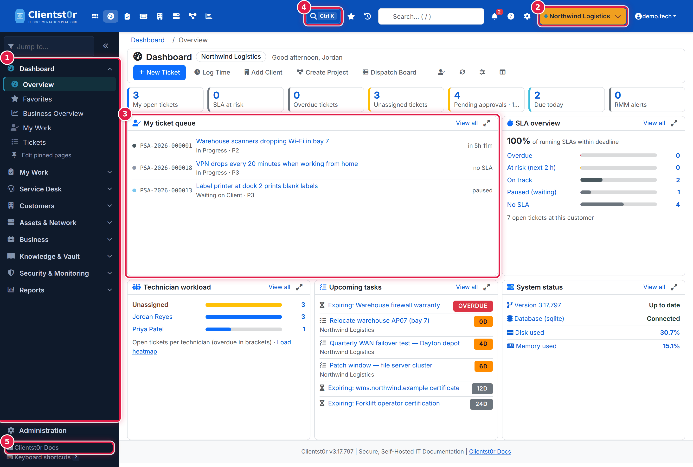

# What is Clientst0r?

Clientst0r is **self-hosted, open-source (MIT) IT documentation and service desk software
for Managed Service Providers (MSPs)** and IT teams.

It keeps client documentation, assets, credentials and support work in one structured,
searchable system that you run on your own server. Optional managed hosting and support
are offered separately by [MSP Reboot](https://mspreboot.com).

## How it fits together

Every customer is an **organization**. Pick the customer you are working for in the client switcher and the
pages show that customer's assets, documents, passwords and tickets. The sidebar groups the work: My Work,
Service Desk, Clients, Assets & Network, Business, Knowledge & Vault, Security & Monitoring and Reports, with
Administration at the foot. You see only the sections and pages your role allows. The numbers in the
screenshot match the list under it. Every screenshot is a capture of the application against a demo
database; the customers and people in it are invented.

<!-- guide-figure: guide-x1-what-dashboard -->

1. The sidebar: Dashboard, My Work, Service Desk, Clients, Assets & Network, Business, Knowledge & Vault, Security & Monitoring and Reports, with Administration at the foot. You see only what your role allows.
2. The client switcher. Every customer is an organization; pages show the selected customer's records.
3. Your ticket queue: the service desk is built in, with SLA due times.
4. Go to (Ctrl+K): open any page or record by name.
5. Clientst0r Docs: the guides, searchable, inside the application.
<!-- /guide-figure -->

## Typical Use Cases

- Client documentation, runbooks and an internal knowledge base, with owners, review
  dates, drafts and version history
- Documentation readiness: standards for what each client must have documented, a score
  per client and a repair queue for the gaps
- Asset tracking, rack elevations and warranty / lifecycle dates
- Credential storage (AES-256-GCM encrypted vault with audited reveals)
- Network infrastructure (IPAM, VLANs, subnets)
- Service desk (opt-in, switched on by an administrator): tickets, SLAs, contracts, quotes and invoices, with a My Work
  page for each technician
- Customer portal where clients see the tickets you share with them and request services
  through guided forms
- Fleet and service vehicle management

## Who It's For

- Managed Service Providers
- Internal IT departments
- Homelab operators needing structured documentation

## Technology

Built with Django (Python), running on Linux. MariaDB is the default database; SQLite is also supported. Install with Docker Compose or the
`install.sh` native installer; update from the web UI. See the
[README](../README.md#quick-start).

## Related

- [Importing from IT Glue](importing-from-it-glue.md)
- [Importing from Hudu](importing-from-hudu.md)
- [Getting started: finding your way](GETTING_STARTED.md)
- [MSP Documentation Overview](msp-documentation.md)
- [Full feature list](../FEATURES.md)
